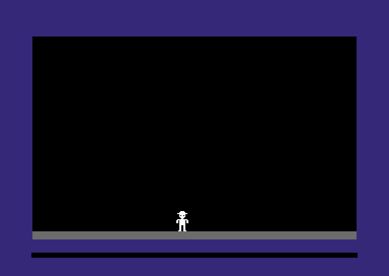
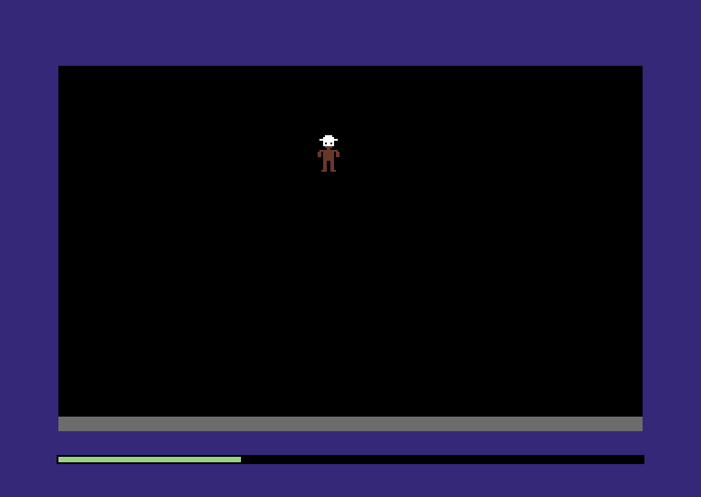

:::mission-briefing
By the end of this chapter the Comet 64 will show a castle floor, and
standing on it, a little explorer in a hat who goes wherever you push the
joystick. Press fire and he changes colour.



On the way you'll meet the machine properly, and find out that the
whole thing, screen and joystick included, is one long row of bytes.

New under the hood: **bytes and `u8`**, **memory as one big array of
addresses**, **hex**, and **a single bit as an on/off switch**. You'll
also start the game's **memory map**, the record of every byte it uses.
:::

## Plug in, power up

Think back to the first time a game answered you. You pushed the stick
and a little figure on the screen moved, right away, exactly as far as
you pushed. It's so basic that you forget it's the moment a game comes
alive. Everything else (the ladders, the doors, the monsters) sits on top
of that one loop: read the stick, move the figure, draw it, fifty times a
second.

That's this chapter. By the end of it, the Comet 64 will be running that
loop with code you wrote, and you'll know what every line does to the
machine.

Open your `my-creep` project from the Prologue. First, one bit of
housekeeping: the starter kit names its game `starter`, and this isn't a
starter kit any more. It's Dr. Creep.

**`build.zig`** (change the name)

```zig
const std = @import("std");
const machine = @import("machine");

pub fn build(b: *std.Build) void {
    machine.addGame(b, .{ .name = "creep", .root = b.path("src/main.zig") });
}
```

That's the last time we touch `build.zig`. Everything from here on
happens in `src/`.

## 65,536 bytes in a row

Here's the whole of the starter's `src/main.zig`:

```zig
//! Your game. The Comet 64 calls `boot` once when it powers on, then
//! `frame` fifty times a second, forever.

const machine = @import("machine");
const Machine = machine.Machine;

// Two VIDEO chip registers. Each holds a colour number (0-15).
const border_color = 0xD020;
const background_color = 0xD021;

pub fn boot(m: *Machine) void {
    m.poke(border_color, 4); // purple
    m.poke(background_color, 0); // black
}

pub fn frame(m: *Machine) void {
    _ = m;
}
```

Two functions. The machine calls `boot` once, at power-on, and `frame`
fifty times a second after that. Both get `m: *Machine`, "a pointer to a `Machine`":
like passing an object to a function in JavaScript, they get the machine
itself, not a copy. (Chapter 2 shows what a pointer really is.) And
`boot` does one thing, twice: `m.poke(address, value)`.

To see what that means, I want to show you my favourite line in the
whole Comet 64. It's from the machine's own definition, in `machine/src`,
and it's the most important line in there:

```zig snippet
ram: [0x10000]u8 = @splat(0),
```

That's an array of 65,536 bytes, all starting at zero. **That's all the
memory the computer has.** Your game's data, the castle, the picture on
the screen, the joystick, the chips that make the picture: every one of
them lives somewhere in that one array. No hidden heap, no operating
system, no back room. One row of bytes.

An **address** is an index into it, from 0 to 65,535. "Poke 4 into
`0xD020`" means "set `ram[0xD020]` to 4"; "peek at `0xDC01`" means "read
`ram[0xDC01]`". The 1980s names stuck around because they're good names.

:::under-the-hood Where does `x` live?
In JavaScript you write `let x = 0;` and the engine keeps `x` somewhere:
a register, a stack, a slot in a closure object out on the heap. You
never learn where, and you never need to. Your program has gigabytes to
play with and never sees an address.

The Comet 64 hands all 64 KB to you, and there's no engine deciding where
things go, because there's nobody else to decide. So in this game `x`
doesn't live "somewhere". It lives at **`$0200`**, because we say so.
It costs exactly one byte, and you always know where it is. Picking those
addresses, and writing them down so two things never pick the same one,
is a big part of writing a game for this machine.
:::

### A byte, and why it stops at 255

Each element of `ram` is a `u8`: an **unsigned 8-bit integer**, which is
Zig for "a byte". Eight bits, each a 0 or a 1, can be arranged
2×2×2×2×2×2×2×2 = **256** ways, so a `u8` holds any whole number from 0
to 255, and nothing else.

:::diagram ch01-byte
:::

Each bit is worth twice the one to its right, the way each decimal digit
is worth ten times the one to its right. Add up the bits that are on:
all eight is 255. 256 would need a ninth bit.

That sounds like trivia. It isn't: it's going to stop our explorer in
his tracks before the chapter's out. In JavaScript you almost never think
about how big a number can get. On the Comet 64 nearly every number is a
byte, and a byte runs out at 255.

:::pro-tip Zig knows how big a byte is
A number in your code takes the type of wherever you put it, and Zig
checks at compile time that it fits:

```zig snippet
const x: u8 = 256;
```

```
error: type 'u8' cannot represent integer value '256'
```

So `m.poke(border_color, 300)` won't build either. It's one of Zig's
quiet superpowers for this kind of work: a whole class of "why is the
screen the wrong colour" bugs becomes a compile error.
:::

## Counting in hex

You've seen `#FF8800` in CSS. That's **hexadecimal**, base 16: the digits
`0`–`9`, then `A` (10) up to `F` (15). Zig writes it with `0x`, like
JavaScript. The Comet 64's reference card writes `$` instead, the way
programmers of its day did: `$D020` on the card is `0xD020` in code.

Why bother? Because **one hex digit is exactly four bits**:

| Hex | Bits | | Hex | Bits |
|---|---|---|---|---|
| `0` | `0000` | | `8` | `1000` |
| `1` | `0001` | | `9` | `1001` |
| `2` | `0010` | | `A` | `1010` |
| `3` | `0011` | | `B` | `1011` |
| `4` | `0100` | | `C` | `1100` |
| `5` | `0101` | | `D` | `1101` |
| `6` | `0110` | | `E` | `1110` |
| `7` | `0111` | | `F` | `1111` |

So **two hex digits are one byte**, `$00` to `$FF`, and **four are one
address**, `$0000` to `$FFFF`. You can read bits straight off the hex:
`$A5` is `1010` `0101`. It pays off most with addresses:

:::diagram ch01-memory-map
All 65,536 bytes, `$0000` at the top. In decimal the addresses are noise; in hex they're round numbers.
:::

The structure jumps out: `$D000`–`$DFFF` is hardware, and the border
colour is register `$20` of the VIDEO chip at `$D000`. The first two
digits name a 256-byte **page** of memory (`$D0`), the last two a spot in
it (`$20`). Give it an hour and decimal addresses will start to look
strange to you.

:::widget memory-map
All 64 KB as one strip, coloured by region; hover for an address in hex and decimal.
:::

Open the reference card, [`machine/REFERENCE.md`](../code/machine/REFERENCE.md),
at section 2, the memory map, and keep it in a tab. It's the machine's
floor plan, and we'll be in and out of it all chapter.

## A colour is a byte at an address

Back to `boot`, and the line that puts 4 at `$D020`. The card's section
4 says `$D020` is the **border colour** register, and colour 4 is purple.
That's the whole trick. There isn't a `setBorderColour` function anywhere
in the machine. There's a byte, and the chip looks at it:

:::diagram ch01-border-byte
Every time it draws the border, the VIDEO chip reads `$D020` and looks the number up in the palette (card section 10).
:::

Try it. Change the `4` to a `6`, run `zig build wasm`, reload the page
(with the Prologue's web server still running), and the border turns
blue. One number, one byte, one colour. **This is the big idea of the
chapter, and of the whole machine: the hardware is memory.** The screen,
the sprites and the joysticks are all bytes at fixed addresses, and you
work them by reading and writing those bytes. Once that clicks, the
Comet 64 stops being a black box for good.

Now let's tidy up. The machine names every address in `machine.hw` (the
card's Zig-name column), and `machine.Color` names the sixteen colours;
`@intFromEnum` turns one into its number.

**`src/main.zig`** (replace the whole file)

```zig
//! Your game. The Comet 64 calls `boot` once when it powers on, then
//! `frame` fifty times a second, forever.

const machine = @import("machine");
const Machine = machine.Machine;
const Color = machine.Color;
const hw = machine.hw;

pub fn boot(m: *Machine) void {
    m.poke(hw.border, @intFromEnum(Color.blue));
    m.poke(hw.background, @intFromEnum(Color.black));
}

pub fn frame(m: *Machine) void {
    _ = m;
}
```

Same result, but the next reader (you, in three weeks) doesn't need the
card open. From here on, addresses in game code are always named. A bare
`0xD020` is a puzzle; `hw.border` is a sentence.

:::pro-tip `_ = m;`
Zig refuses to compile a function that ignores a parameter. `_ = m;`
says "yes, I know." It goes away once `frame` has something to do.
:::

## Laying a floor

A castle room needs a floor, and the floor is our first look at the
screen itself. Chapter 2 covers the screen properly; for now, three facts
from the card's section 3:

1. The display is 320 × 200 pixels, cut into a grid of **cells**, each
   one a square of 8 × 8 pixels. That makes 40 cells across and 25 rows
   of cells down.
2. The **bitmap**, 8,000 bytes from `$E000`, holds the pixels, 8 bytes
   per cell: one byte for each of the cell's 8 pixel rows, top to bottom.
   A byte of `$FF` turns every pixel in its row on. The bitmap stores
   the cells left to right along a row, then moves down to the next row,
   so one row of cells is 40 × 8 = 320 bytes.
3. **Colour RAM**, 1,000 bytes from `$D800`, has one byte per cell: the
   colour of the pixels that are on in that cell.

So the floor is the bottom row of cells, row 24, and painting it takes
two writes: 320 bytes of `$FF` into the bitmap, and 40 bytes of grey into
colour RAM.

:::diagram ch01-floor
Both writes end on the last byte of their plane, a good sign the sums are right: the floor really is the bottom row.
:::

**`src/room.zig`** (new file)

```zig
//! The room: for now, a floor along the bottom of the screen.

const machine = @import("machine");
const Machine = machine.Machine;
const Color = machine.Color;
const hw = machine.hw;

/// The floor is the bottom row of cells, row 24 of 0-24.
const floor_row = 24;
const cells_per_row = 40;
const bytes_per_cell = 8;

/// Display row (0-199) of the floor's top line.
pub const floor_top = floor_row * 8; // 192

/// Where the floor starts in the bitmap and in colour RAM.
const floor_pixels = hw.bitmap + floor_row * cells_per_row * bytes_per_cell; // $FE00
const floor_colors = hw.color_ram + floor_row * cells_per_row; // $DBC0

pub fn paint(m: *Machine) void {
    // $FF gives all four pixels of a bitmap byte the code 11, and code 11
    // pixels take their colour from colour RAM.
    m.fill(floor_pixels, cells_per_row * bytes_per_cell, 0xFF);
    m.fill(floor_colors, cells_per_row, @intFromEnum(Color.grey));
}
```

Zig does the sums at compile time; the comments hold the answers to
check against the card. `m.fill(address, count, value)` sets `count`
bytes in a row to `value`. (The comment's "four pixels" and "code 11"
are Chapter 2's business: on this screen pixels come in side-by-side
pairs, the dotted lines in the close-up.) Only `pub` declarations are visible outside a file, so
`paint` and `floor_top` are public and the rest is the room's own.

**`src/main.zig`** (add the import below `hw`, and call `room.paint` in `boot`)

```zig
const hw = machine.hw;
const room = @import("room.zig");

pub fn boot(m: *Machine) void {
    m.poke(hw.border, @intFromEnum(Color.blue));
    m.poke(hw.background, @intFromEnum(Color.black));
    room.paint(m);
}
```

Build and reload: a strip of grey stone runs along the bottom of the
black display. It's not much of a castle yet, but every pixel of it is a
byte you put there.

## Fifty times a second

Before anything moves on that floor, let's look at `frame` properly,
because it's the heartbeat of the whole game.

Each call to `frame` is one **frame**: one picture on the screen. There's
no "move left for half a second" call anywhere. Motion is an illusion
built out of tiny changes: each frame the game reads the joystick, moves
the explorer one pixel, and the screen shows him one pixel further along.
Do that fifty times a second and the eye sees him walk. Every game of the
era was a flip-book.

Here's the catch, and it's the rule this whole tutorial is played by:
**a frame has a time limit.** Everything `frame` does has to fit into
one fiftieth of a second, on a processor that is slow by today's
standards, so the budget is real and you can run out of it. The **work
meter**, the thin bar in the bottom border, shows how much of each frame
your code used: green, then yellow when it's tight, then red when a frame
goes over. Chapter 2 teaches you to read it properly.

A JavaScript game has a frame budget too, about 16 ms, but on a modern
machine that's a vast, comfy room you rarely think about. Here it's a
broom cupboard. So every chapter has a
second job besides "make it work": make it fit. Think of it as the
level's clock. (`boot` is on the house: the meter starts with the first
frame.)

:::widget budget-meter
This checkpoint's work meter, live: one bar per frame against the budget, with the last frame's cycles.
:::

## The memory map

The explorer needs a position that survives from one frame to the next.
In most languages you'd reach for a global, `var player_x: u8 = 160;`.
Zig would compile it happily. We never write it, and the rule is
absolute for the whole tutorial: **all of the game's changing state
lives in `m.ram`.**
Constants (tables, pictures, the castle you ship) can be Zig `const`s,
part of the program image on the disk. Anything that changes gets an
address.

Why so strict? A Zig `var` hides at an address only the compiler knows,
and on a 64 KB machine a byte nobody wrote down is a byte you'll end up
spending twice. There's no "somewhere else" on this machine: there's the
64 KB, and you decide what goes where. And the rule pays for itself. With
all the state in `m.ram`, the widgets can show it live, tests can check
it, and you never wonder where something is: it's wherever the map says.

So we keep every address the game uses in one file, `map.zig`: the
game's **memory map**. It grows every chapter, and Zig checks it while it
compiles, so two things can never end up in the same place. This
chapter's entry is the player: four bytes at `$0200`, the first free
address above the processor's stack (the processor's own scratch space).

:::diagram ch01-player-bytes
The player, four bytes in a row. Every piece of code that wants to know where he is reads it from here.
:::

The rest of the code imports `map.zig`, so it has to go in now. Open the
side quest to type it in, and to see how Zig catches two regions
sharing a byte before the game ever runs.

:::side-quest Type in the memory map
The map lists every region of memory the game uses: ours, and the
hardware's, so nothing of ours can land on them. This chapter's plan:

| Address | Bytes | What |
|---|---|---|
| `$0100–$01FF` | 256 | the processor's stack (reserved: hands off) |
| `$0200–$0203` | 4 | **the player** |
| `$0800–$77FF` | 28 KB | the program image (reserved) |
| `$C000–$C7FF` | 2 KB | sprite frames |
| `$CFF8–$CFFF` | 8 | sprite pointers |
| `$D000–$D02E` | 47 | the VIDEO chip |
| `$D800–$DBE7` | 1,000 | colour RAM |
| `$DC00–$DC02` | 3 | input ports |
| `$E000–$FF3F` | 8,000 | the bitmap |

**`src/map.zig`** (new file)

```zig
//! The game's memory map: every stretch of memory the game uses, and
//! what it's for. Nothing the game remembers lives anywhere else.

const hw = @import("machine").hw;

pub const Region = struct {
    name: []const u8,
    first: u16,
    last: u16,
};

// ---- the game's own memory ----------------------------------------------

/// Everything the game knows about the player, four bytes in a row.
pub const player = Region{ .name = "player", .first = 0x0200, .last = 0x0203 };
pub const player_x = player.first + 0; // sprite X, 24 (left edge) to 255
pub const player_y = player.first + 1; // sprite Y, 50 (top edge) and down
pub const player_color = player.first + 2; // palette number, 1-15
pub const player_last_stick = player.first + 3; // joystick 1 as it read last frame

// ---- memory the hardware gives us ---------------------------------------

const stack = Region{ .name = "stack (reserved)", .first = hw.stack, .last = hw.stack + 256 - 1 };
const program = Region{ .name = "program image", .first = hw.program, .last = hw.program_end - 1 };
const sprite_frames = Region{ .name = "sprite frames", .first = hw.sprite_data, .last = hw.sprite_data + 32 * 64 - 1 };
const sprite_pointers = Region{ .name = "sprite pointers", .first = hw.sprite_pointers, .last = hw.sprite_pointers + 8 - 1 };
const video_chip = Region{ .name = "VIDEO chip", .first = hw.video_chip, .last = hw.spriteColor(7) };
const color_ram = Region{ .name = "colour RAM", .first = hw.color_ram, .last = hw.color_ram + 1000 - 1 };
const input_ports = Region{ .name = "input ports", .first = hw.joy2, .last = hw.key };
const bitmap = Region{ .name = "bitmap", .first = hw.bitmap, .last = hw.bitmap + 8000 - 1 };

/// The whole map, in address order.
pub const regions = [_]Region{
    stack,
    player,
    program,
    sprite_frames,
    sprite_pointers,
    video_chip,
    color_ram,
    input_ports,
    bitmap,
};

// Checked while the game compiles: two regions sharing a byte is a build
// error, not a mystery bug three chapters from now.
comptime {
    for (regions, 0..) |a, i| {
        if (a.last < a.first) @compileError("memory map: " ++ a.name ++ " ends before it starts");
        for (regions[i + 1 ..]) |b| {
            if (a.first <= b.last and b.first <= a.last)
                @compileError("memory map: " ++ a.name ++ " overlaps " ++ b.name);
        }
    }
}
```

**Addresses are `u16`**: sixteen bits, 0 to 65,535, exactly enough to
name every byte. The Comet 64 has 64 KB *because* its addresses are 16
bits wide.

**Each region records its first and last byte**, the way the card writes
ranges, and the player's field addresses count from its start, so moving
the player is a one-line change. That's the convention to the end: a
`Region` named for what it holds, fields named `region_field`, all in
`map.zig`.

**The `comptime` block runs while Zig compiles your game**, not while it
runs, so it costs the Comet 64 nothing. It compares every pair of regions
(two ranges overlap when each starts before the other ends), and if two
share a byte, `@compileError` stops the build. Give the monsters a table
at `$01F0` one day without checking the map, and instead of a game that
crashes only on Tuesdays you get:

```
error: memory map: stack (reserved) overlaps monsters
```

New syntax, in passing: `[_]Region{...}` lets the compiler count the
array's length; `for (regions, 0..) |a, i|` walks it with each index
alongside; `regions[i + 1 ..]` is a slice, the rest of the array after
`i`; `++` joins compile-time strings. `//!` comments describe the file,
`///` comments the declaration below.
:::

## A sprite is 63 bytes

Now for the star of the show.

You know sprites from the player's side: figures that glide over the
background without smudging it, and flicker when too many crowd onto one
line. The VIDEO chip draws up to **eight**. You don't draw them into the
bitmap: you hand the chip a picture and a position, and it draws them
every frame, for free. Change the position, and next frame the sprite is
somewhere else. No wonder every game of the era used them for whatever
moved.

A sprite's picture (card section 5) is **24 × 21 pixels**. In a **hires**
sprite each pixel is **one bit**: 1 is the sprite's colour, 0 is
see-through. That's the chapter's fourth idea, the **bit as an on/off
switch**. Three bytes a row, 21 rows: **63 bytes**. And here's a lovely
consequence: because each bit is a pixel, we can write the picture so
you can *see* it. Zig has binary literals (`0b00111100` is `$3C`), so lay
three of those per line and the 1s draw him.

**`src/player.zig`** (new file)

```zig
//! Player 1: a hires sprite you steer with joystick 1.

const machine = @import("machine");
const Machine = machine.Machine;
const Color = machine.Color;
const hw = machine.hw;
const joy = machine.joy;
const video = machine.video;
const map = @import("map.zig");
const room = @import("room.zig");

/// The player's picture: 21 rows of 24 pixels, three bytes a row, one bit
/// per pixel. A 1 is a pixel in the sprite's colour; a 0 is see-through.
const picture = [63]u8{
    0b00000000, 0b00000000, 0b00000000,
    0b00000000, 0b00111100, 0b00000000,
    0b00000000, 0b01111110, 0b00000000,
    0b00000001, 0b11111111, 0b10000000,
    0b00000000, 0b01111110, 0b00000000,
    0b00000000, 0b01011010, 0b00000000,
    0b00000000, 0b01111110, 0b00000000,
    0b00000000, 0b00111100, 0b00000000,
    0b00000000, 0b00011000, 0b00000000,
    0b00000001, 0b11111111, 0b10000000,
    0b00000011, 0b01111110, 0b11000000,
    0b00000011, 0b01111110, 0b11000000,
    0b00000011, 0b01111110, 0b11000000,
    0b00000000, 0b01111110, 0b00000000,
    0b00000000, 0b01111110, 0b00000000,
    0b00000000, 0b01100110, 0b00000000,
    0b00000000, 0b01100110, 0b00000000,
    0b00000000, 0b01100110, 0b00000000,
    0b00000000, 0b01100110, 0b00000000,
    0b00000000, 0b01100110, 0b00000000,
    0b00000000, 0b11100111, 0b00000000,
};

/// The player is sprite 0, showing sprite block 0.
const sprite = 0;
const block = 0;

/// How far the sprite may go. X stops at 255 because that's the most a
/// byte can hold; the right-hand strip of the screen needs a ninth bit.
const min_x = video.sprite_origin_x;
const max_x = 255;
const min_y = video.sprite_origin_y;
const max_y = video.sprite_origin_y + room.floor_top - 21; // boots on the floor

pub fn start(m: *Machine) void {
    m.load(hw.sprite_data + block * 64, &picture);
    m.poke(hw.sprite_pointers + sprite, block);
    m.poke(hw.sprite_enable, 0b0000_0001); // bit 0 on: sprite 0 is shown

    m.poke(map.player_x, 160);
    m.poke(map.player_y, max_y);
    m.poke(map.player_color, @intFromEnum(Color.white));
    m.poke(map.player_last_stick, 0xFF); // nothing held
}
```

:::diagram ch01-sprite
Squint at `picture` and you can see him: a brimmed hat, two eyes (the 0s in row 5), arms out, two legs, and boots on the bottom row.
:::

`start` sets everything up once, at power-on:

- **`m.load`** copies a `const` table into sprite block 0 at `$C000`.
  `&picture` passes the table's address rather than a copy: in front of
  a name, `&` means "address of". (Between two numbers it means
  something else, as you'll see.) Blocks are 64 bytes, 63 plus a spare,
  so block *N* starts at `$C000 + N × 64`.
- **The sprite pointer** at `$CFF8` says which block sprite 0 shows.
  Swapping that byte is how sprites animate.
- **`$D015` turns sprites on**, one bit per sprite. `0b0000_0001` sets
  bit 0: sprite 0 on, the rest off. Eight sprites, eight bits, one byte:
  a pattern all over the VIDEO chip. (Zig ignores `_` inside a number;
  it's there so you can read the bits.)
- Then the player's four bytes, including `player_last_stick`, which
  we'll come to.

**Sprite coordinates count from above and left of the display**, so a
sprite can slide in from off-screen: X = 24, Y = 50 (`min_x`, `min_y`) is
the display's top-left. `max_y` stands his boots on the line above the
floor: 50 + 192 − 21 = 221.

And `max_x` is 255, because the player's X is a byte. The right edge is
at X = 320, which the VIDEO chip reaches with a ninth bit per sprite in
`$D010`. We're not using it yet, so our explorer will stop three quarters
of the way across, at an invisible wall made of arithmetic. Remember that
wall.

**`src/main.zig`** (add the import below `room`, and call `player.start` in `boot`)

```zig
const room = @import("room.zig");
const player = @import("player.zig");

pub fn boot(m: *Machine) void {
    m.poke(hw.border, @intFromEnum(Color.blue));
    m.poke(hw.background, @intFromEnum(Color.black));
    room.paint(m);
    player.start(m);
}
```

Build and reload. The floor's there. The explorer isn't.

That's not a bug in the picture. `start` never told the VIDEO chip *where* to draw sprite 0, or in what
colour. Its position registers at `$D000` and `$D001` are still 0, off in
the border where sprites don't show (and his colour is 0: black on
black). His position is in *our* memory, at `$0200`. Something has to
copy it into the chip.

## Racing the beam

The copying happens every frame, and there's one rule about *when*. And it's
a wonderful thing once you see it: the picture isn't a photo, it's being
painted while you watch.

It's drawn by a beam sweeping down the tube a line at a time,
and the VIDEO chip draws each line from memory **as it is when the beam
passes**. Your `frame` starts with the beam up in the top border, and
the more work your code does, the further down it gets. It spends a
little while crossing the border before it reaches the display, and
that head start is yours.

So: **write hardware registers at the start of `frame`.** Write a
sprite's registers while the beam is halfway down it, and the top half
is drawn the old way and the bottom half the new. That's a **tear**: the
figure you've seen split in two for a frame as it moves, like a magic
trick gone wrong. The habit that prevents it is three words long:
hardware first, then think.

**`src/player.zig`** (add below `start`)

```zig
/// Copy the player's position and colour into the VIDEO chip.
pub fn show(m: *Machine) void {
    m.poke(hw.spriteX(sprite), m.peek(map.player_x));
    m.poke(hw.spriteY(sprite), m.peek(map.player_y));
    m.poke(hw.spriteColor(sprite), m.peek(map.player_color));
}
```

`hw.spriteX(n)` and friends give sprite *n*'s register addresses. Three
peeks and three pokes are done long before the beam gets anywhere near
him.

**`src/main.zig`** (replace `frame`)

```zig
pub fn frame(m: *Machine) void {
    // Hardware first. The beam reaches the top of the display 3,213
    // cycles into the frame; registers written before then can't tear.
    player.show(m);
}
```

The comment in `frame` puts a number on the beam's head start;
Chapter 2 shows how to read numbers like that.

Build and reload, and there he is: white, standing on the grey floor.

**It's alive!** Well, it's standing there. Close enough for one more
section.

:::inside-the-disk The shadow registers
The 1984 disk follows the same rule, and goes one better. Its game
logic never touches the sprite registers at all. It keeps a 30-byte
**shadow copy** of them near the bottom of memory (every sprite's X and
Y, the enable bits, the sprite pointers, even the border colour), and
first thing every frame the whole shadow is copied into the chip in one
go. The game can move a sprite halfway through working out a monster's
move, and the chip never sees a half-finished position. Our bytes at
`$0200` are the same idea, one sprite wide.
:::

## Reading the joystick

Now let's give him somewhere to go.

From the player's side, a joystick is a stick and a button. From the
machine's side, it's five switches, each pressed or not: one bit each,
packed into one byte. Joystick 1 is at **`$DC01`** (`hw.joy1`), and the
top three bits are always 1. Here's the twist: **a switch reads 0 while
it's pressed, and 1 when it isn't.** That's **active-low**: pressing
connects the switch's wire to ground, and letting go lets a resistor pull
it back up to 1. So an untouched stick reads `$FF`, and holding left
drops bit 2 to give `$FB`.

:::diagram ch01-joystick
Joystick 1 at `$DC01`, bit by bit. The pressed switches are the 0s.
:::

So "is left held?" means "is bit 2 a 0?" To look at one bit and ignore
seven, use **`&`**, bitwise AND: each bit of the result is 1 only where
*both* inputs have a 1. AND the port with a **mask** that has only bit 2
set, and every other bit is forced to 0:

```
  holding left:         port  1111 1011   ($FB)
                      & mask  0000 0100   (joy.left)
                      =       0000 0000   zero: left is held

  not holding left:     port  1111 1111   ($FF)
                      & mask  0000 0100   (joy.left)
                      =       0000 0100   not zero: left is free
```

The machine names the five masks: `machine.joy.up`, `.down`, `.left`,
`.right` and `.fire`. A tiny function keeps the active-low twist written
down in exactly one place.

**`src/player.zig`** (add at the end of the file)

```zig
/// Read joystick 1 and move the player one pixel in each direction held.
pub fn steer(m: *Machine) void {
    const stick = m.peek(hw.joy1);
    var x = m.peek(map.player_x);
    var y = m.peek(map.player_y);

    if (held(stick, joy.left) and x > min_x) x -= 1;
    if (held(stick, joy.right) and x < max_x) x += 1;
    if (held(stick, joy.up) and y > min_y) y -= 1;
    if (held(stick, joy.down) and y < max_y) y += 1;

    m.poke(map.player_x, x);
    m.poke(map.player_y, y);
    m.work(40); // the tests, sums and branches above
}

/// Is this switch held? Joystick switches read 0 while they're pressed.
fn held(stick: u8, switch_bit: u8) bool {
    return stick & switch_bit == 0;
}
```

`steer` moves the position one pixel for each direction held, within the
limits, and writes it back. Two directions held is a diagonal, for free.
`x` and `y` are `var` locals, which is fine: the rule is about state that
*survives* between frames. A local is scratch paper, gone when `steer`
returns, and anything worth remembering goes back to `$0200` before we
leave.

The `m.work(40)` is us being honest with the meter: `peek` and `poke`
report their own time, and that line tells it roughly what the tests and
sums cost on top. Chapter 2 shows how to read those numbers.

:::pro-tip `&` binds tighter than `==` in Zig
In JavaScript, `stick & LEFT == 0` means `stick & (LEFT == 0)`, a classic
bug that has eaten many afternoons. Zig, like Python, puts bitwise
operators *above* comparison, so `stick & switch_bit == 0` means what it
looks like. Parentheses are still welcome; `zig fmt` keeps them.
:::

**`src/main.zig`** (replace `frame`)

```zig
pub fn frame(m: *Machine) void {
    // Hardware first. The beam reaches the top of the display 3,213
    // cycles into the frame; registers written before then can't tear.
    player.show(m);

    // Then the game itself. What it decides shows up next frame.
    player.steer(m);
}
```

The order is the beam rule at work: `show` copies the position `steer`
worked out *last* frame, safely before the beam arrives, then `steer`
works out the next one. The picture is a fiftieth of a second behind the
stick, and no player alive can feel it.

Build, reload, click the screen and push the arrow keys. **He moves!**
Take a minute and walk him around. Up, down, diagonally, back to the
floor. That's a stick you pushed and a figure that answered, and you
wrote every byte in between.

Now walk him right. He stops three quarters of the way across, in the
middle of nowhere, nose against nothing at all. There's the wall made of
arithmetic: X is a byte, and a byte stops at 255. Without the `x < max_x` check,
`x += 1` at 255 would try to make 256, and Zig would stop the game with
`panic: integer overflow`. Chapter 4 shows how the 1984 game gets past
it.

## Fire!

Fire is bit 4 of the same byte, and we already have `held`. So changing
colour on fire should be one line: "if fire is held, pick the next
colour". Right?

Think it through frame by frame. A quick tap lasts about a tenth of a
second: five frames, five colours per tap. Hold the button and he strobes
through the palette fifty times a second, a one-man disco. The port tells
you whether the button *is down*; we want to know whether it *went
down*.

So remember last frame's stick. A press is "held now, and not held last
frame". That's what `player_last_stick` at `$0203` is for: `steer` stores
the port byte at the end, and reads it back next frame as `before`.

:::power-up The Edge Detector Power-Up
Keep last frame's input byte, and a press is `held(now) and
!held(before)`; a release is the reverse. One byte of memory turns "is
the button down?" into "was it pressed *this frame*?",
for all five switches at once. Doorbells, control panels, anything in the
castle that wants presses rather than holds: this byte serves them all.
:::

**`src/player.zig`** (replace `steer`)

```zig
/// Read joystick 1 and move the player one pixel in each direction held.
/// A fresh press of fire picks the next colour.
pub fn steer(m: *Machine) void {
    const stick = m.peek(hw.joy1);
    const before = m.peek(map.player_last_stick);
    var x = m.peek(map.player_x);
    var y = m.peek(map.player_y);

    if (held(stick, joy.left) and x > min_x) x -= 1;
    if (held(stick, joy.right) and x < max_x) x += 1;
    if (held(stick, joy.up) and y > min_y) y -= 1;
    if (held(stick, joy.down) and y < max_y) y += 1;

    // Held now but not last frame: that's a press. Without this check,
    // holding fire would change colour fifty times a second.
    if (held(stick, joy.fire) and !held(before, joy.fire)) {
        const c = m.peek(map.player_color);
        m.poke(map.player_color, if (c == 15) 1 else c + 1); // 0 is black, like the background
    }

    m.poke(map.player_x, x);
    m.poke(map.player_y, y);
    m.poke(map.player_last_stick, stick);
    m.work(40); // the tests, sums and branches above
}
```

After 15 the colour wraps to 1, skipping 0, black, which would make him
vanish. In Zig `if` is an expression, so `if (c == 15) 1 else c + 1` is
JavaScript's `c === 15 ? 1 : c + 1`.

Remember that `start` set `player_last_stick` to `$FF`? Memory powers on
as zeros, and to a joystick byte zero means *every switch held*. Left
alone, the first frame would think all five switches had been held a
moment ago, and a release check would see five releases that never
happened. `$FF` is what an idle stick reads, so the first frame has an
honest "before" to compare against.

Build and reload. Tap Space: white, red, cyan, purple, one colour per
tap, however long you hold it. The disco is closed.

:::secret-passage Make it tear
Now that he moves and changes colour, you can break him on purpose.
In `frame`, put `m.work(6000);` before
`player.show(m);`. That tells the meter the game did a big pile of work
first, so the registers get written with the beam well down the
screen. The tear lasts only the frame his colour changes, so let the
headless runner catch it:

```
zig build run -- --frames 152 --press 0:u:134 --press 150:f:5
```

That walks him up until his hat is in the beam's way and presses fire on
frame 150. `show` writes the new colour on frame 151, after the beam has
drawn the top of him, so `frames/frame_00151.ppm` looks like this:



His hat and face are still white; the rest of him is already red. In a
game whose sprites move every frame and whose logic runs long, that's a
constant shimmer. Move the `m.work(6000);` below `player.show(m);` and
frame 151 is clean, with exactly the same work. Take the line out when you're done; the
checkpoint doesn't have it.
:::

## A test that plays the game

`zig build test` already plays 100 frames to check the game doesn't
crash. Not crashing is a low bar. Let's test that it does what we said.

**`src/main.zig`** (add `std` at the top of the imports, and the
`map` import after `hw`)

```zig
const std = @import("std");
const machine = @import("machine");
const Machine = machine.Machine;
const Color = machine.Color;
const hw = machine.hw;
const map = @import("map.zig");
const room = @import("room.zig");
const player = @import("player.zig");
```

**`src/main.zig`** (add at the end of the file)

```zig
test "the stick steers the sprite and fire changes its colour" {
    const m = try std.testing.allocator.create(Machine);
    defer std.testing.allocator.destroy(m);
    m.boot(@This());
    const x = m.ram[map.player_x];
    const color = m.ram[map.player_color];

    m.input = .{ .joy1 = machine.joy.left | machine.joy.fire };
    _ = m.runFrame(@This());
    try std.testing.expectEqual(x - 1, m.ram[map.player_x]);
    try std.testing.expectEqual(color + 1, m.ram[map.player_color]);

    // Still holding fire: same colour. The sprite registers caught up.
    _ = m.runFrame(@This());
    try std.testing.expectEqual(color + 1, m.ram[map.player_color]);
    try std.testing.expectEqual(x - 1, m.ram[hw.spriteX(0)]);
}
```

The test powers on a whole Comet 64, holds left and fire (`m.input`
takes the same `joy` masks), and checks the player's bytes. A second
frame checks the colour *didn't* change again and that `show` caught the
chip up. Because all the state lives in `m.ram`, a test reads it
straight out of memory, with no special hooks. That strict rule from the
memory map has paid its first dividend.

:::pro-tip Three Zig things in that test
- **`@This()`** is the type of the file you're in. Every Zig file is a
  struct, and `main.zig` *is* the game, so `m.boot(@This())` boots it.
- **`create` and `destroy`.** A function's locals live in a small fixed
  area called the *stack*, and the half-megabyte `Machine` is too big
  for it. So the test asks an allocator for memory elsewhere, and `defer
  ... destroy(m)` hands it back when the test ends. The game itself
  never allocates.
- **`try`** means "if this fails, return the error", so a failed
  `expectEqual` stops the test and reports the line.
:::

The whole of `main.zig`, to check yours against:

**`src/main.zig`** (complete)

```zig
//! Your game. The Comet 64 calls `boot` once when it powers on, then
//! `frame` fifty times a second, forever.

const std = @import("std");
const machine = @import("machine");
const Machine = machine.Machine;
const Color = machine.Color;
const hw = machine.hw;
const map = @import("map.zig");
const room = @import("room.zig");
const player = @import("player.zig");

pub fn boot(m: *Machine) void {
    m.poke(hw.border, @intFromEnum(Color.blue));
    m.poke(hw.background, @intFromEnum(Color.black));
    room.paint(m);
    player.start(m);
}

pub fn frame(m: *Machine) void {
    // Hardware first. The beam reaches the top of the display 3,213
    // cycles into the frame; registers written before then can't tear.
    player.show(m);

    // Then the game itself. What it decides shows up next frame.
    player.steer(m);
}

test "the stick steers the sprite and fire changes its colour" {
    const m = try std.testing.allocator.create(Machine);
    defer std.testing.allocator.destroy(m);
    m.boot(@This());
    const x = m.ram[map.player_x];
    const color = m.ram[map.player_color];

    m.input = .{ .joy1 = machine.joy.left | machine.joy.fire };
    _ = m.runFrame(@This());
    try std.testing.expectEqual(x - 1, m.ram[map.player_x]);
    try std.testing.expectEqual(color + 1, m.ram[map.player_color]);

    // Still holding fire: same colour. The sprite registers caught up.
    _ = m.runFrame(@This());
    try std.testing.expectEqual(color + 1, m.ram[map.player_color]);
    try std.testing.expectEqual(x - 1, m.ram[hw.spriteX(0)]);
}
```

:::byte-budget Chapter 1
**Memory.** 4 bytes of game state at `$0200–$0203`, plus a 63-byte
picture copied into one of the 32 sprite blocks.

**Time.** A sliver of green at the left of the meter. Enjoy the elbow
room while it lasts.
:::

:::game-over Common mistakes
- **Forgetting active-low.** `stick & joy.left != 0` for "left is held"
  is backwards: with nothing pressed every bit is 1, so he runs left on
  his own the moment the game starts and stops when you *press* left.
  Keep the test in `held` and use it everywhere.
- **Writing registers late.** `player.show(m)` after the game logic works
  today, because the logic is tiny. As the game grows it gets pushed past
  the moment the beam reaches the display, and the tearing starts. Hardware first, always.
- **Fire strobes through the colours.** The `!held(before, joy.fire)`
  check, or the poke of `player_last_stick` at the end of `steer`, is
  missing.
- **The explorer never appears.** Check that `frame` calls
  `player.show(m)` and that `start` sets bit 0 of `$D015`.
- **`panic: integer overflow`.** A limit check went missing.
:::

:::boss-battle Bring him to life
From your project folder:

```
zig build
zig build test
zig build run -- --frames 250 --press 10:l:60 --press 80:u:80 --press 170:f:5 --press 200:rf:40 --dump-every 50
```

The first two print nothing when they pass. The headless run walks left,
then up, taps fire, then holds right and fire together for 40 frames. It
prints:

```
ran 250 frames (250 calls to frame)
cycles: max 100 (0%), avg 92 (0%) of 19656
  bucket 0: max 100, avg 92
overruns: 0, loading pauses: 0
last frame: frames/frame_00249.ppm
```

The `cycles:` line is the work meter's report, a sliver of the budget
(Chapter 2 shows how to read it). The run also saves six pictures in
`frames/`. In `frame_00000.ppm` he stands on
the floor, white. By `frame_00100.ppm` he's walked left and is on his
way up. In `frame_00249.ppm` he's floating near the middle, cyan: two
presses of fire, and the 40-frame one changed the colour only once.

Then play it:

```
zig build wasm
python3 -m http.server -d web
```

Open <http://localhost:8000>, click the screen, and steer with the arrow
keys or W A S D. Space changes his colour.

**Your Comet 64 has a player!** Everything else in the castle, every
door and monster and trapdoor, will be built the same way: bytes at
addresses you chose, read and written a little at a time, fifty times a
second.
:::

:::warp-zone
The finished checkpoint is [`code/ch01/`](../code/ch01/), or
[`ch01.zip`](downloads/ch01.zip), which unzips into the same `code/`
folder as the starter kit. To start Chapter 2 from it:

```
cd code
rm -rf my-creep
cp -r ch01 my-creep
rm -rf my-creep/.zig-cache my-creep/zig-out my-creep/web
```

The last line matters: a copied `.zig-cache` remembers the *original's*
source, and `zig build` can quietly keep building that instead of your
copy.
:::

:::bonus-stage
- **Draw your own explorer.** Change the 1s in `picture`. A different
  hat? A cape? Keep his boots on the bottom row, or adjust `max_y`.
- **Make him bigger.** Set bit 0 of `$D017` (`hw.sprite_double_height`)
  and `$D01D` (`hw.sprite_double_width`) in `start`, and adjust the
  limits.
- **Cross the wall.** Bit 0 of `$D010` (`hw.sprite_x_msb`) is the ninth
  bit of sprite 0's X. You'll need a little more state in the memory map.
- **Player 2.** Joystick 2 is at `$DC00` (`hw.joy2`), I J K L and Return
  in the browser. Sprite 1 is waiting for its own bytes, and the overlap
  check will tell you if they land on player 1's.
:::
