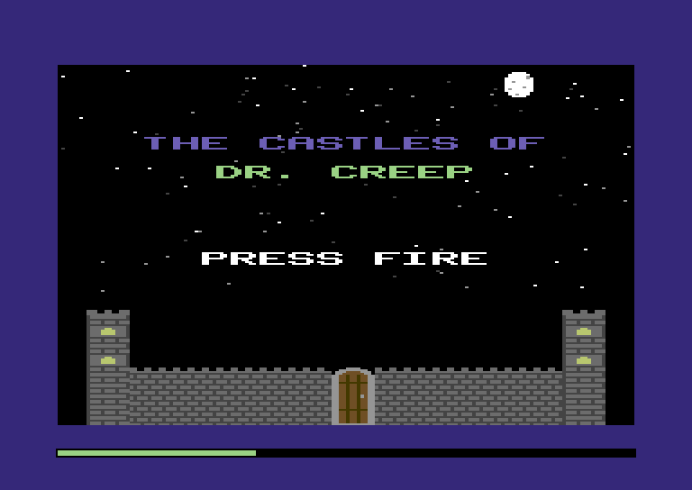
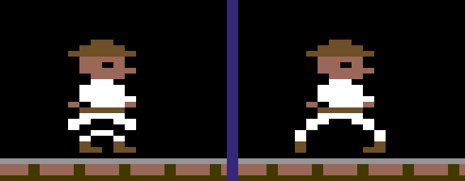
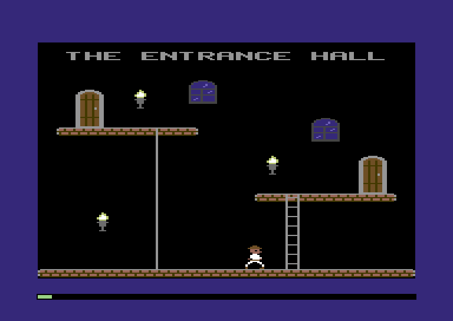

:::mission-briefing
By the end of this chapter the Comet 64 boots to a title screen: a
castle by moonlight under a sky of twinkling stars. Press fire, the
screen goes dark for a blink, and you're standing in the **Entrance
Hall**: stone walkways, a ladder, a sliding pole, torches on the walls,
and the explorer, in full colour now, striding along the floor.

This is the chapter where the Comet 64 stops being a blue screen with a
sprite on it and starts looking like a game.



New under the hood: **packing several values into a byte** (shifts and
masks), **pointers as addresses you can do arithmetic on**, and
**lookup tables versus computing** (and what a multiply really costs).
:::

## Four pixels to a byte

Remember Chapter 1's floor? We filled 320 bitmap bytes with `$FF`, and
the comment said "four pixels, code 11". Time to find out what that
meant, because every picture in the game depends on it.

You know the look from the player's side: on machines like this one the
pixels are wide, and colour comes in small square patches that don't
quite follow the edges of things. That's the multicolour
bitmap (card section 3). The display is 320 × 200, but a pixel takes
**two bits**, so each one is two dots wide: 160 **fat pixels** across.
A byte holds **four fat pixels**, leftmost in the top two bits. The two
bits aren't a colour but a **code** that says where to *find* one:

:::diagram ch02-fat-pixels
Byte `$6C` in a cell with the walkway's colours: screen plane `$9A`, colour RAM `$0F`.
:::

A **cell** is 8 × 8 dots (4 fat pixels across, 8 rows down), 40 cells by
25. Each cell owns one screen-plane byte and one colour-RAM byte, so a
cell gets four colours: the shared background plus three of its own.
That's the "4 colours per 8×8 cell" rule. It fits a whole screen of
colour into 10,000 bytes: 8,000 of bitmap, 1,000 of screen plane and
1,000 of colour RAM.

So `$FF` is `11 11 11 11`, four pixels of "whatever colour RAM says".
**One byte held four pixels; a second byte coloured the whole cell.** (A
browser canvas spends four bytes on *each* pixel.)

The screen-plane byte holds *two* colours. A palette number runs 0–15,
which fits in four bits, so one byte has room for two of them. That's the
chapter's first new idea, **packing several values into one byte**. Once
you start looking for it, you'll see it everywhere on this machine.

:::widget byte-diagram
A bitmap byte as four fat pixels: click to cycle codes and set the cell's colours.
:::

## Claiming the memory

Time to stake out some territory. This chapter needs a lot more memory
than the last: tables, a text buffer, a home for the pictures. New rows
in bold:

| Address | Bytes | What |
|---|---|---|
| `$0100–$01FF` | 256 | the processor's stack (reserved) |
| `$0200–$0205` | 6 | the player (**two new bytes**) |
| **`$0206–$0207`** | **2** | **the game: which screen we're on, and a clock** |
| **`$0300–$035F`** | **96** | **text: a lookup table, one letter's shape, a string buffer** |
| `$0800–$66FF` | 24 KB | the program image (reserved) |
| **`$6700–$67FF`** | **256** | **the star map** |
| **`$6800–$77FF`** | **4 KB** | **the shape table** |
| **`$BB00–$BC8F`** | **400** | **the row table** |
| `$C000–$C7FF` | 2 KB | sprite frames |
| **`$CC00–$CFE7`** | **1,000** | **the screen plane** |
| `$CFF8–$CFFF` | 8 | sprite pointers |
| `$D000–$D02E` | 47 | the VIDEO chip |
| `$D800–$DBE7` | 1,000 | colour RAM |
| `$DC00–$DC02` | 3 | input ports |
| `$E000–$FF3F` | 8,000 | the bitmap |

The star map and shape table are built into the program, like Chapter 1's
explorer picture. Boot copies them to `$6700` and `$6800`, just above
the program image.

**`src/map.zig`** (replace the whole file)

```zig
//! The game's memory map: every stretch of memory the game uses, and
//! what it's for. Nothing the game remembers lives anywhere else.

const hw = @import("machine").hw;

pub const Region = struct {
    name: []const u8,
    first: u16,
    last: u16,
};

// ---- the game's own memory ----------------------------------------------

/// Everything the game knows about the player, six bytes in a row.
pub const player = Region{ .name = "player", .first = 0x0200, .last = 0x0205 };
pub const player_x = player.first + 0; // sprite X, 24 (left edge) to 255
pub const player_y = player.first + 1; // sprite Y, 50 (top edge) and down
pub const player_color = player.first + 2; // palette number, 1-15
pub const player_last_stick = player.first + 3; // joystick 1 as it read last frame
pub const player_block = player.first + 4; // sprite block the VIDEO chip shows: 0 or 8
pub const player_frame = player.first + 5; // shape ID of the picture in that block

/// Which screen the game is on, and a clock.
pub const game = Region{ .name = "game", .first = 0x0206, .last = 0x0207 };
pub const game_mode = game.first + 0; // a main.Mode
pub const game_tick = game.first + 1; // goes up by one every frame, and wraps

/// Text: a lookup table, the shape each letter is built in, and a string.
pub const text = Region{ .name = "text", .first = 0x0300, .last = 0x035F };
pub const text_widen = text.first + 0x00; // 16 bytes: 4 glyph bits -> 4 fat pixels
pub const text_glyph = text.first + 0x10; // one letter as a 2x8 shape: 23 bytes
pub const text_buffer = text.first + 0x30; // a string to print
pub const text_buffer_size = text.last - text_buffer + 1; // 48 letters

/// Built-in tables, copied to the top of the program image at boot.
pub const stars = Region{ .name = "star map", .first = 0x6700, .last = 0x67FF };
pub const shape_table = Region{ .name = "shape table", .first = 0x6800, .last = hw.program_end - 1 };

/// Where each of the 200 bitmap rows starts: two bytes per row.
pub const row_table = Region{ .name = "row table", .first = 0xBB00, .last = 0xBB00 + 200 * 2 - 1 };

// ---- memory the hardware gives us ---------------------------------------

const stack = Region{ .name = "stack (reserved)", .first = hw.stack, .last = hw.stack + 256 - 1 };
const program = Region{ .name = "program image", .first = hw.program, .last = stars.first - 1 };
const sprite_frames = Region{ .name = "sprite frames", .first = hw.sprite_data, .last = hw.sprite_data + 32 * 64 - 1 };
const screen_plane = Region{ .name = "screen plane", .first = hw.screen, .last = hw.screen + 1000 - 1 };
const sprite_pointers = Region{ .name = "sprite pointers", .first = hw.sprite_pointers, .last = hw.sprite_pointers + 8 - 1 };
const video_chip = Region{ .name = "VIDEO chip", .first = hw.video_chip, .last = hw.spriteColor(7) };
const color_ram = Region{ .name = "colour RAM", .first = hw.color_ram, .last = hw.color_ram + 1000 - 1 };
const input_ports = Region{ .name = "input ports", .first = hw.joy2, .last = hw.key };
const bitmap = Region{ .name = "bitmap", .first = hw.bitmap, .last = hw.bitmap + 8000 - 1 };

/// The whole map, in address order.
pub const regions = [_]Region{
    stack,
    player,
    game,
    text,
    program,
    stars,
    shape_table,
    row_table,
    sprite_frames,
    screen_plane,
    sprite_pointers,
    video_chip,
    color_ram,
    input_ports,
    bitmap,
};

// Checked while the game compiles: two regions sharing a byte is a build
// error, not a mystery bug three chapters from now.
comptime {
    for (regions, 0..) |a, i| {
        if (a.last < a.first) @compileError("memory map: " ++ a.name ++ " ends before it starts");
        for (regions[i + 1 ..]) |b| {
            if (a.first <= b.last and b.first <= a.last)
                @compileError("memory map: " ++ a.name ++ " overlaps " ++ b.name);
        }
    }
}
```

`zig build` still builds the Chapter 1 game: nothing it used has moved.

## One fat pixel

The card gives the address of the byte holding fat pixel (`x`, `y`):

```
byte = $E000 + (y / 8) × 320 + (x / 4) × 8 + (y mod 8)
```

:::diagram ch02-cell-order
Chapter 1's cell layout. A row of pixels isn't one run of bytes: fat pixel (6, 3) is `$E000 + 0 × 320 + 1 × 8 + 3 = $E00B`.
:::

Here's the first version, straight from the card. The machine has no
multiply instruction, so `× 40` is a call to `m.mul8`, the card's multiply
routine, at **120 cycles**. Keep an eye on that number. It's about to
cause trouble.

**`src/screen.zig`** (new file)

```zig
//! The bitmap: finding a pixel's byte, setting one fat pixel, and drawing
//! shapes from the shape table.

const machine = @import("machine");
const Machine = machine.Machine;
const hw = machine.hw;
const map = @import("map.zig");

/// The address of the first byte of bitmap row `y` (0-199), worked out
/// the way the reference card writes it.
pub fn rowAddress(m: *Machine, y: u8) u16 {
    m.work(12); // y / 8, y % 8, the * 8 and the adds
    return hw.bitmap + m.mul8(y / 8, 40) * 8 + y % 8;
}

/// The bitmap byte that holds fat pixel (x, y). x runs 0-159.
fn pixelByte(m: *Machine, x: u8, y: u8) u16 {
    m.work(6); // x / 4 * 8: three shifts
    return rowAddress(m, y) + @as(u16, x / 4) * 8;
}

/// How far fat pixel x's two bits sit from the right of its byte: 6 for
/// the leftmost pixel of the four, then 4, 2 and 0.
fn pixelShift(x: u8) u3 {
    return @intCast(6 - (x % 4) * 2);
}

/// Set fat pixel (x, y) to colour code 0-3, leaving the other three
/// pixels in its byte alone.
pub fn plot(m: *Machine, x: u8, y: u8, code: u2) void {
    const addr = pixelByte(m, x, y);
    const shift = pixelShift(x);
    const mask = @as(u8, 0b11) << shift;
    const old = m.peek(addr);
    m.poke(addr, (old & ~mask) | @as(u8, code) << shift);
    m.work(12); // the shifts, the mask and the OR
}

/// The colour code (0-3) of fat pixel (x, y).
pub fn codeAt(m: *Machine, x: u8, y: u8) u2 {
    const addr = pixelByte(m, x, y);
    m.work(8); // the shift
    return @truncate(m.peek(addr) >> pixelShift(x));
}

/// Wipe the screen: every pixel code 00, every cell's colours 0.
pub fn clear(m: *Machine) void {
    m.fill(hw.bitmap, 8000, 0);
    m.fill(hw.screen, 1000, 0);
    m.fill(hw.color_ram, 1000, 0);
}

// ---- tests ----------------------------------------------------------------

const std = @import("std");

test "plot sets one fat pixel and leaves its neighbours alone" {
    const m = try std.testing.allocator.create(Machine);
    defer std.testing.allocator.destroy(m);
    m.* = .{};
    m.ram[hw.bitmap + 8 + 3] = 0b11_11_11_11; // row 3 of cell 1: fat pixels 4-7
    plot(m, 6, 3, 0b01);
    try std.testing.expectEqual(0b11_11_01_11, m.ram[hw.bitmap + 8 + 3]);
    try std.testing.expectEqual(0b01, codeAt(m, 6, 3));
    try std.testing.expectEqual(0b11, codeAt(m, 7, 3));
}
```

### Shifts: sliding bits along

**`<<` and `>>` shift a number's bits** left or right, as in JavaScript.
`0b11 << 4` slides the two 1s four places left: `0b0011_0000`. Bits that fall off the end are gone, and
the gaps fill with 0s. Shifting left by one doubles a number and right
halves it, so `x / 4` is `x >> 2` and `× 8` is `<< 3`: a few cycles each,
no multiply. Zig turns `/ 4` into a shift for you.

`pixelShift` says where fat pixel `x`'s bits sit: the leftmost pixel of a
byte is 6 places from the right, each one after it two places less. So
`x = 6`, the third pixel in its byte (pixels 4 to 7 share one), is at
shift 2.

### Masks: changing two bits and no others

The smallest thing the machine can write is a byte, and the byte holds
three other pixels. So `plot` reads the byte, changes two bits, and
writes it back. For `plot(m, 6, 3, 0b01)` on a byte of all 1s:

```
  the byte now         1111 1111
  mask = 0b11 << 2     0000 1100    the two bits that belong to pixel 6
  ~mask                1111 0011    ~ flips every bit
  byte & ~mask         1111 0011    pixel 6 cleared, the others kept
  code << 2            0000 0100    the new code, slid into place
  ... | (code << 2)    1111 0111    = $F7: three 11s and a 01
```

AND keeps a bit only where both sides have a 1, so `& ~mask` clears the
pixel's two bits. OR (`|`) sets a bit where *either* side has a 1, so it
drops the new code in without disturbing anything else. **Clear with AND,
set with OR**: that's how you change one value packed among others, on
any machine, in any language. If you keep one line from this chapter,
keep that one. `codeAt` reads instead of writing: it
shifts the pixel's two bits down to the bottom of the byte and keeps
only those.

:::pro-tip Zig sizes your shifts
In Zig the shift *amount* has a type that depends on what you're
shifting: a `u8` shifts by a `u3` (0 to 7), a `u2` only by a `u1`. Shift
our `u2` code by a `u3` and the build stops with `expected type 'u1',
found 'u3'`, so `plot` widens the code to a `u8` first. Colours hit the
same rule: `@intFromEnum(Color.dark_grey)` is a `u4`, so widen it before
`<< 4`. Going the other way, `@truncate` in `codeAt` narrows a value on
purpose: it keeps the low bits and throws the rest away.
:::

`clear` writes 10,000 bytes at 8 cycles each: **80,000 cycles**, four
whole frames. Remember that number; it matters a few sections from now.

## A sky full of stars

Every good title screen has something moving on it, so the player knows
the machine hasn't crashed while they go and find the joystick. Ours
gets a night sky, and a night sky needs stars that twinkle.

That gives `plot` something to do *every frame*: 128 stars, one fat pixel
each. Every cell gets the same three colours (dark grey, light grey,
white), and every eighth frame each star steps through codes 00, 01, 10,
11 (off, dim, bright, brightest), each star one step behind the one
before it.

**`src/title.zig`** (new file)

```zig
//! The title screen: the castle by moonlight, and a sky full of stars.

const machine = @import("machine");
const Machine = machine.Machine;
const Color = machine.Color;
const hw = machine.hw;
const map = @import("map.zig");
const screen = @import("screen.zig");

pub const star_count = 128;

/// Where the stars are: x then y for each, scattered while the game
/// compiles, keeping clear of the cells the words and the moon use.
pub const star_map: [star_count * 2]u8 = blk: {
    @setEvalBranchQuota(100_000); // compile-time loops are capped; this raises the cap
    var out: [star_count * 2]u8 = undefined;
    var seed: u32 = 1984;
    var n = 0;
    while (n < star_count) {
        seed = seed *% 1103515245 +% 12345;
        const x: u8 = @intCast((seed >> 8) % 160);
        const y: u8 = @intCast((seed >> 20) % 128);
        const row = y / 8;
        const col = x / 4;
        const busy = (row == 5 and col >= 6 and col < 34) or // THE CASTLES OF
            (row == 7 and col >= 11 and col < 29) or // DR. CREEP
            (row == 13 and col >= 10 and col < 30) or // PRESS FIRE
            (row < 3 and col >= 31 and col < 34); // the moon
        if (busy) continue;
        out[n * 2] = x;
        out[n * 2 + 1] = y;
        n += 1;
    }
    break :blk out;
};

/// Draw the title screen. Call it with the display blanked.
pub fn draw(m: *Machine) void {
    screen.clear(m);
    // The stars' colours, in every cell: dark grey, light grey, white.
    m.fill(hw.screen, 1000, @as(u8, @intFromEnum(Color.dark_grey)) << 4 | @intFromEnum(Color.light_grey));
    m.fill(hw.color_ram, 1000, @intFromEnum(Color.white));
}

/// Every frame, replot the stars. Every eighth frame each one moves a step
/// through off, dim, bright and brightest, a little out of step with the last.
pub fn twinkle(m: *Machine) void {
    const phase = m.peek(map.game_tick) >> 3; // a new step every 8 frames
    var i: u8 = 0;
    while (i < star_count) : (i += 1) {
        const at = map.stars.first + @as(u16, i) * 2;
        const x = m.peek(at);
        const y = m.peek(at + 1);
        screen.plot(m, x, y, @truncate(phase +% i));
        m.work(6); // the loop
    }
}
```

Zig works out every top-level `const` while it compiles, so scattering
128 stars (and throwing away any that land where the words or the moon
will go) costs the Comet 64 nothing. The `blk:` label names the block,
and `break :blk out` ends it with `out` as its value. Boot copies the
256 bytes to `$6700`.

In `draw`, `dark_grey << 4 | light_grey` packs two colours into one
screen-plane byte. In `twinkle`, `phase` is the clock divided by eight,
`phase +% i` gives each star its own place in the cycle (`+%` wraps past
255 instead of stopping the game), and `@truncate` keeps a code from 0 to 3.

Now `main.zig`. The game has screens, so it remembers which one it's on
in `game_mode` at `$0206`. Power-on memory is zero, and mode zero is
`draw_title`, so that's where it starts. The explorer sits out for a few
sections.

**`src/main.zig`** (replace the whole file)

```zig
//! Your game. The Comet 64 calls `boot` once when it powers on, then
//! `frame` fifty times a second, forever.

const machine = @import("machine");
const Machine = machine.Machine;
const Color = machine.Color;
const hw = machine.hw;
const map = @import("map.zig");
const screen = @import("screen.zig");
const title = @import("title.zig");

/// What the game is doing. Power-on memory is 0, so it starts by drawing
/// the title screen.
const Mode = enum(u8) { draw_title, title, draw_room, room };

/// Meter buckets, so the meter can say where each frame went.
const bucket_drawing = 1;
const bucket_sprites = 2;

pub fn boot(m: *Machine) void {
    m.poke(hw.border, @intFromEnum(Color.blue));
    m.poke(hw.background, @intFromEnum(Color.black));
    m.load(map.stars.first, &title.star_map);
}

pub fn frame(m: *Machine) void {
    switch (mode(m)) {
        .draw_title => {
            m.poke(hw.control, 0); // blank first, inside the first 3,213 cycles
            m.bucket(bucket_drawing);
            title.draw(m);
            setMode(m, .title); // the display comes back on next frame
        },
        .title => {
            m.poke(hw.control, machine.display_on); // before the beam reaches the display
            m.bucket(bucket_drawing);
            title.twinkle(m);
        },
        .draw_room, .room => {}, // later in this chapter
    }
    m.bucket(0);
    m.poke(map.game_tick, m.peek(map.game_tick) +% 1);
}

fn mode(m: *Machine) Mode {
    return @enumFromInt(m.peek(map.game_mode));
}

fn setMode(m: *Machine, new: Mode) void {
    m.poke(map.game_mode, @intFromEnum(new));
}
```

If `game_mode` ever held a 4, `@enumFromInt` would find no such `Mode` and
stop the game, where JavaScript would hand you `undefined` and carry on.

### Drawing a screen is a loading pause

Chapter 1 promised that once we started drawing, the meter would have
something to say. It's about to say a lot. `title.draw` clears 10,000
bytes and fills 2,000 more: 96,000 cycles, nearly five frames. So `draw_title`
follows the card's advice (section 6): switch the display off first
thing, while the beam is still above the display, and do the work. The
meter then counts the frame as a loading pause (a grey bar), not an
overrun (a red one).

Then the satisfying part: **leave the display off**. A long frame ends
partway through a sweep of the beam, and switching on there would show
the picture appearing from the middle down. Instead the *next* frame
switches it on first thing, before the beam reaches the display, and the
player sees one clean cut from blank to finished. It costs one extra
write, four cycles, and every room change in the game will work this
way.

`m.bucket(id)` sends the cycles that follow to one of the meter's
buckets: from now on 1 is drawing, 2 sprites, 0 everything else. Run it:

```
zig build run -- --frames 100
```

```
ran 100 frames (49 calls to frame)
cycles: max 96020 (488%), avg 23545 (119%) of 19656
  bucket 0: max 16, avg 16
  bucket 1: max 96004, avg 23529
overruns: 48, loading pauses: 1
last frame: frames/frame_00099.ppm
```

**48 overruns**, and only 49 calls to `frame` in 100 frames: each call
runs past the end of its frame and uses up the next one too, so the sky
twinkles at half speed. Open the game in the browser and there are the stars, twinkling away over a **red**
meter and a red stripe across the border. That's not a title screen;
that's a slideshow.

So who's eating the frame? Add it up for one star: about 40 cycles of peeks, pokes, shifts and
looping, then `rowAddress` charges **132**, 120 of it the multiply.
172 cycles a star, 22,020 for 128, more than the whole frame's 19,656.
Seventy percent of that is the one `mul8` call per star.

## The Lookup Table Power-Up

Okay, this is my favourite trick in the whole chapter.

Here's the thing about `(y / 8) × 320`: `y` has only 200 possible
values. The game asks the same 200 questions over and over, fifty times a
second, and the answers never change. So answer each once, at
boot, and from then on **look them up**.

That's the **row table**: 200 two-byte addresses at `$BB00`. We can build
it without multiplying, by walking down the screen:

:::diagram ch02-row-table
Each entry is a row's first byte, low byte first. Down a cell is +1; from a cell's last line to the top of the one below is +313.
:::

**`src/screen.zig`** (add above `rowAddress`)

```zig
/// Build the row table: the address of the first byte of each of the 200
/// bitmap rows. Done once, at boot, without a single multiply.
pub fn start(m: *Machine) void {
    var addr: u16 = hw.bitmap;
    var y: u16 = 0;
    while (y < 200) : (y += 1) {
        m.poke16(map.row_table.first + y * 2, addr);
        // The next line down inside a cell is the next byte. Below a
        // cell's last line comes the top of the cell underneath, 320 bytes
        // on from this cell's top line: 313 on from its last.
        addr += if (y % 8 == 7) 313 else 1;
    }
}
```

**`src/screen.zig`** (replace `rowAddress`)

```zig
/// The address of the first byte of bitmap row `y` (0-199).
pub fn rowAddress(m: *Machine, y: u8) u16 {
    m.work(4); // doubling y: one shift
    return m.peek16(map.row_table.first + @as(u16, y) * 2);
}
```

`peek16` reads a two-byte address, low byte first (Chapter 3 says why),
for 8 cycles. Doubling `y` is one shift, so finding a row went from 132
cycles to 12. The table gets a test against the card's formula:

**`src/screen.zig`** (replace everything from `// ---- tests` down)

```zig
// ---- tests ----------------------------------------------------------------

const std = @import("std");

test "the row table agrees with the reference card's formula" {
    const m = try std.testing.allocator.create(Machine);
    defer std.testing.allocator.destroy(m);
    m.* = .{};
    start(m);
    for (0..200) |y| {
        const card: u16 = @intCast(hw.bitmap + (y / 8) * 320 + y % 8);
        try std.testing.expectEqual(card, rowAddress(m, @intCast(y)));
    }
}

test "plot sets one fat pixel and leaves its neighbours alone" {
    const m = try std.testing.allocator.create(Machine);
    defer std.testing.allocator.destroy(m);
    m.* = .{};
    start(m);
    m.ram[hw.bitmap + 8 + 3] = 0b11_11_11_11; // row 3 of cell 1: fat pixels 4-7
    plot(m, 6, 3, 0b01);
    try std.testing.expectEqual(0b11_11_01_11, m.ram[hw.bitmap + 8 + 3]);
    try std.testing.expectEqual(0b01, codeAt(m, 6, 3));
    try std.testing.expectEqual(0b11, codeAt(m, 7, 3));
}
```

**`src/main.zig`** (in `boot`, add after the `hw.background` line)

```zig
    screen.start(m);
```

Run the same command:

```
ran 100 frames (96 calls to frame)
cycles: max 96020 (488%), avg 7606 (38%) of 19656
  bucket 0: max 16, avg 16
  bucket 1: max 96004, avg 7590
overruns: 0, loading pauses: 1
last frame: frames/frame_00099.ppm
```

No overruns, full speed. A title frame is now **6,676 cycles, 34%**, and
the meter is green and a third of the way across. Same stars, same
pixels, same picture. We didn't make the stars any cleverer. We only
stopped working out the same 200 answers fifty times a second.

:::power-up The Lookup Table Power-Up
When a calculation has few possible inputs and answers that never
change, work out every answer once and keep them in a table. Here 12
cycles replace 132, eleven times faster, for 400 bytes. On a machine with
no multiply instruction, a table of answers almost always wins, and the
1984 disk is full of them.
:::

:::widget toggle
The title screen live, with a "row table" switch: off, the meter goes red.
:::

:::inside-the-disk Rows by table
The 1984 disk keeps two 256-byte tables at `$BB00` and `$BC00`, high
bytes in one and low bytes in the other, built at start-up with the same
1-and-313 walk. Its shape drawer goes one better: it looks up only a
shape's *top* row, then walks down the screen itself, adding 1, or 313
at a cell boundary. We look up every row: it reads better and costs only
12 cycles.
:::

## One table for every picture

Every walkway is the same few bricks repeated; every ladder is the same
rung, over and over; every door is the same door, in every castle. You
don't store rooms as pictures.
You store **pieces**, once, and a room says where to put them.

The **shape table** holds every piece and gives each a number, its
**shape ID**. Room pieces, sprite frames and even letters go through it:

:::diagram ch02-shape-entry
The directory, then each shape: a header, its pixels, and (room shapes only) a screen-plane and a colour-RAM byte per cell.
:::

Shapes are all different sizes, so you can't find shape 7 by
multiplying 7 by a fixed size. Instead the directory at the front holds
each shape's address, so finding any shape is one read. The castle file
that Chapter 3 loads stores its pictures the same way, so one drawing
routine serves both.

### Drawing pictures as text

We're not typing pixels in hex. A picture is a list of strings, one
character per fat pixel, and Zig turns it into bytes while compiling.
Here's the top of the art file and a piece of walkway:

**`src/art.zig`** (new file: the beginning, and the walkway)

```zig snippet
//! The game's pictures, drawn as text. One string per row of fat pixels:
//! '.' is code 00 (the background), '1', '2', '3' are codes 01, 10, 11.
//! For a room shape, the three colours say what those codes look like.
//! For a sprite frame, 10 is the sprite's own colour and 01 and 11 are
//! the two colours every multicolour sprite shares.

const Color = @import("machine").Color;
const shapes = @import("shapes.zig");
const room = shapes.room;
const frame = shapes.frame;
const mirror = shapes.mirror;

// ---- room pieces ------------------------------------------------------------

/// Floors, ladders and poles share colours, so they can cross each other
/// without fighting over a cell.
const stone = [3]Color{ .brown, .pink, .light_grey };

pub const walkway = room(stone, &.{
    "3333",
    "2221",
    "2221",
    "1111",
    "2122",
    "2122",
    "1111",
});
```

`room` attaches the three colours: brown mortar, pink brick, a light grey
top edge. Squint and you can see the brickwork, the bricks offset row to
row. The rest of `art.zig` is about 370 lines of pictures; copy it
from the checkpoint (`code/ch02/src/art.zig`, see the Warp Zone) into
your `src/`. Now the code that turns strings into the table:

**`src/shapes.zig`** (new file)

```zig
//! The shape table: every picture in the game (room pieces, letters and
//! sprite frames) in one table, found by ID.
//!
//! In memory the table starts with a directory, a two-byte pointer per
//! shape, and then the shapes themselves. Each shape is
//!
//!   width (bytes)  height (rows)  flags  pixels: width * height bytes
//!
//! and a room shape then carries its colours: one screen-plane byte per
//! cell, then one colour-RAM byte per cell, width * ceil(height / 8) each.

const std = @import("std");
const machine = @import("machine");
const Machine = machine.Machine;
const Color = machine.Color;
const map = @import("map.zig");
const art = @import("art.zig");

/// Every shape, by ID. Each name except `glyph` has a picture of the same
/// name in art.zig. New shapes go at the end: the walk counts on the
/// explorer's frames being in a row, and IDs will be stored in castles.
pub const Id = enum(u8) {
    glyph, // built by text.zig, one letter at a time
    walkway,
    walkway_left,
    walkway_right,
    ladder,
    pole,
    door,
    window,
    torch,
    moon,
    tower,
    wall,
    explorer_right_0,
    explorer_right_1,
    explorer_right_2,
    explorer_right_3,
    explorer_left_0,
    explorer_left_1,
    explorer_left_2,
    explorer_left_3,
};

/// A picture as art.zig draws it: one string per row, one character per
/// fat pixel. '.' is code 00, and '1', '2', '3' are codes 01, 10, 11.
pub const Art = struct {
    flags: u8 = 0,
    /// Room shapes: the colours for codes 01, 10 and 11. Sprite frames
    /// have none (their colours are the sprite's).
    colors: ?[3]Color = null,
    rows: []const []const u8,
};

/// A room shape: drawn into the bitmap, with these colours in every cell.
pub fn room(colors: [3]Color, rows: []const []const u8) Art {
    return .{ .colors = colors, .rows = rows };
}

/// A sprite frame: a multicolour sprite picture, at most 12 fat pixels
/// wide and 21 rows tall. Code 10 takes the sprite's own colour.
pub fn frame(color: Color, rows: []const []const u8) Art {
    return .{ .flags = @intFromEnum(color), .rows = rows };
}

/// The same picture facing the other way.
pub fn mirror(comptime a: Art) Art {
    comptime {
        var rows: [a.rows.len][]const u8 = undefined;
        for (a.rows, 0..) |row, r| {
            var flipped: [row.len]u8 = undefined;
            for (row, 0..) |ch, i| flipped[row.len - 1 - i] = ch;
            const done = flipped;
            rows[r] = &done;
        }
        const done = rows;
        return .{ .flags = a.flags, .colors = a.colors, .rows = &done };
    }
}

/// Turn a picture into the bytes the shape table holds. Every mistake in
/// the art is a compile error.
fn pack(comptime name: []const u8, comptime a: Art) []const u8 {
    comptime {
        const height = a.rows.len;
        const pixels = a.rows[0].len;
        if (pixels % 4 != 0)
            @compileError(std.fmt.comptimePrint("shape {s}: {d} fat pixels wide; shapes are whole bytes of 4", .{ name, pixels }));
        const width = pixels / 4;
        if (a.colors == null and (width > 3 or height > 21))
            @compileError("shape " ++ name ++ ": sprite frames are at most 12 fat pixels by 21 rows");

        var out: []const u8 = &.{ width, height, a.flags };
        for (a.rows, 0..) |row, r| {
            if (row.len != pixels)
                @compileError(std.fmt.comptimePrint("shape {s}: row {d} is {d} fat pixels wide, not {d}", .{ name, r, row.len, pixels }));
            for (0..width) |b| {
                var byte: u8 = 0;
                for (row[b * 4 ..][0..4]) |ch| {
                    const code: u8 = switch (ch) {
                        '.' => 0b00,
                        '1' => 0b01,
                        '2' => 0b10,
                        '3' => 0b11,
                        else => @compileError(std.fmt.comptimePrint("shape {s}: row {d} has '{c}'; use . 1 2 3", .{ name, r, ch })),
                    };
                    byte = byte << 2 | code; // leftmost pixel ends up in the top bits
                }
                out = out ++ [_]u8{byte};
            }
        }

        if (a.colors) |c| {
            const cells = width * ((height + 7) / 8);
            const screen_byte = @as(u8, @intFromEnum(c[0])) << 4 | @intFromEnum(c[1]);
            out = out ++ [_]u8{screen_byte} ** cells ++ [_]u8{@intFromEnum(c[2])} ** cells;
        }
        return out;
    }
}

/// The whole table, directory first, built while the game compiles. The
/// pointers in the directory are addresses in the Comet 64's memory:
/// where each shape will be once boot copies the table into place.
pub const table: []const u8 = build();

fn build() []const u8 {
    comptime {
        @setEvalBranchQuota(200_000); // compile-time loops are capped; this raises the cap
        const ids = std.enums.values(Id);
        var directory: []const u8 = &.{};
        var shapes: []const u8 = &.{};
        var at: u16 = map.shape_table.first + ids.len * 2;
        for (ids) |id| {
            // The glyph is built at run time, in the text region.
            const where = if (id == .glyph) map.text_glyph else at;
            directory = directory ++ [_]u8{ where & 0xFF, where >> 8 }; // low byte first
            if (id == .glyph) continue;
            const bytes = pack(@tagName(id), @field(art, @tagName(id)));
            shapes = shapes ++ bytes;
            at += bytes.len;
        }
        const all = directory ++ shapes;
        if (all.len > map.shape_table.last - map.shape_table.first + 1)
            @compileError("the shape table doesn't fit in its region");
        const done = all[0..all.len].*;
        return &done;
    }
}

/// Where shape `id` lives: follow its pointer in the directory.
pub fn address(m: *Machine, id: Id) u16 {
    m.work(4); // doubling the ID
    return m.peek16(map.shape_table.first + @as(u16, @intFromEnum(id)) * 2);
}

test "a picture packs into width, height, flags, pixels and colours" {
    const bytes = comptime pack("test", room(.{ .red, .green, .blue }, &.{
        "123.....",
        "33333333",
    }));
    try std.testing.expectEqualSlices(u8, &.{
        2, 2, 0, // 2 bytes wide, 2 rows, no flags
        0b01_10_11_00, 0b00_00_00_00, // row 0
        0b11_11_11_11, 0b11_11_11_11, // row 1
        0x25, 0x25, // screen plane, per cell: red (2) high, green (5) low
        0x06, 0x06, // colour RAM, per cell: blue (6)
    }, bytes);
}
```

This file does all its real work while the game compiles.

**`Id`** numbers every shape from 0: `walkway` is 1, `explorer_left_3`
is 19.

**`pack`** turns a picture into bytes. Each four characters become a byte
(`byte << 2 | code`: shift what you have left two places and OR the next
code into the gap). Then come the colours. A `comptime` block runs
entirely at compile time, so every check in it is a **compile error**,
not a crash.

**`build`** packs each picture in ID order and writes the directory.
`@field(art, @tagName(id))` is the neat part: `@tagName` turns `.walkway`
into the string `"walkway"`, and `@field` finds the declaration of that
name in `art.zig`, so a shape with no picture doesn't build. Each
directory entry is a real Comet 64 address, worked out before the game
ever runs. `glyph`'s entry points to `$0310`, a spare shape that the text code
overwrites with each letter just before drawing it.

`address`, the only part that runs at play time, follows one pointer.

:::pro-tip Reading comptime code
Chapter 3 takes `comptime` apart; for now: a `comptime` parameter, like
`pack`'s `a`, must be known while compiling. `?[3]Color` is "three
colours, or `null`", and `if (a.colors) |c|` runs only when there are
some, with `c` the unwrapped value. `**` repeats an array (`[_]u8{x} ** cells`
is `cells` copies of `x`), the way `++` joins two. `undefined` means
"filled in below". And `const done = flipped; ... &done` copies the
compile-time `var` into a `const`, which the finished program is allowed
to keep a pointer to. Every comptime builder ends with that line.
:::

:::game-over Bad art doesn't build
Give a row of the explorer one fat pixel too many, and the build stops:

```
src/shapes.zig:96:17: error: shape explorer_right_1: row 20 is 9 fat pixels wide, not 8
```

A stray character, or a sprite frame over 12 × 21, is named just as
precisely: the shape, the row, the culprit. On a machine that didn't
check, each one would be a garbled picture and an evening spent finding
out why.
:::

Copy the table into place at boot:

**`src/main.zig`** (add below the `screen` import)

```zig
const shapes = @import("shapes.zig");
```

**`src/main.zig`** (in `boot`, add before the star map's `m.load`)

```zig
    m.load(map.shape_table.first, shapes.table);
```

## The blitter

Now the heart of the chapter: the routine that stamps a shape onto the
screen. Programmers of the era called it a **blitter** ("bit-block
transfer"), and every room, every letter and every piece of the castle
goes through it. It takes a shape ID and the top-left corner:
**x in fat pixels (0–159), y in rows (0–199)**. x is rounded down to a
multiple of 4, as in the 1984 game, so every shape byte lands on exactly
one screen byte, with no shifting.

**`src/screen.zig`** (add the import below `map`)

```zig
const shapes = @import("shapes.zig");
```

**`src/screen.zig`** (add below `clear`)

```zig
/// Draw room shape (or glyph) `id` with its top-left corner at fat pixel
/// (x, y); sprite frames have no colours, so they don't belong here. x is
/// rounded down to a multiple of 4, because shapes sit on whole bitmap
/// bytes. Anything past the right or bottom edge of the screen is cut off.
pub fn drawShape(m: *Machine, id: shapes.Id, x: u8, y: u8) void {
    var src = shapes.address(m, id);
    const width = m.peek(src);
    const height = m.peek(src + 1);
    src += 3; // past width, height and flags
    const column = x / 4;

    // The pixels, a row at a time, ORed over whatever is already there.
    var row: u16 = 0;
    while (row < height) : (row += 1) {
        const line = y + row;
        if (line < 200) {
            var dst = rowAddress(m, @intCast(line)) + @as(u16, column) * 8;
            var i: u16 = 0;
            while (i < width and column + i < 40) : (i += 1) {
                m.poke(dst, m.peek(dst) | m.peek(src + i));
                dst += 8; // the same line of the next cell along
                m.work(4);
            }
        }
        src += width;
    }

    // The colours: rows of cells, one screen-plane byte and one colour-RAM
    // byte per cell. A shape that doesn't start on a cell's top line
    // reaches one more row of cells, which gets the last row's colours.
    const cell_rows = (height + 7) / 8;
    const reach = cell_rows + @intFromBool(y % 8 != 0);
    const screen_src = src;
    const color_src = src + cell_rows * width;
    // The top line of a cell row is bitmap + row * 320; one eighth of
    // the distance from the bitmap's start is row * 40, the cell number.
    var cell = (rowAddress(m, y & 0b1111_1000) - hw.bitmap) / 8 + column;
    var r: u16 = 0;
    while (r < reach and y / 8 + r < 25) : (r += 1) {
        const from = @min(r, cell_rows - 1) * width;
        var i: u16 = 0;
        while (i < width and column + i < 40) : (i += 1) {
            m.poke(hw.screen + cell + i, m.peek(screen_src + from + i));
            m.poke(hw.color_ram + cell + i, m.peek(color_src + from + i));
            m.work(4);
        }
        cell += 40;
    }
}
```

Walk through it with a pointer in each hand. `src` starts at the shape,
reads the width and height, and steps past the header. For each row,
`dst` is that row's screen address, and each byte copies from `src` to
`dst`, stepping `dst` by 8 to the same line of the next cell. Both pointers
only ever move forward through memory.

The pixels are **ORed** on, not copied, so a ladder drawn through a
walkway lands on the bricks instead of punching holes in them (which is
why a room starts with `clear`). The colours that follow are *copied*: a
cell can only have one set.

The blitter also needs the shape's first cell, for its colours, and
the row table finds that without a multiply too. `y & 0b1111_1000` clears
the bottom three bits, rounding `y` down to the top row of its cell. The
row table says that row starts at `$E000 + cell row × 320`. Subtract
`$E000`, divide by 8, and you have `cell row × 40`: the number of the
leftmost cell in that row, counted the way the screen plane and colour
RAM count them. **One table, two jobs.** A shape that starts partway down a cell
spills into one more row of cells, and anything past the edges is cut off.

### What a pointer really is

Look at what that code did with addresses. It read one out of a table,
added to it, and stepped along memory with it. An address you can store,
pass around and do sums on: **that's a pointer.** That's the whole
secret, and it's what Chapter 1 promised this chapter would show you.

Zig's pointers are the same idea, built into the language: `m: *Machine`
is the address of the machine's state. A Zig pointer carries a type, so
the compiler checks every use, and it won't let you add to a `*Machine`
(it points at one thing, so there's no "next" one to step to). Our `u16` addresses are the kind you do sums
on, and the memory map's names say what they point at.

:::under-the-hood A JavaScript reference vs. an address
Every object you pass around in JavaScript is secretly a pointer:

```js
const room = { x: 3 };
const same = room;   // copies the pointer, not the object
same.x = 4;          // room.x is 4 now too
```

But JavaScript never lets you *see* the address, because the engine
moves objects around whenever it likes. On the Comet 64 nothing moves
unless you move it, so an address is a plain number, and it stays right
for as long as the data stays put.
:::

Now the castle:

**`src/title.zig`** (in `draw`, add after the colour-RAM fill)

```zig

    screen.drawShape(m, .moon, 124, 4);

    // The castle: two towers, and a wall with a door in it.
    screen.drawShape(m, .tower, 8, 136);
    screen.drawShape(m, .tower, 140, 136);
    var x: u8 = 20;
    while (x < 140) : (x += 4) {
        if (x < 76 or x >= 88) screen.drawShape(m, .wall, x, 168);
    }
    screen.drawShape(m, .door, 76, 168);
```

Build and reload. A moon hangs over the stars, and a grey castle with lit
windows stands along the bottom of the screen. Look closely at the wall:
it leaves a gap where the door goes, and not only for looks. The wall
and the door have different colours, and a cell keeps only one set. Draw
the door over the wall and the wall's pixels in those cells would turn
the door's colours. That's the 4-colours-per-cell rule made visible.
It's also why the room's walkways, ladders and poles all share one set
of colours: they cross each other.

## Words in the bitmap

The title needs a title. Our display is always in bitmap mode, so letters
are drawn into it like everything else. The **character ROM** (card section 7) has 256 glyphs,
8 × 8, one bit per pixel. `m.charRom('A')` returns a `*const [8]u8`, a
pointer to the letter's eight bytes.

As in the 1984 game, **each glyph bit becomes one fat pixel** (1 to code
01, 0 to 00), so each glyph row becomes two bitmap bytes and the letters
come out broad and chunky. Expanding bits one at a time would be 64
shifts and tests a letter. But four glyph bits become one bitmap byte, and four
bits have only 16 possible values, so all 16 answers fit in a table:

```
  glyph bits   bitmap byte
  0000         00 00 00 00   $00
  0001         00 00 00 01   $01
  0010         00 00 01 00   $04
  ...
  1011         01 00 01 01   $45
  ...
  1111         01 01 01 01   $55
```

That's the **widen table**, 16 bytes at `$0300`. A glyph row's high four
bits (`bits >> 4`) look up its left byte and its low four (`bits & 0x0F`)
its right. The letter goes into the `glyph` scratch shape at `$0310` and
is drawn with `drawShape`, so text gets the same blitter, clipping and
colours as every other picture.

How does a string end? JavaScript strings carry their length. The 1984
game spends no extra bytes: printable characters are all below `$80`,
so **the last letter has bit 7 set.** Bit 7 was never used by a letter
anyway, so marking the end with it costs nothing. I love this one. The castle file stores
all its text this way.

**`src/text.zig`** (new file)

```zig
//! Text: letters from the character ROM, blown up into the bitmap one
//! glyph bit to one fat pixel, and drawn through the shape table.

const machine = @import("machine");
const Machine = machine.Machine;
const Color = machine.Color;
const map = @import("map.zig");
const screen = @import("screen.zig");

/// The glyph shape's pixels start after its width, height and flags.
const glyph_pixels = map.text_glyph + 3;
const glyph_screen = glyph_pixels + 2 * 8; // then two screen-plane bytes
const glyph_colors = glyph_screen + 2; // and two colour-RAM bytes

/// Build the widen table, and the glyph shape's header.
pub fn start(m: *Machine) void {
    // Entry n is four glyph bits (the bits of n) as four fat pixels: a 1
    // bit becomes code 01, a 0 bit code 00. So 0b1011 becomes 01 00 01 01.
    var n: u8 = 0;
    while (n < 16) : (n += 1) {
        var byte: u8 = 0;
        var bit: u3 = 4;
        while (bit > 0) {
            bit -= 1;
            byte = byte << 2 | ((n >> bit) & 1);
        }
        m.poke(map.text_widen + n, byte);
    }
    m.poke(map.text_glyph + 0, 2); // 2 bytes wide: 8 fat pixels
    m.poke(map.text_glyph + 1, 8); // 8 rows tall
    m.poke(map.text_glyph + 2, 0); // no flags
}

/// Print the string at `addr` with its top-left corner at fat pixel
/// (x, y). Letters are 8 fat pixels wide. The string ends at the first
/// byte with bit 7 set, which is its last letter; letters that would run
/// off the right edge of the screen are left out.
pub fn draw(m: *Machine, x: u8, y: u8, color: Color, addr: u16) void {
    // Glyph pixels are code 01, whose colour is the high half of the
    // screen-plane byte.
    const ink = @as(u8, @intFromEnum(color)) << 4;
    m.poke(glyph_screen, ink);
    m.poke(glyph_screen + 1, ink);
    m.poke(glyph_colors, 0);
    m.poke(glyph_colors + 1, 0);

    var at = addr;
    var left = x;
    while (true) : ({
        at += 1;
        left += 8;
    }) {
        const letter = m.peek(at);
        const glyph = m.charRom(letter & 0x7F);
        var dst: u16 = glyph_pixels;
        for (glyph) |bits| {
            m.poke(dst, m.peek(map.text_widen + (bits >> 4))); // left half
            m.poke(dst + 1, m.peek(map.text_widen + (bits & 0x0F))); // right half
            dst += 2;
            m.work(10); // the shift, the mask, the loop
        }
        screen.drawShape(m, .glyph, left, y);
        if (letter & 0x80 != 0 or left >= 160 - 8) break; // the end, or the edge
    }
}

/// Print a string from the program: copy it into the text buffer, then
/// draw it from there.
pub fn say(m: *Machine, x: u8, y: u8, color: Color, comptime words: []const u8) void {
    const bytes = comptime terminated(words);
    m.load(map.text_buffer, &bytes);
    draw(m, x, y, color, map.text_buffer);
}

/// `words` with bit 7 set on its last letter, the way the game stores
/// every string.
pub fn terminated(comptime words: []const u8) [words.len]u8 {
    comptime {
        if (words.len == 0) @compileError("an empty string has no last letter to mark");
        if (words.len > map.text_buffer_size) @compileError("\"" ++ words ++ "\" is too long for the text buffer");
        for (words) |c| {
            if (c >= 0x80) @compileError("\"" ++ words ++ "\" uses bit 7, which marks the end");
        }
    }
    var bytes = words[0..words.len].*;
    bytes[bytes.len - 1] |= 0x80;
    return bytes;
}

test "the last letter carries the end mark" {
    const std = @import("std");
    try std.testing.expectEqualSlices(u8, &.{ 'H', 'I', '!' | 0x80 }, &terminated("HI!"));
}
```

`draw` walks a string by **address**: draw a letter, step `at` one byte
and `left` 8 fat pixels, and stop after the letter with bit 7 set, or at
the right edge. (The `: ({ ... })` after `while` is the step that runs
each time round, but not after a `break`.) `letter & 0x7F` masks bit 7
off before asking the ROM. In Chapter 3, `draw` reads text straight out
of the castle file.

`say` is for strings typed into the program. At compile time,
`terminated` sets bit 7 on the last letter (and refuses bad strings);
then `say` copies the string into the text buffer and draws it from
there.

:::pro-tip `&` and `|` are equals in Zig
A bug that bit us writing the widen table. The first version said

```zig snippet
byte = byte << 2 | (n >> bit) & 1;
```

In JavaScript, `&` binds tighter than `|`. In Zig, `&`, `^` and `|`
share one precedence and run left to right, so this meant
`(byte << 2 | (n >> bit)) & 1`, and every letter came out as a few stray
dots. We stared at that for longer than we'd like to admit. When you mix
them, add the parentheses.
:::

Build the widen table at boot, and put the words on the title:

**`src/main.zig`** (add below the `shapes` import)

```zig
const text = @import("text.zig");
```

**`src/main.zig`** (in `boot`, add after `screen.start(m);`)

```zig
    text.start(m);
```

**`src/title.zig`** (add the import below `screen`)

```zig
const text = @import("text.zig");
```

**`src/title.zig`** (in `draw`, add after the moon)

```zig
    text.say(m, 24, 40, .light_blue, "THE CASTLES OF");
    text.say(m, 44, 56, .light_green, "DR. CREEP");
    text.say(m, 40, 104, .white, "PRESS FIRE");
```

Build and reload. **There's your title screen!** The stars keep clear of
the words because `star_map` steered round them from the start. Take a
moment with it: the moon, the castle, every letter and every star went
through code you wrote in this chapter.

## Into the Entrance Hall

Press fire and the castle doors should open. For now the room is shapes
placed by hand; the castle file takes over in Chapter 3. A walkway is a
left end, some middle pieces and a right end; a ladder or a pole is one
piece stacked every eight rows.

**`src/room.zig`** (replace the whole file)

```zig
//! The room: floors, a ladder, a pole and doors, placed by hand and drawn
//! from the shape table.

const machine = @import("machine");
const Machine = machine.Machine;
const screen = @import("screen.zig");
const text = @import("text.zig");

/// Display row (0-199) of the top of the floor the explorer walks on.
pub const floor_top = 192; // the bottom row of cells, as in Chapter 1

/// Draw the whole room. Far too big for one frame: call it with the
/// display blanked.
pub fn draw(m: *Machine) void {
    screen.clear(m);
    text.say(m, 12, 8, .light_grey, "THE ENTRANCE HALL");

    screen.drawShape(m, .window, 64, 32);
    screen.drawShape(m, .window, 116, 64);
    screen.drawShape(m, .torch, 40, 40);
    screen.drawShape(m, .torch, 96, 96);
    screen.drawShape(m, .torch, 24, 144);

    walkway(m, 8, 72, 15); // upper left
    walkway(m, 92, 128, 15); // middle right
    walkway(m, 0, floor_top, 40); // the floor, wall to wall

    screen.drawShape(m, .door, 16, 72 - 32);
    screen.drawShape(m, .door, 136, 128 - 32);

    ladder(m, 104, 128, floor_top);
    pole(m, 48, 72, floor_top);
}

/// A walkway `pieces` bytes long: a left end, a middle, a right end.
fn walkway(m: *Machine, x: u8, y: u8, pieces: u8) void {
    screen.drawShape(m, .walkway_left, x, y);
    var i: u8 = 1;
    while (i < pieces - 1) : (i += 1) screen.drawShape(m, .walkway, x + i * 4, y);
    screen.drawShape(m, .walkway_right, x + (pieces - 1) * 4, y);
}

/// A ladder from `top` down to `bottom`, eight rows at a time.
fn ladder(m: *Machine, x: u8, top: u8, bottom: u8) void {
    var y = top;
    while (y < bottom) : (y += 8) screen.drawShape(m, .ladder, x, y);
}

/// A pole from `top` down to `bottom`.
fn pole(m: *Machine, x: u8, top: u8, bottom: u8) void {
    var y = top;
    while (y < bottom) : (y += 8) screen.drawShape(m, .pole, x, y);
}
```

`floor_top` stays 192, where Chapter 1's floor was. The ladder and pole
go last, so their rails are ORed over the bricks, in the same colours.

The title needs to notice a fire *press*, the moment the button goes
down, not every frame it's held. That's Chapter 1's Edge Detector, now
packaged as a function next to `held`. It stores this frame's stick for
next time, so call it once a frame.

**`src/player.zig`** (add at the end of the file)

```zig
/// Was fire pressed this frame? (Held now, and not last frame.) It also
/// remembers this frame's stick for next time, so call it once a frame.
pub fn pressedFire(m: *Machine) bool {
    const stick = m.peek(hw.joy1);
    const before = m.peek(map.player_last_stick);
    m.poke(map.player_last_stick, stick);
    m.work(10);
    return held(stick, joy.fire) and !held(before, joy.fire);
}
```

**`src/main.zig`** (add below the `title` import)

```zig
const room = @import("room.zig");
const player = @import("player.zig");
```

**`src/main.zig`** (replace `frame`)

```zig
pub fn frame(m: *Machine) void {
    switch (mode(m)) {
        .draw_title => {
            m.poke(hw.control, 0); // blank first, inside the first 3,213 cycles
            m.bucket(bucket_drawing);
            title.draw(m);
            setMode(m, .title); // the display comes back on next frame
        },
        .title => {
            m.poke(hw.control, machine.display_on); // before the beam reaches the display
            m.bucket(bucket_drawing);
            title.twinkle(m);
            m.bucket(0);
            if (player.pressedFire(m)) setMode(m, .draw_room);
        },
        .draw_room => {
            m.poke(hw.control, 0);
            m.bucket(bucket_drawing);
            room.draw(m);
            m.bucket(bucket_sprites);
            player.start(m);
            setMode(m, .room);
        },
        .room => {
            // Hardware first. The beam reaches the top of the display 3,213
            // cycles into the frame; registers written before then can't tear.
            m.poke(hw.control, machine.display_on);
            m.bucket(bucket_sprites);
            player.show(m);

            // Then the game itself. What it decides shows up next frame.
            player.steer(m);
        },
    }
    m.bucket(0);
    m.poke(map.game_tick, m.peek(map.game_tick) +% 1);
}
```

Build, reload and press Space: a blink under a grey meter bar, then the
Entrance Hall, all at once. And there's Chapter 1's explorer on its
floor. He still floats up and down if you push the stick, still flashes
through colours when you press fire, and never moves his legs. Let's fix
all three.

## A walk cycle

### Multicolour sprites

Chapter 1's explorer was a **hires** sprite: one bit per pixel, one
colour. A **multicolour** sprite works like the bitmap, two bits per
pixel, 12 fat pixels across (card section 5). Code 00 is see-through, 10
is the sprite's own colour, and 01 and 11 are two colours shared by every
multicolour sprite, set in `$D025` and `$D026`. The explorer's coat is
his own colour (white); skin (pink) and hat, belt and boots (orange) are
shared.

His frames live in the shape table as **sprite frames**: no colour cells,
at most 12 fat pixels by 21 rows. Here's the first:

**`src/art.zig`** (part of the file you copied: the first frame)

```zig snippet
/// The explorer's coat is the sprite's own colour (code 10). Code 01 is
/// skin and code 11 is his hat, belt and boots: the two shared colours.
pub const explorer_right_0 = frame(.white, &.{
    "........",
    "...33...",
    "..3333..",
    ".333333.",
    "..1111..",
    "..11.1..",
    "..11111.",
    "...111..",
    "...22...",
    "..2222..",
    ".222222.",
    ".222222.",
    ".1.22.1.",
    "..3333..",
    "..2222..",
    "..2..2..",
    "..2..2..",
    "..2..2..",
    "..2..2..",
    "..3..3..",
    "..33.33.",
});
```

Frames 1 to 3 swing the arms and legs through a stride. The four
left-facing frames aren't drawn at all: `mirror` reverses every row at
compile time. Eight frames from four drawings.

### The flags byte

A sprite frame's third byte, its **flags**, is the most tightly packed
byte in the game so far. It holds five values:

```
  bit:   7      6      5        4        3   2   1   0
       ┌──────┬──────┬────────┬────────┬───────────────┐
       │ wide │ tall │ behind │ hires  │    colour     │
       └──────┴──────┴────────┴────────┴───────────────┘
```

The low four bits are the sprite's colour (`.white` is 1), and bits 4 to
7 are on/off switches, all off for us. Read it back with masks:
`flags & 0x0F` is the colour; `flags & 0x10` is non-zero for a hires frame.

**`src/sprites.zig`** (new file)

```zig
//! Sprite frames: pictures in the shape table, unpacked into a sprite
//! block when they're needed.

const machine = @import("machine");
const Machine = machine.Machine;
const hw = machine.hw;
const shapes = @import("shapes.zig");

/// A sprite frame's flags byte.
pub const flag_color: u8 = 0b0000_1111; // the sprite's own colour
pub const flag_hires: u8 = 0b0001_0000; // set: hires; clear: multicolour
pub const flag_behind: u8 = 0b0010_0000; // goes behind foreground pixels
pub const flag_tall: u8 = 0b0100_0000; // double height
pub const flag_wide: u8 = 0b1000_0000; // double width

/// Unpack sprite frame `id` into sprite block `block`: three bytes a row
/// for 21 rows, with see-through filling whatever the frame doesn't
/// cover. Returns the frame's flags.
pub fn unpack(m: *Machine, id: shapes.Id, block: u8) u8 {
    var src = shapes.address(m, id);
    const width = m.peek(src);
    const height = m.peek(src + 1);
    const flags = m.peek(src + 2);
    src += 3;

    var dst = hw.sprite_data + @as(u16, block) * 64;
    var row: u8 = 0;
    while (row < 21) : (row += 1) {
        var i: u8 = 0;
        while (i < 3) : (i += 1) {
            m.poke(dst + i, if (i < width and row < height) m.peek(src + i) else 0);
        }
        if (row < height) src += width;
        dst += 3;
        m.work(8); // the tests and the loop
    }
    return flags;
}
```

`unpack` copies a frame into the 63-byte block the VIDEO chip wants,
padding with see-through zeros. Each explorer frame is 45 bytes in the
table, and only the one on screen needs a block.

### The Double Buffer Power-Up

Here's the catch. Unpacking a frame is about 630 cycles of writes, and
the VIDEO chip reads the block as the beam passes the explorer. Unpack
into the block on screen while the beam is crossing him, and the top of
him shows the old frame and the bottom the new. Today the unpack is done
long before the beam gets there, but in a room full of monsters it will
happen later in the frame, close enough for the beam to catch it. So each sprite gets **two blocks**:

:::diagram ch02-double-buffer
Unpack into the block the beam isn't reading, and flip the pointer, one byte, at the top of the next frame.
:::

The explorer uses blocks 0 and 8, and `player_block` at `$0204` says
which one is showing. 0 is `0000_0000` and 8 is `0000_1000`, differing
only in bit 3. `block ^ 8` is **exclusive OR**: it flips the bits set in
8 and leaves the rest, so 0 becomes 8 and 8 becomes 0. A light switch
for bit 3.

**`src/player.zig`** (replace the whole file)

```zig
//! Player 1: a multicolour sprite who walks the floor with joystick 1.

const machine = @import("machine");
const Machine = machine.Machine;
const Color = machine.Color;
const hw = machine.hw;
const joy = machine.joy;
const video = machine.video;
const map = @import("map.zig");
const room = @import("room.zig");
const shapes = @import("shapes.zig");
const sprites = @import("sprites.zig");

/// Which of the VIDEO chip's eight sprite slots (0-7) is the player's.
/// He shows block 0 or block 8, whichever one isn't being rewritten.
const player_sprite = 0;

/// How far the sprite may go. X stops at 255 because that's the most a
/// byte can hold; the right-hand strip of the screen needs a ninth bit.
const min_x = video.sprite_origin_x;
const max_x = 255;
const floor_y = video.sprite_origin_y + room.floor_top - 21; // boots on the floor

/// The first frame of each walk: four frames facing right, then four left.
const right_0 = @intFromEnum(shapes.Id.explorer_right_0);
const left_0 = @intFromEnum(shapes.Id.explorer_left_0);
comptime {
    if (left_0 != right_0 + 4 or @intFromEnum(shapes.Id.explorer_left_3) != left_0 + 3)
        @compileError("the explorer's eight frames must be in a row in shapes.Id");
}

/// Once, at power-on.
pub fn start(m: *Machine) void {
    m.poke(hw.sprite_multicolor, 0b0000_0001); // sprite 0 is multicolour
    m.poke(hw.sprite_mc0, @intFromEnum(Color.pink)); // code 01: skin
    m.poke(hw.sprite_mc1, @intFromEnum(Color.orange)); // code 11: hat, belt, boots
    m.poke(map.player_last_stick, 0xFF); // nothing held
    m.poke(map.player_block, 8); // so the first frame goes into block 0
}

/// Into the room: on the floor, facing right, visible.
pub fn enter(m: *Machine) void {
    m.poke(map.player_x, 160);
    m.poke(map.player_y, floor_y);
    setFrame(m, .explorer_right_0);
    m.poke(hw.sprite_enable, 0b0000_0001); // bit 0 on: sprite 0 is shown
}

/// Copy the player's position, colour and frame into the VIDEO chip.
pub fn show(m: *Machine) void {
    m.poke(hw.spriteX(player_sprite), m.peek(map.player_x));
    m.poke(hw.spriteY(player_sprite), m.peek(map.player_y));
    m.poke(hw.spriteColor(player_sprite), m.peek(map.player_color));
    m.poke(hw.sprite_pointers + player_sprite, m.peek(map.player_block));
}

/// Walk left or right along the floor, a pixel a frame, stepping through
/// the walk cycle as he goes.
pub fn steer(m: *Machine) void {
    const stick = m.peek(hw.joy1);
    var x = m.peek(map.player_x);
    const now = m.peek(map.player_frame);
    var first: u8 = if (now >= left_0) left_0 else right_0;
    var walking = false;

    if (held(stick, joy.left) and x > min_x) {
        x -= 1;
        first = left_0;
        walking = true;
    } else if (held(stick, joy.right) and x < max_x) {
        x += 1;
        first = right_0;
        walking = true;
    }

    // Bits 2 and 3 of x count 0, 1, 2, 3 as he walks, a new frame every
    // four pixels. Standing still, he stands on frame 0.
    const step = if (walking) (x >> 2) & 0b11 else 0;
    const next = first + step;
    if (next != now) setFrame(m, @enumFromInt(next));

    m.poke(map.player_x, x);
    m.work(40); // the tests, sums and branches above
}

/// Show frame `id` from the next frame on. It's unpacked into the block
/// the VIDEO chip *isn't* showing, so the beam never sees it half done;
/// `show` points the chip at it at the top of the next frame.
fn setFrame(m: *Machine, id: shapes.Id) void {
    const hidden = m.peek(map.player_block) ^ 8; // 0 <-> 8
    const flags = sprites.unpack(m, id, hidden);
    m.poke(map.player_color, flags & sprites.flag_color);
    m.poke(map.player_block, hidden);
    m.poke(map.player_frame, @intFromEnum(id));
}

/// Was fire pressed this frame? (Held now, and not last frame.) It also
/// remembers this frame's stick for next time, so call it once a frame.
pub fn pressedFire(m: *Machine) bool {
    const stick = m.peek(hw.joy1);
    const before = m.peek(map.player_last_stick);
    m.poke(map.player_last_stick, stick);
    m.work(10);
    return held(stick, joy.fire) and !held(before, joy.fire);
}

/// Is this switch held? Joystick switches read 0 while they're pressed.
fn held(stick: u8, switch_bit: u8) bool {
    return stick & switch_bit == 0;
}
```

What's new:

- **`start`** (at boot) makes sprite 0 multicolour, sets the shared
  colours, and starts `player_block` at 8 so the first frame goes into
  block 0. **`enter`** puts him on the floor and switches him on.
- **`show`** copies the sprite pointer too: that's the flip.
- **`steer`** walks left or right only. The walk frame comes straight
  out of `x`: `(x >> 2) & 0b11` counts 0, 1, 2, 3 as `x` goes up by
  four, so his feet keep pace with the floor. Walking left, `x` goes
  down, so the frames count 3, 2, 1, 0; a stride looks right played in
  either order.
- **`setFrame`** is the double buffer: `^ 8` finds the hidden block,
  `unpack` fills it, and it becomes the shown one.

The fire colour cycle is gone: in the castle, the fire button will work
the things in the rooms. Last, `main.zig`:

**`src/main.zig`** (at the end of `boot`, after the star map's `m.load`)

```zig
    player.start(m);
```

**`src/main.zig`** (in `frame`, in the `.draw_room` branch, replace `player.start(m);`)

```zig
            player.enter(m);
```

Build and reload, press fire, and walk. **He walks!** Arms swinging, legs
striding, turning to face whichever way you push. Take him up and down
the hall a few times.

:::power-up The Double Buffer Power-Up
Never change what the hardware is showing. Build the next picture where
it can't see, then switch to it with one small write at a safe moment.
For a sprite that's a second 64-byte block and a pointer flip, and in
exchange the frame can be unpacked as late as you like and never tears.
:::

:::widget toggle
The room live under a busy frame, with a "double buffer" switch: off, his legs tear.
:::

:::secret-passage Make it tear
Two temporary changes: put `m.work(14500);` before `player.steer(m);` in
the `.room` branch, and take the `^ 8` out of `setFrame`. Run

```
zig build run -- --frames 72 --press 20:f:5 --press 60:r:30
```

and look at `frames/frame_00071.ppm`:



On the left, the unpack overtook the beam at his knees: above, the old
frame; below, the new. His hips are mid-stride and his feet are standing
still. That's the ghost in the bitmap, half of one frame
haunting the next. Put the `^ 8` back and he's whole (right), even though
the frame is just as busy. Then take the `m.work` out.
:::

:::inside-the-disk Two blocks per sprite
The 1984 disk double-buffers every sprite our way: it unpacks into the
other block of the pair, found with the same `^ 8`, and only then hands
the flipped pointer to the frame interrupt. Its shape table
holds about 155 shapes, close to 6 KB: room pieces, monsters, the
explorer, and the scratch shape letters are built in. Its
text goes one step further than ours: it stamps a mask over a letter's
cells first, so words can sit over a picture without ORing into it.
:::

## A test that walks

Finish with a test that plays the game: title, fire, room, then four
pixels right, which should be a new walk frame in the other block.

**`src/main.zig`** (add `std` at the top of the imports)

```zig
const std = @import("std");
```

**`src/main.zig`** (add at the end of the file)

```zig
test "fire on the title screen opens the room, and the explorer walks" {
    const m = try std.testing.allocator.create(Machine);
    defer std.testing.allocator.destroy(m);
    m.boot(@This());

    _ = m.runFrame(@This()); // draws the title
    try std.testing.expectEqual(machine.FrameKind.loading, m.last.kind);
    try std.testing.expectEqual(@intFromEnum(Mode.title), m.ram[map.game_mode]);

    m.input = .{ .joy1 = machine.joy.fire };
    _ = m.runFrame(@This()); // the press
    m.input = .{};
    _ = m.runFrame(@This()); // draws the room
    try std.testing.expectEqual(@intFromEnum(Mode.room), m.ram[map.game_mode]);
    const x = m.ram[map.player_x];
    const block = m.ram[map.player_block];

    // Four pixels right is a new frame of the walk, in the other block.
    m.input = .{ .joy1 = machine.joy.right };
    for (0..4) |_| _ = m.runFrame(@This());
    try std.testing.expectEqual(x + 4, m.ram[map.player_x]);
    try std.testing.expect(m.ram[map.player_block] != block);
    try std.testing.expectEqual(@intFromEnum(shapes.Id.explorer_right_1), m.ram[map.player_frame]);
}
```

`zig build test` runs it, along with the tests in the files `main.zig`
imports.

:::byte-budget Chapter 2
**Memory.** The shape table is 1,044 bytes: a walkway piece is 12, and
the room's floor is forty of that one piece. The table holds it once.
The 4 KB region lets the table nearly quadruple before `build` refuses
it. The row table is 400.

**Time.** The title draws in **156,200 cycles** and the room in
**126,172**; more than half of each is `clear`. A title frame costs
**6,698**; a room frame **104**, or 732 when the walk changes frame. The
meter has plenty to say now, and the news is good: a room frame leaves
almost the whole budget free for monsters.
:::

:::game-over Common mistakes
- **A cell in the wrong colours.** Two shapes share a cell and the second
  one's colours win. Give crossing shapes the same colours, or keep them
  apart.
- **Text that's a few stray dots.** The widen table is wrong, usually `&`
  and `|` without parentheses. **No words at all:** `boot` never called
  `text.start`.
- **A red meter on the title.** Something in the per-frame path is doing
  a multiply. The `bucket 1` line of the headless summary says how much.
- **Words cut short.** A line holds 20 letters; the rest are left out.
- **The room appears from the middle down.** The display came back on at
  the end of the long frame, not the top of the next.
- **The explorer is a smear, or missing.** `start` didn't set bit 0 of
  `$D01C` (multicolour), or `enter` didn't set `$D015`.
:::

:::boss-battle Light up the castle
From your project folder:

```
zig build
zig build test
zig build run -- --frames 300 --press 20:f:5 --press 60:r:60 --press 140:l:100 --dump-every 50
```

It waits on the title, presses fire at frame 20, walks right for 60
frames and left for 100, and prints:

```
ran 300 frames (287 calls to frame)
cycles: max 156200 (794%), avg 1477 (7%) of 19656
  bucket 0: max 42, avg 17
  bucket 1: max 156184, avg 1283
  bucket 2: max 716, avg 177
overruns: 0, loading pauses: 2
last frame: frames/frame_00299.ppm
```

`frame_00100.ppm` has him walking right, `frame_00150.ppm` walking back.



Then play it:

```
zig build wasm
python3 -m http.server -d web
```

Open <http://localhost:8000>, press Space, and walk the hall with the
arrow keys. The meter is a sliver of green.

**You've drawn a castle.** Every room from here on is stamped by that
blitter from that table. Next chapter, the rooms stop being code and
become data.
:::

:::warp-zone
The finished checkpoint is [`code/ch02/`](../code/ch02/), also as
[`ch02.zip`](downloads/ch02.zip). The full picture file is
[`code/ch02/src/art.zig`](../code/ch02/src/art.zig). To start Chapter 3
from a known-good game:

```
cd code
rm -rf my-creep
cp -r ch02 my-creep
rm -rf my-creep/.zig-cache my-creep/zig-out my-creep/web
```
:::

:::bonus-stage
- **Redecorate.** Add a shape to `art.zig` and its name **at the end of**
  `Id`: a portrait, a cobweb. (Make it a room shape: `drawShape`
  has no colours to copy for a sprite frame.)
- **Design your own room.** Rearrange `room.draw`: more walkways, a
  longer ladder, a door on every floor.
- **Blink PRESS FIRE.** Change its 20 screen-plane bytes every few frames:
  the words flash without redrawing a pixel.
- **Twinkle for less.** Seven frames in eight, `twinkle` replots the
  stars exactly as they were. Skip those and watch bucket 1.
- **A shooting star.** One pixel that `plot`s across the sky, erasing
  behind itself. What does it cost?
:::
