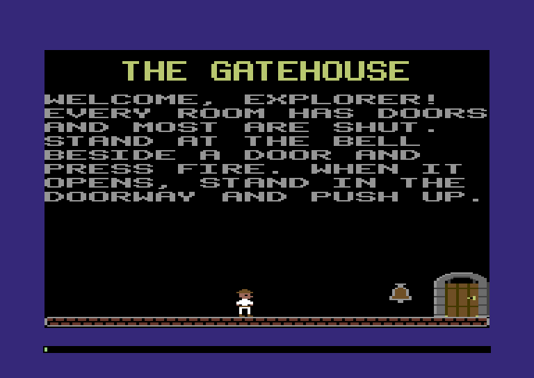
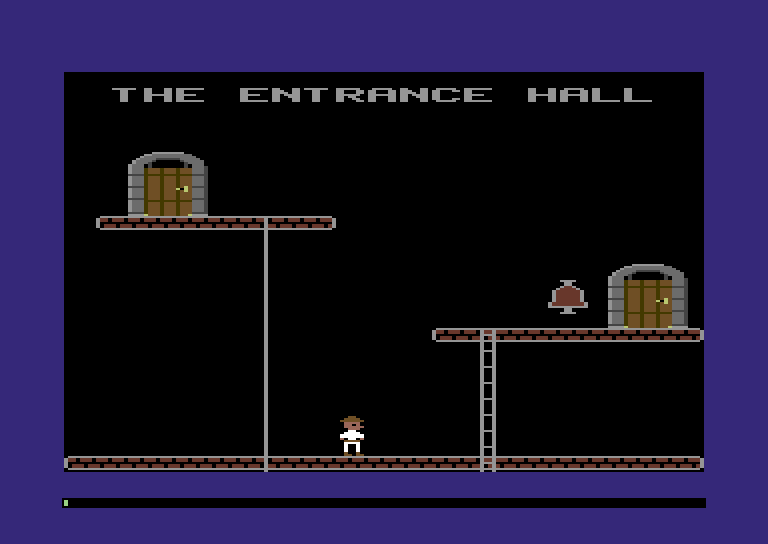
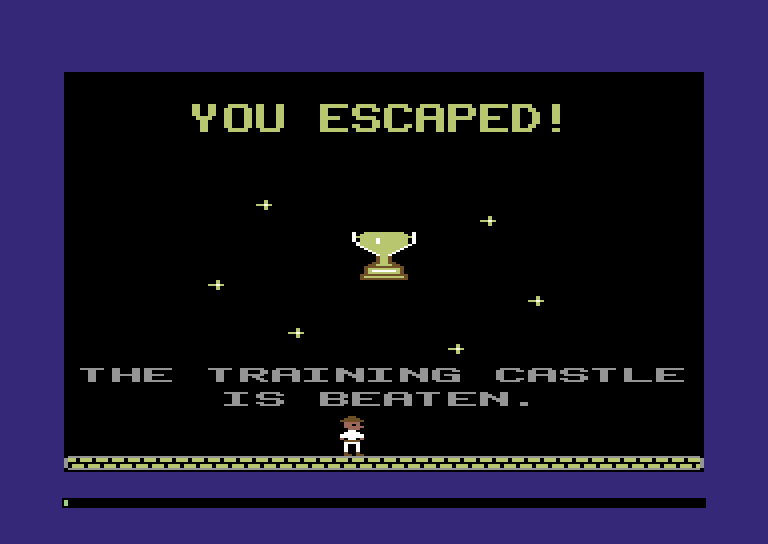

:::mission-briefing
By the end of this chapter the Comet 64 holds a whole castle: the
**Training Castle**, twenty rooms and a prize room in 4,323 bytes. Press
fire and you're standing in its Gatehouse, with a door, a doorbell and a
word of welcome on the wall. Press **N** and the screen goes dark for a
moment and comes back as the next room; **P** takes you back.



Nothing in those rooms is placed by code. Every walkway, door and line of
text comes out of a castle file in the 1984 disk's format, down to the
last byte, and you'll write that file in a small Zig language of your own
that refuses to build if a door leads nowhere.

New under the hood: **structs as bytes in memory**, **two-byte values,
low byte first**, **lists ended by sentinel bytes**, and **`comptime`,
taken apart properly**.
:::

## The castle is the level

Think about what a castle disk gives you: fourteen castles, each a
different maze with different machines in different places, and one
program that plays them all. Nobody wrote fourteen programs. They wrote
one engine and fourteen castles, and a castle isn't code at all. It's a
few thousand bytes of description: *a red room; a walkway along the
bottom, forty pieces long; a door on the right that leads to room 1.*

That's the big idea of this chapter, and maybe of the whole game: **data
is the program**. The engine knows how to draw a ladder; the castle says
where the ladders go. Change the bytes and you have a different game
without touching a line of code. By the end of this chapter, `room.zig`
won't have a single room built into its code.

In JavaScript you'd keep the castle as JSON and `JSON.parse` it. It reads
well. Here's what it costs: the Training Castle with every field named is
about 21,000 bytes, a third of the Comet's memory, before parsing has
built a single object. The castle file says the same in 4,323 bytes with
no names at all, because a byte's position tells you what it means: the
third byte is always the castle marker. The game never converts the file
into objects. It reads each value straight out of memory when it needs it.

## The header: 256 bytes and a magic number

A castle file starts with a 256-byte **header** at `$7800`, the first free
byte above the program image. Only a few fields are set:

| Offset | Bytes | What |
|---|---|---|
| `$00` | 2 | the castle's size in bytes, header included |
| `$02` | 1 | `$80`, which says "this is a castle" |
| `$03` | 2 | the room each player starts in (player 1, then player 2) |
| `$05` | 2 | the door each player starts at |
| `$07` | 2 | each player's lives |
| `$5F` | 2 | where the final room's objects are, or 0 if there's no final room |

The rest is spare. While you play, the game keeps its notes there (which
room you're in, the clock, your keys). That's why the header takes 256
bytes when its fields need only a dozen.

### Low byte first

Chapter 2 promised to explain why two-byte values go low byte first. A
castle of `$0154` bytes stores its size like this:

```
  address:   $7800   $7801
  byte:       $54     $01        $01 × 256 + $54 = $0154 = 340
              low     high
```

This is called **little-endian**: the little end goes first. It looks
backwards, because people write the big digits on the left. But it
suits a processor that reads one byte at a time. Think about adding 3
to an address on paper. You start with the right-hand column, the
small digits, and carry into the next. The processor does the same: it
adds to the low byte first, then carries into the high byte. With the
low byte stored first, it can start adding as soon as it has read one
byte. `m.peek16` puts the halves back
together: `peek(a) | peek(a + 1) << 8`.

## The room directory

Right after the header, at `$7900`, comes the **room directory**: 8 bytes
per room, so room *n*'s entry is at `$7900 + n × 8`. Its last two bytes
say where that room's objects start:

:::diagram ch03-castle-file
The Training Castle in memory. Each directory entry points at its room's stream; the header points at the final room's.
:::

:::diagram ch03-entry
One entry, field by field. Nothing reads the two **skip** bytes (see the end of the chapter).
:::

How does the game know where the directory stops? There's no room count
anywhere. An entry's first byte is its colour, and no colour byte has
**bit 6** set. So the castle puts a byte with bit 6 set after the last
entry: `$40` if the castle has a final room, `$FF` if not. It's Chapter 2's bit-7 string trick again: a
**sentinel**, a value that means "stop here", tucked into a bit
the data never uses.

### A struct is a row of bytes

Here's where Zig gets to describe those 8 bytes for us. In JavaScript, the engine
decides how an object is stored, and you never see it. So there's no
way to take 8 bytes of memory and say "read these as an object with
these fields". Zig can do exactly that with an **`extern struct`**. Its
fields sit in memory in the order you wrote them, one after the other,
like boxes on a shelf. So if you declare the entry as an `extern
struct`, `@sizeOf(Entry)` is 8, `@offsetOf(Entry, "objects")` is 6, and
the declaration is an exact picture of the format. (A plain `struct`, like the `Walker`
coming up, makes no such promise; Zig may reorder its fields.)

One catch. A `u16` field has to start at an even offset (that rule is its
**alignment**). Put a `u16` right after a single `u8` and Zig inserts an
unused **padding** byte before it, so from there on every field sits one
byte later than the castle format says:

:::diagram ch03-padding
Top: a JavaScript object is found by name; an `extern struct` is bytes in order. Bottom: one padding byte puts `objects` on the wrong bytes.
:::

The castle packs its bytes tight. For example, the final-room field is
two bytes starting at `$5F`, an odd offset. So in our structs,
every two-byte castle value is written as `[2]u8` (two separate bytes,
which never get padding) and read with `m.peek16`. `m.view`, the
reference card's typed pointer into memory (section 9), refuses padded
types at compile time, so you find out from the compiler instead of by
reading garbage:

```
error: m.view(room.Squeezed): field room.Squeezed.objects would start at byte 2, but the fields before it only fill 1: Zig inserts padding to align a u16. Use [2]u8 for it (and m.peek16), or move it
```

When the layout lines up, `m.view(Entry, address)` hands you a typed
pointer, so `entry.map_y` means "the byte at that address plus 2". For the
size byte, a **`packed struct(u8)`** cuts a byte into bit fields from bit
0 up, so `size.width` reads bits 3–5 without hand-written masking.

The castle needs somewhere to land: an 8 KB region from `$7800`, room for
any castle on the 1984 disk.

**`src/map.zig`** (add above the row table)

```zig
/// The castle: its header, its room directory and every room's objects,
/// exactly as the castle file holds them.
pub const castle = Region{ .name = "castle", .first = 0x7800, .last = 0x97FF };
```

**`src/map.zig`** (in `regions`, add after `shape_table,`)

```zig
    castle,
```

Then the header and the directory:

**`src/castle.zig`** (new file)

```zig
//! The castle file, byte for byte as the 1984 disk lays it out: a
//! 256-byte header at $7800, a room directory at $7900 (8 bytes a room),
//! then each room's objects as a stream of tagged records.

const std = @import("std");
const machine = @import("machine");
const Machine = machine.Machine;
const map = @import("map.zig");

// ---- the header -----------------------------------------------------------

pub const header = map.castle.first;
pub const header_size = 0x100;
pub const size = header + 0x00; // 2 bytes: the castle's length, header included
pub const magic = header + 0x02; // always $80: "this is a castle"
pub const start_room = header + 0x03; // player 1, then player 2
pub const start_door = header + 0x05; // player 1, then player 2
pub const lives = header + 0x07; // player 1, then player 2
pub const final_room = header + 0x5F; // 2 bytes: the final room's objects, or 0
pub const magic_value: u8 = 0x80;

// ---- the room directory ---------------------------------------------------

pub const directory = header + header_size; // $7900
pub const max_rooms = 31; // so the directory and its end byte fit in one page

/// One room's entry in the directory: 8 bytes.
pub const Entry = extern struct {
    color: u8, // low four bits: the room's colour. Bit 6 set: the end.
    map_x: u8, // where the room sits on the castle map
    map_y: u8,
    size: Size, // how big it is there
    skip: [2]u8, // nothing reads these two
    objects: [2]u8, // where its object stream starts, low byte first
};

/// A room's size on the castle map, in map cells: two 3-bit numbers in a byte.
pub const Size = packed struct(u8) {
    height: u3, // bits 0-2: cells of 8 rows
    width: u3, // bits 3-5: cells of 4 fat pixels
    unused: u2 = 0,
};

/// Bit 6 of a colour byte ends the directory. The end byte is $40 when
/// the castle has a final room and $FF when it doesn't.
pub const end_flag: u8 = 0b0100_0000;
pub const end_with_final: u8 = 0x40;
pub const end_plain: u8 = 0xFF;

/// The address of room `n`'s directory entry.
pub fn entry(m: *Machine, n: u8) u16 {
    m.work(6); // n * 8 is three shifts
    return directory + @as(u16, n) * @sizeOf(Entry);
}

/// How many rooms the directory lists.
pub fn roomCount(m: *Machine) u8 {
    var n: u8 = 0;
    while (m.peek(entry(m, n)) & end_flag == 0) : (n += 1) m.work(2);
    return n;
}
```

`roomCount` walks the directory until it finds the bit-6 sentinel.
`max_rooms` is our own limit: 31 entries and the end byte fit in the 256
bytes from `$7900`, so an entry's distance from `$7900` always fits in one
byte.

:::widget hex-inspector
The Training Castle's header and directory as hex; hover a byte to see its field and value.
:::

## A castle typed by hand

Before we write any tools, let's make a castle the hard way, so you know
exactly what the tools are saving you: Chapter 2's Entrance Hall, typed
as bytes. Its objects (`hall`) are the next section's subject, so for now
trust that they describe the hall.

**`src/hall.zig`** (new file)

```zig
//! The Entrance Hall from Chapter 2 as a one-room castle, typed in by
//! hand, byte by byte.

/// The whole castle file, ready to load at $7800.
pub const bytes = &(header ++ directory ++ hall);

const header = [_]u8{
    0x54, 0x01, // the castle is $0154 bytes long, header and all
    0x80, // "this is a castle"
    0, 0, // both players start in room 0...
    0, 0, // ...at its door 0...
    3, 3, // ...with three lives each
} ++ [_]u8{0} ** (0x5F - 9) ++ [_]u8{ 0x00, 0x00 } // $785F: no final room
++ [_]u8{0} ** (0x100 - 0x61);

const directory = [_]u8{
    0x02, // red, and bit 6 is clear: this is a room, not the end
    56, 48, // its place on the castle map
    0b00_100_011, // 4 map cells wide, 3 tall
    0x0B, 0x79, // skip: $790B
    0x09, 0x79, // its objects start at $7909, right after the end byte
    0xFF, // the end of the directory, and no final room
};

/// The Entrance Hall's objects.
const hall = [_]u8{
    0x03, 0x08, 2, // doors: two of them
    32, 40, 3, 0, 1, 0, 6, 0, // upper left, leading to door 1
    152, 96, 1, 0, 0, 14, 13, 0, // middle right, leading to door 0
    0x06, 0x08, // walkways
    15, 24, 72, // upper left
    17, 108, 128, // middle right
    40, 16, 192, // the floor
    0, // no more walkways
    0x09, 0x08, 16, 64, 72, 0, // one sliding pole
    0x0C, 0x08, 9, 120, 128, 0, // one ladder
    0x0F, 0x08, 1, 136, 104, 1, // one doorbell, for door 1
    0x33, 0x08, 28, 8, 15, 0x21, // text at (28, 8), light grey, plain
} ++ "THE ENTRANCE HAL".* ++ [_]u8{
    'L' | 0x80, // the last letter has bit 7 set
    0, // no more text
    0x00, 0x00, // the end of the room
};
```

Count along with the comments. The directory is one entry and the end
byte, `$7900` to `$7908`, so the hall's objects start at `$7909`, written
`09 79`. The hall is 75 bytes, so the castle is 256 + 9 + 75 = 340 bytes,
`$0154`, written `54 01`. Add or remove one byte in the hall and that size
is wrong, and nothing warns you. Hold that thought.

Boot copies the castle into its region:

**`src/main.zig`** (add below the `player` import)

```zig
const hall = @import("hall.zig");
```

**`src/main.zig`** (in `boot`, add after the star map's `m.load`)

```zig
    m.load(map.castle.first, hall.bytes);
```

The floor pieces get new pictures this chapter, so copy the new `art.zig`
from the Warp Zone checkpoint (`code/ch03/src/art.zig`) over yours. The
walkway now looks like this:

```zig snippet
/// Floors, ladders and poles share colours, so they can cross each other
/// without fighting over a cell. Codes 01 and 10 take the room's colour
/// when a room is drawn; code 11 stays light grey.
const stone = [3]Color{ .brown, .pink, .light_grey };

pub const walkway = room(stone, &.{
    "3333",
    "111.",
    "111.",
    "....",
    "1.11",
    "1.11",
    "3333",
});
```

Its bricks are all code 01 and its mortar code 00, the background. That's
because of how a room gets its colour, and it's one of my favourite
tricks in the whole game.

### One colour per room

Every walkway, ladder and pole takes the room's one colour. Before a room
is drawn, the game **repaints the floor pieces in the shape table
itself**, writing the colour into the screen-plane bytes for codes 01 and
10. No colour per walkway, no colour parameter on the drawing code. The
shape table is ordinary memory, so instead of telling every drawing call
which colour to use, the room rewrites the pictures themselves. The 1984
game does exactly this.

**`src/shapes.zig`** (add below `address`)

```zig
/// Repaint room shape `id`: every one of its screen-plane bytes becomes
/// `colors`, the two colours for codes 01 and 10.
pub fn recolor(m: *Machine, id: Id, colors: u8) void {
    const at = address(m, id);
    const width = m.peek(at);
    const height = m.peek(at + 1);
    const pixels = m.mul8(width, height);
    const cells = m.mul8(width, (height + 7) / 8);
    m.fill(at + 3 + pixels, cells, colors);
}
```

`recolor` finds the shape's screen-plane bytes (past the 3-byte header and
`width × height` pixel bytes) and fills them. Two `m.mul8`s are fine: this
runs once per piece per room, not per frame.

Now `room.zig` paints with room 0's colour before drawing the hall, which
is still hand-placed in code:

**`src/room.zig`** (replace the imports)

```zig
const machine = @import("machine");
const Machine = machine.Machine;
const castle = @import("castle.zig");
const screen = @import("screen.zig");
const shapes = @import("shapes.zig");
const text = @import("text.zig");
```

**`src/room.zig`** (in `draw`, add after `screen.clear(m);`)

```zig
    paint(m, roomColors(m, 0)); // room 0's colour, from the directory
```

**`src/room.zig`** (add at the end of the file)

```zig
/// One colour per room, not per walkway: before drawing, repaint the
/// floor pieces in the shape table itself.
fn paint(m: *Machine, colors: u8) void {
    for ([_]shapes.Id{ .walkway, .walkway_left, .walkway_right, .ladder, .pole }) |id| {
        shapes.recolor(m, id, colors);
    }
}

/// Room `n`'s colour from its directory entry, for both codes 01 and 10.
fn roomColors(m: *Machine, n: u8) u8 {
    return both(m.peek(castle.entry(m, n)) & 0x0F);
}

/// One colour in both halves of a screen-plane byte.
fn both(color: u8) u8 {
    return color << 4 | color;
}
```

`both` puts a colour in both halves of a byte. Build, press fire, and the
bricks are red because the castle file said so. Everything else in the
room is still Chapter 2's hand-placed code. Time to read the rest of the
room from the castle file too.

## Streams of tagged objects

A room's objects are a **stream**: groups of records, one group per kind
of object, each introduced by a two-byte **tag**. Here's the hall from `$7909`,
plus one group from the final room:

:::diagram ch03-stream
Every group starts with a tag; how it ends depends on the kind.
:::

Read low byte first, the tags go up in threes: `$0803` for doors, `$0806`
for walkways, and so on up to `$0836`, one for each of the eighteen kinds
of object. `$0000` ends the room. Why those numbers? Okay, this next bit
is the cleverest thing in the whole format:

:::inside-the-disk The tag is the address
Why `$0803`, and why three apart? Because the tags are **addresses in the
program**. The 1984 engine starts with a table of jumps at `$0803`, three
bytes each: one for the processor's "jump" instruction and two for where
to jump. To set up each group, it jumps to the address in its tag, which
lands on the jump to the code for that kind of object. No lookup, no
comparison: **the data carries the address of the code that reads it.**
The title screens' tags skip the table and give the routines' own
addresses, `$160A` and `$2A6D`.
:::

:::diagram ch03-tags
Top: the jump table the tags point into. Bottom: our 54-entry table, every third entry a kind.
:::

Our tags can't be addresses in our own program: Zig decides where our
functions go, and it isn't `$0803`. So we turn each tag back into a kind
with the 54-entry table from the figure (Chapter 2's Lookup Table
Power-Up), which saves dividing by three. The enum lists the kinds in
table order.

**`src/castle.zig`** (add at the end of the file)

```zig
// ---- object streams -------------------------------------------------------

/// Every kind of object a room can hold, in the order of the program's
/// jump table: kind k's tag code is $0803 + 3k.
pub const Kind = enum(u8) {
    door,
    walkway,
    pole,
    ladder,
    bell,
    lightning,
    forcefield,
    mummy,
    key,
    lock,
    pattern, // a shape stamped in a row; only the title screens use it
    ray_gun,
    teleport,
    trapdoor,
    conveyor,
    frankenstein,
    text,
    image,
};

pub const first_code: u16 = 0x0803;
pub const end_code: u16 = 0x0000;

/// The tag code that introduces `kind`.
pub fn code(kind: Kind) u16 {
    return first_code + 3 * @as(u16, @intFromEnum(kind));
}

/// (code - $0803) to kind. Codes are 3 apart, so two in three entries are
/// null: those numbers aren't codes at all.
const kinds: [3 * std.enums.values(Kind).len]?Kind = blk: {
    var table: [3 * std.enums.values(Kind).len]?Kind = @splat(null);
    for (std.enums.values(Kind)) |kind| table[@intFromEnum(kind) * 3] = kind;
    break :blk table;
};

/// The kind a tag code introduces, or null if it isn't one.
pub fn kindOf(m: *Machine, tag: u16) ?Kind {
    m.work(12); // a subtraction, a compare and a table read
    const offset = tag -% first_code; // below $0803 wraps round to a huge number
    return if (offset < kinds.len) kinds[offset] else null;
}
```

`tag -% first_code` is a subtraction that wraps round instead of stopping
the game (the stars' `+%`, going the other way). A tag below `$0803`
becomes an enormous number, bigger than the table, so `kindOf` returns
`null`. `?Kind` is "a kind
or `null`".

Each record is an `extern struct` of `u8`s to lay over the stream with
`m.view`. We declare all eighteen now: the loader needs every size to step
over them, and `@sizeOf` reads it from the declaration.

**`src/castle.zig`** (add at the end of the file)

```zig
// ---- records --------------------------------------------------------------

/// A door: 8 bytes.
pub const Door = extern struct {
    x: u8,
    y: u8,
    side: u8, // its wall on the castle map: 0 up, 1 right, 2 down, 3 left. Bit 7: open
    to_room: u8, // where it leads
    to_door: u8,
    map_x: u8, // where it sits on the castle map, from the room's corner
    map_y: u8,
    exit: u8, // 1: the way out of the castle
};
pub const door_open: u8 = 0b1000_0000;

/// A walkway, a sliding pole or a ladder: `length` pieces from (x, y).
pub const Run = extern struct { length: u8, x: u8, y: u8 };

/// A doorbell, and which of the room's doors it opens (0 is the first).
pub const Bell = extern struct { x: u8, y: u8, door: u8 };

/// A line of text; its letters follow, the last one with bit 7 set.
pub const Text = extern struct { x: u8, y: u8, color: u8, style: u8 };
```

The fourteen later kinds are one line each; for now only their sizes
matter.

:::type-in The machines and monsters
**`src/castle.zig`** (add at the end of the file)

```zig
// The machines and monsters later chapters bring to life. For now the
// loader only needs their sizes, and the authoring kit their fields.
pub const Lightning = extern struct { state: u8, x: u8, y: u8, length: u8, machines: [4]u8 };
pub const Forcefield = extern struct { button_x: u8, button_y: u8, field_x: u8, field_y: u8 };
pub const Mummy = extern struct { state: u8, ankh_x: u8, ankh_y: u8, tomb_x: u8, tomb_y: u8, runtime: [2]u8 };
pub const Key = extern struct { number: u8, shape: u8, x: u8, y: u8 };
pub const Lock = extern struct { number: u8, shape: u8, door: u8, x: u8, y: u8 };
pub const Pattern = extern struct { count: u8, shape: u8, x: u8, y: u8, step_x: u8, step_y: u8 };
pub const RayGun = extern struct { state: u8, x: u8, y: u8, length: u8, runtime: u8, control_x: u8, control_y: u8 };
pub const Trapdoor = extern struct { state: u8, x: u8, y: u8, switch_x: u8, switch_y: u8 };
pub const Conveyor = extern struct { state: u8, x: u8, y: u8, control_x: u8, control_y: u8 };
pub const Frankenstein = extern struct { state: u8, x: u8, y: u8, runtime: [4]u8 };
```
:::

### Three ways to end a list

Look back at the stream figure. The groups don't all end the same way,
and that's deliberate. The castle uses three framing schemes:

- **Counted.** Doors and doorbells: a count, then that many records.
- **End marker.** The other kinds that come in lists run until a record
  starts with a marker byte, and the marker is skipped. Usually the marker
  is a 0 where the next record's length would be; a walkway of no pieces
  would be pointless anyway. Machines whose first byte (their state) can
  be 0 use a bit their state never sets instead: bit 5 for lightning,
  bit 7 for ray guns, trapdoors, conveyors and Frankensteins.
- **One tag per thing.** Each picture and each matter transmitter gets a
  tag of its own. A picture is its shape, then the places to draw it,
  ended by a 0; a transmitter is its booth, then its pads, ended by a 0.

:::power-up The Sentinel Power-Up
Mark the end of a list *inside* the data instead of storing its length.
It costs one byte, or none when the marker hides in a bit the data never
uses, and lists grow and shrink without anyone updating a count. The price is that you can't jump to the 20th
entry; you walk to it. For a room drawn start to finish, that's no price
at all.
:::

In Zig, "one of these, and which one it is" is a **tagged union**, like a
TypeScript discriminated union, and a `switch` on one can capture the
case's data (`.counted => |size|`):

**`src/castle.zig`** (add at the end of the file)

```zig
/// How a kind's records are strung together after its tag.
pub const Framing = union(enum) {
    /// A count byte, then that many records of this size.
    counted: u8,
    /// Records of this size until one starts with the end marker: a byte
    /// of 0 when `end` is 0, otherwise a byte with any of `end`'s bits set.
    marked: struct { size: u8, end: u8 },
    /// Like `marked`, ended by a 0, but each record ends with a string.
    text,
    /// One booth (x, y, target), then (x, y) pads up to a 0.
    teleport,
    /// One shape, then (x, y) places to draw it, up to a 0.
    image,
};

pub fn framing(kind: Kind) Framing {
    return switch (kind) {
        .door => .{ .counted = @sizeOf(Door) },
        .bell => .{ .counted = @sizeOf(Bell) },
        .walkway, .pole, .ladder => .{ .marked = .{ .size = @sizeOf(Run), .end = 0 } },
        .lightning => .{ .marked = .{ .size = @sizeOf(Lightning), .end = 0x20 } },
        .forcefield => .{ .marked = .{ .size = @sizeOf(Forcefield), .end = 0 } },
        .mummy => .{ .marked = .{ .size = @sizeOf(Mummy), .end = 0 } },
        .key => .{ .marked = .{ .size = @sizeOf(Key), .end = 0 } },
        .lock => .{ .marked = .{ .size = @sizeOf(Lock), .end = 0 } },
        .pattern => .{ .marked = .{ .size = @sizeOf(Pattern), .end = 0 } },
        .ray_gun => .{ .marked = .{ .size = @sizeOf(RayGun), .end = 0x80 } },
        .trapdoor => .{ .marked = .{ .size = @sizeOf(Trapdoor), .end = 0x80 } },
        .conveyor => .{ .marked = .{ .size = @sizeOf(Conveyor), .end = 0x80 } },
        .frankenstein => .{ .marked = .{ .size = @sizeOf(Frankenstein), .end = 0x80 } },
        .text => .text,
        .teleport => .teleport,
        .image => .image,
    };
}

/// Does `byte`, at the start of a record, mark the end of the group?
pub fn isEnd(byte: u8, end: u8) bool {
    return if (end == 0) byte == 0 else byte & end != 0;
}
```

:::pro-tip `switch` must cover everything
`framing` has no `else`, so a nineteenth kind without a framing stops the
build: `switch must handle all possibilities`. Leave out `else` when you
can, and the compiler checks that every `switch` handles every kind.
:::

### The walker

Now the part that reads a stream. `Walker` is an **iterator**: a little
struct that remembers where it is, with a `next` that hands you one
record at a time, or `null` at the end.
`while (walk.next(m)) |r|` is Zig's version of Python's `for r in walker:`.

**`src/castle.zig`** (add at the end of the file)

```zig
/// One record in a room's stream: its kind, where it starts, and the
/// address after it.
pub const Record = struct { kind: Kind, at: u16, end: u16 };

/// Walks a room's object stream, one record at a time.
pub const Walker = struct {
    at: u16, // the next byte to read
    kind: Kind = .door, // the group we're in
    in_group: bool = false,
    left: u8 = 0, // records still to come in a counted group

    /// The next record, or null at the stream's end tag.
    pub fn next(w: *Walker, m: *Machine) ?Record {
        while (true) {
            if (!w.in_group) {
                const tag = m.peek16(w.at);
                w.at += 2;
                if (tag == end_code) return null;
                w.kind = kindOf(m, tag) orelse @panic("castle: that's not an object code");
                w.in_group = true;
                if (framing(w.kind) == .counted) {
                    w.left = m.peek(w.at);
                    w.at += 1;
                }
            }
            const start = w.at;
            m.work(16); // the tests and the sums below
            switch (framing(w.kind)) {
                .counted => |record_size| {
                    if (w.left == 0) {
                        w.in_group = false;
                        continue;
                    }
                    w.left -= 1;
                    w.at += record_size;
                },
                .marked => |f| {
                    if (isEnd(m.peek(w.at), f.end)) {
                        w.at += 1; // the marker is part of the group
                        w.in_group = false;
                        continue;
                    }
                    w.at += f.size;
                },
                .text => {
                    if (m.peek(w.at) == 0) {
                        w.at += 1;
                        w.in_group = false;
                        continue;
                    }
                    w.at = stringEnd(m, w.at + @sizeOf(Text));
                },
                .teleport => {
                    w.at = placesEnd(m, w.at + 3);
                    w.in_group = false; // one booth per tag
                },
                .image => {
                    w.at = placesEnd(m, w.at + shapeSize(m, w.at));
                    w.in_group = false; // one image per tag
                },
            }
            return .{ .kind = w.kind, .at = start, .end = w.at };
        }
    }
};

/// The address after a string whose last letter has bit 7 set.
fn stringEnd(m: *Machine, at: u16) u16 {
    var a = at;
    while (m.peek(a) & 0x80 == 0) : (a += 1) m.work(2);
    return a + 1;
}

/// The address after a list of (x, y) pairs ended by a 0.
fn placesEnd(m: *Machine, at: u16) u16 {
    var a = at;
    while (m.peek(a) != 0) : (a += 2) m.work(2);
    return a + 1;
}

/// How many bytes a shape takes: width, height and flags, its pixels,
/// and a screen-plane and a colour-RAM byte for each cell.
pub fn shapeSize(m: *Machine, at: u16) u16 {
    const width = m.peek(at);
    const height = m.peek(at + 1);
    return 3 + m.mul8(width, height) + 2 * m.mul8(width, (height + 7) / 8);
}

/// Object X counts fat pixels from 16 to the left of the screen, so that
/// things can start a little way off its left edge: X = 16 is the edge.
pub const left_edge: u8 = 16;
```

Here's `next` walking the hall:

| `at` | reads | does |
|---|---|---|
| `$7909` | `03 08` | a tag: doors, counted |
| `$790B` | `02` | the count: two |
| `$790C` | 8 bytes | returns door 1 of 2 |
| `$7914` | 8 bytes | returns door 2 of 2 |
| `$791C` | | the count is used up: `continue` to the next tag |
| `$791C` | `06 08` | a tag: walkways, ended by a 0 |
| `$791E` | 3 bytes | returns a walkway (and twice more) |
| `$7927` | `00` | the end marker: skip it, `continue` |
| ... | ... | the pole, the ladder, the bell, the text |
| `$7952` | `00 00` | the end tag: `null` |

`orelse @panic(...)` unwraps the optional kind, stopping the game on a
bad tag.

Test it against bytes that no tool produced: a hand-typed room with one
of nearly everything.

:::type-in The walker's tests
**`src/castle.zig`** (add at the end of the file)

```zig
// ---- tests ----------------------------------------------------------------

test "tag codes turn into kinds and back" {
    const m = try std.testing.allocator.create(Machine);
    defer std.testing.allocator.destroy(m);
    m.* = .{};
    try std.testing.expectEqual(Kind.door, kindOf(m, 0x0803).?);
    try std.testing.expectEqual(Kind.image, kindOf(m, 0x0836).?);
    try std.testing.expectEqual(null, kindOf(m, 0x0804));
    try std.testing.expectEqual(null, kindOf(m, 0x0839));
    try std.testing.expectEqual(null, kindOf(m, 0x0100));
    for (std.enums.values(Kind)) |kind| try std.testing.expectEqual(kind, kindOf(m, code(kind)).?);
}

test "the walker finds every record in a stream written by hand" {
    const m = try std.testing.allocator.create(Machine);
    defer std.testing.allocator.destroy(m);
    m.* = .{};
    const room = [_]u8{
        0x03, 0x08, 1, 0x9C, 0xA0, 0x01, 0x02, 0x00, 0x24, 0x10, 0x00, // one door
        0x06, 0x08, 40, 0x10, 0xC0, 0, // a walkway, then its end marker
        0x0F, 0x08, 1, 0x88, 0xA8, 0x00, // one doorbell, for door 0
        0x12, 0x08, 0x40, 0x50, 0x88, 5, 0, 0, 0, 0, // a lightning machine...
        0x80, 0x30, 0x60, 0, 0x00, 0xFF, 0xFF, 0xFF, 0x20, // ...its switch, the end
        0x24, 0x08, 0x01, 0x20, 0x40, 8, 0x48, 0x30, 0x40, 0x80, // a ray gun, end
        0x27, 0x08, 0x40, 0x98, 0x00, 0x80, 0x98, 0x00, // a booth with one pad
        0x33, 0x08, 0x14, 0x00, 0x07, 0x22, 'H', 'E', 'L', 'L', 'O' | 0x80, // text...
        0x14, 0x18, 0x01, 0x21, 'H', 'I' | 0x80, 0x00, // ...more text, the end
        0x36, 0x08, 1, 2, 0, 0xFF, 0xFF, 0x21, 0x07, 0x20, 0x08, 0x30, 0x08, 0, // an image, twice
        0x00, 0x00, // the end of the room
    };
    const at = 0x7969;
    m.load(at, &room);

    const expected = [_]Kind{ .door, .walkway, .bell, .lightning, .lightning, .ray_gun, .teleport, .text, .text, .image };
    var walk = Walker{ .at = at };
    for (expected) |kind| {
        const r = walk.next(m) orelse return error.EndedEarly;
        try std.testing.expectEqual(kind, r.kind);
    }
    try std.testing.expectEqual(null, walk.next(m));
    try std.testing.expectEqual(at + room.len, walk.at);
}
```
:::

Run `zig build test`. Then change the lightning group's end byte from
`0x20` to `0x00` and watch the walker read the end marker as a record and
everything after it go wrong. One byte, and the whole room is nonsense.
Put it back.

## Drawing from the stream

An object's X is its fat-pixel column **plus 16**. So X = 16 is the left
edge, and an object can start a little past the left edge (X below 16)
without X going negative. Y is the pixel row. So that such a shape is
clipped at the edge instead of not drawn at all, `drawShape` learns to
skip its first few byte columns:

**`src/screen.zig`** (replace `drawShape`)

```zig
/// Draw room shape (or glyph) `id` with its top-left corner at fat pixel
/// (x, y); sprite frames have no colours, so they don't belong here. x is
/// rounded down to a multiple of 4, because shapes sit on whole bitmap
/// bytes. Anything past the right or bottom edge of the screen is cut off.
pub fn drawShape(m: *Machine, id: shapes.Id, x: u8, y: u8) void {
    drawPart(m, id, x, y, 0);
}

/// `drawShape`, leaving out the shape's first `skip` byte columns, so that
/// what's left starts at x. That's how a shape hanging off the left edge
/// of the screen gets drawn.
pub fn drawPart(m: *Machine, id: shapes.Id, x: u8, y: u8, skip: u8) void {
    var src = shapes.address(m, id);
    const width = m.peek(src);
    const height = m.peek(src + 1);
    src += 3; // past width, height and flags
    const column = x / 4;

    // The pixels, a row at a time, ORed over whatever is already there.
    var row: u16 = 0;
    while (row < height) : (row += 1) {
        const line = y + row;
        if (line < 200) {
            var dst = rowAddress(m, @intCast(line)) + @as(u16, column) * 8;
            var i: u16 = skip;
            while (i < width and column + i - skip < 40) : (i += 1) {
                m.poke(dst, m.peek(dst) | m.peek(src + i));
                dst += 8; // the same line of the next cell along
                m.work(4);
            }
        }
        src += width;
    }

    // The colours: rows of cells, one screen-plane byte and one colour-RAM
    // byte per cell. A shape that doesn't start on a cell's top line
    // reaches one more row of cells, which gets the last row's colours.
    const cell_rows = (height + 7) / 8;
    const reach = cell_rows + @intFromBool(y % 8 != 0);
    const screen_src = src;
    const color_src = src + cell_rows * width;
    // The top line of a cell row is bitmap + row * 320; one eighth of
    // the distance from the bitmap's start is row * 40, the cell number.
    var cell = (rowAddress(m, y & 0b1111_1000) - hw.bitmap) / 8 + column;
    var r: u16 = 0;
    while (r < reach and y / 8 + r < 25) : (r += 1) {
        const from = @min(r, cell_rows - 1) * width;
        var i: u16 = skip;
        while (i < width and column + i - skip < 40) : (i += 1) {
            m.poke(hw.screen + cell + i - skip, m.peek(screen_src + from + i));
            m.poke(hw.color_ram + cell + i - skip, m.peek(color_src + from + i));
            m.work(4);
        }
        cell += 40;
    }
}
```

Now `room.zig` forgets the Entrance Hall and walks room 0's stream:

**`src/room.zig`** (replace the comment at the top)

```zig
//! The room on screen, drawn from the castle: walk the room's object
//! stream and draw everything in it that stands still.
```

**`src/room.zig`** (replace `draw`)

```zig
/// Draw the whole room. Far too big for one frame: call it with the
/// display blanked.
pub fn draw(m: *Machine) void {
    screen.clear(m);
    var walk = prepare(m, 0);
    while (walk.next(m)) |r| {
        switch (r.kind) {
            .walkway => walkway(m, r.at),
            .pole => column(m, .pole, r.at),
            .ladder => column(m, .ladder, r.at),
            else => {}, // the rest: later in this chapter, and in later chapters
        }
    }
}
```

Delete the three hand-placed helpers at the bottom of the file
(`walkway`, `ladder` and `pole`). Then add `prepare`, which picks the
room's colour and first object out of the directory:

**`src/room.zig`** (add below `draw`)

```zig
/// Get room `n` ready to draw: paint the floor pieces its colour, and
/// return a walker at the start of its objects.
fn prepare(m: *Machine, n: u8) castle.Walker {
    paint(m, roomColors(m, n));
    return .{ .at = m.peek16(castle.entry(m, n) + @offsetOf(castle.Entry, "objects")) };
}
```

`@offsetOf(castle.Entry, "objects")` is the struct telling us the field
is 6 bytes in, instead of a 6 typed by hand. Last, the pieces:

**`src/room.zig`** (add at the end of the file)

```zig
/// Draw shape `id` with its top-left corner at castle coordinates
/// (x, y), cut off where it hangs over the left edge of the screen. This
/// is the one place an object's X becomes the blitter's fat pixel.
fn place(m: *Machine, id: shapes.Id, x: u8, y: u8) void {
    m.work(8); // the test and the sums
    if (x >= castle.left_edge) {
        screen.drawShape(m, id, x - castle.left_edge, y);
    } else {
        // Four fat pixels to a byte column: leave out the columns left of the edge.
        screen.drawPart(m, id, 0, y, (castle.left_edge - x + 3) / 4);
    }
}

/// A walkway: `length` pieces 4 fat pixels wide, a left end, middles and
/// a right end.
fn walkway(m: *Machine, at: u16) void {
    const w = m.view(castle.Run, at);
    var x = w.x;
    var i: u8 = 1;
    while (i <= w.length and x < castle.left_edge + 160) : (i += 1) {
        const piece: shapes.Id = if (i == 1) .walkway_left else if (i == w.length) .walkway_right else .walkway;
        place(m, piece, x, w.y);
        x += 4;
        m.work(12); // the tests and the loop
    }
}

/// A ladder or a pole: `length` pieces stacked 8 rows apart, top first.
fn column(m: *Machine, id: shapes.Id, at: u16) void {
    const c = m.view(castle.Run, at);
    var y = c.y;
    var i: u8 = 0;
    while (i < c.length and y < 200) : (i += 1) {
        place(m, id, c.x, y);
        y += 8;
        m.work(8); // the tests and the loop
    }
}
```

`place` is the one place an object's X becomes a fat pixel. A walkway is
`length` pieces 4 fat pixels wide; a ladder or pole is `length` pieces
stacked 8 rows apart. That's how the 1984 game reads `length`, so castles
from its disk line up. `m.view(castle.Run, at)` returns a
`*align(1) castle.Run`, a pointer that allows the record to sit at any
address, odd or even.

Build, press fire, and the hall's floors, ladder and pole are back, read
from 75 bytes of castle (the torches are gone: the format has none). The
doors and the title are in the stream too, and the walker steps over them
because it knows their sizes, even though nothing draws them yet. Let's
draw them.

## Doors, bells and words

Five new pictures go at the end of the shape IDs, so the IDs that already
exist keep their numbers: an arched doorway, the way out's doorway, a shut door,
an open one, and a doorbell. Plus one ID with no picture: `image`. Hold
that thought too.

**`src/shapes.zig`** (replace `Id` and the comment above it)

```zig
/// Every shape, by ID. Each name except `glyph` and `image` has a picture
/// of the same name in art.zig. New shapes go at the end: the walk counts
/// on the explorer's frames being in a row, and IDs are stored in castles.
pub const Id = enum(u8) {
    glyph, // built by text.zig, one letter at a time
    walkway,
    walkway_left,
    walkway_right,
    ladder,
    pole,
    door,
    window,
    torch,
    moon,
    tower,
    wall,
    explorer_right_0,
    explorer_right_1,
    explorer_right_2,
    explorer_right_3,
    explorer_left_0,
    explorer_left_1,
    explorer_left_2,
    explorer_left_3,
    door_frame,
    exit_frame,
    door_shut,
    door_open,
    bell,
    image, // points into the castle, at whichever image is being drawn
};
```

Like `glyph`, `image`'s directory entry starts as 0 and gets pointed at a
picture when there's one to draw:

**`src/shapes.zig`** (in `build`, replace the four lines at the top of the loop)

```zig
            // The glyph is built at run time, in the text region, and
            // `image` is pointed at a picture in the castle when one is drawn.
            const where = switch (id) {
                .glyph => map.text_glyph,
                .image => 0,
                else => at,
            };
            directory = directory ++ [_]u8{ where & 0xFF, where >> 8 }; // low byte first
            if (id == .glyph or id == .image) continue;
```

**`src/shapes.zig`** (add below `address`)

```zig
/// Point shape `id`'s directory entry at the shape stored at `at`.
pub fn point(m: *Machine, id: Id, at: u16) void {
    m.work(4); // doubling the ID
    m.poke16(map.shape_table.first + @as(u16, @intFromEnum(id)) * 2, at);
}
```

### The text style byte

Every text record carries a **style** byte after its colour, another
packed byte:

```
  bit:   7   6     5        4        3   2     1   0
       ┌───┬───┬─────────┬──────────┬───────┬─────────┐
       │ 0 │ 0 │ letters │ reversed │ 0   0 │ height  │
       └───┴───┴─────────┴──────────┴───────┴─────────┘
```

The low two bits make the letters 1, 2 or 3 times the usual 8 rows tall
(0 counts as 1), by drawing each glyph row that many times. So the glyph's
scratch shape grows from 23 bytes to 63, and the string buffer moves up to
make room:

**`src/map.zig`** (replace the `text` region's comment and first four lines)

```zig
/// Text: a lookup table, the shape each letter is built in, and a string.
pub const text = Region{ .name = "text", .first = 0x0300, .last = 0x037F };
pub const text_widen = text.first + 0x00; // 16 bytes: 4 glyph bits -> 4 fat pixels
pub const text_glyph = text.first + 0x10; // one letter, up to 2x24: 63 bytes
pub const text_buffer = text.first + 0x50; // a string to print
```

Bit 4 asks for reversed text: a solid block with the letters cut out of
it. Bit 5 (always set) asks for letters. So a heading is `$22` and an ordinary line `$21`.

`draw` gets a style, and returns the address after the string so the
caller knows where it ended.

**`src/text.zig`** (replace `glyph_pixels` and the two lines below it)

```zig
/// The glyph shape's pixels start after its width, height and flags.
const glyph_pixels = map.text_glyph + 3;

/// The style byte every castle Text object carries. Bits 0-1: how tall,
/// 1 to 3 times (0 counts as 1). Bit 4: reversed, light letters cut out
/// of a solid block. Bit 5 asks for the letters (rather than picture)
/// character set, which is the only one our ROM has; castles always set it.
pub const style_height: u8 = 0b0000_0011;
pub const style_reversed: u8 = 0b0001_0000;
pub const style_letters: u8 = 0b0010_0000;
pub const plain = style_letters | 1;
```

**`src/text.zig`** (in `start`, replace the last two lines)

```zig
    m.poke(map.text_glyph + 2, 0); // no flags; the height depends on the style
```

**`src/text.zig`** (replace `draw`)

```zig
/// Print the string at `addr` with its top-left corner at fat pixel
/// (x, y), in `style` (see `style_height`). Letters are 8 fat pixels wide.
/// The string ends at the first byte with bit 7 set, which is its last
/// letter; letters that would run off the right edge of the screen are
/// left out. Returns the address after the string.
pub fn draw(m: *Machine, x: u8, y: u8, color: Color, style: u8, addr: u16) u16 {
    const tall = @max(1, style & style_height); // each glyph row drawn this many times
    const flip: u8 = if (style & style_reversed != 0) 0xFF else 0x00;
    const rows = 8 * tall;
    m.poke(map.text_glyph + 1, rows);

    // Glyph pixels are code 01, whose colour is the high half of the
    // screen-plane byte. The glyph is 2 cells wide and `tall` cells high.
    const glyph_screen = glyph_pixels + 2 * @as(u16, rows);
    const glyph_colors = glyph_screen + 2 * @as(u16, tall);
    m.fill(glyph_screen, 2 * tall, @as(u8, @intFromEnum(color)) << 4);
    m.fill(glyph_colors, 2 * tall, 0);

    var at = addr;
    var left: u16 = x;
    while (true) : (left += 8) {
        const letter = m.peek(at);
        at += 1;
        if (left <= 160 - 8) {
            const glyph = m.charRom(letter & 0x7F);
            var dst: u16 = glyph_pixels;
            for (glyph) |row| {
                const bits = row ^ flip;
                const left_half = m.peek(map.text_widen + (bits >> 4));
                const right_half = m.peek(map.text_widen + (bits & 0x0F));
                for (0..tall) |_| {
                    m.poke(dst, left_half);
                    m.poke(dst + 1, right_half);
                    dst += 2;
                }
                m.work(10 + 4 * @as(u32, tall)); // the shift, the mask, the loops
            }
            screen.drawShape(m, .glyph, @intCast(left), y);
        }
        if (letter & 0x80 != 0) return at;
    }
}
```

**`src/text.zig`** (in `say`, replace the last line)

```zig
    _ = draw(m, x, y, color, plain, map.text_buffer);
```

`for (0..tall) |_|` repeats each row, and `row ^ flip` inverts it when
the style says reversed (flip is `$FF`) and leaves it alone otherwise
(flip is 0). `say` asks for plain letters, so the title screen is
unchanged.

### Drawing them

Now the room draws everything that stands still:

**`src/room.zig`** (add an import below `Machine`)

```zig
const Color = machine.Color;
```

**`src/room.zig`** (replace `draw`)

```zig
/// Draw the whole room. Far too big for one frame: call it with the
/// display blanked.
pub fn draw(m: *Machine) void {
    screen.clear(m);
    var walk = prepare(m, 0);
    var doors: u16 = 0; // where this room's door records start
    while (walk.next(m)) |r| {
        switch (r.kind) {
            .door => {
                if (doors == 0) doors = r.at;
                door(m, r.at);
            },
            .walkway => walkway(m, r.at),
            .pole => column(m, .pole, r.at),
            .ladder => column(m, .ladder, r.at),
            .bell => bell(m, r.at, doors),
            .text => line(m, r.at),
            .image => image(m, r.at),
            else => {}, // machines and monsters come alive in later chapters
        }
    }
}
```

**`src/room.zig`** (add at the end of the file)

```zig
/// Where the door itself sits inside its arch. Ours is taller than the
/// 1984 game's (12 x 15, 16 rows down), so that the explorer fits through.
pub const door_panel_dx: u8 = 4;
pub const door_panel_dy: u8 = 8;

/// A door: the arch (or the way out's), and in it the door itself, shut
/// or open onto the colour of the room beyond.
fn door(m: *Machine, at: u16) void {
    const d = m.view(castle.Door, at);
    m.work(8); // the two tests
    place(m, if (d.exit != 0) .exit_frame else .door_frame, d.x, d.y);
    const x = d.x +| door_panel_dx;
    const y = d.y +| door_panel_dy;
    if (d.side & castle.door_open != 0) {
        shapes.recolor(m, .door_open, roomColors(m, d.to_room));
        place(m, .door_open, x, y);
    } else {
        place(m, .door_shut, x, y);
    }
}

/// A doorbell, in the colour of the room its door leads to.
fn bell(m: *Machine, at: u16, doors: u16) void {
    const b = m.view(castle.Bell, at);
    const d = m.view(castle.Door, doors + @as(u16, b.door) * @sizeOf(castle.Door));
    m.work(10); // the multiply by 8 is three shifts
    shapes.recolor(m, .bell, roomColors(m, d.to_room));
    place(m, .bell, b.x, b.y);
}

/// A line of text: x, y, colour and style, then the letters. Letters that
/// would start left of the screen are left out, as they are at the right.
fn line(m: *Machine, at: u16) void {
    const t = m.view(castle.Text, at);
    const color: Color = @enumFromInt(@as(u4, @truncate(t.color)));
    var x = t.x;
    var letters = at + @sizeOf(castle.Text);
    while (x < castle.left_edge) : ({
        x += 8;
        letters += 1;
    }) {
        if (m.peek(letters) & 0x80 != 0) return; // the whole line is off the edge
        m.work(4);
    }
    _ = text.draw(m, x - castle.left_edge, t.y, color, t.style, letters);
}

/// An image is a shape that lives in the castle. Point the shape
/// directory's spare entry at it, then draw it at each place listed
/// after it.
fn image(m: *Machine, at: u16) void {
    shapes.point(m, .image, at);
    var spot = at + castle.shapeSize(m, at);
    while (m.peek(spot) != 0) : (spot += 2) {
        place(m, .image, m.peek(spot), m.peek(spot + 1));
        m.work(2); // the loop
    }
}
```

**Doors.** A door's last byte picks which arch to draw (1 means the way
out). Bit 7 of its third byte says the door is open, and an open door
shows **the colour of the room beyond**, using `recolor` again. `+|` is an add that stops at 255 instead of overflowing.

**Bells.** A doorbell names a door by its place in the room's door group,
so `draw` remembers where that group starts (`doors`), and the bell takes
the colour of the room its door leads to. A bell tells you where it goes
before you ring it.

**Pictures** are where `image` pays off. A castle picture is stored in
exactly Chapter 2's shape format, so `image` points the spare directory
entry *into the castle*, at the picture, and draws it at each listed
place. The blitter has no idea the shape isn't in its table. **A pointer
doesn't care what it points at**, and the 1984 game does the same trick.



Build and press fire. **There's the Entrance Hall, every piece of it out
of the castle file!** Doorways, a doorbell (red, because its door leads
back into this red room) and its name.

## Comptime, properly this time

The hand-typed castle works, but it's fragile. Its size word and its
objects pointer are sums you did on paper. Add a walkway to the hall and
both are wrong, and nothing complains. Twenty rooms of that, all pointing
at each other, is a castle that breaks every time you touch it.

What we want is to write a room like this:

```zig snippet
.gatehouse = .{
    .color = .red,
    .map = spot(0),
    .door = &.{.{ .x = 156, .y = 160, .to = .gallery }},
    .walkway = &.{floor},
    .bell = &.{.{ .x = 140, .y = 168, .door = 0 }},
    .text = says("THE GATEHOUSE", &.{ "WELCOME, EXPLORER!", ... }),
},
```

and have the compiler work out every byte, every pointer and the size,
and refuse to build if a door leads to a room that doesn't lead back.
That's `comptime`, and here's the full story, in three parts.

**Compile-time code is ordinary Zig.** Many languages have a separate
mini-language for code that runs during the build. Zig doesn't. Any
code whose inputs are all known while compiling can run while
compiling, like the star map and shape table did. The only code that
can't is code that needs the running machine, like `m.peek` or frames.

**Types are values.** At compile time a function can take a type as an
argument and hand a new type back. `Door(Name)` below takes the castle's enum of room names and
returns a struct type whose `to` field is one of those names. In
TypeScript you'd write `Door<Name>`; in Zig it's an ordinary function
call that happens to run in the compiler. So `.to = .gallery` is checked:
misspell it `.galery` and the compiler says `enum 'training.Room' has no
member named 'galery'`, before a byte is written.

**Loops over different types.** The builder loops over a room's lists.
But `room.door` is a list of doors and `room.text` is a list of lines,
and in an ordinary loop the variable can only have one type. **`inline
for`** gets round that. It makes the compiler copy the loop's body out
once per kind of object, eighteen copies, and each copy gets its own
types. `@field(room, @tagName(kind))` picks the room's list for that
kind, and a `switch` on a kind the compiler already knows compiles only
the matching branch. The loop is gone before the program runs.

The compiler gives up after 1,000 compile-time branches, in case of an
infinite loop; `@setEvalBranchQuota` raises that for one job. A castle is
a big job.

The declarations and the code that turns them into bytes make up our
castle kit. We'll make it work first, then make it strict. The builder packs pictures
with Chapter 2's `pack`, so that goes public:

**`src/shapes.zig`** (make `pack` public)

```zig
pub fn pack(comptime name: []const u8, comptime a: Art) []const u8 {
```

First, the declarations: what you write.

**`src/author.zig`** (new file)

```zig
//! The castle-authoring kit: describe rooms as Zig declarations, and get
//! back the castle file's bytes, checked while the game compiles.

const std = @import("std");
const Color = @import("machine").Color;
const castle = @import("castle.zig");
const shapes = @import("shapes.zig");
const text = @import("text.zig");
const map = @import("map.zig");

// ---- what you write -------------------------------------------------------

/// Where a room sits on the castle map: x and y like an object's, and
/// its size in map cells of 4 fat pixels by 8 rows.
pub const Map = struct { x: u8 = 0, y: u8 = 0, width: u3 = 0, height: u3 = 0 };

/// A door, and the door on the far side. `Name` is the castle's enum of
/// room names, so a door can only lead to a room that exists.
pub fn Door(comptime Name: type) type {
    return struct {
        x: u8,
        y: u8,
        to: Name,
        to_door: u8 = 0,
        open: bool = false,
        exit: bool = false, // the way out of the castle: it needs no partner
    };
}

/// Walkways, ladders, poles and doorbells are written as their records.
pub const Run = castle.Run;
pub const Bell = castle.Bell;

/// A line of text, 1 to 3 times the usual 8 rows tall.
pub const Line = struct { x: u8, y: u8, color: Color = .white, height: u2 = 1, words: []const u8 };

pub const Spot = struct { x: u8, y: u8 };
pub const Teleport = struct { x: u8, y: u8, target: u8 = 0, pads: []const Spot };

/// A picture stored in the castle, and everywhere it's drawn.
pub const Image = struct { art: shapes.Art, at: []const Spot };

/// Everything one room holds. Each list is named after its `castle.Kind`.
pub fn Room(comptime Name: type) type {
    return struct {
        color: Color = .black,
        map: Map = .{},
        door: []const Door(Name) = &.{},
        walkway: []const Run = &.{},
        pole: []const Run = &.{},
        ladder: []const Run = &.{},
        bell: []const Bell = &.{},
        lightning: []const castle.Lightning = &.{},
        forcefield: []const castle.Forcefield = &.{},
        mummy: []const castle.Mummy = &.{},
        key: []const castle.Key = &.{},
        lock: []const castle.Lock = &.{},
        pattern: []const castle.Pattern = &.{},
        ray_gun: []const castle.RayGun = &.{},
        teleport: ?Teleport = null,
        trapdoor: []const castle.Trapdoor = &.{},
        conveyor: []const castle.Conveyor = &.{},
        frankenstein: []const castle.Frankenstein = &.{},
        text: []const Line = &.{},
        image: []const Image = &.{},
    };
}

/// A whole castle: a field in `rooms` for every name in `Name`, in the
/// enum's order, and a final room that isn't on the map.
pub fn Castle(comptime Name: type) type {
    return struct {
        start: struct { room: Name, door: u8 = 0 },
        lives: u8 = 3,
        rooms: std.enums.EnumFieldStruct(Name, Room(Name), null),
        final: ?Room(Name) = null,
    };
}
```

`Map`'s width and height are `u3`s, three-bit numbers (0 to 7) like the
fields of the size byte, so `.width = 9` doesn't build. `std.enums.EnumFieldStruct(Name, Room(Name),
null)` makes a struct with one field per room name, so a missing room
doesn't build, and room numbers come from the enum's order.

Second, `build`, which lays the castle out:

**`src/author.zig`** (add at the end of the file)

```zig
// ---- what you get ---------------------------------------------------------

/// The castle file: header, room directory, then every room's objects.
pub fn build(comptime Name: type, comptime c: Castle(Name)) []const u8 {
    comptime {
        @setEvalBranchQuota(2_000_000);
        const names = std.enums.values(Name);

        // The streams go after the directory and its end byte, one after
        // another, so each room's address is the sum of the ones before.
        var at: u16 = castle.directory + names.len * @sizeOf(castle.Entry) + 1;
        var directory: []const u8 = &.{};
        var streams: []const u8 = &.{};
        for (names) |name| {
            const room = @field(c.rooms, @tagName(name));
            const entry = castle.Entry{
                .color = @intFromEnum(room.color),
                .map_x = room.map.x,
                .map_y = room.map.y,
                .size = .{ .width = room.map.width, .height = room.map.height },
                .skip = le(at + 2),
                .objects = le(at),
            };
            directory = directory ++ std.mem.asBytes(&entry);
            const objects = stream(Name, c, room);
            streams = streams ++ objects;
            at += objects.len;
        }
        directory = directory ++ [_]u8{if (c.final == null) castle.end_plain else castle.end_with_final};
        const final_at = if (c.final == null) 0 else at;
        if (c.final) |room| streams = streams ++ stream(Name, c, room);

        const total = castle.header_size + directory.len + streams.len;
        if (total > map.castle.last - map.castle.first + 1)
            fail("the castle is {d} bytes, and its region holds {d}", .{ total, map.castle.last - map.castle.first + 1 });

        var head = [_]u8{0} ** castle.header_size;
        head[0..2].* = le(total);
        head[2] = castle.magic_value;
        const first = @intFromEnum(c.start.room);
        head[3..9].* = .{ first, first, c.start.door, c.start.door, c.lives, c.lives };
        head[0x5F..0x61].* = le(final_at);

        const all = head ++ directory[0..directory.len].* ++ streams[0..streams.len].*;
        return &all;
    }
}
```

Each room's stream starts where the last ended: `at` keeps the running
total of addresses that you added up by hand earlier. `std.mem.asBytes(&entry)` is the struct read as
bytes, so the loader and the builder share one `castle.Entry` and can't
disagree about the format.

Third, the streams: one branch per framing scheme, in tag order.

:::type-in The stream encoders
**`src/author.zig`** (add at the end of the file)

```zig
/// One room's object stream: each kind's group in tag order (doors and
/// floors first, text and pictures last, a good order to draw in), then
/// the end tag.
fn stream(comptime Name: type, comptime c: Castle(Name), comptime room: Room(Name)) []const u8 {
    var out: []const u8 = &.{};
    inline for (comptime std.enums.values(castle.Kind)) |kind| {
        const list = @field(room, @tagName(kind));
        const tag = le(castle.code(kind));
        switch (kind) {
            // Counted: the tag, how many, then the records.
            .door => if (list.len > 0) {
                out = out ++ tag ++ [_]u8{list.len};
                for (list) |d| out = out ++ std.mem.asBytes(&door(Name, c, room, d));
            },
            .bell => if (list.len > 0) {
                out = out ++ tag ++ [_]u8{list.len};
                for (list) |b| out = out ++ std.mem.asBytes(&b);
            },
            // Runs of pieces, ended by a length of 0.
            .walkway, .pole, .ladder => if (list.len > 0) {
                out = out ++ tag;
                for (list) |r| out = out ++ std.mem.asBytes(&r);
                out = out ++ [_]u8{0};
            },
            // Lines of text, each ending on a letter with bit 7 set; a 0 ends them all.
            .text => if (list.len > 0) {
                out = out ++ tag;
                for (list) |line| {
                    const record = castle.Text{ .x = line.x, .y = line.y, .color = @intFromEnum(line.color), .style = text.style_letters | line.height };
                    out = out ++ std.mem.asBytes(&record) ++ &text.terminated(line.words);
                }
                out = out ++ [_]u8{0};
            },
            // One booth, then its pads up to a 0.
            .teleport => if (list) |t| {
                out = out ++ tag ++ [_]u8{ t.x, t.y, t.target };
                for (t.pads) |p| out = out ++ [_]u8{ p.x, p.y };
                out = out ++ [_]u8{0};
            },
            // A tag for every picture: the shape, then where it goes, up to a 0.
            .image => for (list) |picture| {
                out = out ++ tag ++ shapes.pack("a castle image", picture.art);
                for (picture.at) |p| out = out ++ [_]u8{ p.x, p.y };
                out = out ++ [_]u8{0};
            },
            // The machines and monsters: records as written, then the end marker.
            else => if (list.len > 0) {
                out = out ++ tag;
                for (list) |r| out = out ++ std.mem.asBytes(&r);
                out = out ++ [_]u8{castle.framing(kind).marked.end};
            },
        }
    }
    return out ++ le(castle.end_code);
}
```
:::

Last, the door records and two helpers:

**`src/author.zig`** (add at the end of the file)

```zig
/// A door's 8 bytes. Besides where it leads, it says where it shows on the
/// castle map: which wall of the room (the one facing the room it leads
/// to), where across the room from its corner, and where down.
fn door(comptime Name: type, comptime c: Castle(Name), comptime room: Room(Name), comptime d: Door(Name)) castle.Door {
    const here = room.map;
    const there = @field(c.rooms, @tagName(d.to)).map;
    const width = 4 * @as(u16, here.width);
    const height = 8 * @as(u16, here.height);
    const side: u8 = if (there.x >= here.x + width) 1 // right
        else if (there.x + 4 * @as(u16, there.width) <= here.x) 3 // left
        else if (there.y + 8 * @as(u16, there.height) <= here.y) 0 // up
        else if (there.y >= here.y + height) 2 // down
        else if (d.x < 96) 3 else 1; // the way out: whichever wall it's nearer
    const along_x = @min(width - 4, (d.x - 16) * width / 160);
    const along_y = @min(height - 3, (@as(u16, d.y) + 16) * height / 200);
    return .{
        .x = d.x,
        .y = d.y,
        .side = side | if (d.open) castle.door_open else 0,
        .to_room = @intFromEnum(d.to),
        .to_door = d.to_door,
        .map_x = switch (side) {
            1 => width - 2, // the right wall
            3 => 0, // the left wall
            else => along_x,
        },
        .map_y = switch (side) {
            0 => 0, // the top wall
            2 => height - 3, // the bottom wall
            else => along_y,
        },
        .exit = @intFromBool(d.exit),
    };
}

/// A two-byte value as the Comet stores it: low byte first.
fn le(value: u16) [2]u8 {
    return .{ @truncate(value), @truncate(value >> 8) };
}

fn fail(comptime format: []const u8, args: anytype) noreturn {
    @compileError("castle: " ++ std.fmt.comptimePrint(format, args));
}
```

`door` works out the bytes nobody wants to type: which wall of the room
the door is in on the castle map, and how far along it.

`anytype` means "whatever type the caller passes": Zig compiles a copy per
type and checks every use (generics, not TypeScript's `any`). `noreturn`
is the type of `fail`, which ends the build, so it can go where a value is
expected. `x[0..x.len].*` copies a compile-time slice into an array.
Stored in a `const`, that array gets a fixed place in the program, so the
castle bytes can point at it.

### The moment of truth

Write the hall again with the kit, at the end of the file you typed it
into by hand, and ask the compiler whether the two agree:

**`src/hall.zig`** (add at the end of the file)

```zig
// ---- the same hall, written with the kit ------------------------------------

const std = @import("std");
const author = @import("author.zig");

const Room = enum { hall };

const plan: author.Castle(Room) = .{
    .start = .{ .room = .hall },
    .rooms = .{ .hall = .{
        .color = .red,
        .map = .{ .x = 56, .y = 48, .width = 4, .height = 3 },
        .door = &.{
            .{ .x = 32, .y = 40, .to = .hall, .to_door = 1 },
            .{ .x = 152, .y = 96, .to = .hall, .to_door = 0 },
        },
        .walkway = &.{
            .{ .length = 15, .x = 24, .y = 72 },
            .{ .length = 17, .x = 108, .y = 128 },
            .{ .length = 40, .x = 16, .y = 192 },
        },
        .pole = &.{.{ .length = 16, .x = 64, .y = 72 }},
        .ladder = &.{.{ .length = 9, .x = 120, .y = 128 }},
        .bell = &.{.{ .x = 136, .y = 104, .door = 1 }},
        .text = &.{.{ .x = 28, .y = 8, .color = .light_grey, .words = "THE ENTRANCE HALL" }},
    } },
};

test "the kit writes the castle you typed, byte for byte" {
    try std.testing.expectEqualSlices(u8, bytes, comptime author.build(Room, plan));
}
```

This is where all that counting pays off. Run `zig build test`. It
passes. **The compiler wrote the same 340 bytes
you typed by hand**, every pointer, count and end marker, from twenty
readable lines. (If it fails, it prints the first byte that differs; your
hand-typed castle is the likely culprit.)

### Make it strict

Remember the size word that could go wrong without any warning? Now we
add the warnings. The checks go in a pass of their own, before anything
is laid out:

**`src/author.zig`** (in `build`, add after the `@setEvalBranchQuota` line)

```zig
        check(Name, c);
```

:::type-in The castle's spell-checker
**`src/author.zig`** (add at the end of the file)

```zig
// ---- checking it ----------------------------------------------------------

/// Everything that would make a broken castle, refused while compiling.
fn check(comptime Name: type, comptime c: Castle(Name)) void {
    const names = std.enums.values(Name);
    if (names.len > castle.max_rooms)
        fail("a castle has at most {d} rooms, not {d}", .{ castle.max_rooms, names.len });
    if (c.start.door >= @field(c.rooms, @tagName(c.start.room)).door.len)
        fail("the start room, {s}, has no door {d}", .{ @tagName(c.start.room), c.start.door });
    for (names) |name| {
        const room = @field(c.rooms, @tagName(name));
        if (room.map.width == 0 or room.map.height == 0)
            fail("room {s}: give it a place and a size on the castle map", .{@tagName(name)});
        if (room.color == .black)
            fail("room {s}: a black room has black walkways", .{@tagName(name)});
        checkRoom(Name, c, room, @tagName(name));
    }
    if (c.final) |room| checkRoom(Name, c, room, "final");
}

fn checkRoom(comptime Name: type, comptime c: Castle(Name), comptime room: Room(Name), comptime name: []const u8) void {
    var boxes: []const Box = &.{};
    for (room.door, 0..) |d, i| {
        const what = std.fmt.comptimePrint("door {d}", .{i});
        boxes = boxes ++ [_]Box{onScreen(name, what, d.x, d.y, 20, 32)};
        if (d.y % 8 != 0) fail("room {s}: {s} has y {d}; doors sit on cell rows (multiples of 8)", .{ name, what, d.y });
        if (d.exit) continue; // the way out leads nowhere
        const there = @field(c.rooms, @tagName(d.to));
        if (d.to_door >= there.door.len)
            fail("room {s}: {s} leads to door {d} of {s}, which has {d}", .{ name, what, d.to_door, @tagName(d.to), there.door.len });
        const back = there.door[d.to_door];
        if (!std.mem.eql(u8, @tagName(back.to), name) or back.to_door != i)
            fail("room {s}: {s} leads to {s} door {d}, which doesn't lead back", .{ name, what, @tagName(d.to), d.to_door });
    }
    for (room.bell, 0..) |b, i| {
        const what = std.fmt.comptimePrint("bell {d}", .{i});
        boxes = boxes ++ [_]Box{onScreen(name, what, b.x, b.y, 12, 19)};
        if (b.door >= room.door.len) fail("room {s}: {s} rings door {d}, and the room has {d}", .{ name, what, b.door, room.door.len });
    }
    for (room.walkway, 0..) |r, i| {
        const what = std.fmt.comptimePrint("walkway {d}", .{i});
        if (r.length == 0) fail("room {s}: {s} has length 0, which is the end marker", .{ name, what });
        _ = onScreen(name, what, r.x, r.y, 4 * @as(u16, r.length), 7);
    }
    for ([_][]const Run{ room.ladder, room.pole }, [_][]const u8{ "ladder", "pole" }) |runs, kind| {
        for (runs, 0..) |r, i| {
            const what = std.fmt.comptimePrint("{s} {d}", .{ kind, i });
            if (r.length == 0) fail("room {s}: {s} has length 0, which is the end marker", .{ name, what });
            const bottom = r.y + 8 * (r.length - 1);
            _ = onScreen(name, what, r.x, r.y, 4, bottom + 8 - r.y);
            if (!onWalkway(room, r.x, r.y) or !onWalkway(room, r.x, bottom))
                fail("room {s}: {s} must start and end on a walkway (rows {d} and {d})", .{ name, what, r.y, bottom });
        }
    }
    for (room.text, 0..) |line, i| {
        const what = std.fmt.comptimePrint("text {d} (\"{s}\")", .{ i, line.words });
        if (line.height == 0) fail("room {s}: {s} has height 0", .{ name, what });
        boxes = boxes ++ [_]Box{onScreen(name, what, line.x, line.y, 8 * line.words.len, 8 * @as(u16, line.height))};
    }
    for (room.image, 0..) |picture, i| {
        const bytes = shapes.pack("a castle image", picture.art);
        for (picture.at) |p| {
            const what = std.fmt.comptimePrint("image {d} at ({d}, {d})", .{ i, p.x, p.y });
            boxes = boxes ++ [_]Box{onScreen(name, what, p.x, p.y, 4 * @as(u16, bytes[0]), bytes[1])};
        }
    }
    inline for (comptime std.enums.values(castle.Kind)) |kind| {
        if (castle.framing(kind) == .marked and kind != .walkway and kind != .pole and kind != .ladder) {
            const end = castle.framing(kind).marked.end;
            for (@field(room, @tagName(kind))) |r| {
                const first = std.mem.asBytes(&r)[0];
                if (castle.isEnd(first, end))
                    fail("room {s}: a {s} starting with {d} would read as the end marker", .{ name, @tagName(kind), first });
            }
        }
    }
    for (boxes, 0..) |a, i| {
        for (boxes[i + 1 ..]) |b| {
            if (a.x < b.x + b.w and b.x < a.x + a.w and a.y < b.y + b.h and b.y < a.y + a.h)
                fail("room {s}: {s} overlaps {s}", .{ name, a.what, b.what });
        }
    }
}

/// A rectangle something covers on the screen, for the overlap check.
const Box = struct { what: []const u8, x: u16, y: u16, w: u16, h: u16 };

/// Something `w` fat pixels by `h` rows at (x, y) must be on the screen
/// and start on a whole byte. Returns the rectangle it covers.
fn onScreen(comptime name: []const u8, comptime what: []const u8, comptime x: u16, comptime y: u16, comptime w: u16, comptime h: u16) Box {
    if (x < 16 or x + w > 16 + 160)
        fail("room {s}: {s} runs off the screen (x {d} to {d}; the screen is 16 to 175)", .{ name, what, x, x + w - 1 });
    if (x % 4 != 0) fail("room {s}: {s} has x {d}, which isn't on a byte; use a multiple of 4", .{ name, what, x });
    if (y + h > 200) fail("room {s}: {s} runs off the bottom (rows {d} to {d})", .{ name, what, y, y + h - 1 });
    return .{ .what = what, .x = x, .y = y, .w = w, .h = h };
}

/// Is there a walkway along row `y`, under `x`?
fn onWalkway(comptime room: anytype, comptime x: u16, comptime y: u16) bool {
    for (room.walkway) |w| {
        if (w.y == y and x >= w.x and x < w.x + 4 * @as(u16, w.length)) return true;
    }
    return false;
}
```
:::

Doors must come in pairs that lead to each other, bells must ring doors
that exist, nothing may run off the screen, ladders and poles must start
and end on walkways, no record may look like its group's end marker, and
nothing may overlap.

:::game-over The castle doesn't build
Every one of these is a real message from the builder, and every one would
be a broken room on a machine that didn't check:

```
castle: room gatehouse: door 0 leads to gallery door 0, which doesn't lead back
castle: room ladders: ladder 0 must start and end on a walkway (rows 128 and 184)
castle: room gatehouse: walkway 0 has length 0, which is the end marker
castle: room gatehouse: door 0 overlaps bell 0
castle: room keys: text 6 ("UP. THEN TRY THE LOCK.") runs off the screen (x 20 to 195; the screen is 16 to 175)
```

The last one caught a line in the Training Castle while it was being
written. A line holds 19 letters; that one had 22.
:::

## The Training Castle

Now the castle itself. Copy `training.zig` from the Warp Zone checkpoint
(`code/ch03/src/training.zig`) into your `src/`. It starts with the room
names and a few helpers:

```zig snippet
//! The Training Castle: one lesson per room, written with the authoring
//! kit. Later chapters add each room's machines and monsters.

const author = @import("author.zig");
const art = @import("art.zig");
const Run = author.Run;
const Line = author.Line;

/// Every room, in directory order: room 0 is `gatehouse`.
pub const Room = enum {
    gatehouse,
    gallery,
    ladders,
    poles,
    lightning,
    forcefields,
    trapdoors,
    conveyors,
    transmitter,
    keys,
    ray_guns,
    mummy,
    frankenstein,
    frank_trap,
    frank_ride,
    under_fire,
    mummy_storm,
    locked_away,
    two_players,
    way_out,
};

// The pieces most rooms share.
const floor = Run{ .length = 40, .x = 16, .y = 192 };
const upper_left = Run{ .length = 20, .x = 16, .y = 128 };
const upper_right = Run{ .length = 20, .x = 96, .y = 128 };
const ladder_left = Run{ .length = 9, .x = 56, .y = 128 };
const ladder_right = Run{ .length = 9, .x = 112, .y = 128 };

/// Where room `n` of the snake sits on the castle map: five rooms to a
/// row, the rows running right, left, right, left.
fn spot(n: u8) author.Map {
    const row = n / 5;
    const col = if (row % 2 == 0) n % 5 else 4 - n % 5;
    return .{ .x = 56 + 16 * col, .y = 48 + 24 * row, .width = 4, .height = 3 };
}

/// A room's words: a tall title across the top, then the lesson, a line
/// every 10 rows.
fn says(comptime title: []const u8, comptime lines: []const []const u8) []const Line {
    comptime {
        const x = 16 + (160 - 8 * title.len) / 2 / 4 * 4; // centred, on a byte
        var out: []const Line = &.{.{ .x = x, .y = 8, .color = .yellow, .height = 2, .words = title }};
        for (lines, 0..) |words, i| {
            out = out ++ [_]Line{.{ .x = 20, .y = 32 + 10 * i, .color = .light_grey, .words = words }};
        }
        const done = out[0..out.len].*;
        return &done;
    }
}
```

`spot` lays the rooms out on the map in a snake, five to a row, each row
running the other way, so every door leads to a neighbour. `says` is a
comptime helper of our own on top of the kit: give it a heading and the
lesson's lines, and it centres the heading in tall yellow letters and
stacks the lines underneath. Then the plan:

```zig snippet
/// The castle, as declarations.
pub const plan: author.Castle(Room) = .{
    .start = .{ .room = .gatehouse, .door = 0 },
    .rooms = .{
        .gatehouse = .{
            .color = .red,
            .map = spot(0),
            .door = &.{.{ .x = 156, .y = 160, .to = .gallery }},
            .walkway = &.{floor},
            .bell = &.{.{ .x = 140, .y = 168, .door = 0 }},
            .text = says("THE GATEHOUSE", &.{
                "WELCOME, EXPLORER!",
                "MOST DOORS IN THE",
                "CASTLE ARE SHUT.",
                "TO OPEN ONE, STAND",
                "AT THE BELL BESIDE",
                "IT AND PRESS FIRE.",
                "THEN STAND IN THE",
                "OPEN DOORWAY AND",
                "PUSH UP.",
            }),
        },
        .gallery = .{
            .color = .orange,
            .map = spot(1),
            .door = &.{
                .{ .x = 16, .y = 160, .to = .gatehouse },
                .{ .x = 132, .y = 160, .to = .ladders },
            },
            .walkway = &.{.{ .length = 35, .x = 16, .y = 192 }}, // it stops short of the wall
            .bell = &.{.{ .x = 112, .y = 168, .door = 1 }},
            .text = says("THE LONG GALLERY", &.{
                "WALKWAYS ARE THE",
                "CASTLE'S FLOORS.",
                "PUSH THE STICK LEFT",
                "OR RIGHT TO WALK.",
                "A WALKWAY'S END IS",
                "AS FAR AS YOU GO.",
                "THE DOOR NEAR THE",
                "FAR END LEADS ON.",
            }),
        },
        // ... eighteen more rooms, and the final room ...
```

and at the end, the one line that turns the plan into bytes:

```zig snippet
/// The castle file's bytes, built from the plan while the game compiles.
pub const bytes = author.build(Room, plan);
```

Boot loads it instead of the hall. Zig only compiles files that something
uses, so the hall's file and its tests would silently drop out of the
build. `main.zig` names them to keep them in:

**`src/main.zig`** (add below the `hall` import)

```zig
const training = @import("training.zig");
```

**`src/main.zig`** (in `boot`, replace the castle's `m.load`)

```zig
    m.load(map.castle.first, training.bytes);
```

**`src/main.zig`** (add at the end of the file)

```zig
// hall.zig is no longer loaded, so nothing compiles it unless a test asks.
test {
    _ = hall;
}
```

The castle teaches one thing per room, then mixes them. Rooms 0 to 3
cover doors, walkways, ladders and poles; 4 to 10 a machine each; 11 and
12 the monsters; 13 to 18 combinations (*A Trap for Frank*, *Two's
Company*); 19 is the way out, and the final room is the prize.

The machines and monsters arrive in later chapters as records in these
same declarations. Build, press fire, and you're standing in the
Gatehouse from the top of the chapter, twenty rooms of castle waiting
behind its door.

## Flipping through the castle

One more feature and you can tour the whole thing. The room on screen
becomes a byte in the memory map, `room_number`. Fire
on the title sets it from the header's start room; **N** and **P** step it
on and back.

**`src/map.zig`** (add below the `game` region)

```zig
/// The room on screen.
pub const room = Region{ .name = "room", .first = 0x0208, .last = 0x0208 };
pub const room_number = room.first + 0; // its place in the castle's room directory
```

**`src/map.zig`** (in `regions`, add after `game,`)

```zig
    room,
```

**`src/room.zig`** (add two imports below `Color`)

```zig
const hw = machine.hw;
const map = @import("map.zig");
```

**`src/room.zig`** (add below `floor_top`)

```zig
/// The final room isn't in the directory, so it has no colour byte.
const final_color = Color.yellow;

/// Into the castle: the room player 1 starts in.
pub fn start(m: *Machine) void {
    m.poke(map.room_number, m.peek(castle.start_room));
}
```

**`src/room.zig`** (in `draw`, replace the `prepare` line)

```zig
    var walk = prepare(m, m.peek(map.room_number));
```

**`src/room.zig`** (replace `prepare`)

```zig
/// Get room `n` ready to draw: paint the floor pieces its colour, and
/// return a walker at the start of its objects. The room after the last
/// is the final room.
fn prepare(m: *Machine, n: u8) castle.Walker {
    if (n == castle.roomCount(m)) {
        paint(m, both(@intFromEnum(final_color)));
        return .{ .at = m.peek16(castle.final_room) };
    }
    paint(m, roomColors(m, n));
    return .{ .at = m.peek16(castle.entry(m, n) + @offsetOf(castle.Entry, "objects")) };
}
```

**`src/room.zig`** (add at the end of the file)

```zig
/// N and P on the keyboard: the next or the previous room, with the
/// final room (if the castle has one) after the last. True if it moved.
pub fn flip(m: *Machine) bool {
    const key = m.peek(hw.key);
    if (key == 0) return false;
    m.poke(hw.key, 0); // seen it
    const rooms = castle.roomCount(m);
    const last = if (m.peek16(castle.final_room) != 0) rooms else rooms - 1;
    const n = m.peek(map.room_number);
    m.work(20); // the tests
    const next: u8 = switch (key) {
        'N' => if (n >= last) 0 else n + 1,
        'P' => if (n == 0) last else n - 1,
        else => return false,
    };
    m.poke(map.room_number, next);
    return true;
}
```

`flip` reads the keyboard port, writes 0 to say it's seen the key (card
section 8), and moves `room_number`, wrapping round. The final room has
no directory entry, so `prepare` finds its objects through the header. Last, `main.zig`:

**`src/main.zig`** (in `frame`'s `.title` branch, replace the last line)

```zig
            if (player.pressedFire(m)) {
                room.start(m);
                setMode(m, .draw_room);
            }
```

**`src/main.zig`** (in the `.room` branch, add after `player.steer(m);`)

```zig
            m.bucket(0);
            if (room.flip(m)) setMode(m, .draw_room);
```

Each press redraws the room behind a blank screen, like Chapter 2's
loading pause. The explorer still walks only the bottom floor of every
room; Chapter 4 teaches him to get around the rest.

## Tests that read it back

Two whole-game tests: one flips rooms like a player, and one walks every
stream and checks it against the plan and the header's size.

**`src/main.zig`** (add two imports above `training`)

```zig
const castle = @import("castle.zig");
const author = @import("author.zig");
```

:::type-in The whole-game tests
**`src/main.zig`** (add at the end of the file)

```zig
test "N and P flip through the castle's rooms, with a loading pause" {
    const m = try std.testing.allocator.create(Machine);
    defer std.testing.allocator.destroy(m);
    m.boot(@This());
    _ = m.runFrame(@This()); // draws the title
    m.input = .{ .joy1 = machine.joy.fire };
    _ = m.runFrame(@This());
    m.input = .{};
    _ = m.runFrame(@This()); // draws room 0
    try std.testing.expectEqual(0, m.ram[map.room_number]);

    m.input = .{ .key = 'N' };
    _ = m.runFrame(@This()); // the key
    m.input = .{};
    try std.testing.expectEqual(0, m.ram[hw.key]); // acknowledged
    _ = m.runFrame(@This()); // draws room 1
    try std.testing.expectEqual(machine.FrameKind.loading, m.last.kind);
    try std.testing.expectEqual(1, m.ram[map.room_number]);

    // P twice: back to room 0, then round to the final room.
    for (0..2) |_| {
        m.input = .{ .key = 'P' };
        _ = m.runFrame(@This());
        m.input = .{};
        _ = m.runFrame(@This());
    }
    try std.testing.expectEqual(std.enums.values(training.Room).len, m.ram[map.room_number]);
}

test "the Training Castle reads back: every room walks to its end tag" {
    const m = try std.testing.allocator.create(Machine);
    defer std.testing.allocator.destroy(m);
    m.* = .{};
    m.load(map.castle.first, training.bytes);
    try std.testing.expectEqual(castle.magic_value, m.ram[castle.magic]);
    try std.testing.expectEqual(training.bytes.len, m.peek16(castle.size));
    try std.testing.expectEqual(std.enums.values(training.Room).len, castle.roomCount(m));

    // The streams sit end to end after the directory, the final room last.
    var at: u16 = castle.directory + std.enums.values(training.Room).len * @sizeOf(castle.Entry) + 1;
    inline for (comptime std.enums.values(training.Room), 0..) |name, n| {
        try std.testing.expectEqual(at, m.peek16(castle.entry(m, n) + @offsetOf(castle.Entry, "objects")));
        at = try walkRoom(m, at, @field(training.plan.rooms, @tagName(name)));
    }
    try std.testing.expectEqual(at, m.peek16(castle.final_room));
    at = try walkRoom(m, at, training.plan.final.?);
    try std.testing.expectEqual(castle.header + training.bytes.len, at);

    // And a door says where it goes: the gatehouse's leads to the gallery.
    const first = m.view(castle.Door, m.peek16(castle.entry(m, 0) + @offsetOf(castle.Entry, "objects")) + 3);
    try std.testing.expectEqual(@intFromEnum(training.Room.gallery), first.to_room);
}

/// Walk one room's stream, check it holds what the plan says, and return
/// the address after its end tag.
fn walkRoom(m: *Machine, at: u16, plan: author.Room(training.Room)) !u16 {
    var found = std.enums.EnumArray(castle.Kind, usize).initFill(0);
    var walk = castle.Walker{ .at = at };
    while (walk.next(m)) |r| found.getPtr(r.kind).* += 1;
    inline for (comptime std.enums.values(castle.Kind)) |kind| {
        const list = @field(plan, @tagName(kind));
        const planned = if (kind == .teleport) @intFromBool(list != null) else list.len;
        try std.testing.expectEqual(planned, found.get(kind));
    }
    return walk.at;
}
```
:::

If the builder and the walker ever disagreed about one byte of the
format, `walkRoom` would be the first to say so.

:::byte-budget Chapter 3
**Memory.** The Training Castle is **4,323 bytes** of its 8 KB region,
two thirds of it text. For now it's in memory twice, in the program image
and at `$7800`. The shape table grew to 1,716 bytes.

**Time.** A room draws in **133,000 to 219,000 cycles**, at worst about a
quarter of a second of blank screen, mostly `clear` and the letters.
:::

:::inside-the-disk Castles by the kilobyte
A castle loads to `$9800` and stays untouched; each game, the engine
copies it to `$7800` and plays the copy, because playing *writes* to it
(an open door is bit 7 of its record). Start again and every door is shut.

And the **skip** word? It always holds the objects address plus 2, and
nothing reads it. Perhaps the castle editor needed it; the game never
did. Our builder writes it anyway, so our castles match theirs down to
the bytes nobody uses.
:::

:::game-over Common mistakes
- **`castle: that's not an object code`.** A hand-typed group has a record
  too many or too few, or no end marker. Let the builder count.
- **Walkways in Chapter 2's colours.** `paint` must run before anything is
  drawn, on the new `art.zig`'s floor pieces.
- **N races through the rooms.** `flip` must write 0 to `$DC02`, or the
  key stays latched.
- **A headless key that does nothing.** A `--key` that lands while a room
  is drawing is lost. Space your keys out.
:::

:::boss-battle Tour the castle
From your project folder:

```
zig build
zig build test
zig build run -- --frames 300 --press 20:f:5 --key 60:N --key 100:N --key 140:P --key 180:P --key 220:P --dump-every 20
```

That's fire, N twice, P three times: up to room 2 and round to the final
room. It prints:

```
ran 300 frames (233 calls to frame)
cycles: max 219278 (1115%), avg 6281 (31%) of 19656
  bucket 0: max 314, avg 27
  bucket 1: max 218618, avg 6156
  bucket 2: max 644, avg 97
overruns: 0, loading pauses: 7
last frame: frames/frame_00299.ppm
```

Seven loading pauses: the title, room 0 and five keys. `frame_00040.ppm`
is the Gatehouse, `frame_00120.ppm` the Ladders room, and from
`frame_00240.ppm` on it's the final room:



Then play it:

```
zig build wasm
python3 -m http.server -d web
```

Open <http://localhost:8000>, press Space, and use N and P to walk the
castle.

**You've built a castle!** 4,323 bytes, every one written by the compiler
from declarations you can read, and an engine with no room built into its
code.
:::

:::warp-zone
The finished checkpoint is [`code/ch03/`](../code/ch03/), also as a
download, [`ch03.zip`](downloads/ch03.zip), which unzips into the same
`code/` folder as the others. The two bulk files are
[`code/ch03/src/art.zig`](../code/ch03/src/art.zig) and
[`code/ch03/src/training.zig`](../code/ch03/src/training.zig). To start
Chapter 4 from a known-good game, replace your project with it:

```
cd code
rm -rf my-creep
cp -r ch03 my-creep
rm -rf my-creep/.zig-cache my-creep/zig-out my-creep/web
```
:::

:::bonus-stage
- **Design your own room.** Add a name at the end of `Room`, a door pair
  to link it in, and a room in the plan. The builder will tell you
  everything you got wrong. Then break it on purpose and read the
  messages.
- **A castle of your own.** Make a second plan in a new file, with its
  own `Room` enum, and load its bytes instead of `training.bytes`. Five
  rooms is a castle.
- **Bring the torches back** as an `image`, using Chapter 2's `torch` art.
- **Reversed text.** Add a field to `Line` and set bit 4 of the style in
  the builder's text branch.
:::
