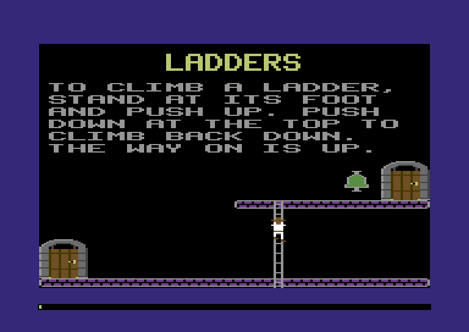
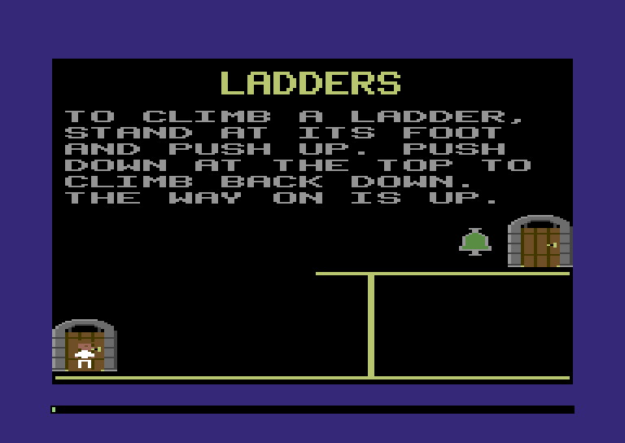
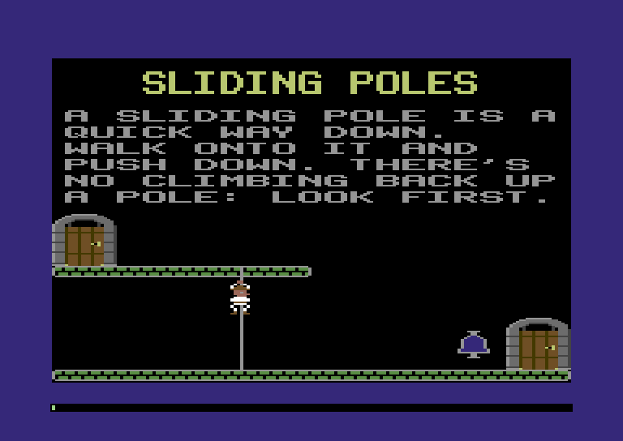

:::mission-briefing
Chapter 3 built a castle the explorer can't use. He shuffles along the
bottom of every room as if the walkways were painted on, and the ladders
might as well be wallpaper. This chapter teaches him the castle. By the
end he walks every floor of the Training Castle, stops where a walkway
stops, lines himself up with a ladder and climbs it, and drops down the
sliding poles, all the way to the right-hand edge of the screen. The wall
he hit in Chapter 1 is gone.



Two ideas do the work. The explorer moves onto the castle's own
coordinates, which fit the whole screen into a byte. And every room gets
a **navigation grid**: a byte for each cell of the screen saying which
ways are open, written once while the room is drawn, so each step is one
read.

New under the hood: **fixed-width integers, overflow and wrapping**, and
**a 2D grid stored as one flat run of bytes**. Chapter 2's **flags
byte** comes back with a new job.
:::

## The wall made of arithmetic

Back in Chapter 1, the explorer walked right and stopped three quarters
of the way across the screen, at nothing. His X was a byte, and a byte
stops at 255. Chapter 1 promised the story of what happens when numbers
outgrow their bytes, and how the 1984 game fits its coordinates into one
without losing the edge of the screen. Here it is.

### Every number has a size

In Zig every integer has a type, and the type says how many bits it
gets. A `u8` is 8 bits, unsigned: 0 to 255. A `u16` is 16 bits: 0 to
65,535. Zig lets you pick any width at all: a `u3` holds 0 to 7, which is
why Chapter 3's castle map sizes were `u3`s. An `i8` is a **signed** 8-bit
number, −128 to 127 (how a byte holds a minus sign is coming up in this
chapter, and it's a good trick).

Fixed width means a sum can need more bits than its type has. 255 + 1
is 256, and 256 needs a ninth bit. That's **overflow**, and the hardware
has a blunt answer: it keeps the low 8 bits and drops the rest, the way
a car's odometer rolls from 99999 to 00000. 255 + 1 comes out as 0. The
answer is wrong, and nothing says so.

Zig won't let that happen by accident. An ordinary `+`, `-` or `*` that
overflows is a bug as far as Zig is concerned, and in a **Debug** build
(what `zig build`, `zig build run` and `zig build test` make) or a
**ReleaseSafe** build (what `zig build wasm` makes for the browser) the
game stops on the spot with `panic: integer overflow` (and, in a native
build, the line that did it). The two fast build modes, ReleaseFast and ReleaseSmall, leave the
check out to save the time it costs, and then an overflow is *undefined*:
you might get the wrapped number, or the optimiser might have built code
that does something stranger. So the checks are worth keeping on.

When you *want* the odometer, you say so with a different operator, and
you've already met them:

| Operator | What 250 + 10 gives in a `u8` | Where you've seen it |
|---|---|---|
| `+` | stops the game: `panic: integer overflow` | everywhere |
| `+%` | **wraps**: 4 (260 − 256) | `game_tick` (Chapter 2), `-%` in `kindOf` (Chapter 3) |
| `+\|` | **saturates**: stops at 255 | a door's panel position (Chapter 3) |

There are `-%`, `*%`, `-|` and `*|` to match. And when a value changes
size there are three tools, two of which you've used since Chapter 2:
`@as(u16, x)` widens (always safe, a `u8` always fits in a `u16`);
`@intCast` narrows, with a check that panics if the value doesn't fit;
`@truncate` narrows on purpose and keeps only the low bits.

Chapter 2 left a question hanging here: what happens when a byte like
`left`, the letter position in `text.draw`, overflows? Now you know: the
game would stop. That's why Chapter 2's `draw` stopped at the right edge
before `left += 8` could carry it past 255, and why Chapter 3's, which
walks on to a string's last letter, counts in a `u16`.

:::under-the-hood Numbers that never overflow (until they do)
In JavaScript, `255 + 1` is `256` and always will be. Every number is a
64-bit floating-point value, and whole numbers are exact up to 2⁵³
(`Number.MAX_SAFE_INTEGER`, about nine quadrillion). Python goes further:
its integers grow as big as memory allows. Neither language ever asks
how many bits a number needs.

The cost is hidden. As far as the language is concerned, every JS number
is an 8-byte float, a player's X included; on the Comet 64 that would be
eight times the memory for every coordinate. The one place JavaScript does
use bytes, it wraps without a word: `const a = new Uint8Array(1); a[0] =
256;` leaves `a[0]` at `0`. Zig makes you choose: a checked `+` that
stops the game, or a `+%` that says "I meant that".
:::

### A byte for the whole width

So what's the trick? The castle already uses it. Since Chapter 3, every
object's X is a **fat pixel plus 16**: X = 16 is the left edge of the
screen, and X = 175 is the last fat pixel on the right. The whole width
of the screen fits in a byte with 80 to spare. Put the explorer on the
same scale and the wall is gone, because 160 fat pixels is a smaller
number than 320 screen pixels.

The VIDEO chip still wants screen pixels. A fat pixel is two of them,
and castle X 16 has to land on sprite X 24, the display's left edge, so
sprite X is `2x − 8`: 342 at the screen's last fat pixel, more than a byte. The chip keeps the
ninth bit of every sprite's X in `$D010`, one bit per sprite, as the
reference card's section 4 says. The natural first try looks like this:

```zig snippet
m.poke(hw.spriteX(n), x * 2 - 8);
```

It compiles. Zig works out `x * 2` in `x`'s own type, a `u8`, so any
castle X of 128 or more overflows. The explorer starts the Gatehouse at
X 162, so the game stops the moment the room appears (your thread number
and addresses will differ):

```
thread 14449 panic: integer overflow
src/sprites.zig:45:29: 0x11ee151 in place (main.zig)
    m.poke(hw.spriteX(n), x * 2 - 8);
                            ^
```

The fix is to do the sum in a type that's big enough, then split it: the
low eight bits to the X register and the ninth to `$D010`. Here's 330,
the explorer at the right-hand end of a floor:

```
  330 as a u16:   0000 0001 │ 0100 1010
                          │      └──── low 8 bits: $4A = 74 → $D000 (sprite 0's X)
                          └─────────── bit 8: 1 → $D010, bit 0 (sprite 0's ninth bit)
```

Sprite conversion belongs with the other sprite code:

**`src/sprites.zig`** (add an import below `hw`)

```zig
const video = machine.video;
```

**`src/sprites.zig`** (add at the end of the file)

```zig
/// Put sprite `n`'s top-left corner at castle point (x, y). A fat pixel is
/// two of the VIDEO chip's pixels and castle X 16 is its X 24, so its X
/// is 2x - 8: 342 at the screen's last fat pixel, a nine-bit number. The
/// ninth bit goes in $D010.
pub fn place(m: *Machine, n: u3, x: u8, y: u8) void {
    const sx = @as(u16, x) * 2 - 8;
    const bit = @as(u8, 1) << n;
    const others = m.peek(hw.sprite_x_msb) & ~bit;
    m.poke(hw.spriteX(n), @truncate(sx)); // the low eight bits
    m.poke(hw.sprite_x_msb, if (sx > 0xFF) others | bit else others);
    m.poke(hw.spriteY(n), y + video.sprite_origin_y);
    m.work(20); // the doubling, the masks and the test
}
```

`@as(u16, x)` widens before anything is multiplied, so the sum has room.
`@truncate` keeps the low byte for the X register; that's dropping bits
on purpose, not by accident. `$D010` holds a bit for each of the eight
sprites, so `place` changes only sprite `n`'s, with Chapter 2's masks:
`& ~bit` clears it, `| bit` sets it, and the other seven bits come back
as they were. (Castle X below 4 would make `2x − 8` negative, and the
`-` would stop the game. Nothing ever stands that far off the screen.)

### Into a doorway

The player's two position bytes change their meaning:

**`src/map.zig`** (replace the `player_x` and `player_y` lines)

```zig
pub const player_x = player.first + 0; // castle X of his left edge: fat pixel + 16
pub const player_y = player.first + 1; // castle Y of his top: the pixel row
```

Because the explorer now shares the castle's coordinates, he can start
somewhere the castle names: in front of a door. Chapter 5 brings the
door he really walked through; until then he appears in the room's first
door, which is quick to find, because doors are the first group in every
stream (Chapter 3's tag order). `room.zig` gets a way to find a room's
objects without painting anything, and the first door among them:

**`src/room.zig`** (replace `prepare`)

```zig
/// Get room `n` ready to draw: paint the floor pieces its colour, and
/// return a walker at the start of its objects.
fn prepare(m: *Machine, n: u8) castle.Walker {
    const final = n == castle.roomCount(m);
    paint(m, if (final) both(@intFromEnum(final_color)) else roomColors(m, n));
    return .{ .at = objects(m, n) };
}

/// Where room `n`'s objects start. The room after the last is the final
/// room.
pub fn objects(m: *Machine, n: u8) u16 {
    if (n == castle.roomCount(m)) return m.peek16(castle.final_room);
    return m.peek16(castle.entry(m, n) + @offsetOf(castle.Entry, "objects"));
}

/// The room's first door, if it has one. Doors come first in a stream.
pub fn firstDoor(m: *Machine) ?u16 {
    var walk = castle.Walker{ .at = objects(m, m.peek(map.room_number)) };
    const first = walk.next(m) orelse return null;
    return if (first.kind == .door) first.at else null;
}
```

Now the player. He needs the castle's left edge and its door records:

**`src/player.zig`** (add an import below `map`, and delete the `video` import above it)

```zig
const map = @import("map.zig");
const castle = @import("castle.zig");
```

**`src/player.zig`** (replace `min_x`, `max_x` and `floor_y`, and the comment above them)

```zig
/// How far he may go, in castle X: from the left edge of the screen to
/// the right edge, less about his own width.
const min_x = castle.left_edge;
const max_x = castle.left_edge + 160 - 8;

/// His feet: the point the grid is read at, 3 fat pixels in from his left
/// edge and 21 rows down from his top, the row his boots stand on.
const feet_x = 3;
const feet_y = 21;

/// Where he appears in a doorway: in the middle, boots on the sill.
const door_x = 6;
const door_y = 11;
```

`min_x` and `max_x` are the screen's edges in castle X, so there's no
wall at 255 any more. The feet and doorway numbers are new. **His feet**
are the point where he meets the floor, and they're about to matter a
great deal. **The doorway** offsets put him in the middle of a door's
opening with his boots on its sill. A door is 32 rows tall and his boots
are 21 rows below his top, so he starts 11 rows below the door's top.

**`src/player.zig`** (replace `enter`)

```zig
/// Into the room, in its first doorway, facing into the room. A room with
/// no doors (the final room) puts him in the middle of the floor.
pub fn enter(m: *Machine) void {
    var x: u8 = castle.left_edge + 80;
    var y: u8 = room.floor_top - feet_y;
    if (room.firstDoor(m)) |at| {
        const door = m.view(castle.Door, at);
        x = door.x + door_x;
        y = door.y + door_y;
    }
    m.poke(map.player_x, x);
    m.poke(map.player_y, y);
    setFrame(m, if (x < castle.left_edge + 80) .explorer_right_0 else .explorer_left_0);
    m.poke(hw.sprite_enable, 0b0000_0001); // bit 0 on: sprite 0 is shown
}
```

**`src/player.zig`** (replace `show`)

```zig
/// Copy the player's position, colour and frame into the VIDEO chip.
pub fn show(m: *Machine) void {
    sprites.place(m, sprite, m.peek(map.player_x), m.peek(map.player_y));
    m.poke(hw.spriteColor(sprite), m.peek(map.player_color));
    m.poke(hw.sprite_pointers + sprite, m.peek(map.player_block));
}
```

`enter` starts him in the doorway, facing into the room (the middle of
the screen is castle X 96). A room with no doors, which is only the final
room, puts him on the floor in the middle. `show` hands his castle
position to `place`.

One more thing changes. His X used to count screen pixels, one step a
frame; now one step of X is a whole fat pixel, two screen pixels. The
1984 game moves the explorer one **step** every other frame, 25 steps a
second, so a fat pixel a step is exactly the speed he walked
before:

**`src/player.zig`** (in `steer`, add at the top)

```zig
    if (m.peek(map.game_tick) & 1 != 0) return; // the castle's pace: 25 steps a second
```

**`src/player.zig`** (in `steer`, replace the walk-frame comment and the line below it)

```zig
    // Bits 1 and 2 of x count 0, 1, 2, 3 as he walks, a new frame every
    // two fat pixels. Standing still, he stands on frame 0.
    const step = if (walking) (x >> 1) & 0b11 else 0;
```

`game_tick` goes up by one every frame (Chapter 2), so its bit 0 is 0 on
every other frame. The walk frame now comes from bits 1 and 2 of `x`, so
he still changes picture every four screen pixels.

The test from Chapter 2 that walked him four pixels now fails: he starts
somewhere else and walks at half the steps. Here's its replacement, and
a helper that holds the stick down for a while:

:::type-in The new walking test
**`src/main.zig`** (replace the first test)

```zig
test "fire on the title screen opens the room, and the explorer walks in" {
    const m = try std.testing.allocator.create(Machine);
    defer std.testing.allocator.destroy(m);
    m.boot(@This());

    _ = m.runFrame(@This()); // draws the title
    try std.testing.expectEqual(machine.FrameKind.loading, m.last.kind);
    try std.testing.expectEqual(@intFromEnum(Mode.title), m.ram[map.game_mode]);

    m.input = .{ .joy1 = machine.joy.fire };
    _ = m.runFrame(@This()); // the press
    m.input = .{};
    _ = m.runFrame(@This()); // draws the room
    try std.testing.expectEqual(@intFromEnum(Mode.room), m.ram[map.game_mode]);

    // In the Gatehouse's doorway, on the right, past the old wall at 255.
    try std.testing.expectEqual(156 + 6, m.ram[map.player_x]);
    try std.testing.expectEqual(160 + 11, m.ram[map.player_y]);
    _ = m.runFrame(@This());
    try std.testing.expect(m.ram[hw.sprite_x_msb] & 1 != 0);
    const block = m.ram[map.player_block];

    // A step every other frame: eight frames is four fat pixels to the
    // left, and a new frame of the walk, in the other block.
    hold(m, machine.joy.left, 8);
    try std.testing.expectEqual(158, m.ram[map.player_x]);
    try std.testing.expect(m.ram[map.player_block] != block);
    try std.testing.expectEqual(@intFromEnum(shapes.Id.explorer_left_3), m.ram[map.player_frame]);
}
```

**`src/main.zig`** (add at the end of the file)

```zig
/// Hold joystick 1's `stick` switches for `frames` frames, then let go.
fn hold(m: *Machine, stick: u8, frames: usize) void {
    m.input = .{ .joy1 = stick };
    for (0..frames) |_| _ = m.runFrame(@This());
    m.input = .{};
}
```
:::

Build, run, press fire. He's standing in the Gatehouse's doorway, on the
right-hand side of the screen, at sprite X 316. **That's past the wall.**
Walk him left and right: edge to edge, the whole width of the screen. In
the Sliding Poles room (press N three times) he starts by the upper door
and strolls on past the end of its walkway, in mid-air, because nobody
has told him where the floors are. That's next.

## The castle's floor plan

You know how in old platformers you have to line up with a ladder before
you can climb it, and how a walkway's end is as far as you go, no matter
how hard you push? Under all of that is one question the game asks every
step: **from here, which ways can he go?**

The castle knows the answer, spread across its records. A walkway runs
from its X for its length; a ladder runs down from its top rung. The
JavaScript way to answer is to ask the castle each time:
`walkways.some(w => w.y === feetY && feetX >= w.x && ...)`, and the same
for the ladders and the poles, every step. On the Comet that means walking
the room's object stream from its first byte, text and all, 25 times a
second. We'll measure what that costs at the end of the chapter. The 1984
game asks once, when the room is drawn, and writes the answers down.

### A byte for every cell

The answers go in a grid with one entry per **cell**, the screen's 8×8
squares: 4 fat pixels across and 8 rows down, 40 cells by 25. That's the
right size because everything you can walk on is built from cell-sized
pieces. A walkway piece is one cell wide, ladders and poles are one cell
wide, and the Training Castle puts every one of them on whole cells.

Each cell's answer is a byte of flags, like Chapter 2's sprite flags
byte: each bit is one switch. Here the switches are directions. Number
the eight directions clockwise from up, 0 to 7, and give direction *d*
bit *d*:

```
  bit:     7       6      5       4       3       2      1       0
       ┌───────┬──────┬───────┬──────┬───────┬───────┬──────┬──────┐
       │up-left│ left │dn-left│ down │dn-rght│ right │up-rgt│  up  │
       └───────┴──────┴───────┴──────┴───────┴───────┴──────┴──────┘
           -     $40      -     $10      -      $04     -     $01
```

:::widget byte-diagram
A cell's ways byte: hover any cell of the Ladders room to see its eight
bits, with the four that can be set lit up when they are.
:::

A bit that's set means "you can leave this cell that way". Only the
four straight directions are ever set; the odd bits are diagonals, and no
object in any castle sets them. Why number them at all, then? Because
the joystick gives us a direction number too, and then "is that way
open?" is one test: `ways & (1 << d)`. A cell on the middle of a walkway
is `$44`, left and right. A rung in the middle of a ladder is `$11`, up
and down.

Chapter 3 read the room's size byte through a `packed struct(u8)`, which
names its bits. That's the better tool when your code asks for bits by
name. Here we want to pick a bit by its *number*, so plain masks fit
better.

### A grid is a row of bytes

:::widget memory-map
The memory map with the new 1,000-byte navigation grid at `$C800` lit up;
hovering a byte shows its cell's column, row and ways out.
:::

:::under-the-hood `grid[y][x]` versus one flat buffer
In JavaScript a grid is usually an array of arrays: `grid[y][x]`. That's
26 objects: the outer array and 25 row arrays, each allocated somewhere
on the heap by itself, each with a hidden header. Reading a cell follows
a pointer to the row first, and each row carries its own header and
spare capacity.

The flat version is `new Uint8Array(40 * 25)` with `grid[y * 40 + x]`.
It's 1,000 bytes in one block, row 0 first, then row 1, and so on, with
no pointers anywhere. That's the grid we're building.
:::

Row after row in one run of memory means cell (col, row) is
`row × 40 + col` bytes in:

```
  byte:   0    1    2   ...  39   40   41  ...  79   80  ...      999
       ┌────┬────┬────┬───┬────┬────┬────┬───┬────┬────┬───┬────┐
       │ c0 │ c1 │ c2 │...│c39 │ c0 │ c1 │...│c39 │ c0 │...│c39 │
       └────┴────┴────┴───┴────┴────┴────┴───┴────┴────┴───┴────┘
         └──────── row 0 ──────┘└─────── row 1 ──────┘    row 24
```

That's the same numbering the screen plane and colour RAM use, so cell
*n* of the grid sits under cell *n* of the screen. And `row × 40` doesn't
need Chapter 2's 120-cycle multiply: 40 is 32 + 8, so it's `(row << 5) +
(row << 3)`, two shifts and an add.

Going from a castle X to a column has a neat trick in it. Divide by 4
for the fat pixels in a cell. The castle's 16 is then exactly four
cells, so take 4 away: column = `x / 4 − 4`. For anything from X 16 onward
that's exact. For an X below 16 (Chapter 3 lets objects hang off the
left edge) `x / 4 − 4` is below zero, a `u8` can't hold it, and the `-`
stops the game. So `column` says "no column" for X off the screen, with
Chapter 2's optional, `?u8`.

The grid needs a home. There's a free kilobyte between the sprite frames
and the screen plane, from `$C800`, and 1,000 bytes fit with 24 to
spare:

**`src/map.zig`** (add below the row table)

```zig
/// The navigation grid: one byte for each of the screen's 40 x 25 cells,
/// saying which ways the explorer can go from there (grid.zig).
pub const grid = Region{ .name = "navigation grid", .first = 0xC800, .last = 0xC800 + 40 * 25 - 1 };
```

**`src/map.zig`** (in `regions`, add after `sprite_frames,`)

```zig
    grid,
```

**`src/grid.zig`** (new file)

```zig
//! The navigation grid: one byte for each 8x8 cell of the screen, saying
//! which ways the explorer can leave it. Built while a room is drawn, so
//! that every step he takes is a single read.

const machine = @import("machine");
const Machine = machine.Machine;
const map = @import("map.zig");
const castle = @import("castle.zig");

/// The grid has the screen's shape: 40 cells across, 25 down, each one
/// 4 fat pixels wide and 8 rows tall.
pub const columns = 40;
pub const rows = 25;

/// Directions are numbered clockwise from up, 0 to 7, and bit d of a
/// cell's byte is set when direction d is open. Only the four straight
/// directions are ever set; the diagonals (the odd bits) never are.
pub const up: u8 = 0b0000_0001; // direction 0
pub const right: u8 = 0b0000_0100; // direction 2
pub const down: u8 = 0b0001_0000; // direction 4
pub const left: u8 = 0b0100_0000; // direction 6

/// Every cell closed, before a room adds its walkways, ladders and poles.
pub fn clear(m: *Machine) void {
    m.fill(map.grid.first, columns * rows, 0);
}

/// The grid column under castle X `x`, or null off the screen. Castle X
/// counts from 16, which is exactly four cells, so the column is x / 4 - 4.
pub fn column(x: u8) ?u8 {
    if (x < castle.left_edge or x >= castle.left_edge + 160) return null;
    return x / 4 - 4;
}

/// The address of cell (col, row). The grid is one run of bytes, a row
/// after a row, so the cell is row * 40 + col bytes in.
pub fn cell(m: *Machine, col: u8, row: u8) u16 {
    m.work(16); // row * 40 is row * 32 + row * 8: two shifts and an add
    const r: u16 = row;
    return map.grid.first + (r << 5) + (r << 3) + col;
}

/// The ways out of the cell under castle point (x, y). There are none off
/// the screen.
pub fn at(m: *Machine, x: u8, y: u8) u8 {
    const col = column(x) orelse return 0;
    if (y >= 8 * rows) return 0;
    return m.peek(cell(m, col, y / 8));
}
```

`at` is the whole cost of a step's question: a test, two shifts and an
add, one `peek`. Twenty cycles.

### Writing it down

Now the rules for what each kind of record writes, the 1984 game's
rules exactly, so that real castles play right when they load in
Chapter 11:

- **A walkway** opens right from its first piece, left from its last,
  and both ways in between. Walking off the end is impossible because the
  end piece has no way out in that direction.
- **A ladder** opens down from its top rung, up from its bottom rung,
  and both ways in between. Its top and bottom rungs sit on walkways, so
  those cells are walkway cells too, and the bits add up.
- **A pole** opens down from every piece, and never up.

**`src/grid.zig`** (add at the end of the file)

```zig
/// The ways out of piece `i` (counting from 1) of a walkway, ladder or
/// pole `length` pieces long.
fn piece(kind: castle.Kind, i: u8, length: u8) u8 {
    return switch (kind) {
        // Right from the first piece, left from the last, both in between.
        .walkway => if (i == 1) right else if (i == length) left else left | right,
        // Down from the top rung, up from the bottom one, both in between.
        .ladder => (if (i != 1) up else 0) | (if (i != length) down else 0),
        // Every piece of a pole slides you down. There's no way back up.
        .pole => down,
        else => 0,
    };
}

/// Add a record's cells to the grid, if it's a walkway, a ladder or a
/// pole: a walkway's pieces run right from (x, y), the others' down.
pub fn add(m: *Machine, r: castle.Record) void {
    switch (r.kind) {
        .walkway, .ladder, .pole => {},
        else => return, // nothing else in a room is somewhere to walk
    }
    const o = m.view(castle.Run, r.at);
    var x = o.x;
    var y = o.y;
    var i: u8 = 1;
    while (i <= o.length and x < castle.left_edge + 160 and y < 8 * rows) : (i += 1) {
        if (column(x)) |col| {
            const a = cell(m, col, y / 8);
            m.poke(a, m.peek(a) | piece(r.kind, i, o.length));
        }
        if (r.kind == .walkway) x += 4 else y += 8;
        m.work(16); // the tests, the sums and the loop
    }
}
```

`add` takes any record from Chapter 3's walker and ignores the ones that
aren't walkways, ladders or poles. For the rest it steps along the
record's pieces, right for a walkway and down for the others, ORs each
piece's ways into its cell, and stops at the screen's edge. That edge is
also why `i += 1` can never overflow: a walkway runs out of screen after
40 pieces and a ladder after 25, long before `i` reaches 255.

The room builds its grid as it draws, from the same walk over the
stream, so the grid can never disagree with the picture:

**`src/room.zig`** (add an import below `castle`)

```zig
const grid = @import("grid.zig");
```

**`src/room.zig`** (replace the comment above `draw` and its first line)

```zig
/// Draw the whole room, and build its navigation grid on the way. Far
/// too big for one frame: call it with the display blanked.
pub fn draw(m: *Machine) void {
    screen.clear(m);
    grid.clear(m);
```

**`src/room.zig`** (in `draw`, add after the `switch` statement's closing brace, inside the loop)

```zig
        grid.add(m, r); // walkways, ladders and poles: places to walk
```

### The pole that went through the floor

Look at the pole rule again: *every* piece opens down, even the last.
That's how the 1984 game does it, and it means a pole must stop one cell
*above* the floor. Then the explorer slides off the last piece into the
floor's cell, which has no way down, and lands. A pole whose last piece
sits on the floor would hand him a way down out of the floor itself, and
he'd slide straight through it.

Chapter 3's builder insisted that poles end *on* a walkway, like ladders.
Fix the rule:

**`src/author.zig`** (in `checkRoom`, replace the loop over ladders and poles)

```zig
    // A ladder's bottom rung stands on the walkway below it. A pole stops
    // one row short: every piece of a pole slides you down, even the last.
    const columns = [_]struct { runs: []const Run, kind: []const u8, short: u16 }{
        .{ .runs = room.ladder, .kind = "ladder", .short = 0 },
        .{ .runs = room.pole, .kind = "pole", .short = 8 },
    };
    for (columns) |col| {
        for (col.runs, 0..) |r, i| {
            const what = std.fmt.comptimePrint("{s} {d}", .{ col.kind, i });
            if (r.length == 0) fail("room {s}: {s} has length 0, which is the end marker", .{ name, what });
            const bottom = r.y + 8 * (r.length - 1);
            _ = onScreen(name, what, r.x, r.y, 4, bottom + 8 - r.y);
            if (!onWalkway(room, r.x, r.y) or !onWalkway(room, r.x, bottom + col.short))
                fail("room {s}: {s} must start on a walkway and end {s} one (top piece row {d}, bottom piece row {d})", .{ name, what, if (col.short == 0) "on" else "just above", r.y, bottom });
        }
    }
```

and build. The new rule catches the Training Castle straight away:

```
castle: room poles: pole 0 must start on a walkway and end just above one (top piece row 128, bottom piece row 192)
```

Chapter 3 drew the Sliding Poles pole one piece too long, and the
Entrance Hall's too (only the tests build the hall). On screen you'd never
know, because the last piece disappears into the floor's bricks. In the
grid, it's a hole:

**`src/training.zig`** (in the `poles` room, replace the pole)

```zig
            .pole = &.{.{ .length = 8, .x = 72, .y = 128 }},
```

**`src/hall.zig`** (replace the pole's bytes)

```zig
    0x09, 0x08, 15, 64, 72, 0, // one sliding pole
```

**`src/hall.zig`** (in `plan`, replace the pole)

```zig
        .pole = &.{.{ .length = 15, .x = 64, .y = 72 }},
```

### Seeing the grid

The grid is invisible, which makes it hard to trust. So let's give the
game a switch that draws it. Press **G** and the room is drawn again with
the grid over it. Drawing a room puts the explorer back in its doorway,
so look first, then walk. A second switch, **S**, waits for the end of
the chapter.

**`src/map.zig`** (add below the `room` region)

```zig
/// Two switches for looking inside the game (debug.zig): 0 off, 1 on.
pub const debug = Region{ .name = "debug", .first = 0x020A, .last = 0x020B };
pub const debug_grid = debug.first + 0; // G: draw the navigation grid over the room
pub const debug_search = debug.first + 1; // S: search the castle instead of reading the grid
```

**`src/map.zig`** (in `regions`, add after `room,`)

```zig
    debug,
```

**`src/debug.zig`** (new file)

```zig
//! Two switches for looking inside the game. G draws the navigation grid
//! over the room; S makes the explorer search the castle for his way
//! instead of reading the grid, so the meter can show what that costs.

const machine = @import("machine");
const Machine = machine.Machine;
const Color = machine.Color;
const hw = machine.hw;
const map = @import("map.zig");
const grid = @import("grid.zig");

/// G or S on the keyboard flips its switch. True if the room needs drawing
/// again (the grid view does; the search doesn't).
pub fn keys(m: *Machine) bool {
    const key = m.peek(hw.key);
    const flag = switch (key) {
        'G' => map.debug_grid,
        'S' => map.debug_search,
        else => return false, // N, P and the rest are room.flip's
    };
    m.poke(hw.key, 0); // seen it
    m.poke(flag, m.peek(flag) ^ 1);
    m.work(12);
    return key == 'G';
}

/// With the grid view on, redraw every cell that has a way out as a map
/// of its ways, in yellow: a block in the middle, and an arm out to each
/// side he can leave by. Walkways turn into lines, ladders into rails.
pub fn overlay(m: *Machine) void {
    if (m.peek(map.debug_grid) == 0) return;
    var n: u16 = 0; // the grid, the screen plane and colour RAM all number cells alike
    while (n < grid.columns * grid.rows) : (n += 1) {
        const ways = m.peek(map.grid.first + n);
        m.work(6); // the test and the loop
        if (ways == 0) continue;
        // One bitmap byte is a row of the cell's four fat pixels.
        const middle: u8 = 0b00_11_11_00; // fat pixels 1 and 2, code 11
        const across = middle | (if (ways & grid.left != 0) @as(u8, 0b11_00_00_00) else 0) |
            (if (ways & grid.right != 0) @as(u8, 0b00_00_00_11) else 0);
        const above: u8 = if (ways & grid.up != 0) middle else 0;
        const below: u8 = if (ways & grid.down != 0) middle else 0;
        const pattern = [8]u8{ above, above, above, across, across, below, below, below };
        var at = hw.bitmap + n * 8; // the cell's eight bitmap bytes
        for (pattern) |row| {
            m.poke(at, row);
            at += 1;
        }
        m.poke(hw.color_ram + n, @intFromEnum(Color.yellow)); // code 11 in this cell
        m.work(30); // the tests and the loop
    }
}
```

`keys` handles G and S and leaves every other key for `room.flip`.
`overlay` walks the grid cell by cell, counting `n` as it goes, which
works because the grid, the screen plane and colour RAM number their
cells the same way. Each open cell is redrawn as a little map of its
ways. It's Chapter 2's packing at work: a bitmap byte is one row of a
cell's four fat pixels, so `0b00_11_11_00` is a block of code-11 pixels in
the middle, and the left or right pixel joins it when that way is open.
Turn the cell's colour-RAM byte yellow and every code-11 pixel in it
turns yellow too.

**`src/main.zig`** (add below the `player` import)

```zig
const debug = @import("debug.zig");
```

**`src/main.zig`** (in the `.draw_room` branch, add after `room.draw(m);`)

```zig
            debug.overlay(m);
```

**`src/main.zig`** (in the `.room` branch, replace the `room.flip` line)

```zig
            if (debug.keys(m) or room.flip(m)) setMode(m, .draw_room);
```

`debug.keys(m) or room.flip(m)` asks `keys` first; Zig's `or` only calls
`flip` if `keys` said no, which suits us, since `keys` has already taken
the key.

Build, run, press N twice for the Ladders room, then G:



There's the castle as the explorer will feel it. Each walkway is a line
that stops at its ends, and the ladder is a line joining the two
walkways, with a T where it meets each one. Press G again to put the bricks back.

## Steering by the grid

### Where his feet are

The grid is read at one point on the explorer: his feet, 3 fat pixels in
from his left edge and 21 rows down from his top, the row his boots
stand on. The cell under that point decides everything.

```
  x                       castle point (x, y): his top-left corner
  ┌────────┐
  │  hat   │
  │  face  │   21 rows
  │  coat  │
  │  legs  │
  └──•─────┘
     └──── his feet: (x + 3, y + 21), the point the grid is read at
```

With his boots on a walkway, `y + 21` is the walkway's top row, a
multiple of 8, so he's in the walkway's cell and "8 rows into it" is 0.

### The stick as a direction

The grid speaks in directions, so the joystick should too. The port's
four direction switches can read 16 ways, and a 16-entry table turns each
one into a direction, or `still` for nothing (and for nonsense like up
and down at once). The compiler fills the table using Chapter 1's `held`,
so active-low is still spelled out in one place only.

The player needs one more byte: which way his last step went. Put it in
the `player` region:

**`src/map.zig`** (replace the `player` region's comment and first line)

```zig
/// Everything the game knows about the player, seven bytes in a row.
pub const player = Region{ .name = "player", .first = 0x0200, .last = 0x0206 };
```

**`src/map.zig`** (add below `player_frame`)

```zig
pub const player_way = player.first + 6; // the direction of his last step, or $80 for none
```

and the build stops:

```
memory map: player overlaps game
```

The memory map has `game` starting at `$0206`, the byte we claimed.
That's what the overlap check is for. Move `game` and `room` up a byte:

**`src/map.zig`** (replace the `game` region's first line)

```zig
pub const game = Region{ .name = "game", .first = 0x0207, .last = 0x0208 };
```

**`src/map.zig`** (replace the `room` region's first line)

```zig
pub const room = Region{ .name = "room", .first = 0x0209, .last = 0x0209 };
```

Now the player. Delete `min_x` and `max_x` and the comment above them;
from now on the grid says where he can go. Add the grid's import, and
the tables below the `comptime` block:

**`src/player.zig`** (add an import below `castle`)

```zig
const grid = @import("grid.zig");
```

**`src/player.zig`** (add below the `comptime` block)

```zig
/// Directions run clockwise from 0, up, to 7, up and left: the grid's bit
/// numbers. `still` is no direction at all.
const still: u8 = 0x80;

/// The eight directions, laid out the way they are on the stick.
const compass = [3][3]u8{
    .{ 7, 0, 1 }, // up and left, up, up and right
    .{ 6, still, 2 }, // left, nothing, right
    .{ 5, 4, 3 }, // down and left, down, down and right
};

/// The direction for each of the 16 ways the stick's four direction
/// switches (the low four bits of its port) can read. Worked out by the
/// compiler with `held`; up and down together, or left and right, is still.
const stick_way: [16]u8 = blk: {
    var table: [16]u8 = undefined;
    for (&table, 0..) |*way, n| {
        const u = held(n, joy.up);
        const d = held(n, joy.down);
        const l = held(n, joy.left);
        const r = held(n, joy.right);
        const row: usize = if (u) 0 else if (d) 2 else 1;
        const col: usize = if (l) 0 else if (r) 2 else 1;
        way.* = if ((u and d) or (l and r)) still else compass[row][col];
    }
    break :blk table;
};

/// One step in each direction: fat pixels across, rows down. Added with
/// a wrapping +%, so 0xFF goes back 1 and 0xFE goes back 2.
const step_x = [8]u8{ 0, 1, 1, 1, 0, 0xFF, 0xFF, 0xFF };
const step_y = [8]u8{ 0xFE, 0xFE, 0, 2, 2, 2, 0, 0xFE };
```

`still` is `$80`, a direction that isn't one (directions only go to 7).
`compass` lays the directions out the way they sit on the stick, and the
block that fills `stick_way` picks a row (up, neither, down) and a column
(left, neither, right) for each of the 16 readings. Like every top-level
`const`, it runs in the compiler (Chapter 3), and `held` works there
because it's a plain function of two numbers.

`compass` is a 2D array, and here Zig differs from JavaScript in exactly
the way this chapter is about: a `[3][3]u8` is not three separate arrays
reached through pointers, it's nine bytes in a row, row after row. Zig
lays out an array of arrays the way we're laying out the grid. We could
even ask the machine for the grid as a `[25][40]u8` with Chapter 3's
`m.view`. We index it by hand instead, with `peek` and `poke`, because
those charge the meter for every read, and the meter is the point of this
chapter.

`step_x` and `step_y` say how far one step goes in each direction: a fat
pixel across and two rows up or down. They hold **no negative numbers**,
and they don't need to. That's the next trick.

### 255 is minus one

Add 255 to a byte and let it wrap. 10 + 255 is 265, and 265 − 256 is
9. Adding 255 with `+%` *is* subtracting 1. Adding 254 is subtracting 2.
This isn't a coincidence; it's how computers store negative numbers:

```
     0000 1010   10
  +  1111 1111   255, or −1 as an i8
  ───────────
   1 0000 1001   265: the ninth bit falls off the end, leaving 9
```

In an `i8`, the bit pattern `1111 1111` *means* −1, and `1111 1110` means
−2. That's **two's complement**: the negative numbers are the ones whose
top bit is set, arranged so that adding them with the ordinary wrapping
add works. The processor doesn't even know which kind of byte it's
adding. So the step tables store `0xFF` for "back one" and `0xFE` for
"back two", and `x +%= step_x[way]` moves him either way with one add.
(Zig would let us write the tables as `i8`s and convert with `@bitCast`,
which reuses the same bits under a new type, but the wrapping add makes
that unnecessary.)

### Taking a step

Into the room, he isn't going anywhere yet:

**`src/player.zig`** (in `enter`, add below the `player_y` line)

```zig
    m.poke(map.player_way, still);
```

Update the comment at the top of the file:

**`src/player.zig`** (replace the comment at the top)

```zig
//! Player 1: a multicolour sprite who walks the castle's floors, climbs its
//! ladders and slides down its poles, steered by joystick 1.
```

And the heart of the chapter, a new `steer`:

**`src/player.zig`** (replace `steer`)

```zig
/// One step every other frame: read the grid under his feet, pick a way
/// to go, take the step and pick his picture.
pub fn steer(m: *Machine) void {
    if (m.peek(map.game_tick) & 1 != 0) return; // the castle's pace: 25 steps a second
    var x = m.peek(map.player_x);
    var y = m.peek(map.player_y);
    const fx = x + feet_x;
    const fy = y + feet_y;
    const ways = waysAt(m, fx, fy);

    // The stick's direction if that way is open. If it isn't, but it's
    // next to the way he was already going (a diagonal, say), keep going.
    const want = stick_way[m.peek(hw.joy1) & 0x0F];
    const last = m.peek(map.player_way);
    var way = still;
    if (want != still) {
        if (ways & bit(want) != 0) {
            way = want;
        } else if (last != still and ways & bit(last) != 0 and
            (want == (last +% 1) & 7 or want == (last -% 1) & 7))
        {
            way = last;
        }
    }
    m.poke(map.player_way, way);

    if (way != still) {
        if (way & 3 == 2) y -= fy % 8; // off sideways: up onto the walkway's row
        if (way & 3 == 0) x = x - fx % 4 + 1; // up or down: feet in line with the rungs
        x +%= step_x[way];
        y +%= step_y[way];
        m.poke(map.player_x, x);
        m.poke(map.player_y, y);
    }
    m.work(60); // the sums, tests and table reads above

    // His picture: Chapter 2's walk, a frame every 2 fat pixels. Climbing,
    // sliding or still, he stands for now.
    const now = m.peek(map.player_frame);
    const first: u8 = if (way == 6 or (way != 2 and now >= left_0)) left_0 else right_0;
    const next = if (way == 2 or way == 6) first + ((x >> 1) & 0b11) else first;
    if (next != now) setFrame(m, @enumFromInt(next));
}
```

Then two helpers below it:

**`src/player.zig`** (add below `steer`)

```zig
/// The grid bit for direction `way` (0-7).
fn bit(way: u8) u8 {
    return @as(u8, 1) << @intCast(way);
}

/// The ways out of the cell under castle point (x, y): one byte from the
/// grid.
fn waysAt(m: *Machine, x: u8, y: u8) u8 {
    return grid.at(m, x, y);
}
```

Here's what a step does.

**Which way is open?** `ways` is the byte under his feet. If the stick's
direction is open, he goes that way. If it isn't, there's one more
chance, and it's what makes the stick feel right: if he's already moving
and the stick is pushed *next to* that direction (a diagonal, usually),
he keeps going. Walking right with the stick at up-and-right, he keeps
walking; on a ladder with the stick at down-and-left, he keeps climbing
down. "Next to" is one more or one less round the compass, and the
compass wraps: `(last +% 1) & 7` takes 7 to 0, and `(last -% 1) & 7`
takes 0 to 255 and then to 7. Wrapping arithmetic again, on purpose. (One reading note: Zig binds `&`
tighter than `==`, so `way & 3 == 2` means what it says. In JavaScript
you'd need `(way & 3) === 2`.)

**Lining up.** Up or down, his X is set so that his feet are one fat
pixel into the cell: `x - fx % 4 + 1`. Push up anywhere along a ladder's
cell and he snaps onto it, centred between the rails. Sideways, his Y is
pulled up to the cell's top row, `y -= fy % 8`, which matters at the top
of a ladder: the top rung's cell opens down, left and right, but not up,
so a climb ends with his boots six rows below the walkway. Push left or
right and he steps up onto it. That's the 1984 game's rule, and it's why
stepping off a ladder needs no instructions: you push the way you want
to go.

**The step** is the two table adds. Everything else, from stopping at a
walkway's end to not climbing a pole, falls out of the bits: there's no
code for any of it.

:::pro-tip Shifting by a direction
`bit` shifts 1 left by `way`, and `way` is a `u8`. Shift by it directly
and Zig refuses:

```
expected type 'u3', found 'u8'
```

It's Chapter 2's shift Pro Tip again: a `u8` shifts by a `u3`, because
shifting it 8 or more places would empty it. `@intCast(way)` converts
the `u8` to the `u3` the shift wants, with a check that panics if `way`
is 8 or more. It never is, and if a bug ever made it so, you'd hear
about it.
:::

Build and run, press N twice, and walk him right to the ladder. Push up.
**He climbs!** At the top, push right and he steps onto the walkway, and
right again takes him to the door, at the right-hand edge of the screen.
Try the Long Gallery (one N) and walk off the far end of its walkway:
you can't. In the Sliding Poles room, walk onto the pole and push down.
He climbs and slides standing bolt upright in his walking pose, which is
what we fix next.

## Climbing and sliding

Five new pictures: four climbing frames, seen from behind, and one for
sliding. New shapes go at the end of `Id`:

**`src/shapes.zig`** (in `Id`, add at the end, after `image`)

```zig
    explorer_climb_0,
    explorer_climb_1,
    explorer_climb_2,
    explorer_climb_3,
    explorer_slide,
```

Copy the new `art.zig` from the Warp Zone checkpoint
(`code/ch04/src/art.zig`) over yours. The climbing frames are two
drawings and their mirror images, and the slide is one drawing:

```zig snippet
/// Climbing, seen from behind, hands on the rails: one hand reaching for
/// the next rung while the other foot finds the last one. Then a frame
/// with both hands level, and both again the other way round.
pub const explorer_climb_0 = frame(.white, &.{
    "..1.....",
    "..233...",
    "..233...",
    ".333333.",
    "..3333..",
    "..3333..",
    "...11...",
    "..2221..",
    "..2222..",
    "..2222..",
    "..2222..",
    "..2222..",
    "..3333..",
    "..2222..",
    "..2..2..",
    "..2..2..",
    "..2..3..",
    "..2..33.",
    "..2.....",
    "..3.....",
    ".33.....",
});

pub const explorer_climb_2 = mirror(explorer_climb_0);
pub const explorer_climb_3 = mirror(explorer_climb_1);

/// Sliding down a pole: both hands gripping it above his hat, knees out
/// round it.
pub const explorer_slide = frame(.white, &.{
    "...11...",
    "...11...",
    "..2..2..",
    ".2.33.2.",
    ".233332.",
    ".333333.",
    "..1111..",
    "..11.1..",
    "..11111.",
    "...111..",
    "..2222..",
    ".222222.",
    ".222222.",
    "..3333..",
    "..2222..",
    ".2....2.",
    ".2....2.",
    "..2..2..",
    "..2..2..",
    "..3..3..",
    ".33..33.",
});
```

The climbing frames need to be in a row, like the walking ones, so the
`comptime` check grows:

**`src/player.zig`** (replace `right_0`, `left_0` and the `comptime` block)

```zig
const right_0 = @intFromEnum(shapes.Id.explorer_right_0);
const left_0 = @intFromEnum(shapes.Id.explorer_left_0);
const climb_0 = @intFromEnum(shapes.Id.explorer_climb_0);
comptime {
    if (left_0 != right_0 + 4 or @intFromEnum(shapes.Id.explorer_left_3) != left_0 + 3)
        @compileError("the explorer's eight frames must be in a row in shapes.Id");
    if (@intFromEnum(shapes.Id.explorer_climb_3) != climb_0 + 3)
        @compileError("the explorer's four climbing frames must be in a row in shapes.Id");
}
```

And the picture-picking end of `steer` learns about them:

**`src/player.zig`** (in `steer`, replace everything from `// His picture` to the end)

```zig
    // His picture. Walking: Chapter 2's walk, a frame every 2 fat pixels.
    // Up or down: a ladder has rungs that lead up from here or from just
    // below; a pole has none.
    const now = m.peek(map.player_frame);
    var next = now;
    if (way == 2 or way == 6) {
        next = (if (way == 2) right_0 else left_0) + ((x >> 1) & 0b11);
    } else if (way == 0 or way == 4) {
        const rungs = (ways | waysAt(m, fx, fy +| 8)) & grid.up != 0;
        next = if (rungs) climb_0 + ((y >> 2) & 0b11) else @intFromEnum(shapes.Id.explorer_slide);
    } else if (now >= right_0 and now < left_0 + 4) {
        next = if (now >= left_0) left_0 else right_0; // stopped walking: stand
    } // stopped on a ladder or a pole: hold on
    if (next != now) setFrame(m, @enumFromInt(next));
}
```

Walking is Chapter 2's walk. Going up or down, he's on a ladder if
there's a way **up** from his cell or from the one just below: a ladder's
top rung opens only down, but the rung under it opens up. Poles never
open up anywhere, so on a pole he slides. Climbing frames come from bits
2 and 3 of his Y, a new frame every 4 rows, and when he climbs down they
play backwards, which looks right. When he stops on a ladder or a pole he
holds on and keeps his picture. That includes the bottom of a pole: he
lands in his sliding pose and stays in it until you walk him off, as the
1984 explorer does. When he stops walking he stands.

Build and run. Now he climbs hand over hand and slides down the pole with
his knees round it.

## What the grid saved

The grid is fast, but how fast? There's one way to find out: try the
other way. Here's the explorer's question answered the JavaScript way,
by walking the room's whole stream and working out the cell from every
walkway, ladder and pole in it:

**`src/grid.zig`** (add at the end of the file)

```zig
/// The same answer as `at`, the slow way: no grid, only the castle. Walk
/// the room's whole object stream (from `objects`) and work out the cell
/// under castle point (x, y) from every walkway, ladder and pole in it.
pub fn search(m: *Machine, objects: u16, x: u8, y: u8) u8 {
    const col = column(x) orelse return 0;
    if (y >= 8 * rows) return 0;
    const row = y / 8;
    var ways: u8 = 0;
    var walk = castle.Walker{ .at = objects };
    while (walk.next(m)) |r| {
        switch (r.kind) {
            .walkway, .ladder, .pole => {},
            else => continue,
        }
        const o = m.view(castle.Run, r.at);
        m.work(24); // the tests and the sums
        // Which of its pieces, counting from 1, covers this cell?
        var i: u8 = 0;
        if (r.kind == .walkway) {
            if (o.y / 8 == row and o.x / 4 <= col + 4) i = col + 4 - o.x / 4 + 1;
        } else {
            if (o.x / 4 == col + 4 and o.y / 8 <= row) i = row - o.y / 8 + 1;
        }
        if (i != 0 and i <= o.length) ways |= piece(r.kind, i, o.length);
    }
    return ways;
}
```

For a walkway, the piece covering the cell is `col + 4 − x / 4 + 1`
(counting from 1, as `add` does); for a ladder or pole it's
`row − y / 8 + 1`. Then `piece` gives the same ways that `add` wrote into
the grid. Now let the S switch choose:

**`src/player.zig`** (replace `waysAt`)

```zig
/// The ways out of the cell under castle point (x, y): one byte from the
/// grid, or, with the S switch on, the slow way, from the castle itself.
fn waysAt(m: *Machine, x: u8, y: u8) u8 {
    if (m.peek(map.debug_search) != 0)
        return grid.search(m, room.objects(m, m.peek(map.room_number)), x, y);
    return grid.at(m, x, y);
}
```

:::widget toggle
Navigation grid on/off: the S switch, live, with the sprite bucket of the
budget meter beside it.
:::

Build, run, go to the Ladders room and walk. The meter's sprite bucket,
bucket 2, is where `steer` charges its cycles. Press S and walk again:

| Each step, in the Ladders room | Grid | Search (S) |
|---|---|---|
| finding the way out of one cell | 20 cycles | about 1,440 |
| a walking step | 204 | 1,626 |
| a climbing step, picture change included | 856 | 3,700 |

:::widget budget-meter
The frame budget, bucket by bucket, while the explorer climbs: once
reading the grid and once searching.
:::

A search costs between 1,100 and 1,650 cycles depending on the room, and
most of that is stepping over the room's text, letter by letter. The grid costs 20 in every room,
however full the room is. One explorer can afford to search: 3,700
cycles is a fifth of a frame. But everything that walks the castle asks
the same question every step, and later chapters fill a room with up to
eight sprites: a second explorer, mummies, Frankenstein's monsters. Eight
searchers climbing, two questions a step each, would spend 23,000 cycles
a step only asking, more than a whole frame, before anything has been
drawn. Eight grid readers spend 320.

:::power-up The Precompute Power-Up
When the answer to a question only changes when the world changes, work
it out when the world changes, not when you ask. The room changes once,
when it's drawn; the explorer asks 25 times a second. So the drawing pass
writes every answer into a table, and asking becomes one read. It's the
Lookup Table Power-Up from Chapter 2 with the table built at run time
instead of compile time: you spend memory (1,000 bytes) and a little time
up front (about 10,000 cycles, in a loading pause nobody feels), and every
step after that is cheap.
:::

:::byte-budget Chapter 4
**Memory.** The navigation grid is **1,000 bytes** at `$C800–$CBE7`. The
game's state grew by three bytes: `player_way` and the two debug
switches (and `game` and `room` moved up a byte to make room). The three
tables in `player.zig`, 32 bytes, live in the program image; the fourth,
`compass`, only exists while the compiler fills `stick_way`. The shape
table grew from 1,716 to 1,951 bytes with the five new frames (45 bytes
each, plus a directory entry).

**Time.** Building the grid adds 9,400 to 11,400 cycles to drawing a
room: 8,000 to clear it and the rest to mark the pieces. The worst room now
draws in 229,000 cycles, still 12 frame slots. In play, a frame between
steps costs 88 cycles; a step costs 196 to 228, plus about 630 when he
changes picture (Chapter 2's unpack).
:::

:::inside-the-disk Eight directions, four used
The 1984 game keeps its navigation grid at `$C000`: 32 rows of 40 cells,
**two bytes per cell**, 2,560 bytes in all, and the second byte of every
cell is never read. Its row lookups go through a 32-entry table of row ×
40, like our bitmap's row table. The direction bits are exactly ours,
and its movement code is ready for diagonals, checking the cell above
and to the side when the feet are at a cell's edge. No walkway, ladder
or pole ever sets a diagonal bit.

The same 16-entry table turns the stick into a direction, and the
explorer takes one step every two frames: 25 steps a second, a fat pixel
across or two rows up or down. The 1984 explorer is
a little shorter than ours: his feet are 3 fat pixels in and 17 rows
down. He also takes his pole pose for a moment when he starts down a
ladder, because the top rung's cell has no way up; ours looks one cell
further down before it picks his picture. And the grid isn't only written when a room is drawn. A trapdoor
that opens clears the bits that let you walk across it, and sets them
again when it shuts. Chapter 6 does the same.
:::

## Tests that walk the castle

Three kinds of test. One for `place`, including the ninth bit:

:::type-in The sprite-position test
**`src/sprites.zig`** (add at the end of the file)

```zig
// ---- tests ----------------------------------------------------------------

const std = @import("std");

test "castle X becomes sprite X, ninth bit and all" {
    const m = try std.testing.allocator.create(Machine);
    defer std.testing.allocator.destroy(m);
    m.* = .{};
    m.ram[hw.sprite_x_msb] = 0b1000_0010; // other sprites' ninth bits
    place(m, 0, 16, 0); // the left edge
    try std.testing.expectEqual(24, m.ram[hw.spriteX(0)]);
    try std.testing.expectEqual(0b1000_0010, m.ram[hw.sprite_x_msb]);
    try std.testing.expectEqual(50, m.ram[hw.spriteY(0)]);
    place(m, 0, 131, 171); // sprite X 254: the last before the old wall
    try std.testing.expectEqual(254, m.ram[hw.spriteX(0)]);
    try std.testing.expectEqual(0b1000_0010, m.ram[hw.sprite_x_msb]);
    place(m, 0, 169, 171); // sprite X 330 = 256 + 74
    try std.testing.expectEqual(74, m.ram[hw.spriteX(0)]);
    try std.testing.expectEqual(0b1000_0011, m.ram[hw.sprite_x_msb]);
    try std.testing.expectEqual(221, m.ram[hw.spriteY(0)]);
    place(m, 1, 20, 0); // sprite 1's bit, and only its bit, goes off
    try std.testing.expectEqual(0b1000_0001, m.ram[hw.sprite_x_msb]);
}
```
:::

And whole-game tests, which need the grid's names:

**`src/main.zig`** (add an import below `castle`)

```zig
const grid = @import("grid.zig");
```

:::type-in The floor plan's tests
**`src/main.zig`** (add above `hold`, at the end of the file)

```zig
test "the Ladders room's grid: walkways, a ladder, and the ways between" {
    const m = try std.testing.allocator.create(Machine);
    defer std.testing.allocator.destroy(m);
    inRoom(m, 2);
    const at = struct {
        fn at(mm: *Machine, col: u8, row: u8) u8 {
            return mm.ram[map.grid.first + @as(u16, row) * grid.columns + col];
        }
    }.at;
    // The floor, row 24: right from its first piece, left from its last.
    try std.testing.expectEqual(grid.right, at(m, 0, 24));
    try std.testing.expectEqual(grid.left | grid.right, at(m, 1, 24));
    try std.testing.expectEqual(grid.left, at(m, 39, 24));
    // The ladder, column 24: up from the floor, both ways on the rungs,
    // down from the upper walkway, whose first piece is column 20.
    try std.testing.expectEqual(grid.left | grid.right | grid.up, at(m, 24, 24));
    try std.testing.expectEqual(grid.up | grid.down, at(m, 24, 20));
    try std.testing.expectEqual(grid.left | grid.right | grid.down, at(m, 24, 16));
    try std.testing.expectEqual(grid.right, at(m, 20, 16));
    // And nothing where there's nothing to stand on.
    try std.testing.expectEqual(0, at(m, 19, 16));
    try std.testing.expectEqual(0, at(m, 10, 10));
}

test "searching the castle gives the grid's answer in every cell of every room" {
    const m = try std.testing.allocator.create(Machine);
    defer std.testing.allocator.destroy(m);
    inRoom(m, 0);
    for (0..std.enums.values(training.Room).len + 1) |n| {
        m.ram[map.room_number] = @intCast(n);
        room.draw(m);
        const objects = room.objects(m, @intCast(n));
        for (0..grid.rows) |row| {
            for (0..grid.columns) |col| {
                const x: u8 = @intCast(16 + 4 * col);
                const y: u8 = @intCast(8 * row);
                try std.testing.expectEqual(grid.at(m, x, y), grid.search(m, objects, x, y));
            }
        }
    }
}

test "a walkway's end is as far as you go" {
    const m = try std.testing.allocator.create(Machine);
    defer std.testing.allocator.destroy(m);
    inRoom(m, 1); // the Long Gallery: 35 pieces, columns 0 to 34
    hold(m, machine.joy.right, 400);
    try std.testing.expectEqual(149, m.ram[map.player_x]); // feet at 152, column 34's first fat pixel
    try std.testing.expectEqual(@intFromEnum(shapes.Id.explorer_right_0), m.ram[map.player_frame]); // standing
    hold(m, machine.joy.left, 400);
    try std.testing.expectEqual(16, m.ram[map.player_x]); // feet at 19, column 0's last
    try std.testing.expectEqual(160 + 11, m.ram[map.player_y]); // and never off the floor
}

test "he lines up with a ladder, climbs it, and steps off at the top" {
    const m = try std.testing.allocator.create(Machine);
    defer std.testing.allocator.destroy(m);
    inRoom(m, 2); // Ladders: the ladder is at x 112, from row 128 to the floor
    m.ram[map.player_x] = 111; // feet at 114: two fat pixels into the ladder's cell
    hold(m, machine.joy.up, 2);
    try std.testing.expectEqual(110, m.ram[map.player_x]); // feet at 113, between the rails
    try std.testing.expectEqual(171 - 2, m.ram[map.player_y]);
    try std.testing.expect(m.ram[map.player_frame] >= @intFromEnum(shapes.Id.explorer_climb_0));
    hold(m, machine.joy.up | machine.joy.right, 200); // a diagonal keeps him climbing
    try std.testing.expectEqual(128 - 21 + 6, m.ram[map.player_y]); // the top rung's cell
    try std.testing.expectEqual(110, m.ram[map.player_x]);
    hold(m, machine.joy.right, 2); // step off: up onto the walkway, and along
    try std.testing.expectEqual(128 - 21, m.ram[map.player_y]);
    try std.testing.expectEqual(111, m.ram[map.player_x]);
    hold(m, machine.joy.down, 200);
    try std.testing.expectEqual(192 - 21, m.ram[map.player_y]); // and back to the floor
}

test "a pole only goes down" {
    const m = try std.testing.allocator.create(Machine);
    defer std.testing.allocator.destroy(m);
    inRoom(m, 3); // Sliding Poles: the pole is at x 72, from row 128
    m.ram[map.player_x] = 72; // feet at 75, in the pole's cell
    hold(m, machine.joy.up, 20);
    try std.testing.expectEqual(128 - 21, m.ram[map.player_y]); // no climbing up a pole
    hold(m, machine.joy.down, 200);
    try std.testing.expectEqual(192 - 21, m.ram[map.player_y]); // down onto the floor
    try std.testing.expectEqual(70, m.ram[map.player_x]); // lined up with it on the way
    try std.testing.expectEqual(@intFromEnum(shapes.Id.explorer_slide), m.ram[map.player_frame]);
    hold(m, machine.joy.up, 20);
    try std.testing.expectEqual(192 - 21, m.ram[map.player_y]); // and no way back
}

/// Boot, press fire on the title, and stand in room `n`'s first doorway.
fn inRoom(m: *Machine, n: u8) void {
    m.boot(@This());
    _ = m.runFrame(@This()); // draws the title
    m.input = .{ .joy1 = machine.joy.fire };
    _ = m.runFrame(@This());
    m.input = .{};
    m.ram[map.room_number] = n; // instead of the castle's start room
    _ = m.runFrame(@This()); // draws the room
}
```
:::

They check the Ladders room's grid cell by cell (a floor's first and
last pieces, the rungs, the walkway the ladder meets); that the search
gives the grid's answer in every one of the 1,000 cells of every room,
the final room included; that the Long Gallery's walkway end is as far
as he goes; that he lines up with the ladder, climbs it with the stick
at a diagonal, steps off at the top and climbs back down; and that the
pole takes him down and never up. `inRoom` boots the game and pokes the
room number before the room is drawn, so a test can start anywhere.

:::game-over Common mistakes
- **`panic: integer overflow` in `place`.** The sum was done in a `u8`:
  `x * 2` overflows from castle X 128. Widen first, `@as(u16, x) * 2`.
- **`panic: integer overflow` in `column` or `add`.** An `x / 4 - 4` on
  an X below 16. Test first, as `column` does.
- **He stops six rows short of the top of a ladder.** Not a bug: that's
  the rule. Push left or right to step off.
- **He slides through the floor.** A pole ends on the floor instead of
  just above it. The builder refuses that in any castle it builds; in
  bytes typed by hand, count again.
- **He won't climb.** His feet aren't in the ladder's cell: walk a
  little closer, and push up again. If he never climbs anywhere, check
  that `room.draw` calls `grid.add` inside the loop, after the `switch`.
- **He runs at double speed.** The `game_tick` line at the top of `steer`
  is missing, so he steps every frame.
- **G does nothing.** `debug.overlay(m)` has to come after `room.draw(m)`
  in the `.draw_room` branch, or the room is drawn over the grid.
:::

:::boss-battle Climb, slide, and cross the screen
From your project folder:

```
zig build
zig build test
zig build run -- --frames 1000 --press 20:f:5 --key 60:N --key 100:N --press 120:r:176 --press 300:u:80 --press 390:r:130 --key 530:N --press 560:r:96 --press 660:d:80 --press 750:r:220 --dump-every 10
```

The run presses fire on the title and goes to the Ladders room, walks
right to the ladder, climbs it, steps off and walks to the door on the
far right. Then it goes on to Sliding Poles, walks to the pole, slides
down and walks to the right-hand edge. It prints:

```
ran 1000 frames (950 calls to frame)
cycles: max 229244 (1166%), avg 1428 (7%) of 19656
  bucket 0: max 318, avg 25
  bucket 1: max 228272, avg 1168
  bucket 2: max 956, avg 235
overruns: 0, loading pauses: 5
last frame: frames/frame_00999.ppm
```

`frame_00330.ppm` has him halfway up the ladder (the picture at the top
of the chapter), `frame_00520.ppm` at the upper door on the right, and
`frame_00690.ppm` on his way down the pole:



Then play it:

```
zig build wasm
python3 -m http.server -d web
```

Open <http://localhost:8000>, press Space, and explore: arrows to walk
and climb, N and P for rooms, G for the grid, S for the slow way.

**He knows the castle!** Every floor, ladder and pole in the Training
Castle works, read from 1,000 bytes that the room wrote down as it was
drawn. Next chapter, the doors open.
:::

:::warp-zone
The finished checkpoint is [`code/ch04/`](../code/ch04/), also as a
download, [`ch04.zip`](downloads/ch04.zip), which unzips into the same
`code/` folder as the others. The bulk file is
[`code/ch04/src/art.zig`](../code/ch04/src/art.zig). To start Chapter 5
from a known-good game, replace your project with it:

```
cd code
rm -rf my-creep
cp -r ch04 my-creep
rm -rf my-creep/.zig-cache my-creep/zig-out my-creep/web
```
:::

:::bonus-stage
- **A tower of ladders.** Add a room with ladders between three or four
  walkways, so that every floor can be reached. The builder checks the
  ends; the G switch shows you the paths.
- **A pole through a floor.** A pole that passes a middle walkway and
  goes on down: its piece in the walkway's cell opens down *and* left and
  right. Walk off at the middle, or keep sliding.
- **A faster explorer.** Take out the `game_tick` line and feel the
  castle at 50 steps a second. Then decide why 1984 chose 25.
- **A different grid view.** Draw each cell's bits as numbers, or colour
  ladder cells and walkway cells differently.
:::
