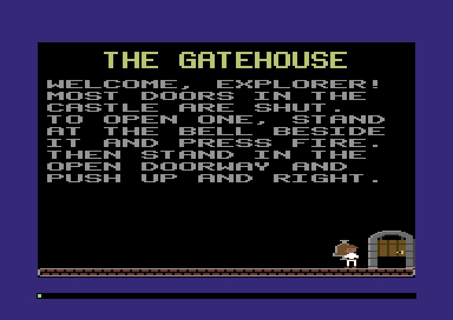
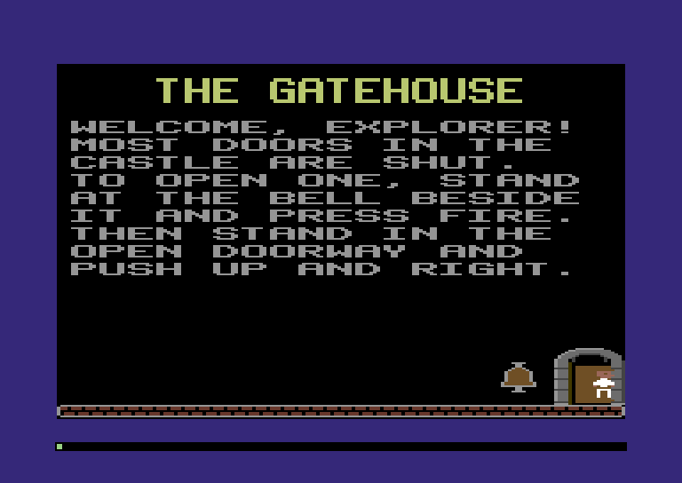
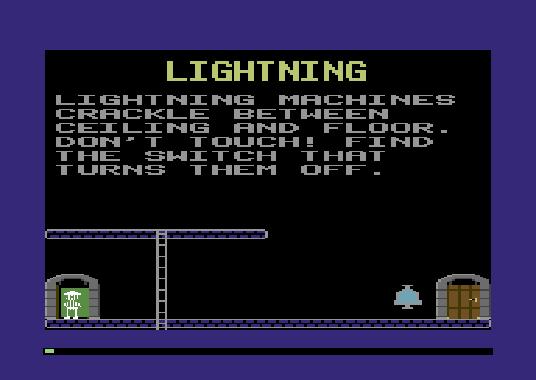

:::mission-briefing
The Gatehouse sign has said "ring the bell" since Chapter 3. This
chapter, it rings. Press fire at the bell and the door slides open; push
up and to the right and the explorer walks through into the next room.
By the end you can walk the whole Training Castle, and he can die.



New under the hood: **an array of structs is one block of memory**,
**fixed-capacity slot tables**, and **tables of functions**.
:::

## A castle full of things

A busy room late in a castle has explorers, monsters, a laser and
lightning on the move: up to eight things, one per sprite, and the Comet
has exactly eight. Around them stand a couple of dozen doors, switches,
keys and locks. Every frame the game visits all of them, and how they sit
in memory decides what that costs.

:::under-the-hood `monsters.push(new Monster())`
In JavaScript you'd write a class and keep a list:

```
class Monster {
  constructor(x, y) { this.x = x; this.y = y; }
  update() { /* chase the player */ }
}
const monsters = [];
monsters.push(new Monster(40, 100));
```

Every `new` takes a fresh piece of the **heap**, the pool of memory the
engine hands out as objects are made, wherever it finds room. So the
array holds **pointers**, and a dead monster waits for the garbage
collector. Python's lists work the same way. The 1984 game never has
more than eight movers, so it keeps **eight slots in one block of
memory** and marks the empty ones free. Nothing to follow, allocate or
collect.
:::

:::diagram ch05-slots
Three monsters in JavaScript, eight actors in 1984.
:::

### Sixteen bytes an actor

Anything that moves by itself is an **actor**, and slot *n* of the actor
table goes with sprite *n*. The explorer moves into slot 0 with his
position, picture and last step. The `player` region keeps only what the
game remembers about him *between* rooms: his slot, status, lives, last
joystick byte (still `$0203`) and the door he came in by.

**`src/map.zig`** (replace the `player` region, its comment and its seven bytes)

```zig
/// What the game knows about player 1 from room to room, five bytes in a
/// row. Where he is and what he's doing in a room is his actor's business
/// (actors.zig).
pub const player = Region{ .name = "player", .first = 0x0200, .last = 0x0204 };
pub const player_actor = player.first + 0; // the actor slot he has in this room
pub const player_status = player.first + 1; // a player.Status: playing, in a doorway, gone, dead
pub const player_lives = player.first + 2; // lives left, counting this one
pub const player_last_stick = player.first + 3; // joystick 1 as it read at his last turn
pub const player_door = player.first + 4; // the door he comes into the room by
```

**`src/map.zig`** (add below the row table)

```zig
/// The actor table: a 16-byte slot for each of the VIDEO chip's eight
/// sprites (actors.zig).
pub const actors = Region{ .name = "actors", .first = 0xBD00, .last = 0xBD00 + 8 * 16 - 1 };
```

**`src/map.zig`** (in `regions`, add after `row_table,`)

```zig
    actors,
```

Now the slot itself, in a new file:

**`src/actors.zig`** (new file)

```zig
//! The actor table: everything in a room that moves by itself, as a
//! sprite. Eight slots in a row, one for each of the VIDEO chip's
//! sprites: slot n is sprite n. The explorer is the only kind of actor so
//! far; lightning, lasers and monsters move in later.

const std = @import("std");
const machine = @import("machine");
const Machine = machine.Machine;
const hw = machine.hw;
const map = @import("map.zig");
const shapes = @import("shapes.zig");
const sprites = @import("sprites.zig");
const player = @import("player.zig");

/// Where something is and how big: its top-left corner in castle
/// coordinates, and its size in fat pixels and rows. Actors and objects
/// both start with one.
pub const Box = extern struct { x: u8, y: u8, width: u8, height: u8 };

/// One slot: 16 bytes.
pub const Actor = extern struct {
    kind: Kind,
    state: State,
    box: Box, // where it is, and the size of its picture
    frame: u8, // the shape ID of its picture
    block: u8, // the sprite block showing it: n or n + 8
    color: u8, // its sprite's own colour
    countdown: u8, // engine steps until its next turn
    pace: u8, // engine steps from one turn to the next: 1 is every step
    flashes: u8, // flashes left while it's dying
    way: u8, // the direction of its last step
    stick: u8, // the direction its joystick read at its last turn
    fire: u8, // 1 if fire was pressed at its last turn
    walk: u8, // how far through a doorway it is
};

/// An actor's state: eight flags in one byte, the engine's to-do list.
pub const State = packed struct(u8) {
    unused: bool = false, // bit 0: the slot is empty
    hit_sprite: bool = false, // bit 1: its sprite touched another sprite
    hit_bitmap: bool = false, // bit 2: its sprite touched the room's foreground
    free: bool = false, // bit 3: empty the slot at the end of this step
    destroy: bool = false, // bit 4: its last turn: it tidies up, then it's freed
    dying: bool = false, // bit 5: flickering
    flash: bool = false, // bit 6: start dying
    created: bool = false, // bit 7: new this step
};
```

`Box` is a corner and a size. Objects start with one too, and overlapping
boxes are how we'll tell an actor is in front of something. `Actor` is
sixteen bytes of `u8`s, so it's an `extern struct` with no padding
(Chapter 3):

:::diagram ch05-actor
:::

`state` is eight flags in a `packed struct(u8)`, in 1984's bit order.
`destroy` is an actor's last turn, and `free` empties its slot after
this step. The two hit flags come from the VIDEO chip, and they're the
best trick in the chapter. They wait for the doorbell.

:::widget byte-diagram
The actor table live: eight 16-byte rows at `$BD00`, slot 0's fields named and its `state` split into flags.
:::

### A table of functions

Each kind of actor does something different on its turn. The engine
walks the table without knowing what, so it needs a way from a slot's
`kind` byte to the right code.

**`src/actors.zig`** (add at the end of the file)

```zig
/// Every kind of actor. Later chapters add more.
pub const Kind = enum(u8) { player, _ };

/// What each kind does: the function that takes its turn.
const Behaviour = struct {
    turn: *const fn (m: *Machine, n: u3) void,
};

/// One entry for every kind, found by number. The compiler won't build
/// the table with a kind missing.
const kinds = std.enums.directEnumArray(Kind, Behaviour, 0, .{
    .player = .{ .turn = player.turn },
});
```

`*const fn (m: *Machine, n: u3) void` is a **function pointer**. Code
lives at addresses too, and a function pointer is the address where a
function's code starts. `player.turn`, without the brackets that would
call it, *is* that address, so `kinds[k].turn(m, n)` reads an address
from the table and calls the code there:

```
  slot 0:  kind = 0 ──► kinds[0] = .{ .turn = ──┐ }
                                                 └──► player.turn's code, in the program image
```

In JavaScript you'd look `turn` up by name in an object while the game
runs, and a missing entry is `undefined is not a function` mid-play.
Ours is looked up by number in an array, and a missing entry stops the
build: `std.enums.directEnumArray` takes a struct with a field for every
tag of `Kind` (like Chapter 3's `EnumFieldStruct`) and returns an array
with each tag's entry at the tag's number.

The `_` in `Kind` makes it **non-exhaustive**: any byte is a legal
`Kind`, which the machine insists on for a field read straight out of
memory (reference card, section 9). If a bug puts an unknown kind in a
slot, indexing `kinds` stops the game with an out-of-bounds panic instead
of jumping somewhere strange.

:::pro-tip `fn` or `*const fn`?
A bare `fn (...) void` is a function *type*, which only the compiler
deals in. `*const fn (...) void` is an address you can store and call
through, and that's what tables hold. A bare `fn` type in a struct field
makes the whole struct compile-time only.
:::

:::power-up The Jump Table Power-Up
When a value picks which code runs, keep the code's addresses in a table
and index it with the value. One read and one call, however many kinds,
and a new kind is a new row, not a new case in every `switch`.
:::

:::inside-the-disk Six kinds, eight bytes each
The 1984 engine keeps an eight-byte record per actor kind at `$088F`:
the addresses of its turn, its "hit a sprite" and its "hit an object"
routines, and two bytes of flags. Object kinds get two addresses each at
`$0842`, and zero means "this kind doesn't". It's the table you're
building, down to the empty entries.
:::

### Slots, not lists

Now the table, and the two things every slot table needs: emptying it
and finding a free slot.

**`src/actors.zig`** (add at the end of the file)

```zig
pub const slots = 8;

comptime {
    if (@sizeOf(Actor) * slots != map.actors.last - map.actors.first + 1)
        @compileError("the actor table doesn't fill its region exactly");
}

/// The whole table, as the eight structs it is.
pub fn table(m: *Machine) *align(1) [slots]Actor {
    return m.view([slots]Actor, map.actors.first);
}

/// Slot `n`.
pub fn slot(m: *Machine, n: u3) *align(1) Actor {
    return &table(m)[n];
}

/// Empty every slot, before a room starts.
pub fn clear(m: *Machine) void {
    for (table(m)) |*a| {
        a.state = .{ .unused = true };
        m.work(10); // the store and the loop
    }
}

/// Take the first empty slot for a new actor of `kind`: every byte 0,
/// then `created`, and a turn every step. Null if all eight are taken.
pub fn add(m: *Machine, kind: Kind) ?u3 {
    for (table(m), 0..) |*a, i| {
        m.work(10); // the test and the loop
        if (!a.state.unused) continue;
        const n: u3 = @intCast(i);
        m.fill(map.actors.first + @as(u16, n) * @sizeOf(Actor), @sizeOf(Actor), 0);
        a.kind = kind;
        a.state = .{ .created = true };
        a.block = @as(u8, n) + 8; // so its first picture goes into block n
        a.countdown = 1;
        a.pace = 1;
        m.work(20);
        return n;
    }
    return null;
}
```

`table` is the big idea in one line. It's Chapter 3's typed view aimed at
an *array* of structs, and in Zig an array of structs is exactly the
diagram above: eight `Actor`s, 128 bytes, nothing between them.
`table(m)[5]` is the 16 bytes at `$BD50`, and `slot(m, 5).box.x` is the
byte at `$BD52`. `*align(1)` says the struct may start at any address
(Chapter 3). The view costs nothing, so the loops charge `m.work`
for their own effort. `add` returns the first `unused` slot, wiped, or
`null` if all eight are taken.

:::power-up The Slot Table Power-Up
Decide the most you'll ever need, make that many slots in one block, and
give each a "free" flag. No allocator, no garbage collector, and the cost
is known before the game ships: eight actors, 128 bytes, always. The
price is a hard limit, and here the hardware sets it anyway.
:::

The rest of the file is what the engine does with the table every frame:

**`src/actors.zig`** (add at the end of the file)

```zig
/// Hand every actor to the VIDEO chip: where it is, its colour, its
/// picture, and which sprites are on at all. First thing in a frame.
pub fn show(m: *Machine) void {
    var on: u8 = 0;
    var multicolor: u8 = 0;
    for (table(m), 0..) |*a, i| {
        m.work(10); // the test and the loop
        if (a.state.unused) continue;
        const n: u3 = @intCast(i);
        const bit = @as(u8, 1) << n;
        on |= bit;
        multicolor |= bit;
        sprites.place(m, n, a.box.x, a.box.y);
        m.poke(hw.spriteColor(n), a.color);
        m.poke(hw.sprite_pointers + n, a.block);
        m.work(10); // the masks
    }
    m.poke(hw.sprite_enable, on);
    m.poke(hw.sprite_multicolor, multicolor);
}

/// One engine step for every actor, in slot order: each one whose
/// countdown runs out takes its turn.
pub fn step(m: *Machine) void {
    for (table(m), 0..) |*a, i| {
        m.work(10); // the test and the loop
        if (a.state.unused) continue;
        const n: u3 = @intCast(i);
        if (a.state.destroy) {
            kinds[@intFromEnum(a.kind)].turn(m, n); // its last turn
        } else {
            a.countdown -= 1;
            if (a.countdown != 0) continue;
            kinds[@intFromEnum(a.kind)].turn(m, n);
        }
        if (a.state.free) a.state = .{ .unused = true };
        a.countdown = a.pace;
        m.work(30); // the flags
    }
}

/// Show picture `id` for actor `n` from the next frame on. It's unpacked
/// into the block the sprite *isn't* showing (Chapter 2's double buffer),
/// and its size becomes the box the actor touches things with.
pub fn setFrame(m: *Machine, n: u3, id: shapes.Id) void {
    const a = slot(m, n);
    const hidden = a.block ^ 8; // n <-> n + 8
    const at = shapes.address(m, id);
    a.box.width = m.peek(at) * 4; // bytes to fat pixels
    a.box.height = m.peek(at + 1);
    const flags = sprites.unpack(m, id, hidden);
    a.color = flags & sprites.flag_color;
    a.block = hidden;
    a.frame = @intFromEnum(id);
    m.work(16); // the stores
}
```

**`show`** is Chapter 1's shadow copy for every actor at once.
**`setFrame`** is Chapter 2's double-buffered unpack, moved here for
every actor; it also sets the box's size, so what you see is what you
touch.

**`step`** is one **engine step**, run every other frame. Each actor's
`countdown` drops by one a step, and at 0 the actor takes its turn and
the countdown restarts from `pace`. An actor marked `destroy` gets its
last turn straight away, and one marked `free` becomes `unused`, so slots
are emptied by the engine, never in the middle of anyone's turn.

### The explorer moves in

The explorer's code now uses his slot instead of the old `player` bytes,
and `actors` instead of `sprites`:

**`src/player.zig`** (replace the comment at the top)

```zig
//! Player 1: the explorer, an actor of kind `player`. He walks the
//! castle's floors, climbs its ladders, slides down its poles and goes
//! through its doors, steered by joystick 1.
```

**`src/player.zig`** (replace the `sprites` import)

```zig
const actors = @import("actors.zig");
```

Delete the `sprite` constant and its comment: his sprite is his slot
number now. `start` sets the two colours all multicolour sprites share:

**`src/player.zig`** (replace `start`)

```zig
/// Once, at power-on.
pub fn start(m: *Machine) void {
    m.poke(hw.sprite_mc0, @intFromEnum(Color.pink)); // code 01: skin
    m.poke(hw.sprite_mc1, @intFromEnum(Color.orange)); // code 11: hat, belt, boots
    m.poke(map.player_last_stick, 0xFF); // nothing held
}
```

`enter` becomes `add`, which puts him in a slot and a doorway:

**`src/player.zig`** (replace `enter`)

```zig
/// Into the room: an actor slot, and his place in its first doorway,
/// facing into the room. A room with no doors (the final room) puts him in
/// the middle of the floor.
pub fn add(m: *Machine) void {
    const n = actors.add(m, .player) orelse return; // he's the first in, so never
    m.poke(map.player_actor, n);
    const a = actors.slot(m, n);
    a.box.x = castle.left_edge + 80;
    a.box.y = room.floor_top - feet_y;
    a.way = still;
    if (room.firstDoor(m)) |at| {
        const d = m.view(castle.Door, at);
        a.box.x = d.x + door_x;
        a.box.y = d.y + door_y;
    }
    m.work(40); // the sums and the stores
    actors.setFrame(m, n, if (a.box.x < castle.left_edge + 80) .explorer_right_0 else .explorer_left_0);
}
```

`show` goes. In its place, his turn and the joystick reader it uses:

**`src/player.zig`** (replace `show`)

```zig
/// His turn, actor `n`'s: on every engine step.
pub fn turn(m: *Machine, n: u3) void {
    const a = actors.slot(m, n);
    a.state.created = false;
    read(m, a);
    steer(m, n);
}

/// Read joystick 1, once a turn: its direction, and whether fire is down
/// now and wasn't at his last turn. The port byte is kept for next time here
/// and nowhere else in a room, so a fire button held down is never a
/// fresh press, however far he carries it.
fn read(m: *Machine, a: *align(1) actors.Actor) void {
    const stick = m.peek(hw.joy1);
    a.stick = stick_way[stick & 0x0F];
    a.fire = @intFromBool(pressed(stick, m.peek(map.player_last_stick)));
    m.poke(map.player_last_stick, stick);
    m.work(16); // the table read and the test
}
```

`read` settles Chapter 2's warning about `pressedFire`. If he only looked
at fire while standing at a bell, the edge detector's memory of the
stick would be stale, and a button held all the way across the room
would look like a fresh press. So `read` runs on every turn, is the one
place that stores `player_last_stick`, and records the direction and
"fire pressed this turn" in his slot.

`steer` hardly changes, except that its `game_tick` test goes: the engine
step sets everybody's pace now.

:::type-in `steer`, reading and writing his slot
**`src/player.zig`** (replace `steer`)

```zig
/// One step: read the grid under his feet, pick a way to go, take the
/// step and pick his picture.
fn steer(m: *Machine, n: u3) void {
    const a = actors.slot(m, n);
    var x = a.box.x;
    var y = a.box.y;
    const fx = x + feet_x;
    const fy = y + feet_y;
    const ways = waysAt(m, fx, fy);

    // The stick's direction if that way is open. If it isn't, but it's
    // next to the way he was already going (a diagonal, say), keep going.
    const want = a.stick;
    const last = a.way;
    var way = still;
    if (want != still) {
        if (ways & bit(want) != 0) {
            way = want;
        } else if (last != still and ways & bit(last) != 0 and
            (want == (last +% 1) & 7 or want == (last -% 1) & 7))
        {
            way = last;
        }
    }
    a.way = way;

    if (way != still) {
        if (way & 3 == 2) y -= fy % 8; // off sideways: up onto the walkway's row
        if (way & 3 == 0) x = x - fx % 4 + 1; // up or down: feet in line with the rungs
        x +%= step_x[way];
        y +%= step_y[way];
        a.box.x = x;
        a.box.y = y;
    }
    m.work(60); // the sums, tests and table reads above

    // His picture. Walking: Chapter 2's walk, a frame every 2 fat pixels.
    // Up or down: a ladder has rungs that lead up from here or from just
    // below; a pole has none.
    const now = a.frame;
    var next = now;
    if (way == 2 or way == 6) {
        next = (if (way == 2) right_0 else left_0) + ((x >> 1) & 0b11);
    } else if (way == 0 or way == 4) {
        const rungs = (ways | waysAt(m, fx, fy +| 8)) & grid.up != 0;
        next = if (rungs) climb_0 + ((y >> 2) & 0b11) else @intFromEnum(shapes.Id.explorer_slide);
    } else if (now >= right_0 and now < left_0 + 4) {
        next = if (now >= left_0) left_0 else right_0; // stopped walking: stand
    } // stopped on a ladder or a pole: hold on
    if (next != now) actors.setFrame(m, n, @enumFromInt(next));
}
```
:::

Delete `setFrame` from `player.zig`, and split the press test out of
`pressedFire`:

**`src/player.zig`** (replace `pressedFire`)

```zig
/// Was fire pressed this frame? For the title screen, where there's no
/// actor yet. It keeps the stick for next time, so call it once a frame.
pub fn pressedFire(m: *Machine) bool {
    const stick = m.peek(hw.joy1);
    const yes = pressed(stick, m.peek(map.player_last_stick));
    m.poke(map.player_last_stick, stick);
    m.work(10);
    return yes;
}

/// Is fire pressed now that wasn't before? The Edge Detector Power-Up as
/// a plain function of two port bytes: no memory of its own.
pub fn pressed(stick: u8, before: u8) bool {
    return held(stick, joy.fire) and !held(before, joy.fire);
}
```

Now the frame. The room branch shows every actor, and every other frame
runs an engine step in a bucket of its own:

**`src/main.zig`** (add below the `player` import)

```zig
const actors = @import("actors.zig");
```

**`src/main.zig`** (add below `bucket_sprites`)

```zig
const bucket_actors = 3;
```

**`src/main.zig`** (in the `.draw_room` branch, replace `player.enter(m);`)

```zig
            actors.clear(m);
            player.add(m);
```

**`src/main.zig`** (in the `.room` branch, replace everything from `m.bucket(bucket_sprites);` to `player.steer(m);`)

```zig
            m.bucket(bucket_sprites);
            actors.show(m);

            // Then the castle itself, one engine step every other frame:
            // 25 a second. What it decides shows up next frame.
            if (m.peek(map.game_tick) & 1 == 0) {
                m.bucket(bucket_actors);
                actors.step(m);
            }
```

The tests still poke at the old `player` bytes. Find and replace these in
`main.zig`'s tests (any you miss won't compile):

| Replace | With |
|---|---|
| `m.ram[map.player_x]` | `explorer(m).box.x` |
| `m.ram[map.player_y]` | `explorer(m).box.y` |
| `m.ram[map.player_frame]` | `explorer(m).frame` |
| `m.ram[map.player_block]` | `explorer(m).block` |

and add the function they now call:

**`src/main.zig`** (add above `inRoom`)

```zig
/// The explorer's actor slot.
fn explorer(m: *Machine) *align(1) actors.Actor {
    return actors.slot(m, @intCast(m.ram[map.player_actor]));
}
```

:::type-in The slot table's tests, and the press rule's
**`src/actors.zig`** (add at the end of the file)

```zig
// ---- tests ----------------------------------------------------------------

test "eight slots: add takes the first empty one, and a full table says no" {
    const m = try std.testing.allocator.create(Machine);
    defer std.testing.allocator.destroy(m);
    m.* = .{};
    clear(m);
    for (0..slots) |i| try std.testing.expectEqual(@as(?u3, @intCast(i)), add(m, .player));
    try std.testing.expectEqual(@as(?u3, null), add(m, .player));
    try std.testing.expect(slot(m, 3).state.created);
    try std.testing.expectEqual(3 + 8, slot(m, 3).block);

    // Free slot 3 the way the engine does, and the next actor gets it.
    slot(m, 3).state.free = true;
    step(m);
    try std.testing.expect(slot(m, 3).state.unused);
    try std.testing.expectEqual(@as(?u3, 3), add(m, .player));
    try std.testing.expectEqual(@as(?u3, null), add(m, .player));
}

test "the table is one block: slot n is 16 n bytes in, in the field order" {
    try std.testing.expectEqual(16, @sizeOf(Actor));
    try std.testing.expectEqual(2, @offsetOf(Actor, "box"));
    try std.testing.expectEqual(1, @bitSizeOf(State) / 8);
    const m = try std.testing.allocator.create(Machine);
    defer std.testing.allocator.destroy(m);
    m.* = .{};
    slot(m, 5).box.x = 99;
    try std.testing.expectEqual(99, m.ram[map.actors.first + 5 * 16 + 2]);
    slot(m, 5).state = .{ .unused = true, .flash = true };
    try std.testing.expectEqual(0b0100_0001, m.ram[map.actors.first + 5 * 16 + 1]);
}
```

**`src/player.zig`** (add at the end of the file)

```zig
// ---- tests ----------------------------------------------------------------

const std = @import("std");

test "a press is fire held now and not before, whatever else is held" {
    const none: u8 = 0xFF;
    const fire: u8 = 0xFF & ~joy.fire;
    try std.testing.expect(pressed(fire, none));
    try std.testing.expect(!pressed(fire, fire)); // still held: not a press
    try std.testing.expect(!pressed(none, fire)); // let go
    try std.testing.expect(!pressed(none, none));
    try std.testing.expect(pressed(fire & ~joy.right, none & ~joy.right)); // walking and pressing
}
```
:::

Build and run. Nothing looks different, and that's the point: he's actor
0 now, and everything he does goes through the table. A frame costs about
twice what it did, because `show` and `step` visit all eight slots, but
it's a fixed price: an empty slot costs one test.

:::widget budget-meter
The frame budget by bucket in the Gatehouse: Chapter 4 beside Chapter 5, then at the bell, while the door opens, and with C on.
:::

## A promise from Chapter 3

Chapter 3's `room.draw` picks each record's code with a `switch`. Now it
gets a table of functions too:

**`src/room.zig`** (add above the `machine` import)

```zig
const std = @import("std");
```

**`src/room.zig`** (replace `draw`)

```zig
/// What preparing a room does with each kind of record: a function for
/// every kind, found by number. The compiler won't build the table with a
/// kind missing.
const Prepare = *const fn (m: *Machine, r: castle.Record) void;
const prepares = std.enums.directEnumArray(castle.Kind, Prepare, 0, .{
    .door = door,
    .walkway = walkway,
    .pole = pole,
    .ladder = ladder,
    .bell = bell,
    .lightning = later,
    .forcefield = later,
    .mummy = later,
    .key = later,
    .lock = later,
    .pattern = later,
    .ray_gun = later,
    .teleport = later,
    .trapdoor = later,
    .conveyor = later,
    .frankenstein = later,
    .text = line,
    .image = image,
});

/// Draw the whole room, and build its navigation grid on the way, every
/// record handed to its kind's function. Far too big for one frame: call
/// it with the display blanked.
pub fn draw(m: *Machine) void {
    screen.clear(m);
    grid.clear(m);
    var walk = prepare(m, m.peek(map.room_number));
    while (walk.next(m)) |r| {
        m.work(10); // the table read and the call
        prepares[@intFromEnum(r.kind)](m, r);
    }
}

/// Machines and monsters come alive in later chapters.
fn later(m: *Machine, r: castle.Record) void {
    _ = m;
    _ = r;
}
```

Eleven kinds point at `later`, which does nothing until Chapter 6 starts
replacing them. Leave a kind out and the build stops:

```
missing struct field: image
```

Every function in the table must have the type `Prepare` says, so the
drawers now take a `castle.Record`, and the bell asks for its door by
number, with a function that replaces `firstDoor`:

**`src/room.zig`** (replace `firstDoor`)

```zig
/// Door `i` of room `n`, if the room has one. Doors come first in a
/// stream: their tag, a count, and 8 bytes for each door.
pub fn doorAt(m: *Machine, n: u8, i: u8) ?u16 {
    const at = objects(m, n);
    m.work(10); // the tests, and i * 8 is three shifts
    if (castle.kindOf(m, m.peek16(at)) != .door or i >= m.peek(at + 2)) return null;
    return at + 3 + @as(u16, i) * @sizeOf(castle.Door);
}
```

`doorAt` finds door `i` of any room, not only the one on screen. The rest
is new signatures, with `grid.add` moving into the drawers that build the
grid:

**`src/room.zig`** (replace the comment above `walkway` and its first two lines)

```zig
/// A walkway: `length` pieces 4 fat pixels wide, a left end, middles and
/// a right end. Somewhere to walk.
fn walkway(m: *Machine, r: castle.Record) void {
    grid.add(m, r);
    const w = m.view(castle.Run, r.at);
```

**`src/room.zig`** (add above `column`)

```zig
/// A sliding pole, and a ladder: somewhere to climb.
fn pole(m: *Machine, r: castle.Record) void {
    grid.add(m, r);
    column(m, .pole, r.at);
}

fn ladder(m: *Machine, r: castle.Record) void {
    grid.add(m, r);
    column(m, .ladder, r.at);
}
```

**`src/room.zig`** (in `door`, replace the first two lines)

```zig
fn door(m: *Machine, r: castle.Record) void {
    const d = m.view(castle.Door, r.at);
```

**`src/room.zig`** (replace `bell`)

```zig
/// A doorbell, in the colour of the room its door leads to.
fn bell(m: *Machine, r: castle.Record) void {
    const b = m.view(castle.Bell, r.at);
    const at = doorAt(m, m.peek(map.room_number), b.door) orelse return;
    const d = m.view(castle.Door, at);
    shapes.recolor(m, .bell, roomColors(m, d.to_room));
    place(m, .bell, b.x, b.y);
}
```

**`src/room.zig`** (in `line`, replace the first line)

```zig
fn line(m: *Machine, r: castle.Record) void {
    const at = r.at;
```

**`src/room.zig`** (in `image`, replace the first line)

```zig
fn image(m: *Machine, r: castle.Record) void {
    const at = r.at;
```

**`src/player.zig`** (in `add`, replace the `firstDoor` line)

```zig
    if (room.doorAt(m, m.peek(map.room_number), 0)) |at| {
```

and a test that every kind has a function:

**`src/room.zig`** (add at the end of the file)

```zig
// ---- tests ----------------------------------------------------------------

test "preparing a room has a function for every kind of record" {
    try std.testing.expectEqual(std.enums.values(castle.Kind).len, prepares.len);
}
```

Build and run: the castle draws as before.

## Things in the room

### The object table

An **object** is something an actor can stand in front of, or that has
work of its own: a door, a doorbell, later switches, keys and locks. 1984
gives the object table 32 slots of 16 bytes, the two pages from `$BE00`.

**`src/map.zig`** (add below the `actors` region)

```zig
/// The room's object table: 32 slots of 16 bytes (objects.zig).
pub const objects = Region{ .name = "objects", .first = 0xBE00, .last = 0xBE00 + 32 * 16 - 1 };
```

**`src/map.zig`** (in `regions`, add after `actors,`)

```zig
    objects,
```

The count of slots in use and how the room ends go in a new region at
`$020D` (`$020C` is saved for one last debug switch):

**`src/map.zig`** (add below the `debug` region)

```zig
/// The room at work: how many objects it has, and how it ends.
pub const engine = Region{ .name = "engine", .first = 0x020D, .last = 0x020E };
pub const engine_objects = engine.first + 0; // object slots in use (objects.zig)
pub const engine_ending = engine.first + 1; // steps until the room is over, or 0 while it isn't ending
```

**`src/map.zig`** (in `regions`, add after `debug,`)

```zig
    engine,
```

**`src/objects.zig`** (new file)

```zig
//! The room's object table: the things in a room that an actor can stand
//! in front of, or that have work to do. Preparing the room fills it, up
//! to 32 of them, 16 bytes each. Doors and doorbells, for now.

const std = @import("std");
const machine = @import("machine");
const Machine = machine.Machine;
const map = @import("map.zig");
const actors = @import("actors.zig");
const doors = @import("doors.zig");

/// One slot: 16 bytes.
pub const Object = extern struct {
    kind: Kind,
    flags: Flags,
    box: actors.Box, // the part an actor has to stand in front of
    record: u16, // where its record is in the castle
    number: u8, // a door: its place among the room's doors. A bell: its door's
    open: u8, // a door: 1 once it's open, or opening
    step: u8, // a door: rows of its panel still to wipe
    spare: [5]u8, // for the machines and monsters to come
};

/// An object's flags. Three are used by the engine; the low five are
/// each kind's own.
pub const Flags = packed struct(u8) {
    own: u5 = 0,
    picked: bool = false, // bit 5: picked up, so it leaves the table (keys)
    execute: bool = false, // bit 6: it has work to do: give it a turn every step
    disable: bool = false, // bit 7: nobody can stand in front of it
};

/// Every kind of object. Later chapters add more.
pub const Kind = enum(u8) { door, bell, _ };
```

`record` is our first `u16` in a structure. It starts at an even byte, so
Zig adds no padding and the machine accepts the view (Chapter 3's rule).
The flags byte has 1984's three: `disable` (nobody can stand in front of
it), `execute` (it has work to do) and `picked` (a taken key, Chapter 7).
The other five bits belong to each kind. Then the handlers:

**`src/objects.zig`** (add at the end of the file)

```zig
/// What each kind does: its work for a step while its `execute` flag is
/// set, and what happens when an actor stands in front of it. Null for
/// "nothing".
const Handlers = struct {
    execute: ?*const fn (m: *Machine, n: u8) void,
    in_front: ?*const fn (m: *Machine, n: u8, who: u3) void,
};

/// One entry for every kind, found by number.
const kinds = std.enums.directEnumArray(Kind, Handlers, 0, .{
    .door = .{ .execute = doors.open, .in_front = null },
    .bell = .{ .execute = null, .in_front = doors.ring },
});
```

This time the function pointers are **optional**, `?*const fn`: a bell
has nothing to do on its own, so its `execute` is `null`, and callers
check with Chapter 2's `if (x) |v|`.

:::diagram ch05-dispatch
From a kind byte to the code that runs: index, read, call.
:::

**`src/objects.zig`** (add at the end of the file)

```zig
pub const slots = 32;

comptime {
    if (@sizeOf(Object) * slots != map.objects.last - map.objects.first + 1)
        @compileError("the object table doesn't fill its region exactly");
}

/// Slot `n`.
pub fn slot(m: *Machine, n: u8) *align(1) Object {
    return &m.view([slots]Object, map.objects.first)[n];
}

/// No objects, before a room is prepared.
pub fn clear(m: *Machine) void {
    m.poke(map.engine_objects, 0);
}

/// Take the next slot for an object of `kind`, standing in `box`, made
/// from the castle record at `record`. Null if the table is full; then
/// the object is drawn, but nothing can use it.
pub fn add(m: *Machine, kind: Kind, box: actors.Box, record: u16) ?u8 {
    const n = m.peek(map.engine_objects);
    if (n == slots) return null;
    m.poke(map.engine_objects, n + 1);
    m.fill(map.objects.first + @as(u16, n) * @sizeOf(Object), @sizeOf(Object), 0);
    const o = slot(m, n);
    o.kind = kind;
    o.box = box;
    o.record = record;
    m.work(30); // the stores
    return n;
}
```

In a room with more than 32 objects, as in 1984, the rest are drawn and
do nothing.

**`src/objects.zig`** (add at the end of the file)

```zig
/// One engine step for the objects: the ones that asked to run, run.
/// Everything else costs one test of one bit.
pub fn step(m: *Machine) void {
    const count = m.peek(map.engine_objects);
    var n: u8 = 0;
    while (n < count) : (n += 1) {
        const o = slot(m, n);
        m.work(12); // the test and the loop
        if (!o.flags.execute) continue;
        if (kinds[@intFromEnum(o.kind)].execute) |execute| execute(m, n) else o.flags.execute = false;
    }
}

/// Actor `who` has touched the room's foreground. Find the objects its box
/// overlaps, and tell each one it has an actor standing in front of it.
pub fn touching(m: *Machine, who: u3) void {
    const a = actors.slot(m, who);
    const count = m.peek(map.engine_objects);
    var n: u8 = 0;
    while (n < count) : (n += 1) {
        const o = slot(m, n);
        m.work(12); // the test and the loop
        if (o.flags.disable or !overlap(m, a.box, o.box)) continue;
        if (kinds[@intFromEnum(o.kind)].in_front) |in_front| in_front(m, n, who);
    }
}

/// Do two boxes overlap? An edge that touches counts. The sums are done in
/// a u16, so a box at the right of the screen can't wrap round.
pub fn overlap(m: *Machine, a: actors.Box, b: actors.Box) bool {
    m.work(40); // four compares, four sums
    return @as(u16, a.x) + a.width >= b.x and @as(u16, b.x) + b.width >= a.x and
        @as(u16, a.y) + a.height >= b.y and @as(u16, b.y) + b.height >= a.y;
}
```

**`step`** costs one bit test per object. Most objects have nothing to
do most of the time: a shut door or an open one is standing still. Only
a door that's been rung has work, so the bell sets its `execute` flag,
and `step` runs only the objects whose flag is up. The flag *is* the
to-do list, and a finished job clears its own bit.

**`touching`** finds out what an actor has bumped into. **`overlap`**
says two boxes overlap unless one is entirely left of, right of, above or
below the other. The sums are `u16` because a box near the right edge
plus its width can pass 255 (Chapter 4's overflow lesson, coming due).

### Who's touching what

Who calls `touching`? Every actor against every object, every step, is
8 × 32 = 256 box tests in a busy room, and nearly all of them say "no".

The VIDEO chip can answer for free. As the beam draws, it sets a
sprite's bit in `$D01F` when one of its pixels lands on a **foreground**
pixel (codes `10` and `11`, reference card section 5), and in `$D01E`
when it lands on another sprite. Every object has foreground pixels,
so an actor that touched no foreground can't be in front of
anything:

:::diagram ch05-touching
The bell three ways: on screen, to the VIDEO chip, and to our code.
:::

Once a step the engine reads both registers, zeroes them, and copies
each actor's bit into `hit_bitmap` and `hit_sprite`. Only an actor with
`hit_bitmap` set looks through the objects. The hardware does
the rough test on every pixel, and our code the exact one only when it
might say yes.

**`src/actors.zig`** (add below the `sprites` import)

```zig
const objects = @import("objects.zig");
```

**`src/actors.zig`** (in `clear`, add at the end, and replace the comment above it)

```zig
/// Empty every slot, and forget any collisions, before a room starts.
pub fn clear(m: *Machine) void {
    for (table(m)) |*a| {
        a.state = .{ .unused = true };
        m.work(10); // the store and the loop
    }
    m.poke(hw.sprite_sprite_hits, 0);
    m.poke(hw.sprite_bitmap_hits, 0);
}
```

**`src/actors.zig`** (replace `step`)

```zig
/// One engine step for every actor, in slot order. The VIDEO chip's
/// collision reports come first, for free: an actor whose sprite touched
/// nothing in the room's foreground can't be standing in front of
/// anything, so only the ones that did look through the objects.
pub fn step(m: *Machine) void {
    const sprite_hits = m.peek(hw.sprite_sprite_hits);
    const bitmap_hits = m.peek(hw.sprite_bitmap_hits);
    m.poke(hw.sprite_sprite_hits, 0); // read them, then start again
    m.poke(hw.sprite_bitmap_hits, 0);
    for (table(m), 0..) |*a, i| {
        m.work(10); // the test and the loop
        if (a.state.unused) continue;
        const n: u3 = @intCast(i);
        const bit = @as(u8, 1) << n;
        a.state.hit_sprite = sprite_hits & bit != 0;
        a.state.hit_bitmap = bitmap_hits & bit != 0;
        if (a.state.destroy) {
            kinds[@intFromEnum(a.kind)].turn(m, n); // its last turn
        } else {
            a.countdown -= 1;
            if (a.countdown != 0) continue;
            if (a.state.hit_bitmap) objects.touching(m, n);
            kinds[@intFromEnum(a.kind)].turn(m, n);
        }
        if (a.state.free) a.state = .{ .unused = true };
        a.countdown = a.pace;
        m.work(30); // the flags
    }
}
```

`clear` clears the registers too, so the last room's hits can't leak into
the next. `hit_sprite` waits for Chapter 6's lightning.

### Ringing the bell

Doors and doorbells get a file of their own:

**`src/doors.zig`** (new file)

```zig
//! Doors and doorbells at work: a bell rung, a door swinging open.

const machine = @import("machine");
const Machine = machine.Machine;
const map = @import("map.zig");
const castle = @import("castle.zig");
const room = @import("room.zig");
const actors = @import("actors.zig");
const objects = @import("objects.zig");
const player = @import("player.zig");

/// A bell answers feet up to 12 fat pixels from its left edge.
const bell_reach = 12;

/// A bell's `in_front`: the explorer, at the bell, presses fire. If its
/// door is shut, the door gets to work.
pub fn ring(m: *Machine, n: u8, who: u3) void {
    const a = actors.slot(m, who);
    const bell = objects.slot(m, n);
    m.work(20); // the tests
    if (a.kind != .player or a.fire == 0) return;
    if (a.box.x +% player.feet_x -% bell.box.x >= bell_reach) return; // his feet aren't under it
    const d = objects.slot(m, find(m, bell.number) orelse return);
    if (d.open == 0) d.flags.execute = true;
}

/// The object for the room's door `number`.
fn find(m: *Machine, number: u8) ?u8 {
    const count = m.peek(map.engine_objects);
    var n: u8 = 0;
    while (n < count) : (n += 1) {
        const o = objects.slot(m, n);
        m.work(12); // the tests and the loop
        if (o.kind == .door and o.number == number) return n;
    }
    return null;
}

/// A door's `execute`, from the step after its bell rang. The first time,
/// it opens in the castle, on both sides; then its panel is wiped a row a
/// step, from the bottom up, and last of all it's drawn open.
pub fn open(m: *Machine, n: u8) void {
    const o = objects.slot(m, n);
    m.work(20); // the tests
    if (o.open == 0) {
        o.open = 1;
        o.step = room.door_panel_height - 1;
        const d = m.view(castle.Door, o.record);
        d.side |= castle.door_open;
        if (room.doorAt(m, d.to_room, d.to_door)) |far| m.view(castle.Door, far).side |= castle.door_open;
        m.work(40); // the two doors' bits
    }
    room.wipe(m, o.box.x, o.box.y + o.step);
    if (o.step != 0) {
        o.step -= 1;
        return;
    }
    o.flags.execute = false; // done
    room.panel(m, o.record);
}
```

**`ring`** is the bell's `in_front`: it's the explorer, fire was pressed
on his last turn, and his feet are within 12 fat pixels of the bell's
left edge. That test is 1984's own: the wrapping `-%` turns "left of the
bell" into a huge number, so one comparison covers both sides. If the
bell's door is shut, `ring` sets its `execute` flag, and that's all a
bell does.

**`open`** is the door's `execute`. The first time, it sets the open bit
**in the castle**, on this door and the one it leads to: a door is one
opening in a wall, so it's open from both sides and stays open when you
come back. Then it wipes the panel a row a step, like a portcullis:

:::diagram ch05-door
The Gatehouse door after its bell rings: a row an engine step, every other frame.
:::

`ring` measures from his feet, so `feet_x` becomes public. `room.zig`
imports the two tables, so its own `objects` function becomes `stream`:

**`src/player.zig`** (replace the `feet_x` line)

```zig
pub const feet_x = 3;
```

**`src/room.zig`** (replace the comment at the top)

```zig
//! The room on screen, prepared from the castle: walk the room's object
//! stream, draw everything in it, and make the objects that do things.
```

**`src/room.zig`** (add below the `text` import)

```zig
const actors = @import("actors.zig");
const objects = @import("objects.zig");
```

**`src/room.zig`** (replace the comment above `objects` and its first line)

```zig
/// Where room `n`'s object stream starts in the castle. The room after the
/// last is the final room.
pub fn stream(m: *Machine, n: u8) u16 {
```

**`src/room.zig`** (in `prepare`, replace the last line)

```zig
    return .{ .at = stream(m, n) };
```

**`src/room.zig`** (in `doorAt`, replace the first line)

```zig
    const at = stream(m, n);
```

**`src/player.zig`** (in `waysAt`, replace `room.objects`)

```zig
        return grid.search(m, room.stream(m, m.peek(map.room_number)), x, y);
```

**`src/main.zig`** (in the test that searches the castle, replace the `objects` line and the lines down to the one that uses it)

```zig
        const stream = room.stream(m, @intCast(n));
        for (0..grid.rows) |row| {
            for (0..grid.columns) |col| {
                const x: u8 = @intCast(16 + 4 * col);
                const y: u8 = @intCast(8 * row);
                try std.testing.expectEqual(grid.at(m, x, y), grid.search(m, stream, x, y));
```

Preparing a room starts with an empty object table:

**`src/room.zig`** (replace the comment above `draw` and its first three lines)

```zig
/// Prepare the whole room: draw it, build its navigation grid and fill its
/// object table, every record handed to its kind's function. Far too big
/// for one frame: call it with the display blanked.
pub fn draw(m: *Machine) void {
    screen.clear(m);
    grid.clear(m);
    objects.clear(m);
```

and the door and the bell make their objects as they're drawn:

**`src/room.zig`** (replace `door_panel_dx`, `door_panel_dy` and `door`, and the comments above them)

```zig
/// Where the door itself sits inside its arch, and its size. Ours is
/// taller than the 1984 game's (12 x 15, 16 rows down), so that the
/// explorer fits through. It's also the box he stands in front of.
pub const door_panel_dx: u8 = 4;
pub const door_panel_dy: u8 = 8;
pub const door_panel_width: u8 = 12;
pub const door_panel_height: u8 = 24;

/// A door: the arch (or the way out's), and in it the door itself, shut
/// or open. An object, too, for the explorer to stand in front of.
fn door(m: *Machine, r: castle.Record) void {
    const d = m.view(castle.Door, r.at);
    m.work(8); // the test
    place(m, if (d.exit != 0) .exit_frame else .door_frame, d.x, d.y);
    panel(m, r.at);
    const box: actors.Box = .{ .x = d.x +| door_panel_dx, .y = d.y +| door_panel_dy, .width = door_panel_width, .height = door_panel_height };
    const n = objects.add(m, .door, box, r.at) orelse return;
    const o = objects.slot(m, n);
    o.number = @intCast((r.at - doorAt(m, m.peek(map.room_number), 0).?) / @sizeOf(castle.Door));
    o.open = @intFromBool(d.side & castle.door_open != 0);
    m.work(20); // the sums and the stores
}

/// The door itself, from its record at `at`: shut, or open onto the colour
/// of the room beyond.
pub fn panel(m: *Machine, at: u16) void {
    const d = m.view(castle.Door, at);
    const x = d.x +| door_panel_dx;
    const y = d.y +| door_panel_dy;
    m.work(8); // the test and the sums
    if (d.side & castle.door_open != 0) {
        shapes.recolor(m, .door_open, roomColors(m, d.to_room));
        place(m, .door_open, x, y);
    } else {
        place(m, .door_shut, x, y);
    }
}

/// Wipe one row of a door's panel back to the background, as it swings
/// open: three bitmap bytes, the ones on the screen.
pub fn wipe(m: *Machine, x: u8, y: u8) void {
    const row = screen.rowAddress(m, y);
    var left = x;
    for (0..door_panel_width / 4) |_| {
        if (left >= castle.left_edge) m.poke(row + @as(u16, (left - castle.left_edge) / 4) * 8, 0);
        left += 4;
        m.work(10); // the test, the sums and the loop
    }
}
```

**`src/room.zig`** (replace `bell`)

```zig
/// A doorbell, in the colour of the room its door leads to. An object,
/// too: stand at it and press fire.
fn bell(m: *Machine, r: castle.Record) void {
    const b = m.view(castle.Bell, r.at);
    const at = doorAt(m, m.peek(map.room_number), b.door) orelse return;
    const d = m.view(castle.Door, at);
    shapes.recolor(m, .bell, roomColors(m, d.to_room));
    place(m, .bell, b.x, b.y);
    const shape = shapes.address(m, .bell);
    const box: actors.Box = .{ .x = b.x, .y = b.y, .width = m.peek(shape) * 4, .height = m.peek(shape + 1) };
    const n = objects.add(m, .bell, box, r.at) orelse return;
    objects.slot(m, n).number = b.door;
    m.work(20); // the sums and the stores
}
```

The door's box is its panel, as in 1984, so the `door_panel_` names
describe both. A door's `number` is its distance from the room's first
door, in 8-byte steps. `.?` unwraps an optional that can't be `null`
here, and stops the game if it ever is.

Last, the main loop runs the objects after the actors, in bucket 4:

**`src/main.zig`** (add below the `actors` import)

```zig
const objects = @import("objects.zig");
```

**`src/main.zig`** (add below `bucket_actors`)

```zig
const bucket_objects = 4;
```

**`src/main.zig`** (in the `.draw_room` branch, replace `room.draw(m);`)

```zig
            room.draw(m); // and its objects
```

**`src/main.zig`** (in the `.room` branch, add below `actors.step(m);`)

```zig
                m.bucket(bucket_objects);
                objects.step(m);
```

:::type-in The object table's tests
**`src/objects.zig`** (add at the end of the file)

```zig
// ---- tests ----------------------------------------------------------------

test "boxes overlap when any part of them does, edges included" {
    const m = try std.testing.allocator.create(Machine);
    defer std.testing.allocator.destroy(m);
    m.* = .{};
    const door: actors.Box = .{ .x = 160, .y = 168, .width = 12, .height = 24 };
    const at = struct {
        fn at(x: u8, y: u8) actors.Box {
            return .{ .x = x, .y = y, .width = 8, .height = 21 };
        }
    }.at;
    try std.testing.expect(overlap(m, at(162, 171), door)); // in the doorway
    try std.testing.expect(overlap(m, at(152, 171), door)); // his right edge on its left edge
    try std.testing.expect(overlap(m, at(172, 171), door)); // his left edge on its right edge
    try std.testing.expect(!overlap(m, at(151, 171), door)); // a fat pixel short
    try std.testing.expect(!overlap(m, at(173, 171), door));
    try std.testing.expect(!overlap(m, at(162, 107), door)); // on the walkway above
    try std.testing.expect(overlap(m, at(250, 171), .{ .x = 245, .y = 170, .width = 12, .height = 4 })); // no wrapping
}

test "the table has handlers for every kind, and add stops at 32" {
    try std.testing.expectEqual(std.meta.fields(Kind).len, kinds.len);
    const m = try std.testing.allocator.create(Machine);
    defer std.testing.allocator.destroy(m);
    m.* = .{};
    clear(m);
    for (0..slots) |i| try std.testing.expectEqual(@as(?u8, @intCast(i)), add(m, .bell, .{ .x = 0, .y = 0, .width = 1, .height = 1 }, 0));
    try std.testing.expectEqual(@as(?u8, null), add(m, .bell, .{ .x = 0, .y = 0, .width = 1, .height = 1 }, 0));
    try std.testing.expectEqual(slots, m.ram[map.engine_objects]);
}
```
:::

Build and run. Walk left to the bell and press fire. **The door opens!**
The panel wipes away, and the doorway shows the orange of the Long
Gallery beyond. Push into it and nothing happens yet.

## Through the door

Chapter 3's sign says "push up", and that sign was wrong. The 1984 game
wants **up and to the right**, on either wall. It makes sense once you
see the walk: he steps up and right into the doorway, as if the door
were set back into the wall.

The walk is a table, one entry a turn: a step and a picture, or, at the
end, what he does next. He walks in seen from behind, in two new narrow
pictures, and out the same way backwards, turning to face the room on
the last step. He needs a status, a count of how long a room carries on
after he's left, and the walk. At the top of `player.zig`:

**`src/player.zig`** (add above `feet_x`)

```zig
/// What he's doing, as far as the room is concerned.
pub const Status = enum(u8) {
    playing, // walking the room
    doorway, // walking into a door, or out of one
    gone, // through a door: the room is over
    dead, // flickering away: the room is over
    _,
};
```

**`src/player.zig`** (add below `door_y`, after a blank line)

```zig
/// How many engine steps the room runs on after he's gone or dead.
const ending_steps = 30;
```

`Status` ends in `_` for the same reason `Kind` does: it's read back out
of memory. The two back views go at the end of `Id`, as new shapes
always do:

**`src/shapes.zig`** (in `Id`, add at the end, after `explorer_slide`)

```zig
    explorer_back_0,
    explorer_back_1,
```

**`src/art.zig`** (add above `// ---- pictures for the castle`)

```zig
/// Walking into a doorway, seen from behind: narrow, so that he fits
/// inside the door's panel, one boot lifted and then the other.
pub const explorer_back_0 = frame(.white, &.{
    ".33.....",
    ".33.....",
    "33333...",
    ".111....",
    ".111....",
    "..1.....",
    "22222...",
    "22222...",
    "22222...",
    "12221...",
    "12221...",
    "12221...",
    "13331...",
    ".222....",
    ".222....",
    ".2.2....",
    ".2.2....",
    ".2.3....",
    ".2.33...",
    ".3......",
    "33......",
});

pub const explorer_back_1 = frame(.white, &.{
    ".33.....",
    ".33.....",
    "33333...",
    ".111....",
    ".111....",
    "..1.....",
    "22222...",
    "22222...",
    "22222...",
    "12221...",
    "12221...",
    "12221...",
    "13331...",
    ".222....",
    ".222....",
    ".2.2....",
    ".2.2....",
    ".3.2....",
    "33.2....",
    "...3....",
    "...33...",
});
```

Then the walk:

**`src/player.zig`** (add below `step_y`, after a blank line)

```zig
/// Walking through a doorway, one entry a turn: a step and a picture, or,
/// at the end, what he does next.
const Walk = struct { dx: u8 = 0, dy: u8 = 0, frame: shapes.Id = .explorer_back_0, then: ?Status = null };
const doorway = [_]Walk{
    // In: five steps up and to the right, into the door, seen from behind.
    .{ .frame = .explorer_back_0 },
    .{ .dx = 1, .dy = 0xFF, .frame = .explorer_back_1 },
    .{ .dx = 1, .dy = 0, .frame = .explorer_back_0 },
    .{ .dx = 1, .dy = 0xFF, .frame = .explorer_back_1 },
    .{ .dx = 1, .dy = 0, .frame = .explorer_back_0 },
    .{ .dx = 1, .dy = 0xFF, .frame = .explorer_back_1 },
    .{ .then = .gone },
    // Out: the same five steps backwards, down and to the left, turning
    // to face the room on the last one.
    .{ .frame = .explorer_back_1 },
    .{ .dx = 0xFF, .dy = 1, .frame = .explorer_back_0 },
    .{ .dx = 0xFF, .dy = 0, .frame = .explorer_back_1 },
    .{ .dx = 0xFF, .dy = 1, .frame = .explorer_back_0 },
    .{ .dx = 0xFF, .dy = 0, .frame = .explorer_back_1 },
    .{ .dx = 0xFF, .dy = 1, .frame = .explorer_left_0 },
    .{ .then = .playing },
};
const walk_in = 0;
const walk_out = 7;

/// How far the walk in takes him: across and up. He arrives in a room
/// where a walk in ends, and the compiler checks the table agrees.
const walk_across = 5;
const walk_up = 3;
comptime {
    var x: u8 = 0;
    var y: u8 = 0;
    for (doorway[walk_in..walk_out]) |w| {
        x +%= w.dx;
        y +%= w.dy;
    }
    if (x != walk_across or y != 0 -% @as(u8, walk_up))
        @compileError("the doorway walk must go 5 across and 3 up");
}

/// The middle of the screen, in castle X.
const middle = castle.left_edge + 80;
```

`Walk`'s fields have defaults, so an entry names only what it needs, and
`then = null` means "keep walking". The
table is a `const` in the program image, so it can hold `shapes.Id`s and
`Status`es directly; only data in the Comet's memory has to be whole
bytes. The `comptime` block checks that the walk in ends at
`walk_across` and `walk_up`, where arriving through an open door starts
him.

A game starts by the castle's start door:

**`src/player.zig`** (add below `start`)

```zig
/// A new game: the castle's start room and start door.
pub fn newGame(m: *Machine) void {
    m.poke(map.room_number, m.peek(castle.start_room));
    m.poke(map.player_door, m.peek(castle.start_door));
}
```

`add` now uses the door he came by, and if that door is open he's
inside it, on his way out.

**`src/player.zig`** (replace `add`)

```zig
/// Into the room, at the door he came by. If it's open he walks out of
/// it; if it's shut he starts in front of it. A room with no doors (the
/// final room) puts him in the middle of the floor.
pub fn add(m: *Machine) void {
    const n = actors.add(m, .player) orelse return; // he's the first in, so never
    m.poke(map.player_actor, n);
    m.poke(map.player_status, @intFromEnum(Status.playing));
    m.poke(map.engine_ending, 0);
    const a = actors.slot(m, n);
    a.box.x = middle;
    a.box.y = room.floor_top - feet_y;
    a.way = still;
    if (room.doorAt(m, m.peek(map.room_number), m.peek(map.player_door))) |at| {
        const d = m.view(castle.Door, at);
        a.box.x = d.x + door_x;
        a.box.y = d.y + door_y;
        if (d.side & castle.door_open != 0) {
            // Inside it, where a walk in ends, and on his way out.
            a.box.x += walk_across;
            a.box.y -= walk_up;
            a.walk = walk_out;
            a.pace = 3;
            m.poke(map.player_status, @intFromEnum(Status.doorway));
        }
    }
    m.work(40); // the sums and the stores
    actors.setFrame(m, n, if (a.box.x < middle) .explorer_right_0 else .explorer_left_0);
}
```

**`src/player.zig`** (add below `add`)

```zig
/// What he's doing.
fn status(m: *Machine) Status {
    return @enumFromInt(m.peek(map.player_status));
}

/// Is he walking the room?
pub fn playing(m: *Machine) bool {
    return status(m) == .playing;
}
```

`turn` learns the other statuses: playing, he steers; in a doorway, he
walks:

**`src/player.zig`** (replace `turn`)

```zig
/// His turn, actor `n`'s: on every engine step while he walks the room,
/// every third in a doorway.
pub fn turn(m: *Machine, n: u3) void {
    const a = actors.slot(m, n);
    if (a.state.destroy) { // his last turn: he's gone, or dead
        a.state.destroy = false;
        a.state.free = true;
        return;
    }
    a.state.created = false;
    read(m, a);
    switch (status(m)) {
        .playing => steer(m, n),
        .doorway => walk(m, n),
        else => {},
    }
}
```

**`src/player.zig`** (add below `waysAt`)

```zig
/// Into the door whose record is at `at`: he stands in front of it and
/// walks in, and when the room is over he'll come out of the door it
/// leads to.
pub fn walkIn(m: *Machine, n: u3, at: u16) void {
    if (!playing(m)) return;
    const a = actors.slot(m, n);
    const d = m.view(castle.Door, at);
    m.poke(map.player_status, @intFromEnum(Status.doorway));
    a.walk = walk_in;
    a.pace = 3;
    a.box.x = d.x + door_x;
    a.box.y = d.y + door_y;
    m.poke(map.room_number, d.to_room);
    m.poke(map.player_door, d.to_door);
    m.work(30); // the stores
}

/// A turn in a doorway: the next entry of the `doorway` table.
fn walk(m: *Machine, n: u3) void {
    const a = actors.slot(m, n);
    const w = doorway[a.walk];
    m.work(24); // the table read and the sums
    if (w.then) |then| {
        m.poke(map.player_status, @intFromEnum(then));
        a.pace = 1;
        if (then == .gone) a.state.destroy = true;
        return;
    }
    a.box.x +%= w.dx;
    a.box.y +%= w.dy;
    a.walk += 1;
    actors.setFrame(m, n, w.frame);
}

/// Is the room over? Not while he's playing or in a doorway. Once he's
/// gone through a door or died, it runs on for 30 more steps (a door
/// finishes opening, a flicker ends), and then it is.
pub fn roomOver(m: *Machine) bool {
    if (playing(m) or status(m) == .doorway) return false;
    const left = m.peek(map.engine_ending);
    m.work(10); // the tests
    if (left == 1) return true;
    m.poke(map.engine_ending, if (left == 0) ending_steps else left - 1);
    return false;
}
```

**`walkIn`** is called by the door. He snaps into place, starts the walk
and slows to a turn every third step. The room and door switch straight
away to where the door leads, since that's where he'll be next. At the
end of the walk in he's `gone` and his slot gets `destroy`; at the end
of the walk out he's `playing`. **`roomOver`** ends the room 30 steps
after he's gone through a door or died, so a door still opening can
finish.

The door gets its `in_front`: it's open, it's the explorer, and the
stick says up and to the right:

**`src/doors.zig`** (add below `bell_reach`, after a blank line)

```zig
/// The stick's direction for walking into a door: up and to the right,
/// the way the walk goes.
const into_door = 1;
```

**`src/doors.zig`** (in `ring`, replace the first test)

```zig
    if (a.kind != .player or a.fire == 0 or !player.playing(m)) return;
```

**`src/doors.zig`** (replace the comment at the top)

```zig
//! Doors and doorbells at work: a bell rung, a door swinging open, and the
//! explorer walking through.
```

**`src/doors.zig`** (add at the end of the file)

```zig
/// A door's `in_front`: at an open door, the explorer pushes the stick up
/// and to the right, and walks in.
pub fn enter(m: *Machine, n: u8, who: u3) void {
    const o = objects.slot(m, n);
    const a = actors.slot(m, who);
    m.work(16); // the tests
    if (o.open == 0 or a.kind != .player or a.stick != into_door) return;
    player.walkIn(m, who, o.record);
}
```

**`src/objects.zig`** (in `kinds`, replace the door's entry)

```zig
    .door = .{ .execute = doors.open, .in_front = doors.enter },
```

`ring` now also checks that he's playing, so a bell can't ring while he's
in a doorway.

Delete `room.start`; `player.newGame` does its job now. N and P put him
in a room by its first door:

**`src/room.zig`** (in `flip`, add below the `room_number` line)

```zig
    m.poke(map.player_door, 0); // he comes in by its first door
```

**`src/main.zig`** (in the `.title` branch, replace `room.start(m);`)

```zig
                player.newGame(m);
```

When the room is over, the game prepares the one `walkIn` chose:

**`src/main.zig`** (in the `.room` branch, add below `objects.step(m);`)

```zig
                m.bucket(0);
                if (player.roomOver(m)) setMode(m, .draw_room);
```

And the Gatehouse's sign gets the right instructions:

**`src/training.zig`** (in the `gatehouse` room, replace the last line of its text)

```zig
                "PUSH UP AND RIGHT.",
```

:::type-in The doors' tests
**`src/main.zig`** (add above `explorer`, near the end of the file)

```zig
test "a doorbell opens its door, on both sides of the wall" {
    const m = try std.testing.allocator.create(Machine);
    defer std.testing.allocator.destroy(m);
    inRoom(m, 0); // the Gatehouse: the door at x 156, its bell at x 140
    const door = objects.slot(m, 0);
    try std.testing.expectEqual(objects.Kind.door, door.kind);
    try std.testing.expectEqual(0, door.open);
    hold(m, machine.joy.left, 34); // 17 steps: feet at 148, under the bell
    try std.testing.expectEqual(145, explorer(m).box.x);
    hold(m, machine.joy.fire, 4);
    try std.testing.expectEqual(1, door.open); // ringing
    try std.testing.expect(door.flags.execute);
    hold(m, 0, 60); // a row of the panel a step
    try std.testing.expect(!door.flags.execute);
    try std.testing.expect(m.view(castle.Door, room.doorAt(m, 0, 0).?).side & castle.door_open != 0);
    try std.testing.expect(m.view(castle.Door, room.doorAt(m, 1, 0).?).side & castle.door_open != 0); // the Gallery's side
}

test "fire held on the way to a bell is not a press" {
    const m = try std.testing.allocator.create(Machine);
    defer std.testing.allocator.destroy(m);
    inRoom(m, 0);
    hold(m, machine.joy.left | machine.joy.fire, 34); // pressed far from the bell, then held
    hold(m, machine.joy.fire, 10);
    try std.testing.expectEqual(0, objects.slot(m, 0).open);
    hold(m, 0, 2);
    hold(m, machine.joy.fire, 4); // let go and pressed again, at the bell
    try std.testing.expectEqual(1, objects.slot(m, 0).open);
}

test "through the door and out of the one it leads to, and back again" {
    const m = try std.testing.allocator.create(Machine);
    defer std.testing.allocator.destroy(m);
    inRoom(m, 0);
    hold(m, machine.joy.left, 34);
    hold(m, machine.joy.fire, 4);
    hold(m, machine.joy.right, 60); // back to the door, and wait for it
    hold(m, machine.joy.up, 4); // up alone isn't the way in
    try std.testing.expectEqual(@intFromEnum(player.Status.playing), m.ram[map.player_status]);
    hold(m, machine.joy.up | machine.joy.right, 4);
    try std.testing.expectEqual(@intFromEnum(player.Status.doorway), m.ram[map.player_status]);
    try std.testing.expectEqual(1, m.ram[map.room_number]); // the Long Gallery
    try std.testing.expectEqual(0, m.ram[map.player_door]); // by its door 0
    hold(m, 0, 160);
    try std.testing.expectEqual(@intFromEnum(Mode.room), m.ram[map.game_mode]);
    try std.testing.expectEqual(@intFromEnum(player.Status.playing), m.ram[map.player_status]);
    try std.testing.expectEqual(16 + 6, explorer(m).box.x); // walked out, in front of it
    try std.testing.expectEqual(160 + 11, explorer(m).box.y);

    // The way back is open already: the Gatehouse's door stays open.
    hold(m, machine.joy.up | machine.joy.right, 4);
    hold(m, 0, 160);
    try std.testing.expectEqual(0, m.ram[map.room_number]);
    try std.testing.expectEqual(1, objects.slot(m, 0).open);
    try std.testing.expectEqual(156 + 6, explorer(m).box.x);
}
```
:::

Build and run. Ring the bell, walk back to the door, and push up and to
the right:



He walks in, and a moment later he's walking out of a door in the Long
Gallery. **You're in the next room!** Every bell opens its door, every
door stays open, and the whole castle is a walk away. (The green door in
The Way Out leads back into its own room until Chapter 9.)

:::inside-the-disk Up and to the right
The 1984 explorer lets a door take him only when his stored stick
direction is 1, up and to the right. The walk is a 12-entry table of
four bytes (step across, step down, picture, and what next, `$FF` for
"carry on"), and the walk out starts halfway down it. The 1984 bell is
happy with fire *held*; we use a press, so a held button never rings a
bell by accident.
:::

## Ding dong, you're dead

Nothing can kill the explorer until Chapter 6, but dying is the actor
table's business, so it's built now. 1984 has a key for giving
up when you've trapped yourself; ours is **X**, for crossing out a life.
Every step after the first is a flag in the state byte:

```
  (alive) ──X──► flash ──► dying: 8 flashes, white / black ──► destroy ──► free ──► unused
                                                              (last turn)  (end of step)
```

A dying actor flashes white and black, in a single colour. His status
says `dead`, so the room ends 30 steps later, and the game takes a life
and starts him again **at the castle's start door**, as 1984 does, with
every door you opened still open.

Whether a kind flickers or vanishes on the spot is part of its
behaviour:

**`src/actors.zig`** (add below the `Machine` import)

```zig
const Color = machine.Color;
```

**`src/actors.zig`** (replace `Behaviour` and `kinds`, and the comment above `Behaviour`)

```zig
/// What each kind does: the function that takes its turn, and whether it
/// flickers when it dies or vanishes on the spot.
const Behaviour = struct {
    turn: *const fn (m: *Machine, n: u3) void,
    flickers: bool,
};

/// One entry for every kind, found by number. The compiler won't build
/// the table with a kind missing.
const kinds = std.enums.directEnumArray(Kind, Behaviour, 0, .{
    .player = .{ .turn = player.turn, .flickers = true },
});
```

**`src/actors.zig`** (in `step`, replace the `else` branch)

```zig
        } else if (a.state.flash or a.state.dying) {
            flicker(m, n);
        } else {
            a.countdown -= 1;
            if (a.countdown != 0) continue;
            if (a.state.hit_bitmap) objects.touching(m, n);
            if (!a.state.flash) kinds[@intFromEnum(a.kind)].turn(m, n);
        }
```

**`src/actors.zig`** (add below `step`)

```zig
/// Dying: flash white on every other step and black in between, eight
/// times, then take a last turn. A kind that doesn't flicker goes at once.
fn flicker(m: *Machine, n: u3) void {
    const a = slot(m, n);
    m.work(20); // the tests
    if (a.state.flash) {
        a.state.flash = false;
        if (!kinds[@intFromEnum(a.kind)].flickers) {
            a.state.destroy = true;
            return;
        }
        a.state.dying = true;
        a.flashes = 8;
        a.pace = 1;
    } else if (a.flashes == 0) {
        a.state.dying = false;
        a.state.destroy = true;
        return;
    }
    // A step every other frame, so bit 1 of the tick flips every step.
    if (m.peek(map.game_tick) & 0b10 == 0) {
        a.color = @intFromEnum(Color.white);
        a.flashes -= 1;
    } else {
        a.color = @intFromEnum(Color.black);
    }
}
```

**`src/actors.zig`** (in `show`, replace the `unused` test, and the `multicolor` line four lines down)

```zig
        if (a.state.unused or a.state.destroy) continue; // gone, or going
        const n: u3 = @intCast(i);
        const bit = @as(u8, 1) << n;
        on |= bit;
        if (!a.state.dying) multicolor |= bit; // dying, it flickers in one colour
```

`flicker` runs in place of a turn while the actor is dying. `show` leaves
out actors marked `destroy`, so he doesn't pop back in full colour for
the step before his slot empties.

Now lives, a way to die, and the decision after the room:

**`src/player.zig`** (in `newGame`, add at the end, and replace the comment above it)

```zig
/// A new game: the castle's start room and start door, and its lives.
pub fn newGame(m: *Machine) void {
    m.poke(map.room_number, m.peek(castle.start_room));
    m.poke(map.player_door, m.peek(castle.start_door));
    m.poke(map.player_lives, m.peek(castle.lives));
}
```

**`src/player.zig`** (add below `walk`)

```zig
/// Give up this life (the X key): he flickers away, and the castle starts
/// him again at its start door.
pub fn kill(m: *Machine) void {
    if (!playing(m)) return;
    m.poke(map.player_status, @intFromEnum(Status.dead));
    actors.slot(m, @intCast(m.peek(map.player_actor))).state.flash = true;
}
```

**`src/player.zig`** (add below `roomOver`)

```zig
/// After the room, where to? Through a door, the room and the door are set
/// already. Dead, he loses a life and starts again at the castle's start.
/// False if that was his last life: the game is over.
pub fn nextRoom(m: *Machine) bool {
    if (status(m) != .dead) return true;
    const lives = m.peek(map.player_lives) -| 1;
    m.poke(map.player_lives, lives);
    if (lives == 0) return false;
    m.poke(map.room_number, m.peek(castle.start_room));
    m.poke(map.player_door, m.peek(castle.start_door));
    return true;
}
```

`-|` is Chapter 4's saturating subtract, so lives stop at 0. When the
last one goes, `nextRoom` says no and the game goes back to the title
screen, a minimal game over until Chapter 9.

**`src/main.zig`** (in the `.room` branch, replace the `roomOver` line)

```zig
                if (player.roomOver(m)) setMode(m, if (player.nextRoom(m)) .draw_room else .draw_title);
```

The X key goes in `debug.keys`:

**`src/debug.zig`** (add below the `grid` import)

```zig
const player = @import("player.zig");
```

**`src/debug.zig`** (replace `keys`)

```zig
/// G or Q on the keyboard flips its switch, and X kills the explorer. True
/// if the room needs drawing again (the grid view does; the others don't).
pub fn keys(m: *Machine) bool {
    const key = m.peek(hw.key);
    const flag = switch (key) {
        'G' => map.debug_grid,
        'Q' => map.debug_search,
        'X' => {
            m.poke(hw.key, 0); // seen it
            player.kill(m);
            return false;
        },
        else => return false, // N, P and the rest are room.flip's
    };
    m.poke(hw.key, 0); // seen it
    m.poke(flag, m.peek(flag) ^ 1);
    m.work(12);
    return key == 'G';
}
```

:::type-in Dying's test
**`src/main.zig`** (add above `explorer`)

```zig
test "X: a flicker, a life lost, back to the start; no lives left, the title" {
    const m = try std.testing.allocator.create(Machine);
    defer std.testing.allocator.destroy(m);
    inRoom(m, 2); // the Ladders room
    try std.testing.expectEqual(3, m.ram[map.player_lives]);
    m.input = .{ .key = 'X' };
    _ = m.runFrame(@This());
    m.input = .{};
    hold(m, 0, 8);
    try std.testing.expect(explorer(m).state.dying);
    try std.testing.expectEqual(0, m.ram[hw.sprite_multicolor] & 1); // one colour while he flickers
    hold(m, 0, 100);
    try std.testing.expectEqual(2, m.ram[map.player_lives]);
    try std.testing.expectEqual(0, m.ram[map.room_number]); // the castle's start
    try std.testing.expectEqual(156 + 6, explorer(m).box.x);
    for (0..2) |_| {
        m.input = .{ .key = 'X' };
        _ = m.runFrame(@This());
        m.input = .{};
        hold(m, 0, 100);
    }
    try std.testing.expectEqual(0, m.ram[map.player_lives]);
    try std.testing.expectEqual(@intFromEnum(Mode.title), m.ram[map.game_mode]);
}
```
:::

Build and run, go a few rooms in, and press X:



He flickers away and walks out of the Gatehouse door. Three Xs and it's
the title screen.

## What the first pass saves

How much do the collision bits save? A third debug switch, **C**, turns
them off, so every actor checks every object on every turn:

**`src/map.zig`** (replace the `debug` region's comment and first line, and add a third switch)

```zig
/// Three switches for looking inside the game (debug.zig): 0 off, 1 on.
pub const debug = Region{ .name = "debug", .first = 0x020A, .last = 0x020C };
pub const debug_grid = debug.first + 0; // G: draw the navigation grid over the room
pub const debug_search = debug.first + 1; // Q: search the castle instead of reading the grid
pub const debug_scan = debug.first + 2; // C: check every object for every actor, every turn
```

**`src/debug.zig`** (replace the comment at the top)

```zig
//! Switches for looking inside the game. G draws the navigation grid over
//! the room; Q makes the explorer search the castle for his way instead
//! of reading the grid, and C makes every actor check every object on
//! every turn, so the meter can show what those cost. X gives up a life.
```

**`src/debug.zig`** (replace `keys`)

```zig
/// G, Q or C on the keyboard flips its switch, and X kills the explorer.
/// True if the room needs drawing again (the grid view does; the others
/// don't).
pub fn keys(m: *Machine) bool {
    const key = m.peek(hw.key);
    const flag = switch (key) {
        'G' => map.debug_grid,
        'Q' => map.debug_search,
        'C' => map.debug_scan,
        'X' => {
            m.poke(hw.key, 0); // seen it
            player.kill(m);
            return false;
        },
        else => return false, // N, P and the rest are room.flip's
    };
    m.poke(hw.key, 0); // seen it
    m.poke(flag, m.peek(flag) ^ 1);
    m.work(12);
    return key == 'G';
}
```

**`src/actors.zig`** (in `step`, replace the `touching` line)

```zig
            if (a.state.hit_bitmap or m.peek(map.debug_scan) != 0) objects.touching(m, n);
```

:::widget toggle
The C switch, live, beside budget buckets 3 (actors) and 4 (objects).
:::

Stand on bare Gatehouse floor and watch bucket 3. An engine step costs
246 cycles; press C and it's 354, or 54 cycles for each of the room's two
objects. In a full room, 8 actors × 32 objects × 54 = 13,824 cycles, seven
tenths of the frame, spent learning that nobody is in front of anything.
With the first pass, only an actor touching the foreground pays.

The execute flags are the same idea from the other side: an idle object
costs one 12-cycle bit test, instead of a call to ask whether it has
anything to do.

:::power-up The Only-If-Asked Power-Up
Don't visit everything to find the few things that need you. Let them
say so, with a hardware bit or a flag. Then a full room costs what its
busy parts cost, and the idle ones are free.
:::

:::byte-budget Chapter 5
**Memory.** The actor table is **128 bytes** at `$BD00–$BD7F` and the
object table **512 bytes** at `$BE00–$BFFF`, fixed for good. The handler
tables and the doorway walk live in the program image. The shape table
grew by 94 bytes, to 2,045, for the two back views.

**Time.** Rooms take 143,106 to 236,478 cycles to prepare, 13 frame slots
at worst. A frame with no engine step costs 170 cycles, one with a step
448 standing still. An opening door costs about 75 cycles a step, and
2,100 on the step it's drawn open.
:::

:::game-over Common mistakes
- **`error: missing struct field`** from `directEnumArray`: a kind has no
  entry. `later` will do for a castle kind with nothing to prepare yet.
- **The bell rings as he walks up to it.** Something other than `read`
  writes `player_last_stick`, or `read` isn't called every turn.
- **He stands at the door.** Push up *and* to the right.
- **Nothing reacts to him.** The collision registers are only set while
  sprites are shown: check `actors.show` runs at the top of `.room`.
- **The next room's door is shut.** `open` must set the open bit on the
  door it leads to as well.
:::

:::boss-battle Ring, walk, and die
From your project folder:

```
zig build
zig build test
zig build run -- --frames 2300 --press 20:f:5 --press 60:l:34 --press 100:f:5 --press 160:r:20 --press 200:ur:10 --press 350:r:180 --press 540:f:5 --press 600:r:40 --press 650:ur:10 --press 840:r:176 --press 1020:u:80 --press 1100:r:60 --press 1165:f:5 --press 1220:r:30 --press 1255:ur:10 --press 1500:r:96 --press 1600:d:70 --press 1675:r:140 --press 1820:f:5 --press 1880:r:30 --press 1915:ur:10 --key 2150:X --dump-every 10
```

The run rings and walks through the Gatehouse and the Long Gallery,
climbs through the Ladders room, slides down Sliding Poles into the
Lightning room, and there presses X. It prints:

```
ran 2300 frames (2227 calls to frame)
cycles: max 236824 (1204%), avg 1125 (5%) of 19656
  bucket 0: max 78, avg 27
  bucket 1: max 235548, avg 702
  bucket 2: max 1260, avg 141
  bucket 3: max 1074, avg 227
  bucket 4: max 2124, avg 26
overruns: 0, loading pauses: 7
last frame: frames/frame_02299.ppm
```

`frame_00120.ppm` has the Gatehouse door half open, `frame_00230.ppm`
the explorer walking into it, `frame_00800.ppm` him walking out of the
Ladders room's door, `frame_02170.ppm` him flickering in the Lightning
room, and `frame_02290.ppm` him back at the Gatehouse, two lives left.

Then play it:

```
zig build wasm
python3 -m http.server -d web
```

Open <http://localhost:8000>, press Space, and explore: arrows to walk
and climb, Space to ring, up and right at an open door, X to give up a
life, C to switch off the first pass.

**The castle is open!** Next chapter, the switches and the machines move
in.
:::

:::warp-zone
The finished checkpoint is [`code/ch05/`](../code/ch05/), also as a
download, [`ch05.zip`](downloads/ch05.zip), which unzips into the same
`code/` folder as the others. To start Chapter 6 from a known-good game,
replace your project with it:

```
cd code
rm -rf my-creep
cp -r ch05 my-creep
rm -rf my-creep/.zig-cache my-creep/zig-out my-creep/web
```
:::

:::bonus-stage
- **Further in.** 1984 walks into a doorway in six pictures. Draw four
  more back views, smaller and smaller.
- **A meter of your own.** Count the box tests in a step and draw the
  number on screen. Watch it with C on and off.
:::
