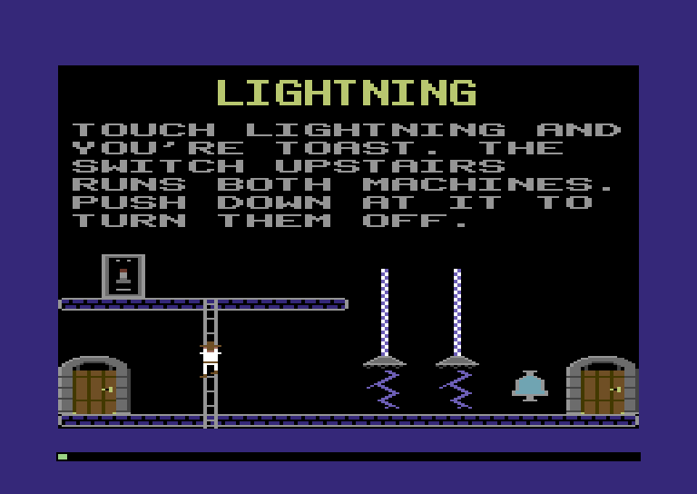
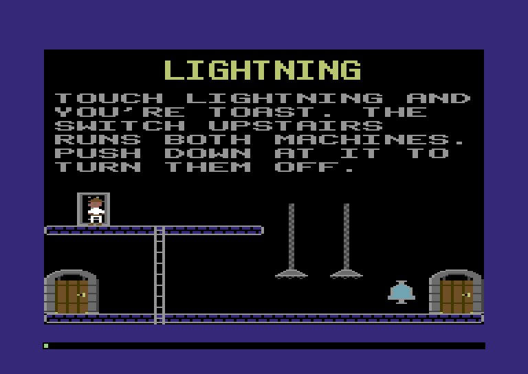
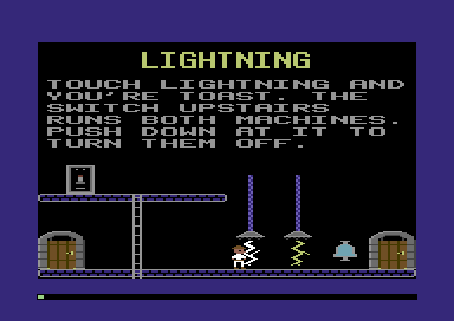
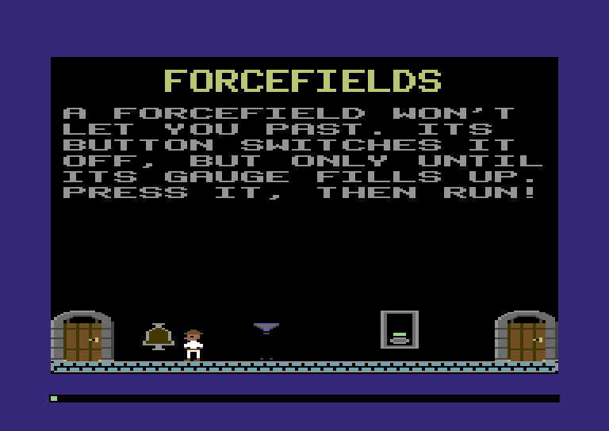
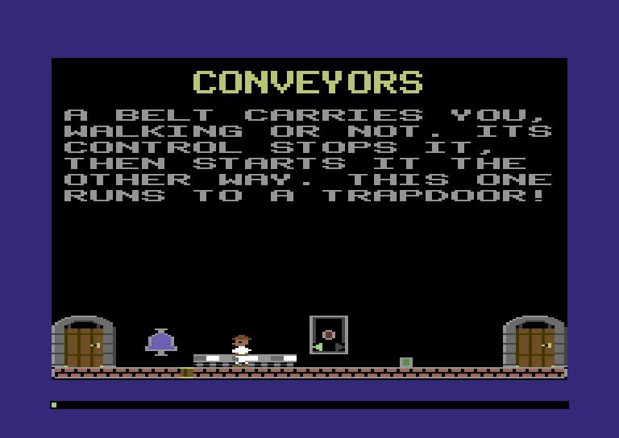
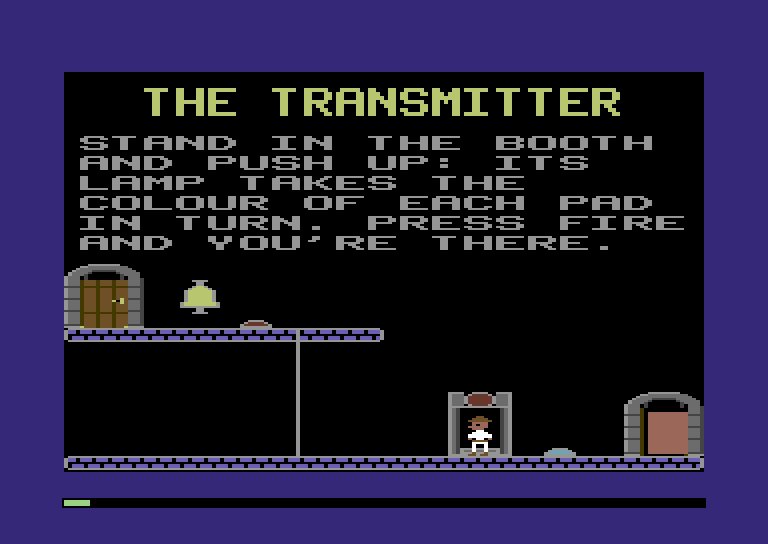

:::mission-briefing
Five rooms of the Training Castle have been all talk. Their signs warn
you about lightning, forcefields, trapdoors, conveyor belts and a matter
transmitter, and the rooms themselves are empty. This chapter fills
them. Lightning crackles under two machines until you find the switch
upstairs. A forcefield blocks the floor until you press its button and
run. A trapdoor opens and shuts as you step on its switch. A belt carries
you somewhere you'd rather not go, and a booth sends you across the room
in a flash. The explorer can die for real now, too: touch a bolt or fall
through a hole and he's gone.



All five machines are one idea used five times: a **control** that the
explorer works, linked to a **device** that does something.

New under the hood: **linking things by index instead of by pointer**.
:::

## One pattern, five machines

Look at any room in the later castles and you'll find the same shape. A
switch on one wall, a machine on the other. A button by the door, a
forcefield in the corridor. A plate in the floor, a trapdoor further
along. The explorer works the **control**, and something happens to the
**device**, sometimes on the far side of the room.

Both halves are things we already know how to build. A control is an
object with an `in_front` handler, like the doorbell. A device is an
object with an `execute` handler, like the door, and sometimes an actor
too, for the parts that move: a bolt of lightning, a shimmering field.
What's new is the line between them. The switch has to know *which*
machines it works.

:::under-the-hood `sw.machines = [machineA, machineB]`
In JavaScript you'd give the switch its machines directly:

```
const machineA = { on: true }, machineB = { on: true };
const sw = { machines: [machineA, machineB] };
sw.machines.forEach(m => m.on = !m.on);
```

The array holds **references**, hidden pointers to the two machine
objects. That works fine while everything is in memory. Now save the
room with `JSON.stringify` and load it back. The file has no way to say
"that object over there". It writes a full copy of each machine inside
the switch. The switch you load has two machines of its own, and
throwing it flips machines that aren't in the room.

The fix in JavaScript is to give every machine an id and store the ids.
A castle file is saved and loaded too, so the 1984 game does exactly
that, with ids one byte long. A switch names its machines by **where
their records are**, counted from the room's first lightning record.
Records are 8 bytes, so the first machine is 0 and the second is 8. Add a
walkway to the room, or a whole room before it, and all the addresses
move, but the machine 8 bytes after the first is still number 8.
:::

At runtime the engine keeps linking by number. An object finds another
object by its kind and number, and an object that runs an actor keeps
the actor's slot number. Here's the switch in the Lightning room,
followed all the way to the sprite it turns off:

:::diagram ch06-links
A switch's machines are distances in the castle, then object numbers,
then a sprite slot. No addresses anywhere.
:::

An index is one byte where an address takes two. It means the same
thing wherever the castle happens to be loaded. You can also check it.
`$FF` can mean "none", and a number can be compared with the table's
size. A pointer to a slot that was freed and reused looks just as good
as a pointer to the right one.

### The records

The castle file already has a record for each machine. Chapter 3 only
needed their sizes. Now we give the bits names:

**`src/castle.zig`** (replace the machines-and-monsters records, from their comment to `Frankenstein`)

```zig
/// A lightning machine, or a switch that works machines. A machine hangs
/// `length` pieces down from (x, y). A switch lists up to four machines,
/// each by how far its record is from the room's first lightning record
/// (records are 8 bytes, so 0, 8, 16...), with $FF ending the list early.
pub const Lightning = extern struct { state: u8, x: u8, y: u8, length: u8, machines: [4]u8 };
pub const lightning_switch: u8 = 0b1000_0000; // a switch, not a machine
pub const lightning_on: u8 = 0b0100_0000; // a machine: running. A switch: thrown up

/// A forcefield: its button, and the field itself.
pub const Forcefield = extern struct { button_x: u8, button_y: u8, field_x: u8, field_y: u8 };

/// A trapdoor in a walkway, and the switch in the floor that works it.
pub const Trapdoor = extern struct { state: u8, x: u8, y: u8, switch_x: u8, switch_y: u8 };
pub const trapdoor_open: u8 = 0b0000_0001;

/// A conveyor belt, and its control box. Bits 2-5 of `state` are the
/// game's, while the room is on screen: which players have pressed the
/// control this step, and which did last step.
pub const Conveyor = extern struct { state: u8, x: u8, y: u8, control_x: u8, control_y: u8 };
pub const conveyor_on: u8 = 0b0000_0001; // running
pub const conveyor_left: u8 = 0b0000_0010; // carrying things to the left
pub const conveyor_pressed: u8 = 0b0000_0100; // player 1 pressed the control this step
pub const conveyor_held: u8 = 0b0001_0000; // ...and last step
pub const conveyor_players: u8 = 0b0011_1100; // all four of those bits, for both players

/// A matter transmitter's booth, and the pad its lamp picks. The pads
/// follow it: x, y for each, up to a 0.
pub const Teleport = extern struct { x: u8, y: u8, target: u8 };

// The monsters, keys, locks and guns later chapters bring to life. For
// now the loader only needs their sizes, and the authoring kit their
// fields.
pub const Mummy = extern struct { state: u8, ankh_x: u8, ankh_y: u8, tomb_x: u8, tomb_y: u8, runtime: [2]u8 };
pub const Key = extern struct { number: u8, shape: u8, x: u8, y: u8 };
pub const Lock = extern struct { number: u8, shape: u8, door: u8, x: u8, y: u8 };
pub const Pattern = extern struct { count: u8, shape: u8, x: u8, y: u8, step_x: u8, step_y: u8 };
pub const RayGun = extern struct { state: u8, x: u8, y: u8, length: u8, runtime: u8, control_x: u8, control_y: u8 };
pub const Frankenstein = extern struct { state: u8, x: u8, y: u8, runtime: [4]u8 };
```

`lightning_on` and `lightning_switch` are single bits in the `state`
byte, like the door's open bit in Chapter 5. Throwing a switch flips one
of them with `^=`, which turns over the bits that are set on its right
and leaves every other bit alone. `state ^= lightning_on` turns a
running machine off and a stopped one on, without reading it first.

## Lightning

The machine is a pole hanging from the ceiling with an emitter at the
bottom. Below that crackles a bolt, which is a sprite, because it changes
shape every few steps and anything touching it should die. The pole
hums: its zigzag stripes crawl downwards while it runs.

First, ids for the new pictures:

**`src/shapes.zig`** (in `Id`, add at the end, after `explorer_back_1`)

```zig
    machine_pole,
    machine_tip,
    bolt_0,
    bolt_1,
    bolt_2,
    bolt_3,
    lever_plate,
    lever_up,
    lever_down,
```

The pole, the emitter, four bolts and the switch, with its lever up and
down. They're pictures like every other, so they go in a type-in:

:::type-in The machines' pictures
**`src/art.zig`** (add above `// ---- pictures for the castle`)

```zig
// ---- machines ---------------------------------------------------------------

/// A lightning machine's pole, one piece of it, in dull greys. While the
/// machine runs, its codes 01 and 10 are recoloured a step at a time, so
/// the zigzag seems to crawl down.
pub const machine_pole = room(.{ .dark_grey, .grey, .light_grey }, &.{
    ".12.",
    ".12.",
    ".21.",
    ".21.",
    ".12.",
    ".12.",
    ".21.",
    ".21.",
});

/// The emitter at the bottom of the pole. The bolt hangs below it.
pub const machine_tip = room(.{ .dark_grey, .grey, .light_grey }, &.{
    "....3333....",
    "...322223...",
    "..32222223..",
    ".3222222223.",
    "333333333333",
    "1.1.1.1.1.1.",
    ".1...1...1..",
    "............",
});

/// Four bolts of lightning, each in its own colour (code 10).
pub const bolt_0 = frame(.white, &.{
    ".....22.....",
    "....22......",
    "...22.......",
    "...222......",
    "....222.....",
    ".....222....",
    "......22....",
    ".....22.....",
    "....22...2..",
    "...22...2...",
    "..22...2....",
    "...22.2.....",
    "....222.....",
    ".....22.....",
    "......22....",
    ".......22...",
    "......22....",
    ".....22.....",
    "....22......",
    "...22.......",
    "..2..2......",
});

pub const bolt_1 = frame(.light_blue, &.{
    "......22....",
    ".......22...",
    "........22..",
    ".......22...",
    "......22....",
    ".....22.....",
    "....22......",
    "...22.......",
    "..2.22......",
    ".2...22.....",
    "......22....",
    ".......22...",
    "........22..",
    ".......22...",
    "......22....",
    ".....22.....",
    "....22......",
    ".....22.....",
    "......22....",
    ".......22...",
    "......2..2..",
});

pub const bolt_2 = frame(.yellow, &.{
    ".....22.....",
    "......22....",
    ".......22...",
    "......22....",
    ".....22.....",
    "....22......",
    "...22.......",
    "....22......",
    ".....22.....",
    "......222...",
    ".......2.2..",
    "......22..2.",
    ".....22.....",
    "....22......",
    "...22.......",
    "....22......",
    ".....22.....",
    "......22....",
    ".....22.....",
    "....22......",
    "...2..2.....",
});

pub const bolt_3 = frame(.cyan, &.{
    ".....22.....",
    ".....22.....",
    "....22......",
    "...22.......",
    "..22........",
    "...22.......",
    "....22......",
    ".....22.....",
    "......22....",
    ".......22...",
    "........22..",
    ".......22...",
    "......22....",
    ".....22.2...",
    "....22...2..",
    "...22.......",
    "....22......",
    ".....22.....",
    "......22....",
    ".....22.....",
    "....2..2....",
});

/// A lightning switch: a plate on the wall with a slot in the middle,
/// where the lever goes (4 fat pixels in, 8 rows down).
pub const lever_plate = room(.{ .dark_grey, .grey, .light_grey }, &.{
    "333333333333",
    "322222222223",
    "32........23",
    "32..3..3..23",
    "32........23",
    "32........23",
    "32........23",
    "32........23",
    "32........23",
    "32........23",
    "32........23",
    "32........23",
    "32........23",
    "32........23",
    "32........23",
    "32........23",
    "32........23",
    "32........23",
    "32........23",
    "32..3333..23",
    "32........23",
    "32........23",
    "322222222223",
    "333333333333",
});

/// The lever itself, thrown up (the machines are on) or down (off).
pub const lever_up = room(.{ .grey, .light_grey, .red }, &.{
    ".33.",
    ".33.",
    ".22.",
    ".22.",
    ".22.",
    ".11.",
    "1111",
    "1111",
});

pub const lever_down = room(.{ .grey, .light_grey, .red }, &.{
    "1111",
    "1111",
    ".11.",
    ".22.",
    ".22.",
    ".22.",
    ".33.",
    ".33.",
});
```
:::

### Objects that find each other

The object table needs two new things. Its comment says what lives there
now:

**`src/objects.zig`** (replace the comment at the top)

```zig
//! The room's object table: the things in a room that an actor can stand
//! in front of, or that have work to do. Preparing the room fills it, up
//! to 32 of them, 16 bytes each: doors and doorbells, and the machines
//! and the switches that work them.
```

**`src/objects.zig`** (add below the `doors` import)

```zig
const lightning = @import("lightning.zig");
```

Five of the spare bytes in each object slot get names. `number` was the
door's place among the doors. Now it's whatever number links this object
to others. `actor` holds the slot of an actor the object runs, and
`timer` counts steps for anything that ticks:

**`src/objects.zig`** (in `Object`, replace the last four fields)

```zig
    number: u8, // which one it is: a door's place among the room's doors, a bell's door, a machine's record
    open: u8, // a door: 1 once it's open, or opening. A trapdoor: 1 if it's opening or open
    step: u8, // how far through its work it is: rows still to wipe, the picture it's on
    actor: u8, // the actor slot it runs (a bolt, a field), or actors.none
    timer: u8, // steps until its next tick
    spare: [3]u8, // for the monsters to come
```

**`src/objects.zig`** (replace `Kind`)

```zig
/// Every kind of object. Later chapters add more.
pub const Kind = enum(u8) { door, bell, machine, lever, _ };
```

**`src/objects.zig`** (in `kinds`, add below the bell's entry)

```zig
    .machine = .{ .execute = lightning.run, .in_front = null },
    .lever = .{ .execute = null, .in_front = lightning.pull },
```

Chapter 5's bell found its door with a search that only knew about
doors. Every control in this chapter needs the same search, so it moves
into the object table and takes the kind as well:

**`src/objects.zig`** (add above `clear`)

```zig
/// The object for the room's `kind` number `number`: the link from a
/// bell to its door, a switch to its machine.
pub fn find(m: *Machine, kind: Kind, number: u8) ?u8 {
    const count = m.peek(map.engine_objects);
    var n: u8 = 0;
    while (n < count) : (n += 1) {
        const o = slot(m, n);
        m.work(12); // the tests and the loop
        if (o.kind == kind and o.number == number) return n;
    }
    return null;
}

/// The engine's clock: the frame tick, halved, so it goes up by one every
/// step.
pub fn clock(m: *Machine) u8 {
    return m.peek(map.game_tick) >> 1;
}
```

`clock` is the engine's step counter. Lots of machines do something
"every fourth step", and this is what they count.

**`src/objects.zig`** (in `add`, add below `o.record = record;`)

```zig
    o.actor = actors.none;
```

Now delete the old search from `src/doors.zig`, the `find` function and
the `map` import above it (nothing else in that file needs `map`), and
point the bell at the new one:

**`src/doors.zig`** (in `ring`, replace the `find` line)

```zig
    const d = objects.slot(m, objects.find(m, .door, bell.number) orelse return);
```

### A second kind of actor

Until now the explorer has been the only actor. The bolt is the second,
numbered 1 to match the 1984 table:

**`src/actors.zig`** (replace the comment at the top)

```zig
//! The actor table: everything in a room that moves by itself, as a
//! sprite. Eight slots in a row, one for each of the VIDEO chip's
//! sprites: slot n is sprite n. The explorer, bolts of lightning and
//! forcefields so far; lasers and monsters move in later.
```

**`src/actors.zig`** (add below the `player` import)

```zig
const lightning = @import("lightning.zig");
```

**`src/actors.zig`** (replace `Kind`)

```zig
/// Every kind of actor, numbered as in 1984. Later chapters add more.
pub const Kind = enum(u8) { player, lightning, _ };
```

**`src/actors.zig`** (in `kinds`, add below the player's entry)

```zig
    .lightning = .{ .turn = lightning.crackle, .flickers = false },
```

An object that isn't running an actor holds `none`:

**`src/actors.zig`** (add below `kinds`, after a blank line)

```zig
/// No actor: what an object holds when it isn't running one.
pub const none: u8 = 0xFF;
```

### Recolouring instead of redrawing

Now the room's side. The lightning records get a preparer of their own:

**`src/room.zig`** (add below the `objects` import)

```zig
const lightning = @import("lightning.zig");
```

**`src/room.zig`** (in `prepares`, replace the lightning entry)

```zig
    .lightning = lightning.prepare,
```

The machines draw their own pictures, so `place` has to be public:

**`src/room.zig`** (make `place` public: add `pub` in front of `fn place`)

```zig
pub fn place(m: *Machine, id: shapes.Id, x: u8, y: u8) void {
```

Leave the `pub` off and the build stops with

```
'place' is not marked 'pub'
```

Three helpers go below `place`:

**`src/room.zig`** (add below `place`)

```zig
/// Recolour a block of cells, `across` by `down`, from the cell holding
/// castle point (x, y): each gets `colors` as its screen-plane byte, the
/// colours of codes 01 and 10. Not a pixel is drawn: one byte a cell,
/// where drawing is a byte for every row of every cell.
pub fn tint(m: *Machine, x: u8, y: u8, across: u8, down: u8, colors: u8) void {
    var cell = @as(u16, y / 8) * 40 + (x - castle.left_edge) / 4;
    m.work(16); // y / 8 * 40 is shifts and an add, as in the grid
    for (0..down) |_| {
        var i: u8 = 0;
        while (i < across) : (i += 1) m.poke(hw.screen + cell + i, colors);
        cell += 40;
        m.work(8); // the loop
    }
}

/// The box that shape `id` covers, drawn at castle point (x, y).
pub fn boxOf(m: *Machine, id: shapes.Id, x: u8, y: u8) actors.Box {
    const shape = shapes.address(m, id);
    return .{ .x = x, .y = y, .width = m.peek(shape) * 4, .height = m.peek(shape + 1) };
}

/// Where the room's first record of `kind` is, if it has one. Records of
/// a kind are numbered from there: a switch names its machines by how
/// far each one is from the first.
pub fn first(m: *Machine, kind: castle.Kind) ?u16 {
    var walk = castle.Walker{ .at = stream(m, m.peek(map.room_number)) };
    while (walk.next(m)) |r| {
        if (r.kind == kind) return r.at;
    }
    return null;
}
```

`tint` is the trick behind every glowing, crawling, flashing thing in
this chapter. Back in Chapter 2, each cell's colours for codes 01 and 10
were one byte in the screen plane. Change that byte and every pixel of
those codes in the cell changes colour at once, without a single pixel
being drawn. The pole's stripes are drawn in codes 01 and 10. Give its
cells three colour pairs in turn, and the stripes seem to crawl. That's
`tint`: one byte a cell. Drawing the same cells is a byte for every row.

`boxOf` gives an object the box of the picture it's drawn as. `first`
walks the room's records for the first one of a kind, which is where a
switch's numbers count from.

### The machine

A new file. The colours come first: dull greys while the machine is off,
and three blues to cycle through while it runs:

**`src/lightning.zig`** (new file)

```zig
//! Lightning machines and their switches. A machine hangs from the
//! ceiling and, while it runs, a bolt of lightning (an actor) crackles
//! below it. A switch names the machines it works by number, and throwing
//! it flips every one of them.

const machine = @import("machine");
const Machine = machine.Machine;
const Color = machine.Color;
const map = @import("map.zig");
const castle = @import("castle.zig");
const room = @import("room.zig");
const shapes = @import("shapes.zig");
const actors = @import("actors.zig");
const objects = @import("objects.zig");
const player = @import("player.zig");

/// The stick's directions for throwing a switch: up and down.
const stick_up = 0;
const stick_down = 4;

/// The pole's colours while the machine is off, and the three it cycles
/// through while it runs: codes 01 and 10, one colour in each half.
const dull: u8 = @as(u8, @intFromEnum(Color.dark_grey)) << 4 | @intFromEnum(Color.grey);
const glow = [3]u8{
    @as(u8, @intFromEnum(Color.white)) << 4 | @intFromEnum(Color.light_blue),
    @as(u8, @intFromEnum(Color.light_blue)) << 4 | @intFromEnum(Color.blue),
    @as(u8, @intFromEnum(Color.blue)) << 4 | @intFromEnum(Color.white),
};
```

Preparing a record draws either a switch or a machine:

**`src/lightning.zig`** (add at the end)

```zig
/// A lightning record: a switch, or a machine.
pub fn prepare(m: *Machine, r: castle.Record) void {
    const l = m.view(castle.Lightning, r.at);
    if (l.state & castle.lightning_switch != 0) {
        // A plate on the wall, and the lever in it, up or down.
        room.place(m, .lever_plate, l.x, l.y);
        const picture = lever(l.state & castle.lightning_on != 0);
        room.place(m, picture, l.x + 4, l.y + 8);
        _ = objects.add(m, .lever, room.boxOf(m, picture, l.x + 4, l.y + 8), r.at);
        return;
    }
    // The pole, a piece every 8 rows, then the emitter, 4 fat pixels to
    // the left so that it's centred under the pole.
    var i: u8 = 0;
    while (i < l.length) : (i += 1) room.place(m, .machine_pole, l.x, l.y + 8 * i);
    const tip_x = l.x - 4;
    const tip_y = l.y + 8 * l.length;
    room.place(m, .machine_tip, tip_x, tip_y);
    const n = objects.add(m, .machine, room.boxOf(m, .machine_tip, tip_x, tip_y), r.at) orelse return;
    const o = objects.slot(m, n);
    o.number = @intCast(r.at - room.first(m, .lightning).?); // how switches name it
    o.flags.execute = l.state & castle.lightning_on != 0; // running: its first step makes the bolt
    m.work(20); // the sums and the stores
}
```

A machine's `number` is its distance from the first lightning record,
the number its switch knows it by. A running machine starts with
`execute` set, and here's what its steps do:

**`src/lightning.zig`** (add at the end)

```zig
/// A machine's `execute`. Switched off, it stops: the bolt goes and the
/// pole goes dull. Running, its first step makes the bolt, and every
/// fourth step after that moves the pole's colours along.
pub fn run(m: *Machine, n: u8) void {
    const o = objects.slot(m, n);
    const l = m.view(castle.Lightning, o.record);
    m.work(20); // the tests
    if (l.state & castle.lightning_on == 0) {
        o.flags.execute = false;
        room.tint(m, l.x, l.y, 1, l.length, dull);
        if (o.actor != actors.none) actors.slot(m, @intCast(o.actor)).state.destroy = true;
        o.actor = actors.none;
        return;
    }
    if (o.actor == actors.none) {
        const bolt = actors.add(m, .lightning) orelse return; // no sprite free: try next step
        o.actor = bolt;
        const a = actors.slot(m, bolt);
        a.box.x = o.box.x;
        a.box.y = o.box.y + 8;
        actors.setFrame(m, bolt, .bolt_0);
        return;
    }
    if (objects.clock(m) & 3 != 0) return;
    o.step = if (o.step == glow.len - 1) 0 else o.step + 1;
    room.tint(m, l.x, l.y, 1, l.length, glow[o.step]);
}
```

Switched off, the machine tints its pole dull, tells its bolt to go
(`destroy`, from Chapter 5's lifecycle) and stops asking for steps.
Running, its first step makes the bolt and keeps the slot number, and
every fourth step after that moves the pole's colours along one.

The bolt's turn picks a new picture and a new wait:

**`src/lightning.zig`** (add at the end)

```zig
/// A bolt's turn: a new picture, never the same one twice running, and a
/// new wait before the next, from 1 to 4 steps. A switched-off machine
/// sets `destroy`, and the bolt's last turn frees its slot.
pub fn crackle(m: *Machine, n: u3) void {
    const a = actors.slot(m, n);
    if (a.state.destroy) {
        a.state.destroy = false;
        a.state.free = true;
        return;
    }
    a.state.created = false;
    // Not really random: the clock, stirred with the slot number so that
    // two bolts don't dance in step. Chapter 8 makes proper dice.
    const roll = objects.clock(m) ^ (@as(u8, n) *% 0x5B);
    a.pace = 1 + (roll & 3);
    const first = @intFromEnum(shapes.Id.bolt_0);
    const next = (a.frame - first + 1 + (roll >> 2) % 3) % 4; // 1 to 3 pictures on
    actors.setFrame(m, n, @enumFromInt(first + next));
    m.work(30); // the sums
}

comptime {
    if (@intFromEnum(shapes.Id.bolt_3) != @intFromEnum(shapes.Id.bolt_0) + 3)
        @compileError("the four bolts must be in a row in shapes.Id");
}
```

A real bolt is random. Ours isn't quite. `roll` mixes the clock with the
slot number, so two bolts don't flicker in step, and it's enough to look
wild. Chapter 8 makes proper dice.

The `comptime` block at the end checks that the four bolt pictures are
in a row in `shapes.Id`, which `crackle` relies on when it adds to
`first`. Reorder them and the build stops.

:::inside-the-disk The bolt that remembers its machine
The 1984 game links a machine and its bolt the other way round. The bolt
keeps its machine's number in its record. When a switch turns the
machine off, the machine searches all eight sprite slots for a bolt
carrying its number. We keep the bolt's slot in the machine's object
instead, so turning it off is one lookup. The 1984 pole doesn't
recolour cells either: it rewrites the colour bytes inside the pole's
picture and draws all six pieces again, every fourth step.
:::

### Throwing the switch

The lever has an up picture and a down picture. Drawing the new one on
top of the old won't do. Drawing in this game only ever adds pixels: it
ORs the shape into the bitmap. Lay the down lever over the up one and you
get both. We need an eraser:

**`src/screen.zig`** (add above `// ---- tests`)

```zig
/// Rub shape `id` out of the bitmap at fat pixel (x, y): every pixel the
/// shape sets goes back to code 00, and the pixels between are left
/// alone. Its colour cells stay as they are. Drawing the next picture of
/// a machine over the last needs this, because drawing only ever adds.
pub fn erase(m: *Machine, id: shapes.Id, x: u8, y: u8) void {
    var src = shapes.address(m, id);
    const width = m.peek(src);
    const height = m.peek(src + 1);
    src += 3;
    const column = x / 4;
    var row: u16 = 0;
    while (row < height) : (row += 1) {
        const line = y + row;
        if (line < 200) {
            var dst = rowAddress(m, @intCast(line)) + @as(u16, column) * 8;
            var i: u16 = 0;
            while (i < width and column + i < 40) : (i += 1) {
                // Both bits of every pixel the shape uses: 01 and 10 both
                // spread to 11 before the mask is turned over.
                const b = m.peek(src + i);
                const used = b | (b >> 1 & 0b01_01_01_01) | (b << 1 & 0b10_10_10_10);
                m.poke(dst, m.peek(dst) & ~used);
                dst += 8;
                m.work(12);
            }
        }
        src += width;
    }
}
```

For each byte of the shape, `used` has both bits set for every pixel the
shape draws. A code-01 pixel is `01`. Shifted left it's `10`, and ORed
together they make `11`. A code-10 pixel spreads the same way, to the
right. Turn `used` over with `~` and AND it in, and exactly the shape's
pixels go back to 00 (black). The pixels around it stay.

Then two room helpers, below `place`:

**`src/room.zig`** (add below `place`)

```zig
/// Rub out shape `id` at castle point (x, y). Machines live on the screen,
/// so x is never left of its edge.
pub fn unplace(m: *Machine, id: shapes.Id, x: u8, y: u8) void {
    screen.erase(m, id, x - castle.left_edge, y);
}

/// Change the picture at castle point (x, y) from shape `old` to shape
/// `new`.
pub fn swap(m: *Machine, old: shapes.Id, new: shapes.Id, x: u8, y: u8) void {
    unplace(m, old, x, y);
    place(m, new, x, y);
}
```

And the switch itself, below `prepare` in `src/lightning.zig`:

**`src/lightning.zig`** (add below `prepare`)

```zig
/// A switch's `in_front`: the explorer, under its lever, pushes the stick
/// up (on) or down (off). Every machine on the switch's list flips, and
/// gets a step to catch up with its new state.
pub fn pull(m: *Machine, n: u8, who: u3) void {
    const o = objects.slot(m, n);
    const a = actors.slot(m, who);
    m.work(20); // the tests
    if (a.kind != .player or !player.playing(m)) return;
    if (a.box.x +% player.feet_x -% o.box.x >= o.box.width) return; // his feet aren't under it
    const on = switch (a.stick) {
        stick_up => true,
        stick_down => false,
        else => return,
    };
    const l = m.view(castle.Lightning, o.record);
    if ((l.state & castle.lightning_on != 0) == on) return; // it's that way already
    l.state ^= castle.lightning_on;
    const first = room.first(m, .lightning) orelse return;
    for (l.machines) |number| {
        if (number == 0xFF) break; // the end of the list
        m.view(castle.Lightning, first + number).state ^= castle.lightning_on;
        const machine_n = objects.find(m, .machine, number) orelse continue;
        objects.slot(m, machine_n).flags.execute = true;
        m.work(20); // the sums and the stores
    }
    room.swap(m, lever(!on), lever(on), o.box.x, o.box.y);
}

/// The lever's picture: up while its switch is on.
fn lever(on: bool) shapes.Id {
    return if (on) .lever_up else .lever_down;
}
```

Here's the pattern in full. The switch checks it's the explorer, under
the lever, pushing up or down. Then it flips its own bit and walks its
list. For each number: flip that machine's bit in the castle, find its
object by number, and set its `execute` so its next step catches up. The
switch never touches a bolt or a pole. It changes the castle's bits and
asks the machines to look.

### Wiring it in

One change in `main.zig`. The forcefield coming later in this chapter
adds its actor while the room is being prepared, so the actor table must
be cleared *before* the room is drawn:

**`src/main.zig`** (in the `.draw_room` branch, replace everything up to `player.add`)

```zig
            m.poke(hw.control, 0);
            m.bucket(bucket_sprites);
            actors.clear(m); // first: preparing the room can add actors
            m.bucket(bucket_drawing);
            room.draw(m); // and its objects
            debug.overlay(m);
            m.bucket(bucket_sprites);
            player.add(m);
```

Then the room. The training castle now needs the record constants:

**`src/training.zig`** (replace the comment at the top, and add a `castle` import below the `author` one)

```zig
//! The Training Castle: one lesson per room, written with the authoring
//! kit. Later chapters add the keys, guns and monsters.

const author = @import("author.zig");
const castle = @import("castle.zig");
```

The Lightning room gets two running machines and a switch upstairs. The
switch lists them as 0 and 8, and `$FF` ends the list:

**`src/training.zig`** (replace the `lightning` room)

```zig
        .lightning = .{
            .color = .blue,
            .map = spot(4),
            .door = &.{
                .{ .x = 16, .y = 160, .to = .poles, .to_door = 1 },
                .{ .x = 156, .y = 160, .to = .forcefields },
            },
            .walkway = &.{ floor, upper_left },
            .ladder = &.{ladder_left},
            .bell = &.{.{ .x = 140, .y = 168, .door = 1 }},
            .lightning = &.{
                // Two machines, running, and then the switch that works
                // them both: it names them by their places, 0 and 8.
                .{ .state = castle.lightning_on, .x = 104, .y = 112, .length = 6, .machines = .{ 0, 0, 0, 0 } },
                .{ .state = castle.lightning_on, .x = 124, .y = 112, .length = 6, .machines = .{ 0, 0, 0, 0 } },
                .{ .state = castle.lightning_switch | castle.lightning_on, .x = 28, .y = 104, .length = 0, .machines = .{ 0, 8, 0xFF, 0xFF } },
            },
            .text = says("LIGHTNING", &.{
                "TOUCH LIGHTNING AND",
                "YOU'RE TOAST. THE",
                "SWITCH UPSTAIRS",
                "RUNS BOTH MACHINES.",
                "PUSH DOWN AT IT TO",
                "TURN THEM OFF.",
            }),
        },
```

And a test that climbs to the switch and throws it both ways:

:::type-in The switch's test
**`src/main.zig`** (add above `explorer`, near the end of the file)

```zig
test "lightning: the switch upstairs stops both machines" {
    const m = try std.testing.allocator.create(Machine);
    defer std.testing.allocator.destroy(m);
    inRoom(m, 4); // Lightning: in at door 0, on the left
    hold(m, 0, 4); // the machines' first step makes their bolts
    try std.testing.expectEqual(2, count(m, .lightning));

    // Up the ladder (x 56) to the switch (x 32).
    while (explorer(m).box.x + player.feet_x < 57) hold(m, machine.joy.right, 2);
    hold(m, machine.joy.up, 200);
    while (explorer(m).box.x + player.feet_x > 34) hold(m, machine.joy.left, 2);
    try std.testing.expectEqual(128 - 21, explorer(m).box.y); // on the upper walkway
    hold(m, machine.joy.down, 4); // throw it down
    hold(m, 0, 4);
    try std.testing.expectEqual(0, count(m, .lightning));
    hold(m, machine.joy.up, 4); // and up again: both run again
    hold(m, 0, 4);
    try std.testing.expectEqual(2, count(m, .lightning));
}
```

**`src/main.zig`** (add above `hold`, at the very end)

```zig
/// How many actors of `kind` are in the room.
fn count(m: *Machine, kind: actors.Kind) usize {
    var n: usize = 0;
    for (actors.table(m)) |a| {
        if (!a.state.unused and a.kind == kind) n += 1;
    }
    return n;
}
```
:::

Build, press N four times for the Lightning room, and climb. At the top,
walk left to the switch and pull down:



**Both machines die at once!** The bolts vanish, the poles go grey, and
the lever drops. Push up and they're back, crackling. Walk into a bolt,
though, and nothing happens. Let's fix that.

## Touching lightning

Chapter 5 recorded a second collision bit and never used it.
`hit_sprite` is set when an actor's sprite touches another sprite, from
the VIDEO chip's sprite-to-sprite register. Like the sprite-to-bitmap
bit, it only says "this sprite touched *some* sprite". Boxes find out
which.

Each kind gets two new things in its behaviour: a `hit` function, and a
`group`:

**`src/actors.zig`** (replace `Behaviour` and the comment above it)

```zig
/// What each kind does: the function that takes its turn, and whether it
/// flickers when it dies or vanishes on the spot. `hit` is what happens
/// when its sprite touches another actor's; it returns true if that
/// starts it dying. Two kinds whose `group` bits overlap pass through
/// each other unseen.
const Behaviour = struct {
    turn: *const fn (m: *Machine, n: u3) void,
    flickers: bool,
    hit: ?*const fn (m: *Machine, n: u3, other: u3) bool = null,
    group: u8,
};
```

**`src/actors.zig`** (in `kinds`, replace both entries)

```zig
    .player = .{ .turn = player.turn, .flickers = true, .hit = player.hit, .group = 0 },
    .lightning = .{ .turn = lightning.crackle, .flickers = false, .group = 0b100 },
```

`group` lets kinds ignore each other. If two kinds share a bit, they pass
through each other without a word. Two bolts are both `0b100`, so they
never hit each other. The explorer is `0`, which shares nothing, so he
meets everyone. These are the 1984 masks.

In `step`, an actor that touched a sprite looks for it before its turn:

**`src/actors.zig`** (in `step`, add above `a.countdown -= 1;`)

```zig
            if (a.state.hit_sprite) hitting(m, n, sprite_hits);
```

**`src/actors.zig`** (add below `step`)

```zig
/// Actor `n`'s sprite touched another sprite (`hits` is the VIDEO chip's
/// report). Find which: every other actor in the report whose box
/// overlaps n's, unless they're in the same group. Each of the two is
/// told about the other, so a bolt and the explorer both hear of it.
fn hitting(m: *Machine, n: u3, hits: u8) void {
    const a = slot(m, n);
    const group = kinds[@intFromEnum(a.kind)].group;
    for (table(m), 0..) |*b, i| {
        m.work(12); // the tests and the loop
        const other: u3 = @intCast(i);
        if (other == n or hits & (@as(u8, 1) << other) == 0 or b.state.dying) continue;
        if (group & kinds[@intFromEnum(b.kind)].group != 0) continue;
        if (!objects.overlap(m, a.box, b.box)) continue;
        if (hit(m, n, other)) a.state.flash = true;
        if (hit(m, other, n)) b.state.flash = true;
    }
}

/// Tell actor `n` its sprite touched actor `other`'s. True if that starts
/// n dying.
fn hit(m: *Machine, n: u3, other: u3) bool {
    const h = kinds[@intFromEnum(slot(m, n).kind)].hit orelse return false;
    return h(m, n, other);
}
```

`hitting` tells both actors, each with the other's slot. The explorer's
`hit` decides whether a bolt kills him, and a bolt (with no `hit`)
doesn't care. If either answers true, it starts flickering, through
Chapter 5's `flash`.

The explorer's side, replacing `kill`:

**`src/player.zig`** (replace `kill`, and add two functions below it)

```zig
/// Give up this life (the X key): he flickers away, and the castle starts
/// him again at its start door.
pub fn kill(m: *Machine) void {
    if (die(m)) actors.slot(m, @intCast(m.peek(map.player_actor))).state.flash = true;
}

/// This life is over, if he's walking the room: he's dead. True if he
/// was, so that he starts to flicker.
fn die(m: *Machine) bool {
    if (!playing(m)) return false;
    m.poke(map.player_status, @intFromEnum(Status.dead));
    return true;
}

/// His `hit`: his sprite touched actor `other`'s. So far that's a bolt
/// of lightning, and lightning is deadly.
pub fn hit(m: *Machine, n: u3, other: u3) bool {
    _ = n;
    _ = other;
    return die(m);
}
```

`die` is the part of `kill` that any hazard can use: only if he's
playing, he's now dead. `kill` (the X key) flashes him itself, while
`hit` returns true and lets `hitting` do it. Add the death to the test:

:::type-in The lightning test, with a death
**`src/main.zig`** (replace the lightning test)

```zig
test "lightning: the bolts kill, and the switch upstairs stops both machines" {
    const m = try std.testing.allocator.create(Machine);
    defer std.testing.allocator.destroy(m);
    inRoom(m, 4); // Lightning: in at door 0, on the left
    hold(m, 0, 4); // the machines' first step makes their bolts
    try std.testing.expectEqual(2, count(m, .lightning));

    // Along the floor, into the first bolt.
    hold(m, machine.joy.right, 200);
    try std.testing.expectEqual(@intFromEnum(player.Status.dead), m.ram[map.player_status]);

    // Again, the other way: up the ladder (x 56) to the switch (x 32).
    inRoom(m, 4);
    while (explorer(m).box.x + player.feet_x < 57) hold(m, machine.joy.right, 2);
    hold(m, machine.joy.up, 200);
    while (explorer(m).box.x + player.feet_x > 34) hold(m, machine.joy.left, 2);
    try std.testing.expectEqual(128 - 21, explorer(m).box.y); // on the upper walkway
    hold(m, machine.joy.down, 4); // throw it down
    hold(m, 0, 4);
    try std.testing.expectEqual(0, count(m, .lightning));
    hold(m, machine.joy.up, 4); // and up again: both run again
    hold(m, 0, 4);
    try std.testing.expectEqual(2, count(m, .lightning));
}
```
:::

Now walk right along the floor:



Toast, as the sign says. That's the first hazard in the game that can
kill you.

## Forcefields

A forcefield is a shimmering curtain across the floor. The
explorer walks up to it and stops. Its button turns it off, and a gauge
on the button fills up as the seconds tick away. When it's full, the
field comes back.

What makes him stop? Not the sprite. In Chapter 4, walking reads the
**navigation grid**, a byte per cell saying which ways are open. The
field has to change the grid, while the room is running. Here's the one
function that does it:

**`src/grid.zig`** (add above `piece`)

```zig
/// Put up a wall in cell (col, row), or take it down again. The wall
/// isn't in the cell: the cell on its left loses its way right, and the
/// cell on its right its way left, so nothing walks in. Whatever is
/// already inside can still walk out. A trapdoor's hole is a wall, and so
/// is a forcefield.
pub fn wall(m: *Machine, col: u8, row: u8, raised: bool) void {
    if (col == 0 or col + 1 >= columns) return; // no cells beyond the edge to change
    const before = cell(m, col - 1, row);
    const after = cell(m, col + 1, row);
    if (raised) {
        m.poke(before, m.peek(before) & ~right);
        m.poke(after, m.peek(after) & ~left);
    } else {
        m.poke(before, m.peek(before) | right);
        m.poke(after, m.peek(after) | left);
    }
    m.work(16); // the tests and the masks
}
```

:::diagram ch06-wall
A wall changes two bits, in the cells on either side.
:::

A wall goes up in one cell, but no bit in that cell changes. The cell on
its left loses its way right, and the cell on its right loses its way
left. Nothing can walk in from either side. This is the 1984 game's own
trick, and it has a nice side effect: anything already standing in the
cell can still walk out. A wall can never trap him inside it.

The field's pictures, and the button's:

**`src/shapes.zig`** (in `Id`, add at the end, after `lever_down`)

```zig
    button_frame,
    button_lit,
    field_top,
    field_on_0,
    field_on_1,
    field_off,
```

:::type-in The forcefield's pictures
**`src/art.zig`** (add above `// ---- pictures for the castle`)

```zig
/// A forcefield's button: a panel with a gauge in a slot (4 fat pixels
/// in, 8 rows down) and a big round button to press.
pub const button_frame = room(.{ .dark_grey, .grey, .light_grey }, &.{
    "333333333333",
    "322222222223",
    "32........23",
    "32........23",
    "32........23",
    "32........23",
    "32........23",
    "32........23",
    "32........23",
    "32........23",
    "32........23",
    "32........23",
    "32........23",
    "32........23",
    "32........23",
    "32........23",
    "32........23",
    "32..3333..23",
    "32.322223.23",
    "32.322223.23",
    "32..3333..23",
    "32........23",
    "322222222223",
    "333333333333",
});

/// The gauge, every row lit: the field is up. Pressing the button puts
/// them all out, and they come back one at a time, from the bottom.
pub const button_lit = room(.{ .dark_grey, .green, .light_green }, &.{
    "3333",
    "3333",
    "3333",
    "3333",
    "3333",
    "3333",
    "3333",
    "3333",
});

/// The emitter over a forcefield.
pub const field_top = room(.{ .dark_grey, .grey, .light_blue }, &.{
    "33333333",
    "12222221",
    ".122221.",
    "..1331..",
    "...33...",
    "........",
    "........",
    "........",
});

/// The field: a sprite, two pictures of a shimmer, and one with the field
/// switched off.
pub const field_on_0 = frame(.light_blue, &.{
    "........",
    "........",
    "........",
    "........",
    "..2222..",
    ".2.22.2.",
    "2.2..2.2",
    ".2.22.2.",
    "2.2..2.2",
    ".2.22.2.",
    "2.2..2.2",
    ".2.22.2.",
    "2.2..2.2",
    ".2.22.2.",
    "2.2..2.2",
    ".2.22.2.",
    "2.2..2.2",
    ".2.22.2.",
    "2.2..2.2",
    ".2.22.2.",
    "..2222..",
});

pub const field_on_1 = frame(.light_blue, &.{
    "........",
    "........",
    "........",
    "........",
    "..2222..",
    "2.2..2.2",
    ".2.22.2.",
    "2.2..2.2",
    ".2.22.2.",
    "2.2..2.2",
    ".2.22.2.",
    "2.2..2.2",
    ".2.22.2.",
    "2.2..2.2",
    ".2.22.2.",
    "2.2..2.2",
    ".2.22.2.",
    "2.2..2.2",
    ".2.22.2.",
    "2.2..2.2",
    "..2222..",
});

pub const field_off = frame(.dark_grey, &.{
    "........",
    "........",
    "........",
    "........",
    "...22...",
    "........",
    "........",
    "........",
    "........",
    "........",
    "........",
    "........",
    "........",
    "........",
    "........",
    "........",
    "........",
    "........",
    "........",
    "........",
    "..2..2..",
});
```
:::

A new object, the button, and a new actor, the field:

**`src/objects.zig`** (add below the `lightning` import)

```zig
const forcefields = @import("forcefields.zig");
```

**`src/objects.zig`** (replace `Kind`)

```zig
/// Every kind of object. Later chapters add more.
pub const Kind = enum(u8) { door, bell, machine, lever, button, _ };
```

**`src/objects.zig`** (in `kinds`, add below the lever's entry)

```zig
    .button = .{ .execute = forcefields.count, .in_front = forcefields.press },
```

**`src/actors.zig`** (add below the `lightning` import)

```zig
const forcefields = @import("forcefields.zig");
```

**`src/actors.zig`** (replace `Kind`)

```zig
/// Every kind of actor, numbered as in 1984. Later chapters add more.
pub const Kind = enum(u8) { player, lightning, forcefield, _ };
```

**`src/actors.zig`** (in `kinds`, add below the lightning entry)

```zig
    .forcefield = .{ .turn = forcefields.shimmer, .flickers = false, .group = 0b011 },
```

Now the explorer's sprite touches the field's sprite too. That isn't
deadly, so `hit` lets it go. The grid is what stops him:

**`src/player.zig`** (replace `hit`)

```zig
/// His `hit`: his sprite touched actor `other`'s. A forcefield only stands
/// in his way (the grid sees to that); anything else is deadly.
pub fn hit(m: *Machine, n: u3, other: u3) bool {
    _ = n;
    if (actors.slot(m, other).kind == .forcefield) return false;
    return die(m);
}
```

**`src/room.zig`** (add below the `lightning` import)

```zig
const forcefields = @import("forcefields.zig");
```

**`src/room.zig`** (in `prepares`, replace the forcefield entry)

```zig
    .forcefield = forcefields.prepare,
```

### The button and its gauge

A new file:

**`src/forcefields.zig`** (new file)

```zig
//! Forcefields and their buttons. The field is an actor that shimmers,
//! and a wall in the navigation grid. Its button takes it down, and a
//! gauge on the button counts the seconds until it comes back.

const machine = @import("machine");
const Machine = machine.Machine;
const castle = @import("castle.zig");
const grid = @import("grid.zig");
const room = @import("room.zig");
const screen = @import("screen.zig");
const shapes = @import("shapes.zig");
const actors = @import("actors.zig");
const objects = @import("objects.zig");
const player = @import("player.zig");

/// The gauge has a row for each of 8 ticks, and a tick is 30 engine
/// steps: the field is down for 240 steps, nine and a bit seconds.
const ticks = 8;
const tick_steps = 30;
```

**`src/forcefields.zig`** (add at the end)

```zig
/// A forcefield record: the button, its gauge, the field's emitter, and
/// the field itself, up.
pub fn prepare(m: *Machine, r: castle.Record) void {
    const f = m.view(castle.Forcefield, r.at);
    room.place(m, .button_frame, f.button_x, f.button_y);
    room.place(m, .button_lit, f.button_x + 4, f.button_y + 8);
    room.place(m, .field_top, f.field_x, f.field_y);
    const n = objects.add(m, .button, room.boxOf(m, .button_frame, f.button_x, f.button_y), r.at) orelse return;
    const o = objects.slot(m, n);
    if (actors.add(m, .forcefield)) |field| {
        o.actor = field; // the link: the button knows its field by slot number
        const a = actors.slot(m, field);
        a.box.x = f.field_x;
        a.box.y = f.field_y + 2;
        a.pace = 4;
    }
    raise(m, o, true);
    m.work(20); // the sums and the stores
}

/// Put button `o`'s field up, or take it down: its wall in the grid (in
/// the cell 27 rows under the emitter, as in 1984), and its picture. With
/// no sprite free for it, the field is invisible, but still a wall.
fn raise(m: *Machine, o: *align(1) objects.Object, up: bool) void {
    const f = m.view(castle.Forcefield, o.record);
    const col = grid.column(f.field_x + 2) orelse return;
    grid.wall(m, col, (f.field_y + 27) / 8, up);
    if (o.actor != actors.none) actors.setFrame(m, @intCast(o.actor), if (up) .field_on_0 else .field_off);
}
```

The link is one byte. `o.actor = field` gives the button its field's slot
number, and from then on the button runs the field: up, down, and its
picture. If all eight sprites were taken, `actors.add` returns null, and
the field is an invisible wall. That's harmless, and better than a field
that isn't there at all.

**`src/forcefields.zig`** (add at the end)

```zig
/// A button's `in_front`: the explorer presses fire at it. The field goes
/// down (if it's up), the gauge goes out, and the countdown starts again
/// from the top.
pub fn press(m: *Machine, n: u8, who: u3) void {
    const a = actors.slot(m, who);
    const o = objects.slot(m, n);
    m.work(16); // the tests
    if (a.kind != .player or a.fire == 0 or !player.playing(m)) return;
    if (!o.flags.execute) raise(m, o, false);
    o.flags.execute = true;
    o.step = ticks;
    o.timer = tick_steps;
    const shape = shapes.address(m, .button_lit);
    for (0..ticks) |row| gauge(m, o, @intCast(row), shape, false);
}

/// A button's `execute`, every step while its field is down: every 30
/// steps, light the next row of the gauge, from the bottom. With all 8
/// lit, the field goes back up.
pub fn count(m: *Machine, n: u8) void {
    const o = objects.slot(m, n);
    o.timer -= 1;
    m.work(8); // the test
    if (o.timer != 0) return;
    o.timer = tick_steps;
    o.step -= 1;
    gauge(m, o, o.step, shapes.address(m, .button_lit), true);
    if (o.step != 0) return;
    o.flags.execute = false;
    raise(m, o, true);
}

/// Light row `row` of button `o`'s gauge, or put it out: one bitmap byte,
/// copied from the gauge's shape at `shape`, or 0.
fn gauge(m: *Machine, o: *align(1) objects.Object, row: u8, shape: u16, lit: bool) void {
    const x = o.box.x + 4 - castle.left_edge;
    const at = screen.rowAddress(m, o.box.y + 8 + row) + @as(u16, x / 4) * 8;
    m.poke(at, if (lit) m.peek(shape + 3 + row) else 0);
    m.work(12); // the sums
}
```

`press` takes the field down and puts out all eight rows of the gauge.
`count` runs every step while the field is down. Each 30 steps it lights
one more row, from the bottom. When the eighth is lit, the field goes
back up. Each gauge row is one byte of the bitmap, copied from the
`button_lit` picture, so lighting it costs one poke.

The field's own turn is the shimmer, two pictures taking turns:

**`src/forcefields.zig`** (add at the end)

```zig
/// A field's turn, every fourth step: while it's up, its two pictures
/// take turns. Its button does everything else.
pub fn shimmer(m: *Machine, n: u3) void {
    const a = actors.slot(m, n);
    a.state.created = false;
    m.work(12); // the tests
    const frame: shapes.Id = @enumFromInt(a.frame);
    switch (frame) {
        .field_on_0 => actors.setFrame(m, n, .field_on_1),
        .field_on_1 => actors.setFrame(m, n, .field_on_0),
        else => {},
    }
}
```

:::inside-the-disk A flag for every field
In the 1984 game, the field doesn't take orders from its button. The
button writes a 1 or a 0 into a little table of flags, one per field, and
every field reads its flag on each of its turns to decide whether it
should be up. It's another link by number, just pointing the other way.
We let the button set the field's picture directly, so the field's turn
has nothing to look up.
:::

The Forcefields room gets its field:

**`src/training.zig`** (replace the `forcefields` room)

```zig
        .forcefields = .{
            .color = .cyan,
            .map = spot(5),
            .door = &.{
                .{ .x = 156, .y = 160, .to = .lightning, .to_door = 1 },
                .{ .x = 16, .y = 160, .to = .trapdoors },
            },
            .walkway = &.{floor},
            .bell = &.{.{ .x = 44, .y = 168, .door = 1 }},
            .forcefield = &.{.{ .button_x = 120, .button_y = 160, .field_x = 80, .field_y = 168 }},
            .text = says("FORCEFIELDS", &.{
                "A FORCEFIELD WON'T",
                "LET YOU PAST. ITS",
                "BUTTON SWITCHES IT",
                "OFF, BUT ONLY UNTIL",
                "ITS GAUGE FILLS UP.",
                "PRESS IT, THEN RUN!",
            }),
        },
```

### The grid isn't the castle any more

Chapter 4's test checked that the grid and a search of the castle agree
in every cell of every room. With a raised field, they don't. The grid
has the wall, and the castle doesn't know about it. That's correct. The
castle is the plan of the room, and the grid is the room as it is right
now. So the test now counts the cells that differ, and expects two for
every wall:

**`src/main.zig`** (replace the searching test)

```zig
test "searching the castle gives the grid's answer, except at a machine's walls" {
    const m = try std.testing.allocator.create(Machine);
    defer std.testing.allocator.destroy(m);
    inRoom(m, 0);
    inline for (comptime std.enums.values(training.Room), 0..) |name, n| {
        m.ram[map.room_number] = n;
        actors.clear(m);
        room.draw(m);
        const stream = room.stream(m, n);
        var differ: usize = 0;
        for (0..grid.rows) |row| {
            for (0..grid.columns) |col| {
                const x: u8 = @intCast(16 + 4 * col);
                const y: u8 = @intCast(8 * row);
                if (grid.at(m, x, y) != grid.search(m, stream, x, y)) differ += 1;
            }
        }
        // The search reads only the castle, so it walks through every
        // raised forcefield: two cells each.
        const plan = @field(training.plan.rooms, @tagName(name));
        const walls = plan.forcefield.len;
        try std.testing.expectEqual(2 * walls, differ);
    }
}
```

`inline for` unrolls the loop at compile time, so `name` is known to the
compiler on every pass. `@field(training.plan.rooms, @tagName(name))`
can then pick the room's plan by its name, and count its forcefields.
The final room isn't in the plan, so the loop now stops before it.
Chapter 9 builds that room properly.

:::type-in The forcefield's test
**`src/main.zig`** (add above `explorer`)

```zig
test "a forcefield stops him until its button takes it down, for 240 steps" {
    const m = try std.testing.allocator.create(Machine);
    defer std.testing.allocator.destroy(m);
    inRoom(m, 5); // Forcefields: in at door 0, on the right
    hold(m, machine.joy.left, 200);
    try std.testing.expectEqual(87, explorer(m).box.x + player.feet_x); // the cell beside the field
    while (explorer(m).box.x < 122) hold(m, machine.joy.right, 2); // back to the button
    hold(m, machine.joy.fire, 4);
    const field = actors.slot(m, 0); // the field took slot 0 while the room was prepared
    try std.testing.expectEqual(actors.Kind.forcefield, field.kind);
    try std.testing.expectEqual(@intFromEnum(shapes.Id.field_off), field.frame);
    hold(m, machine.joy.left, 120);
    try std.testing.expect(explorer(m).box.x < 70); // through
    hold(m, 0, 2 * 240 - 120);
    try std.testing.expect(field.frame == @intFromEnum(shapes.Id.field_on_0) or field.frame == @intFromEnum(shapes.Id.field_on_1));
    hold(m, machine.joy.right, 100);
    try std.testing.expectEqual(76, explorer(m).box.x + player.feet_x); // walled in again, from this side
}
```
:::



Press **Q** (Chapter 4's search-the-castle key) and walk at the field:
he walks straight through it, because the castle doesn't know it's
there. Press Q again and it stops him.

## Trapdoors

A trapdoor is a hole in a walkway. Open, it drops you to your death. Its
switch is a plate in the floor. Step onto it and the trapdoor flips, open
to shut or shut to open.

Two new things happen here. An object kills him (an *object*, not a
sprite). And a switch that works when he **steps onto it**, not while he
stands on it. Standing on the plate for a second must flip the trapdoor
once, not 25 times.

That second rule is an old friend. Chapter 2's fire button had the same
problem: a press is "down now, and up last time". The plate is "under
his feet now, and not under them last turn", so he needs two bytes to
remember it in:

**`src/map.zig`** (replace the `player` region's comment and first line, and add two bytes below `player_door`)

```zig
/// What the game knows about player 1, seven bytes in a row. Where he is
/// and what he's doing in a room is mostly his actor's business
/// (actors.zig).
pub const player = Region{ .name = "player", .first = 0x0200, .last = 0x0206 };
pub const player_actor = player.first + 0; // the actor slot he has in this room
pub const player_status = player.first + 1; // a player.Status: playing, in a doorway, gone, dead
pub const player_lives = player.first + 2; // lives left, counting this one
pub const player_last_stick = player.first + 3; // joystick 1 as it read at his last turn
pub const player_door = player.first + 4; // the door he comes into the room by
pub const player_plate = player.first + 5; // the trapdoor switch under his feet this turn, or objects.none
pub const player_last_plate = player.first + 6; // the one under them last turn
```

**`src/objects.zig`** (add above `find`)

```zig
/// No object: what the explorer's switch bytes hold when he isn't on one.
pub const none: u8 = 0xFF;
```

The explorer finds the plate the way he finds a bell: his sprite touches
its pixels, and `touching` (Chapter 5) box-tests the objects. Until now,
that only called the *object's* `in_front`. A trapdoor needs the actor to
decide, so `touching` asks the actor too:

**`src/objects.zig`** (add below the `forcefields` import)

```zig
const trapdoors = @import("trapdoors.zig");
```

**`src/objects.zig`** (replace `Kind`)

```zig
/// Every kind of object. Later chapters add more.
pub const Kind = enum(u8) { door, bell, machine, lever, button, trapdoor, plate, _ };
```

**`src/objects.zig`** (in `kinds`, add below the button's entry)

```zig
    .trapdoor = .{ .execute = trapdoors.swing, .in_front = null },
    .plate = .{ .execute = null, .in_front = null }, // the explorer's touch does the work
```

**`src/objects.zig`** (in `touching`, add above the `in_front` line)

```zig
        if (actors.touch(m, who, n)) a.state.flash = true;
```

The plate has no handlers at all. The explorer's `touch` does the work.

**`src/actors.zig`** (replace `Behaviour` and the comment above it)

```zig
/// What each kind does: the function that takes its turn, and whether it
/// flickers when it dies or vanishes on the spot. `hit` is what happens
/// when its sprite touches another actor's, and `touch` when it stands in
/// front of an object; either returns true if that starts it dying. Two
/// kinds whose `group` bits overlap pass through each other unseen.
const Behaviour = struct {
    turn: *const fn (m: *Machine, n: u3) void,
    flickers: bool,
    hit: ?*const fn (m: *Machine, n: u3, other: u3) bool = null,
    touch: ?*const fn (m: *Machine, n: u3, object: u8) bool = null,
    group: u8,
};
```

**`src/actors.zig`** (in `kinds`, replace the player's entry)

```zig
    .player = .{ .turn = player.turn, .flickers = true, .hit = player.hit, .touch = player.touch, .group = 0 },
```

**`src/actors.zig`** (add below `hit`)

```zig
/// Tell actor `n` it's standing in front of object `object`. True if that
/// starts it dying.
pub fn touch(m: *Machine, n: u3, object: u8) bool {
    const t = kinds[@intFromEnum(slot(m, n).kind)].touch orelse return false;
    return t(m, n, object);
}
```

### The explorer steps on it

**`src/player.zig`** (add below the `actors` import)

```zig
const objects = @import("objects.zig");
const trapdoors = @import("trapdoors.zig");
```

`feet_y` goes public for the transmitter later in the chapter, and
`underfoot` is how close his feet must be to the left edge of a plate or
a trapdoor:

**`src/player.zig`** (replace the `feet_y` line)

```zig
pub const feet_y = 21;

/// Something under his feet: they're within 4 fat pixels of its left
/// edge, one byte of the screen.
const underfoot = 4;
```

**`src/player.zig`** (in `add`, add below the `engine_ending` line)

```zig
    m.poke(map.player_plate, objects.none);
    m.poke(map.player_last_plate, objects.none);
```

**`src/player.zig`** (in `turn`, add below `read(m, a);`)

```zig
    tread(m);
```

**`src/player.zig`** (add below `read`)

```zig
/// A trapdoor switch flips when he steps onto it: when his touch found
/// one under his feet this turn that wasn't there last turn. Standing on
/// it doesn't flip it again.
fn tread(m: *Machine) void {
    const plate = m.peek(map.player_plate);
    if (plate != objects.none and plate != m.peek(map.player_last_plate)) trapdoors.flip(m, plate);
    m.poke(map.player_last_plate, plate);
    m.poke(map.player_plate, objects.none);
    m.work(16); // the tests
}
```

**`src/player.zig`** (add below `hit`)

```zig
/// His `touch`: he's in front of object `object`. An open trapdoor under
/// his feet is the end of him; a trapdoor's switch under them is noted,
/// for `tread` to flip on his turn.
pub fn touch(m: *Machine, n: u3, object: u8) bool {
    const a = actors.slot(m, n);
    const o = objects.slot(m, object);
    m.work(16); // the tests
    if (a.box.x +% feet_x -% o.box.x >= underfoot) return false;
    switch (o.kind) {
        .trapdoor => return die(m),
        .plate => m.poke(map.player_plate, object),
        else => {},
    }
    return false;
}
```

`touch` only *notes* the plate, and his turn does the flipping in
`tread`. The order matters: `touching` runs before his turn in the same
step, so `tread` sees this step's plate and last step's side by side,
then moves one into the other. An open trapdoor under his feet is simply
`die`.

### The trapdoor

**`src/shapes.zig`** (in `Id`, add at the end, after `field_off`)

```zig
    trapdoor_shut,
    trapdoor_tilt,
    trapdoor_open,
    plate,
```

The trapdoor's three pictures, shut, tilting and open, and the plate:

:::type-in The trapdoor's pictures
**`src/art.zig`** (add above `// ---- pictures for the castle`)

```zig
/// A trapdoor, in the cell of floor it replaces and the cell above it:
/// shut and flush with the floor, swinging up, and open over a black hole.
pub const trapdoor_shut = room(.{ .brown, .orange, .yellow }, &.{
    "....",
    "....",
    "....",
    "....",
    "....",
    "....",
    "....",
    "....",
    "3333",
    "2122",
    "2122",
    "2122",
    "2122",
    "2122",
    "3333",
});

pub const trapdoor_tilt = room(.{ .brown, .orange, .yellow }, &.{
    "....",
    "....",
    "....",
    "....",
    "...3",
    "..32",
    ".322",
    "3221",
    "321.",
    "3...",
    "....",
    "....",
    "....",
    "....",
    "....",
});

pub const trapdoor_open = room(.{ .brown, .orange, .yellow }, &.{
    "33..",
    "32..",
    "322.",
    "3222",
    "3222",
    "3212",
    "3222",
    "3333",
    "3...",
    "....",
    "....",
    "....",
    "....",
    "....",
    "....",
});

/// A trapdoor's switch: a plate in the floor. Its middle (code 10) shows
/// red while the trapdoor is open and green while it's shut.
pub const plate = room(.{ .dark_grey, .red, .light_grey }, &.{
    "....",
    "....",
    "3333",
    "3223",
    "3223",
    "3223",
    "3223",
    "3333",
});
```
:::

**`src/room.zig`** (add below the `forcefields` import)

```zig
const trapdoors = @import("trapdoors.zig");
```

**`src/room.zig`** (in `prepares`, replace the trapdoor entry)

```zig
    .trapdoor = trapdoors.prepare,
```

A new file:

**`src/trapdoors.zig`** (new file)

```zig
//! Trapdoors and their switches. A trapdoor is a hole in a walkway, and a
//! wall in the navigation grid while it's open. Its switch is a plate in
//! the floor: step onto it and the trapdoor flips.

const machine = @import("machine");
const Machine = machine.Machine;
const Color = machine.Color;
const castle = @import("castle.zig");
const grid = @import("grid.zig");
const room = @import("room.zig");
const shapes = @import("shapes.zig");
const objects = @import("objects.zig");

/// The trapdoor's three pictures, from shut to open. Each covers the hole
/// and the cell above it.
const pictures = [_]shapes.Id{ .trapdoor_shut, .trapdoor_tilt, .trapdoor_open };
const shut = 0;
const open = pictures.len - 1;

/// The switch's middle: red while the trapdoor is open, green while it's
/// shut.
const danger: u8 = @as(u8, @intFromEnum(Color.dark_grey)) << 4 | @intFromEnum(Color.red);
const safe: u8 = @as(u8, @intFromEnum(Color.dark_grey)) << 4 | @intFromEnum(Color.green);
```

**`src/trapdoors.zig`** (add at the end)

```zig
/// A trapdoor record: the trapdoor, in place of a piece of the walkway
/// at (x + 4, y), and its switch. Both objects get the same number, the
/// record's place in the group, so either can find the other.
pub fn prepare(m: *Machine, r: castle.Record) void {
    const t = m.view(castle.Trapdoor, r.at);
    const number: u8 = @intCast(r.at - room.first(m, .trapdoor).?);
    const is_open = t.state & castle.trapdoor_open != 0;
    const x = t.x + 4;
    const y = t.y - 8;
    room.unplace(m, .walkway, x, t.y);
    room.place(m, pictures[if (is_open) open else shut], x, y);
    if (objects.add(m, .trapdoor, .{ .x = x, .y = y, .width = 4, .height = 16 }, r.at)) |n| {
        const o = objects.slot(m, n);
        o.number = number;
        o.open = @intFromBool(is_open);
        o.step = if (is_open) open else shut;
        o.flags.disable = !is_open; // shut, there's nothing to fall through
    }
    if (is_open) wall(m, t, true);
    room.place(m, .plate, t.switch_x, t.switch_y);
    room.tint(m, t.switch_x, t.switch_y, 1, 1, if (is_open) danger else safe);
    const n = objects.add(m, .plate, room.boxOf(m, .plate, t.switch_x, t.switch_y), r.at) orelse return;
    objects.slot(m, n).number = number;
    m.work(30); // the sums and the stores
}

/// Open trapdoor `t` stops the walkway either side of its hole leading
/// into it (1984's arithmetic: the hole is the cell after the one under
/// x). Shut, they lead across again.
fn wall(m: *Machine, t: *align(1) castle.Trapdoor, up: bool) void {
    const col = grid.column(t.x) orelse return;
    grid.wall(m, col + 1, t.y / 8, up);
}
```

The trapdoor and its plate are two objects, and both get the **same
number**. Either can find the other with `objects.find`, so no one has
to store a link. Shut, the trapdoor is `disable`d, and Chapter 5's
`touching` skips it. There's nothing there to fall through.

`prepare` starts by rubbing out the piece of walkway where the hole goes.
The grid is the same trick as the forcefield, a wall in the hole's cell.
The 1984 game works out the hole's column with the same sum, one cell
right of the trapdoor's x.

**`src/trapdoors.zig`** (add at the end)

```zig
/// The explorer stepped onto switch `plate`: flip its trapdoor, in the
/// castle and in the grid, and set it swinging.
pub fn flip(m: *Machine, plate: u8) void {
    const p = objects.slot(m, plate);
    const t = m.view(castle.Trapdoor, p.record);
    t.state ^= castle.trapdoor_open;
    const opening = t.state & castle.trapdoor_open != 0;
    wall(m, t, opening);
    room.tint(m, t.switch_x, t.switch_y, 1, 1, if (opening) danger else safe);
    const o = objects.slot(m, objects.find(m, .trapdoor, p.number) orelse return);
    o.open = @intFromBool(opening);
    o.flags.execute = true;
    if (!opening) o.flags.disable = true; // shutting: safe from the first step
    m.work(30); // the tests and the stores
}

/// A trapdoor's `execute`: one picture a step towards open or shut. Open
/// at last, it can be fallen through.
pub fn swing(m: *Machine, n: u8) void {
    const o = objects.slot(m, n);
    const goal: u8 = if (o.open != 0) open else shut;
    m.work(16); // the tests
    if (o.step == goal) {
        o.flags.execute = false;
        if (o.open != 0) o.flags.disable = false;
        return;
    }
    const next = if (o.step < goal) o.step + 1 else o.step - 1;
    room.swap(m, pictures[o.step], pictures[next], o.box.x, o.box.y);
    o.step = next;
}
```

`flip` changes the castle's bit, so the trapdoor stays the way you left
it when you come back. It moves the wall straight away and starts the
swing. Opening, the trapdoor only becomes deadly when it's fully open.
Shutting, it's safe from the first step. That's the generous way round.

The Trapdoors room starts with its trapdoor open:

**`src/training.zig`** (replace the `trapdoors` room)

```zig
        .trapdoors = .{
            .color = .brown,
            .map = spot(6),
            .door = &.{
                .{ .x = 156, .y = 160, .to = .forcefields, .to_door = 1 },
                .{ .x = 16, .y = 160, .to = .conveyors },
            },
            .walkway = &.{floor},
            .bell = &.{.{ .x = 44, .y = 168, .door = 1 }},
            .trapdoor = &.{.{ .state = castle.trapdoor_open, .x = 72, .y = 192, .switch_x = 112, .switch_y = 184 }},
            .text = says("TRAPDOORS", &.{
                "A TRAPDOOR IS OPEN.",
                "YOU CAN'T WALK OVER",
                "THE HOLE. STEP ON",
                "ITS SWITCH AND IT",
                "SHUTS. STEP ON IT",
                "AGAIN AND IT OPENS.",
            }),
        },
```

An open trapdoor is a wall too, so the search test counts it:

**`src/main.zig`** (in the searching test, replace the comment and the `walls` line)

```zig
        // The search reads only the castle, so it walks through every
        // raised forcefield and open trapdoor: two cells each.
        const plan = @field(training.plan.rooms, @tagName(name));
        var walls = plan.forcefield.len;
        for (plan.trapdoor) |t| walls += t.state & castle.trapdoor_open;
```

:::type-in The trapdoor's test
**`src/main.zig`** (add above `explorer`)

```zig
test "a trapdoor's switch flips it once each time he steps onto it" {
    const m = try std.testing.allocator.create(Machine);
    defer std.testing.allocator.destroy(m);
    inRoom(m, 6); // Trapdoors: in on the right, the switch at x 112, the hole at x 76
    const record = m.view(castle.Trapdoor, room.first(m, .trapdoor).?);
    try std.testing.expect(record.state & castle.trapdoor_open != 0);
    hold(m, machine.joy.left, 120); // over the switch, and on
    try std.testing.expect(record.state & castle.trapdoor_open == 0);
    hold(m, machine.joy.left, 120);
    try std.testing.expect(explorer(m).box.x < 60); // over the shut trapdoor
    hold(m, machine.joy.right, 200); // back over the switch: open again
    try std.testing.expect(record.state & castle.trapdoor_open != 0);
    try std.testing.expect(explorer(m).box.x > 116);
}
```
:::

Build and walk left. The hole stops him at its edge. Step on the plate
and its middle turns from red to green, and the trapdoor swings shut.
Walk back over the plate and it opens again behind you.

## Conveyors

A conveyor belt carries whatever stands on it, at a little more than
walking speed. Walk with it and you fly. Walk against it and you slowly
go backwards. Its control box stops it, and pressing again starts it the
other way.

The belt must *look* as if it's moving, too. The obvious way is to draw
it again a little further along each time. Remember `tint`, though. The
slats are drawn in code 10, one cell each, and code 10's colour is that
cell's byte in the screen plane. Give the eight cells three shades, and
every other step give each cell the shade its neighbour had:

:::diagram ch06-belt
The stripes slide, and not a pixel is drawn.
:::

**`src/shapes.zig`** (in `Id`, add at the end, after `plate`)

```zig
    belt,
    control,
    control_knob,
```

:::type-in The belt's pictures
**`src/art.zig`** (add above `// ---- pictures for the castle`)

```zig
/// A conveyor belt, on top of the floor. Its slats are code 10, one colour
/// to a cell; running it recolours them, a cell at a time.
pub const belt = room(.{ .dark_grey, .grey, .light_grey }, &.{
    "33333333333333333333333333333333",
    "22222222222222222222222222222222",
    "22222222222222222222222222222222",
    "22222222222222222222222222222222",
    "33333333333333333333333333333333",
    ".11..11..11..11..11..11..11..11.",
    "1331133113311331133113311331133.",
    ".11..11..11..11..11..11..11..11.",
});

/// A conveyor's control box, with a button in a slot (4 fat pixels in, 8
/// rows down) and an arrow for each way the belt can run. The arrows are
/// code 10, each in a cell of its own: the one for the way the belt is
/// running lights up.
pub const control = room(.{ .dark_grey, .dark_grey, .light_grey }, &.{
    "333333333333",
    "311111111113",
    "31........13",
    "31........13",
    "31........13",
    "31........13",
    "31........13",
    "31........13",
    "31........13",
    "31........13",
    "31........13",
    "31........13",
    "31........13",
    "31........13",
    "31........13",
    "31........13",
    "31........13",
    "3..2....2..3",
    "3.22....22.3",
    "3222....2223",
    "3.22....22.3",
    "3..2....2..3",
    "311111111113",
    "333333333333",
});

/// The control box's button.
pub const control_knob = room(.{ .dark_grey, .red, .light_grey }, &.{
    "....",
    ".33.",
    "3223",
    "3223",
    "3223",
    "3223",
    ".33.",
    "....",
});
```
:::

**`src/objects.zig`** (add below the `trapdoors` import)

```zig
const conveyors = @import("conveyors.zig");
```

**`src/objects.zig`** (replace `Kind`)

```zig
/// Every kind of object. Later chapters add more.
pub const Kind = enum(u8) { door, bell, machine, lever, button, trapdoor, plate, belt, control, _ };
```

**`src/objects.zig`** (in `kinds`, add below the plate's entry)

```zig
    .belt = .{ .execute = conveyors.run, .in_front = conveyors.carry },
    .control = .{ .execute = null, .in_front = conveyors.press },
```

**`src/room.zig`** (add below the `trapdoors` import)

```zig
const conveyors = @import("conveyors.zig");
```

**`src/room.zig`** (in `prepares`, replace the conveyor entry)

```zig
    .conveyor = conveyors.prepare,
```

A new file:

**`src/conveyors.zig`** (new file)

```zig
//! Conveyor belts and their control boxes. A running belt carries the
//! explorer along whether he likes it or not. Its control stops it, and
//! starts it again the other way.

const machine = @import("machine");
const Machine = machine.Machine;
const Color = machine.Color;
const castle = @import("castle.zig");
const room = @import("room.zig");
const shapes = @import("shapes.zig");
const actors = @import("actors.zig");
const objects = @import("objects.zig");
const player = @import("player.zig");

/// A belt is 8 cells long: 32 fat pixels.
const cells = 8;
const length = 4 * cells;

/// The slats' three shades, and the arrows on the control box, unlit and
/// lit. Code 01 stays dark grey in every cell.
fn shade(color: Color) u8 {
    return @as(u8, @intFromEnum(Color.dark_grey)) << 4 | @intFromEnum(color);
}
const slats = [3]u8{ shade(.white), shade(.light_grey), shade(.grey) };
const shades: u8 = slats.len;
const unlit = shade(.dark_grey);
const lit = shade(.light_green);
```

**`src/conveyors.zig`** (add at the end)

```zig
/// A conveyor record: the belt on the floor, and its control box with
/// the button in it. Nobody has pressed anything yet.
pub fn prepare(m: *Machine, r: castle.Record) void {
    const c = m.view(castle.Conveyor, r.at);
    c.state &= ~castle.conveyor_players;
    room.place(m, .belt, c.x, c.y);
    room.place(m, .control, c.control_x, c.control_y);
    room.place(m, .control_knob, c.control_x + 4, c.control_y + 8);
    arrows(m, c);
    if (objects.add(m, .belt, room.boxOf(m, .belt, c.x, c.y), r.at)) |n| {
        objects.slot(m, n).flags.execute = true; // a belt always has work to do
    }
    _ = objects.add(m, .control, room.boxOf(m, .control, c.control_x, c.control_y), r.at);
    m.work(20); // the sums and the stores
}

/// Light the arrow for the way belt `c` is running, or neither if it's
/// stopped.
fn arrows(m: *Machine, c: *align(1) castle.Conveyor) void {
    const on = c.state & castle.conveyor_on != 0;
    const left = c.state & castle.conveyor_left != 0;
    room.tint(m, c.control_x, c.control_y + 16, 1, 1, if (on and left) lit else unlit);
    room.tint(m, c.control_x + 8, c.control_y + 16, 1, 1, if (on and !left) lit else unlit);
}

/// A control box's `in_front`: the explorer presses fire at it. The belt
/// hears about it on its next step.
pub fn press(m: *Machine, n: u8, who: u3) void {
    const a = actors.slot(m, who);
    m.work(12); // the tests
    if (a.kind != .player or a.fire == 0 or !player.playing(m)) return;
    m.view(castle.Conveyor, objects.slot(m, n).record).state |= castle.conveyor_pressed;
}
```

The control's arrows are two cells of the control box, and lighting one
is a `tint` as well.

The 1984 belt has room for two players' presses in its `state` byte.
`pressed` is set by the control's `in_front` when the explorer presses
fire there. `held` remembers last step's press:

**`src/conveyors.zig`** (add at the end)

```zig
/// A belt's `execute`, every step. A fresh press (pressed this step, not
/// last step) works the belt: running, it stops and turns round; stopped,
/// it starts. Then, every other step while it runs, its slats move on a
/// cell, by recolouring them.
pub fn run(m: *Machine, n: u8) void {
    const o = objects.slot(m, n);
    const c = m.view(castle.Conveyor, o.record);
    m.work(20); // the tests
    const pressed = c.state & castle.conveyor_pressed != 0;
    if (pressed and c.state & castle.conveyor_held == 0) {
        if (c.state & castle.conveyor_on != 0) {
            c.state ^= castle.conveyor_on | castle.conveyor_left;
        } else {
            c.state |= castle.conveyor_on;
        }
        arrows(m, c);
    }
    c.state &= ~(castle.conveyor_pressed | castle.conveyor_held);
    if (pressed) c.state |= castle.conveyor_held;

    if (c.state & castle.conveyor_on == 0 or objects.clock(m) & 1 != 0) return;
    // Running left, each cell takes the shade of the cell on its right.
    o.step = if (c.state & castle.conveyor_left != 0)
        (o.step + 1) % shades
    else
        (o.step + shades - 1) % shades;
    var i: u8 = 0;
    while (i < cells) : (i += 1) {
        room.tint(m, c.x + 4 * i, c.y, 1, 1, slats[(i + o.step) % shades]);
    }
}
```

Here's the same "now, and not last time" rule as the plate, kept in two
bits of the castle byte instead of two bytes of the player's. A fresh
press stops a running belt and turns it round with one `^=` of two bits.
It starts a stopped belt. Then, if it's running, every other step the
shades move one cell.

**`src/conveyors.zig`** (add at the end)

```zig
/// A belt's `in_front`: while it runs, it carries an explorer who's
/// standing or walking on it (not climbing) a fat pixel a step, and two
/// every eighth step, so walking against it only just loses.
pub fn carry(m: *Machine, n: u8, who: u3) void {
    const o = objects.slot(m, n);
    const a = actors.slot(m, who);
    m.work(24); // the tests
    if (m.view(castle.Conveyor, o.record).state & castle.conveyor_on == 0) return;
    if (a.kind != .player) return; // monsters ride belts in Chapter 8
    const walking = a.frame >= @intFromEnum(shapes.Id.explorer_right_0) and a.frame <= @intFromEnum(shapes.Id.explorer_left_3);
    if (!walking) return;
    if (a.box.x +% player.feet_x -% o.box.x >= length) return; // his feet aren't on it
    const left = m.view(castle.Conveyor, o.record).state & castle.conveyor_left != 0;
    const dx: u8 = if (left) 0xFF else 1;
    a.box.x +%= dx;
    if (objects.clock(m) & 7 == 0) a.box.x +%= dx;
}
```

`carry` is the belt's `in_front`. It nudges him a fat pixel each step,
and two every eighth step. He's only carried while standing or walking:
a belt can't pull him off a ladder.

:::inside-the-disk Four belts and a backwards bit
The 1984 belt really is redrawn: four pictures of it, drawn one after
another every other step. The trapdoor has six pictures, and the
transmitter's lamp is redrawn in each new colour. Our belt changes 8
bytes where theirs draws 64. One more thing: the bit we call
`conveyor_left` is named in the 1984 data as the belt moving *right*.
Set it and things move left. We named ours after what it does. The
castle files keep the same bit, so they read the same either way.
:::

:::power-up The Recolour Power-Up
If a picture's shape stays the same and only its colours change, don't
draw it again. Change its cells' colour bytes. A glowing pole, a belt's
moving stripes, a lamp, a warning light: one byte a cell, where drawing
is eight. Plan the art for it: put the parts that change colour in their
own codes and their own cells.
:::

The Conveyors room gets a belt that runs left, towards a trapdoor:

**`src/training.zig`** (replace the `conveyors` room)

```zig
        .conveyors = .{
            .color = .pink,
            .map = spot(7),
            .door = &.{
                .{ .x = 156, .y = 160, .to = .trapdoors, .to_door = 1 },
                .{ .x = 16, .y = 160, .to = .transmitter },
            },
            .walkway = &.{floor},
            .bell = &.{.{ .x = 44, .y = 168, .door = 1 }},
            .trapdoor = &.{.{ .state = castle.trapdoor_open, .x = 52, .y = 192, .switch_x = 124, .switch_y = 184 }},
            .conveyor = &.{.{ .state = castle.conveyor_on | castle.conveyor_left, .x = 60, .y = 184, .control_x = 96, .control_y = 160 }},
            .text = says("CONVEYORS", &.{
                "A BELT CARRIES YOU,",
                "WALKING OR NOT. ITS",
                "CONTROL STOPS IT,",
                "THEN STARTS IT THE",
                "OTHER WAY. THIS ONE",
                "RUNS TO A TRAPDOOR!",
            }),
        },
```

:::type-in The belt's test
**`src/main.zig`** (add above `explorer`)

```zig
test "a conveyor carries him into the open trapdoor, and its control stops it" {
    const m = try std.testing.allocator.create(Machine);
    defer std.testing.allocator.destroy(m);
    inRoom(m, 7); // Conveyors: the belt runs left from x 60 to 91, into the hole at x 56
    explorer(m).box.x = 80; // on the belt, past the switch that would have shut the trapdoor
    hold(m, 0, 60);
    try std.testing.expectEqual(@intFromEnum(player.Status.dead), m.ram[map.player_status]);

    inRoom(m, 7);
    const belt = m.view(castle.Conveyor, room.first(m, .conveyor).?);
    while (explorer(m).box.x > 98) hold(m, machine.joy.left, 2); // to the control box
    hold(m, machine.joy.fire, 4);
    try std.testing.expectEqual(castle.conveyor_held, belt.state); // stopped, and turned round
    hold(m, 0, 4);
    hold(m, machine.joy.fire, 4);
    try std.testing.expectEqual(castle.conveyor_on | castle.conveyor_held, belt.state); // running right
    explorer(m).box.x = 70;
    hold(m, 0, 20);
    try std.testing.expect(explorer(m).box.x > 78); // carried right
}
```
:::



Two machines in one room, and they work together without knowing about
each other. The belt pushes, and the trapdoor's `touch` kills. That's
what the 1984 castles build their nastiest rooms out of.

## The matter transmitter

The last machine is a booth. Stand inside it and push up, and the lamp
on its roof changes colour. Each colour matches a pad somewhere in the
room. Press fire and you're standing on the pad of that colour.

**`src/shapes.zig`** (in `Id`, add at the end, after `control_knob`)

```zig
    booth,
    lamp,
    pad,
```

:::type-in The transmitter's pictures
**`src/art.zig`** (add above `// ---- pictures for the castle`)

```zig
/// The matter transmitter: a booth with room for the explorer inside, a
/// gap in its roof for the lamp (4 fat pixels in), and a glowing floor.
pub const booth = room(.{ .dark_grey, .grey, .light_grey }, &.{
    "3333........3333",
    "3222........2223",
    "3222........2223",
    "3222........2223",
    "3222........2223",
    "3222........2223",
    "3222........2223",
    "3333333333333333",
    "321..........123",
    "321..........123",
    "321..........123",
    "321..........123",
    "321..........123",
    "321..........123",
    "321..........123",
    "321..........123",
    "321..........123",
    "321..........123",
    "321..........123",
    "321..........123",
    "321..........123",
    "321..........123",
    "321..........123",
    "321..........123",
    "321..........123",
    "321..........123",
    "321..........123",
    "321..........123",
    "3213333333333123",
    "3213222222223123",
    "3213333333333123",
    "3333333333333333",
});

/// The booth's lamp, and a pad to arrive on. Code 10 takes the colour of
/// a pad: the lamp's is the pad it will send you to.
pub const lamp = room(.{ .dark_grey, .white, .light_grey }, &.{
    "..3333..",
    ".322223.",
    "32222223",
    "32222223",
    "32222223",
    "32222223",
    ".322223.",
    "..3333..",
});

pub const pad = room(.{ .dark_grey, .white, .light_grey }, &.{
    "........",
    "........",
    "........",
    "........",
    "..3333..",
    ".322223.",
    "32222223",
    "33333333",
});
```
:::

**`src/objects.zig`** (add below the `conveyors` import)

```zig
const transmitter = @import("transmitter.zig");
```

**`src/objects.zig`** (replace `Kind`)

```zig
/// Every kind of object. Later chapters add more.
pub const Kind = enum(u8) { door, bell, machine, lever, button, trapdoor, plate, belt, control, booth, _ };
```

**`src/objects.zig`** (in `kinds`, add below the control box's entry)

```zig
    .booth = .{ .execute = transmitter.flash, .in_front = transmitter.use },
```

**`src/room.zig`** (add below the `conveyors` import)

```zig
const transmitter = @import("transmitter.zig");
```

**`src/room.zig`** (in `prepares`, replace the teleport entry)

```zig
    .teleport = transmitter.prepare,
```

Every castle kind has a preparer now except the monsters, keys, locks
and guns, so the comment on `later` changes:

**`src/room.zig`** (replace the comment above `later`)

```zig
/// Monsters, keys, locks and guns come alive in later chapters.
```

A new file:

**`src/transmitter.zig`** (new file)

```zig
//! The matter transmitter: a booth, and the pads it can send you to. Each
//! pad has a colour of its own, and the lamp on the booth shows the
//! colour of the pad it will send you to.

const machine = @import("machine");
const Machine = machine.Machine;
const Color = machine.Color;
const castle = @import("castle.zig");
const room = @import("room.zig");
const actors = @import("actors.zig");
const objects = @import("objects.zig");
const player = @import("player.zig");

/// The stick's direction for picking the next pad: up.
const stick_up = 0;

/// A lamp's or a pad's colours: code 10 is `color`, round a rim of dark
/// grey (code 01).
fn shade(color: u8) u8 {
    return @as(u8, @intFromEnum(Color.dark_grey)) << 4 | color;
}

/// Pad `i` is colour number i + 2: red, cyan, purple, green...
fn padColors(i: u8) u8 {
    return shade(i + 2);
}

/// Sending flashes the pad and the lamp 8 times: 2 steps on, 2 off.
const flashes = 8;

/// Where pad `i` of the booth at `at` is: the address of its x and y.
fn padAt(at: u16, i: u8) u16 {
    return at + @sizeOf(castle.Teleport) + @as(u16, i) * 2;
}
```

A teleport record is the booth's x and y, then its target, then a list of
pads, two bytes each, ending in a 0. The target is a pad's place in that
list, so `padAt` is an index times two. The pads' colours come from
their numbers: pad 0 is colour 2, red, pad 1 is colour 3, cyan, and so
on through the Comet's palette.

**`src/transmitter.zig`** (add at the end)

```zig
/// A teleport record: the booth, its lamp in the target pad's colour, and
/// every pad in its own colour.
pub fn prepare(m: *Machine, r: castle.Record) void {
    const t = m.view(castle.Teleport, r.at);
    room.place(m, .booth, t.x, t.y);
    room.place(m, .lamp, t.x + 4, t.y);
    room.tint(m, t.x + 4, t.y, 2, 1, padColors(t.target));
    var i: u8 = 0;
    while (m.peek(padAt(r.at, i)) != 0) : (i += 1) {
        const x = m.peek(padAt(r.at, i));
        const y = m.peek(padAt(r.at, i) + 1);
        room.place(m, .pad, x, y);
        room.tint(m, x, y, 2, 1, padColors(i));
        m.work(10); // the loop
    }
    // The box he stands in: inside the booth, below its roof.
    _ = objects.add(m, .booth, .{ .x = t.x + 4, .y = t.y + 8, .width = 8, .height = 24 }, r.at);
}
```

**`src/transmitter.zig`** (add at the end)

```zig
/// A booth's `in_front`: the explorer inside it. Pushing up moves the
/// lamp on to the next pad (one every 16 steps while it's held); fire
/// sends him to the pad the lamp shows.
pub fn use(m: *Machine, n: u8, who: u3) void {
    const o = objects.slot(m, n);
    const a = actors.slot(m, who);
    m.work(20); // the tests
    if (o.flags.execute or a.kind != .player or !player.playing(m)) return;
    const t = m.view(castle.Teleport, o.record);
    if (a.fire != 0) {
        const pad = padAt(o.record, t.target);
        a.box.x = m.peek(pad); // standing on it, feet on its floor
        a.box.y = m.peek(pad + 1) + 8 - player.feet_y;
        o.flags.execute = true;
        o.step = 4 * flashes;
        return;
    }
    if (a.stick != stick_up or objects.clock(m) & 15 != 0) return;
    t.target += 1;
    if (m.peek(padAt(o.record, t.target)) == 0) t.target = 0; // past the last pad: back to the first
    room.tint(m, t.x + 4, t.y, 2, 1, padColors(t.target));
}

/// A booth's `execute`, after a send: the pad flashes white and the lamp
/// black, then both show the pad's colour again.
pub fn flash(m: *Machine, n: u8) void {
    const o = objects.slot(m, n);
    const t = m.view(castle.Teleport, o.record);
    const pad = padAt(o.record, t.target);
    m.work(16); // the tests
    o.step -= 1;
    const on = o.step & 2 != 0;
    room.tint(m, m.peek(pad), m.peek(pad + 1), 2, 1, if (on) shade(@intFromEnum(Color.white)) else padColors(t.target));
    room.tint(m, t.x + 4, t.y, 2, 1, if (on) shade(@intFromEnum(Color.black)) else padColors(t.target));
    if (o.step == 0) o.flags.execute = false;
}
```

Holding up moves the lamp on every 16 steps, and `tint` repaints it.
Fire moves him to the pad, feet on its floor, and sets the booth's
`execute`, which flashes the pad and the lamp for 32 steps. While it's
flashing, the booth ignores him, so he can't send himself twice.

:::inside-the-disk Up to choose, fire to go
Chapter 3's sign for this room had it backwards: "press fire to pick a
pad by its colour, push up and you're there". The 1984 booth works the other way.
Push up and the lamp changes, once every 16 steps while you hold it.
Press fire and you go. It's my mistake, and the sign is fixed below.
:::

The room gets a booth and two pads, and a pole replaces the ladder. The
booth is the way up, and the pole the way down:

**`src/training.zig`** (replace the `transmitter` room)

```zig
        .transmitter = .{
            .color = .light_blue,
            .map = spot(8),
            .door = &.{
                .{ .x = 156, .y = 160, .to = .conveyors, .to_door = 1 },
                .{ .x = 16, .y = 96, .to = .keys },
            },
            .walkway = &.{ floor, upper_left },
            .pole = &.{.{ .length = 8, .x = 72, .y = 128 }}, // the way down; the booth is the way up
            .bell = &.{.{ .x = 44, .y = 104, .door = 1 }},
            .teleport = .{
                .x = 112,
                .y = 160,
                .target = 1,
                .pads = &.{
                    .{ .x = 60, .y = 120 }, // pad 0, red: upstairs
                    .{ .x = 136, .y = 184 }, // pad 1, cyan: by the door
                },
            },
            .text = says("THE TRANSMITTER", &.{
                "STAND IN THE BOOTH",
                "AND PUSH UP: ITS",
                "LAMP TAKES THE",
                "COLOUR OF EACH PAD",
                "IN TURN. PRESS FIRE",
                "AND YOU'RE THERE.",
            }),
        },
```

:::type-in The transmitter's test, and one for `erase`
**`src/main.zig`** (add above `explorer`)

```zig
test "the transmitter's lamp picks a pad, and fire sends him there" {
    const m = try std.testing.allocator.create(Machine);
    defer std.testing.allocator.destroy(m);
    inRoom(m, 8); // the Transmitter: the booth at x 112, pad 0 upstairs at (60, 120)
    const booth = m.view(castle.Teleport, room.first(m, .teleport).?);
    while (explorer(m).box.x > 116) hold(m, machine.joy.left, 2); // into the booth
    try std.testing.expectEqual(1, booth.target);
    var steps: usize = 0;
    while (booth.target == 1 and steps < 17) : (steps += 1) hold(m, machine.joy.up, 2);
    try std.testing.expect(steps > 0); // up moves the lamp on once every 16 steps
    try std.testing.expectEqual(0, booth.target);
    hold(m, machine.joy.fire, 4);
    try std.testing.expectEqual(60, explorer(m).box.x);
    try std.testing.expectEqual(128 - 21, explorer(m).box.y);
}
```

**`src/screen.zig`** (add above the `plot` test)

```zig
test "erase takes out a shape's pixels and only those" {
    const m = try std.testing.allocator.create(Machine);
    defer std.testing.allocator.destroy(m);
    m.* = .{};
    start(m);
    m.load(map.shape_table.first, shapes.table);
    m.ram[hw.bitmap + 1] = 0b10_00_00_01; // pixels already there, round the walkway's
    drawShape(m, .walkway, 0, 0);
    erase(m, .walkway, 0, 0);
    try std.testing.expectEqual(0, m.ram[hw.bitmap]); // "3333": gone
    try std.testing.expectEqual(0b00_00_00_01, m.ram[hw.bitmap + 1]); // "111.": the last pixel stays
}
```
:::

`erase` has been working since the lever, and now it has a test of its
own. A walkway drawn next to a pixel that was already there is rubbed out
again, and that pixel survives.



**Every machine room in the Training Castle works!**

:::power-up The Index Link Power-Up
Link things by number, not by address. A switch names its machines by
their place in the castle, a trapdoor and its plate share a number, a
button keeps its field's slot. Numbers are a byte, they mean the same
thing wherever the data is loaded, they can be saved, and `$FF` makes a
safe "none". Following one costs a short search or an index, and that's
cheap in a table of 32.
:::

:::byte-budget Chapter 6
**Memory.** Two new bytes, `player_plate` and `player_last_plate`, so the
`player` region is now `$0200–$0206`. The object slot stays 16 bytes:
`actor` and `timer` come out of the spare bytes. The shape table grew by
1,220 bytes, to 3,265, for 25 new pictures. The castle is 4,438 bytes,
105 more for the machines' records.

**Time.** Recolouring the belt's eight cells costs 224 cycles. Drawing
the belt again would be 1,320, and rubbing it out and drawing it 2,972.
The pole's glow is 88 cycles a tint against 1,704 to redraw it. Following
a link is cheap: `objects.find` is about 76 cycles in the Lightning room,
and `room.first` about 576. In the Lightning room the actors' bucket peaks at
2,218 cycles, with two bolts and the explorer. The busiest step in the
whole Boss Battle run is 2,750 cycles, a seventh of a frame.
:::

:::game-over Common mistakes
- **`error: 'place' is not marked 'pub'`.** The machines draw their own
  pictures. Add `pub` to `place` in `src/room.zig`.
- **The forcefield room has no field, or the explorer has vanished.**
  `actors.clear` runs after `room.draw`, wiping the field (or giving
  him its slot). Clear the table first.
- **He walks through the forcefield.** Check the wall's column and row
  with **G**, the grid view: the cells either side of the field should
  have lost an arrow.
- **The trapdoor flaps open and shut while he stands on the plate.**
  `tread` must compare with `player_last_plate`, and it must write it
  every turn.
- **The belt reverses on every step while fire is held.** The `held` bit
  isn't being kept from one step to the next.
- **The lever shows up and down at once.** `swap`'s `old` and `new` are
  the wrong way round, or `erase` isn't removing both bits of each
  pixel.
- **The transmitter drops him into the floor.** His y is the pad's y
  plus 8, less `feet_y`.
:::

:::boss-battle Five machines, one run
From your project folder:

```
zig build
zig build test
zig build run -- --frames 2900 --press 20:f:5 --key 45:N --key 60:N --key 75:N --key 90:N --press 110:r:64 --press 180:u:80 --press 265:l:46 --press 315:d:6 --press 330:r:46 --press 380:d:80 --press 465:r:172 --press 640:f:5 --press 700:r:40 --press 760:ur:10 --press 920:l:76 --press 1000:f:5 --press 1010:l:160 --press 1172:f:5 --press 1240:l:30 --press 1272:ur:10 --press 1420:l:236 --press 1660:f:5 --press 1720:l:30 --press 1752:ur:10 --press 1900:l:124 --press 2026:f:5 --press 2034:l:112 --press 2150:f:5 --press 2210:l:30 --press 2242:ur:10 --press 2390:l:92 --press 2486:u:34 --press 2524:f:5 --press 2534:l:32 --press 2570:f:5 --press 2630:l:28 --press 2662:ur:10 --dump-every 10
```

The run presses N to reach the Lightning room, then plays rooms 4 to 8
in one go. It prints:

```
ran 2900 frames (2786 calls to frame)
cycles: max 236486 (1203%), avg 1427 (7%) of 19656
  bucket 0: max 326, avg 27
  bucket 1: max 235206, avg 865
  bucket 2: max 1278, avg 161
  bucket 3: max 2750, avg 320
  bucket 4: max 2192, avg 52
overruns: 0, loading pauses: 11
last frame: frames/frame_02899.ppm
```

`frame_00330.ppm` has the lever down and both machines dull.
`frame_01010.ppm` is him at the forcefield's button, the field down.
`frame_01700.ppm` has him past the shut trapdoor, at the bell, `frame_02200.ppm`
the belt stopped and him at the bell, and `frame_02540.ppm` him upstairs
in the Transmitter room, sent there by the booth. The last frame is the
Keys room.

Then play it:

```
zig build wasm
python3 -m http.server -d web
```

Open <http://localhost:8000> and work every machine. Try riding the
belt into the trapdoor, and walking into a bolt. Press **G** in the
Trapdoors room to see the grid: the yellow line of the floor breaks on
either side of the open hole.

**Flip the switch!** Five machines, one pattern, and a castle that can
kill you. Next chapter, the keys and the ray guns.
:::

:::warp-zone
The finished checkpoint is [`code/ch06/`](../code/ch06/), also as a
download, [`ch06.zip`](downloads/ch06.zip), which unzips into the same
`code/` folder as the others. To start Chapter 7 from a known-good game,
replace your project with it:

```
cd code
rm -rf my-creep
cp -r ch06 my-creep
rm -rf my-creep/.zig-cache my-creep/zig-out my-creep/web
```
:::

:::bonus-stage
- **Two switches, one machine.** Give the Lightning room a second switch
  on the floor that works only the right-hand machine. What happens when
  the two switches disagree?
- **A slower gauge.** Make the forcefield's ticks depend on a byte in
  its record, so each field in a castle can have its own time.
- **A belt you can see coming.** Run the belt's shades in four colours
  instead of three, and see whether it looks faster.
- **More pads.** Add a third pad to the Transmitter room, somewhere you
  can't walk to.
:::
