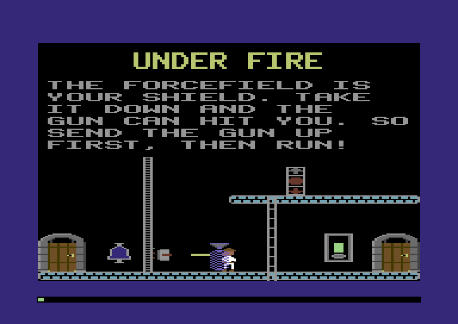
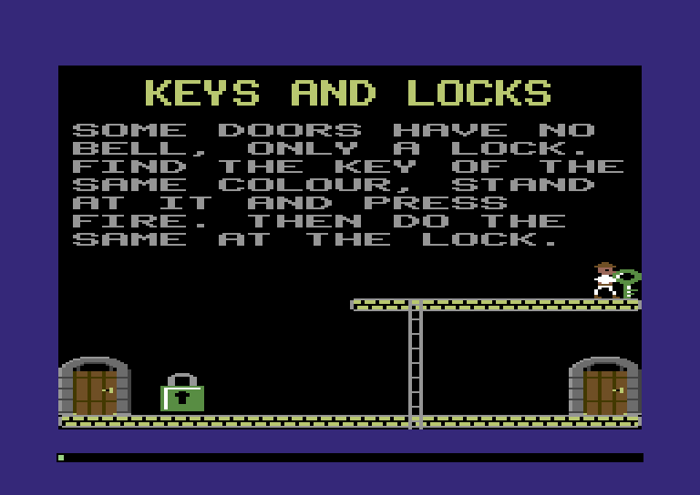
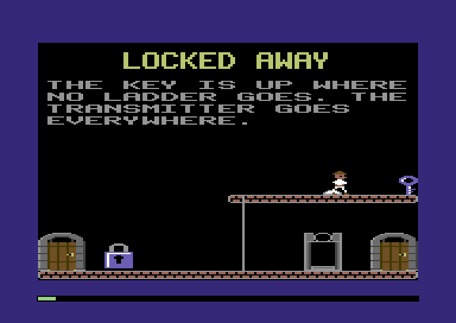
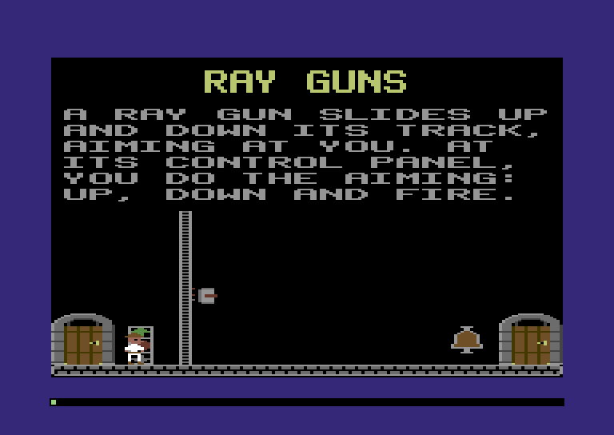
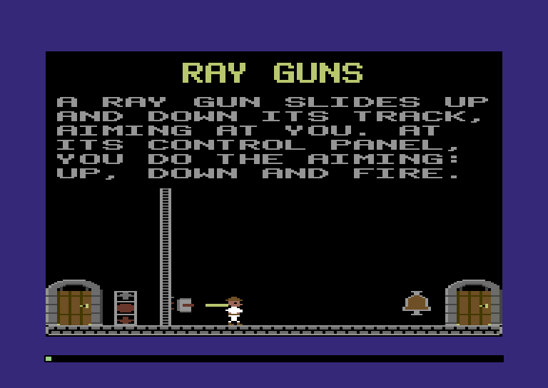
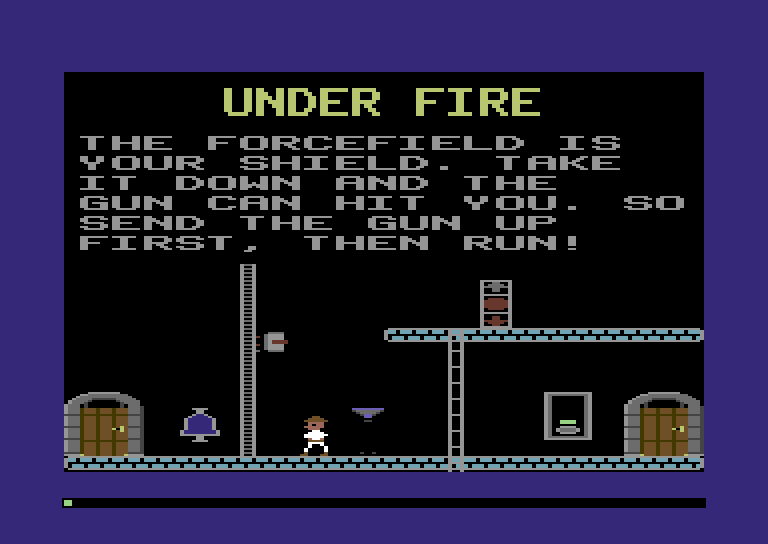

:::mission-briefing
Four more rooms of the Training Castle wake up in this chapter. A door
with no bell, only a lock, and a key of the same colour somewhere up a
ladder. A key you can only reach by matter transmitter. A ray gun that
slides up and down its track, turning to follow you, and fires the
moment you're level with it. And a room where the gun and a forcefield
work together: the field is your shield, until you need to get past it.



The explorer gets a pocket for keys. The guns get a control panel, so
he can take one over, steer it and fire it himself. And every shot is a
**laser**: the first actor that lives for a second and then is gone.

New under the hood: **taking something out of a table by moving the last
one into its place**, a gun's whole state in **one flag byte**, and
**spawning actors under a hard cap of eight sprites**.
:::

## A pocket for keys

In a 1984 castle, a key is a little picture standing on a walkway. Stand
at it and press fire, and it's gone from the room. It's in your pocket
now. Keys have colours, and so do locks. A lock opens its door for the
key of its colour, and nothing else.

:::under-the-hood `pocket.push(key)`
In JavaScript a pocket would be an array that grows:

```
const pocket = [];
pocket.push(5);            // the green key
pocket.includes(5);        // true: open the green lock
```

`push` asks for more memory whenever the array runs out. The engine
behind it finds a bigger block somewhere, copies the array across and
lets the old one go, and a garbage collector frees the old block later.
That's fine when there's plenty of memory and a collector to clean up.
We have neither.

So our pocket is a byte that counts the keys, and a fixed list of 32
bytes after it. Taking a key writes its number at `list[count]` and adds
one to the count. Looking for a key reads the list from 0 up to
`count − 1`.
Nothing ever grows, nothing is ever copied, and the pocket can't be
bigger than 33 bytes. 32 keys is more than any castle has.
:::

Where does the pocket live? The 1984 game keeps it in the castle file's
header, right beside the start rooms and the lives. That sounds odd, but
there's a good reason. A saved game is a copy of the castle, so the keys
you're carrying are saved with it, without a line of extra code. There
are two pockets, one for each player: two counts, then two lists. We
add the header addresses next to the lives:

**`src/castle.zig`** (in the header, add below `lives`)

```zig
pub const keys_count = header + 0x13; // keys carried: player 1, then player 2
pub const keys_held = header + 0x15; // their numbers: 32 for player 1, then 32 for player 2
pub const pocket = 32; // keys a player can carry
```

`keys_held + count` is where player 1's next key goes. Player 2's count is
the byte after player 1's, and his list starts 32 bytes after player 1's.
Player 2 arrives in Chapter 9, and his pocket is already there.

### The records

A key's record is four bytes: its number, its picture, and where it
stands. Its number is a colour, from 1 to 15, and the lock with the same
number is the one it opens. A lock's record says which of the room's
doors it opens:

**`src/castle.zig`** (replace the monsters, keys, locks and guns, from their comment to `Frankenstein`)

```zig
/// A key: its number, which is its colour too and the number of the lock
/// it opens, and its picture: the 1984 disk's picture number, $50 plus
/// the colour. We draw our own key in that colour, so all `shape` tells
/// us is whether the key is still there. 0 means it's been taken.
pub const Key = extern struct { number: u8, shape: u8, x: u8, y: u8 };

/// A lock: the number of the key it wants (its colour too), a picture
/// number nobody reads, and which of the room's doors it opens (0 is
/// the first).
pub const Lock = extern struct { number: u8, shape: u8, door: u8, x: u8, y: u8 };

// The guns and monsters later chapters bring to life, and the title
// screens' pattern. For now the loader only needs their sizes, and the
// authoring kit their fields.
pub const Mummy = extern struct { state: u8, ankh_x: u8, ankh_y: u8, tomb_x: u8, tomb_y: u8, runtime: [2]u8 };
pub const Pattern = extern struct { count: u8, shape: u8, x: u8, y: u8, step_x: u8, step_y: u8 };
pub const RayGun = extern struct { state: u8, x: u8, y: u8, length: u8, runtime: u8, control_x: u8, control_y: u8 };
pub const Frankenstein = extern struct { state: u8, x: u8, y: u8, runtime: [4]u8 };
```

The picture byte is a number from the 1984 game's own picture table,
`$50` plus the colour. Our pictures are numbered differently, so we
don't use it to draw. We draw our own key, coloured by its number. The
byte still has one job, and it's a good one. Taking a key writes a 0
there, in the castle. Prepare the room again and the key isn't drawn.
Once you've taken a key, it's gone for good.

The lock's picture byte isn't read at all, not even in 1984. Both
records' groups end with a 0 in the first byte, which is why colour 0,
black, can't be a key.

One picture each, recoloured for every key and lock:

**`src/shapes.zig`** (in `Id`, add at the end, after `pad`)

```zig
    key,
    lock,
```

:::type-in The key and the lock
**`src/art.zig`** (add above `// ---- pictures for the castle`)

```zig
// ---- keys and locks ---------------------------------------------------------

/// A key. Before it's drawn it's recoloured: code 10 in the key's own
/// colour, code 01 a white glint.
pub const key = room(.{ .white, .yellow, .light_grey }, &.{
    "..2222..",
    ".222222.",
    "221..222",
    "21....22",
    "21....22",
    "222..222",
    ".222222.",
    "..2222..",
    "...22...",
    "...21...",
    "...21...",
    "...2222.",
    "...21...",
    "...222..",
    "...21...",
    "...22...",
});

/// A lock: a shackle of code 11 over a body that's recoloured like a key:
/// code 10 in the colour of the key it wants, code 01 a white glint.
pub const lock = room(.{ .yellow, .yellow, .light_grey }, &.{
    "............",
    "....3333....",
    "...333333...",
    "..33....33..",
    "..33....33..",
    "..33....33..",
    "..33....33..",
    "..33....33..",
    "222222222222",
    "211111111112",
    "212222222222",
    "21222..22222",
    "2122....2222",
    "2122....2222",
    "21222..22222",
    "21222..22222",
    "21222..22222",
    "21222..22222",
    "212222222222",
    "212222222222",
    "212222222222",
    "222222222222",
    "............",
    "............",
});
```
:::

Code 10 is the key's colour, and code 01 is a glint of white. Like the
transmitter's pads in Chapter 6, the colours are set just before
drawing, so one picture serves all fifteen keys.

### A key leaves the table

Every object so far has stayed in the room for as long as the room was
on screen. A key doesn't. Once it's in your pocket, there's nothing to
stand in front of, and it shouldn't take up a slot.

The object table keeps its objects packed: slots 0 up to the count are
in use, and nothing in between is empty. Chapter 5 gave the flags byte a
bit for exactly this moment, `picked`, and left it waiting. To take an
object out, the 1984 game copies the **last** object over it and counts
one fewer:

:::diagram ch07-swap
:::

That's one write and a 16-byte copy, whatever the size of the table.
The order of the objects changes, and nothing in this game cares about
the order. A bell finds its door by number, not by slot. A switch finds
its machine by number too. That was Chapter 6's Index Link Power-Up, and
here it pays off again.

The object table's top comment, and its new kinds:

**`src/objects.zig`** (replace the comment at the top)

```zig
//! The room's object table: the things in a room that an actor can stand
//! in front of, or that have work to do. Preparing the room fills it, up
//! to 32 of them, 16 bytes each: doors and doorbells, the machines and
//! the switches that work them, and keys and locks. A key can leave the
//! table while the room runs.
```

**`src/objects.zig`** (add below the `transmitter` import)

```zig
const locks = @import("locks.zig");
```

**`src/objects.zig`** (replace `Kind`)

```zig
/// Every kind of object. Later chapters add more.
pub const Kind = enum(u8) { door, bell, machine, lever, button, trapdoor, plate, belt, control, booth, key, lock, _ };
```

**`src/objects.zig`** (in `kinds`, add below the booth's entry)

```zig
    .key = .{ .execute = null, .in_front = locks.take },
    .lock = .{ .execute = null, .in_front = locks.unlock },
```

`step` checks `picked` first:

**`src/objects.zig`** (replace `step`)

```zig
/// One engine step for the objects: the ones that asked to run, run.
/// Everything else costs one test of one bit. An object picked up in the
/// actors' step just before leaves the table here.
pub fn step(m: *Machine) void {
    var n: u8 = 0;
    while (n < m.peek(map.engine_objects)) : (n += 1) {
        const o = slot(m, n);
        m.work(12); // the test and the loop
        if (o.flags.picked) {
            remove(m, n);
            continue; // the object moved into n waits for the next step
        }
        if (!o.flags.execute) continue;
        if (kinds[@intFromEnum(o.kind)].execute) |execute| execute(m, n) else o.flags.execute = false;
    }
}
```

The loop reads the count from memory every time round now, because the
count can go down while the loop is running. After a removal, slot `n`
holds an object that hasn't had its turn. The `continue` moves on
anyway, so that object waits for the next step. That's 1984's rule.
Waiting one step, a 25th of a second, never matters to anything in this
game.

**`src/objects.zig`** (add below `step`)

```zig
/// Take object `n` out of the table: the last object moves into its slot,
/// and the table is one shorter. Nothing else moves.
fn remove(m: *Machine, n: u8) void {
    const last = m.peek(map.engine_objects) - 1;
    m.poke(map.engine_objects, last);
    if (n != last) m.copy(map.objects.first + @as(u16, n) * @sizeOf(Object), map.objects.first + @as(u16, last) * @sizeOf(Object), @sizeOf(Object));
}
```

:::inside-the-disk The slot number that went stale
One thing *does* keep a slot number: the explorer remembers which
trapdoor plate he was standing on, by its slot, from one turn to the
next. Pick up a key in a room with a plate, and the plate might move
into the key's slot. The 1984 game has the same quirk. No room puts a
key and a plate together, so it never bites.
:::

### Taking a key

The room's preparer gets two new entries:

**`src/room.zig`** (add below the `transmitter` import)

```zig
const locks = @import("locks.zig");
```

**`src/room.zig`** (in `prepares`, replace the key and lock entries)

```zig
    .key = locks.prepareKey,
    .lock = locks.prepareLock,
```

And a new file:

**`src/locks.zig`** (new file)

```zig
//! Keys and locks. A key is an object until the explorer presses fire at
//! it; then it's a number in his pocket. A lock opens its door when he
//! presses fire at it with the right number in his pocket.

const machine = @import("machine");
const Machine = machine.Machine;
const Color = machine.Color;
const castle = @import("castle.zig");
const room = @import("room.zig");
const shapes = @import("shapes.zig");
const actors = @import("actors.zig");
const objects = @import("objects.zig");
const player = @import("player.zig");

/// A key's or a lock's colours: code 10 is key number `number`'s colour,
/// and code 01 a white glint.
fn colors(number: u8) u8 {
    return @as(u8, @intFromEnum(Color.white)) << 4 | (number & 0x0F);
}
```

Preparing a key draws it, unless its picture byte says it's been taken:

**`src/locks.zig`** (add at the end)

```zig
/// A key record: the key, in its colour, unless it was taken on an
/// earlier visit. Then there's nothing to draw, and no object.
pub fn prepareKey(m: *Machine, r: castle.Record) void {
    const k = m.view(castle.Key, r.at);
    if (k.shape == 0) return; // taken: the castle remembers
    shapes.recolor(m, .key, colors(k.number));
    room.place(m, .key, k.x, k.y);
    _ = objects.add(m, .key, room.boxOf(m, .key, k.x, k.y), r.at);
}
```

The key's `in_front` is the moment he picks it up:

**`src/locks.zig`** (add at the end)

```zig
/// A key's `in_front`: the explorer presses fire at it, and it goes into
/// his pocket. It's rubbed out of the room and out of the castle, and the
/// object table lets it go at the end of the step.
pub fn take(m: *Machine, n: u8, who: u3) void {
    const a = actors.slot(m, who);
    const o = objects.slot(m, n);
    m.work(16); // the tests
    if (a.kind != .player or a.fire == 0 or !player.playing(m)) return;
    const count = m.peek(castle.keys_count);
    if (count == castle.pocket) return; // his pocket is full: leave it where it is
    const k = m.view(castle.Key, o.record);
    m.poke(castle.keys_held + count, k.number);
    m.poke(castle.keys_count, count + 1);
    k.shape = 0; // gone from the castle, for good
    room.unplace(m, .key, o.box.x, o.box.y);
    o.flags.picked = true;
    o.flags.disable = true; // and until it goes, nobody can stand in front of it
}
```

Like a doorbell, it wants the explorer, playing, and a press of fire.
If his pocket is full, the key stays where it is. Otherwise it puts the
key's number in his pocket, writes 0 into the castle record, and rubs
out the picture. Last, it raises two flags. `picked` tells the object
table to let the key go when the objects take their turn, right after
the actors'. `disable` stops anyone else
standing in front of it before then, so a key can't go into two
pockets.

Is a key in his pocket? Look through the list:

**`src/locks.zig`** (add at the end)

```zig
/// Is key `number` in his pocket?
pub fn carrying(m: *Machine, number: u8) bool {
    const count = m.peek(castle.keys_count);
    var i: u8 = 0;
    while (i < count) : (i += 1) {
        m.work(10); // the test and the loop
        if (m.peek(castle.keys_held + i) == number) return true;
    }
    return false;
}
```

### Locks

A lock is the key's partner. Press fire at it with its key in your
pocket, and its door gets to work:

**`src/locks.zig`** (add at the end)

```zig
/// A lock record: the lock, in the colour of the key it wants.
pub fn prepareLock(m: *Machine, r: castle.Record) void {
    const l = m.view(castle.Lock, r.at);
    shapes.recolor(m, .lock, colors(l.number));
    room.place(m, .lock, l.x, l.y);
    _ = objects.add(m, .lock, room.boxOf(m, .lock, l.x, l.y), r.at);
}

/// A lock's `in_front`: the explorer presses fire at it. With its key in
/// his pocket, its door gets to work, as if its bell had rung.
pub fn unlock(m: *Machine, n: u8, who: u3) void {
    const a = actors.slot(m, who);
    const l = m.view(castle.Lock, objects.slot(m, n).record);
    m.work(16); // the tests
    if (a.kind != .player or a.fire == 0 or !player.playing(m)) return;
    if (!carrying(m, l.number)) return;
    const d = objects.slot(m, objects.find(m, .door, l.door) orelse return);
    if (d.open == 0) d.flags.execute = true;
}
```

`unlock` ends just like `ring`, the bell's handler from Chapter 5. It
finds the door by its number, and if the door is shut, sets its
`execute`. The door neither knows nor cares whether a bell or a lock
woke it. The key stays in your pocket afterwards, so one key can open
several locks of its colour.

The authoring kit learns about keys and locks too. It checks that they're
on the screen, that nothing overlaps them, and that a lock's door
exists:

**`src/author.zig`** (in `checkRoom`, add above the walkways' loop)

```zig
    for (room.key, 0..) |k, i| {
        boxes = boxes ++ [_]Box{onScreen(name, std.fmt.comptimePrint("key {d}", .{i}), k.x, k.y, 8, 16)};
    }
    for (room.lock, 0..) |l, i| {
        const what = std.fmt.comptimePrint("lock {d}", .{i});
        boxes = boxes ++ [_]Box{onScreen(name, what, l.x, l.y, 12, 24)};
        if (l.door >= room.door.len) fail("room {s}: {s} opens door {d}, and the room has {d}", .{ name, what, l.door, room.door.len });
    }
```

### The Keys room

Writing `$50 + colour` by hand for every key would be asking for typos,
so the training castle gets two helpers. First, `Color` for its colour
names:

**`src/training.zig`** (add below the `art` import)

```zig
const Color = @import("machine").Color;
```

**`src/training.zig`** (add above `says`)

```zig
/// A key of colour `color`, standing at (x, y). Its number is its colour,
/// and its picture the 1984 disk's, $50 plus the colour.
fn key(color: Color, x: u8, y: u8) castle.Key {
    return .{ .number = @intFromEnum(color), .shape = 0x50 + @as(u8, @intFromEnum(color)), .x = x, .y = y };
}

/// A lock for the key of colour `color`, opening the room's door `door`.
fn lock(color: Color, door: u8, x: u8, y: u8) castle.Lock {
    return .{ .number = @intFromEnum(color), .shape = 0x57 + @as(u8, @intFromEnum(color)), .door = door, .x = x, .y = y };
}
```

The Keys room loses its doorbell. The lock takes the bell's place by
door 1, and the key waits upstairs at the end of the walkway:

**`src/training.zig`** (replace the `keys` room)

```zig
        .keys = .{
            .color = .yellow,
            .map = spot(9),
            .door = &.{
                .{ .x = 156, .y = 160, .to = .transmitter, .to_door = 1 },
                .{ .x = 16, .y = 160, .to = .ray_guns },
            },
            .walkway = &.{ floor, upper_right },
            .ladder = &.{ladder_right},
            .key = &.{key(.green, 168, 112)}, // upstairs, at the walkway's end
            .lock = &.{lock(.green, 1, 44, 168)}, // where door 1's bell would be
            .text = says("KEYS AND LOCKS", &.{
                "SOME DOORS HAVE NO",
                "BELL, ONLY A LOCK.",
                "FIND THE KEY OF THE",
                "SAME COLOUR, STAND",
                "AT IT AND PRESS",
                "FIRE. THEN DO THE",
                "SAME AT THE LOCK.",
            }),
        },
```

The test tries the lock first, empty-handed. Then it climbs to the key,
checks that the lock took the key's slot in the table, and comes back:

:::type-in The keys test
**`src/main.zig`** (add above `explorer`, near the end of the file)

```zig
test "keys: the lock does nothing without its key, and opens its door with it" {
    const m = try std.testing.allocator.create(Machine);
    defer std.testing.allocator.destroy(m);
    inRoom(m, 9); // Keys and Locks: the lock at x 44, the key upstairs at x 168
    const door = objects.slot(m, objects.find(m, .door, 1).?);
    while (feet(m) > 50) hold(m, machine.joy.left, 2); // to the lock
    hold(m, machine.joy.fire, 4);
    hold(m, 0, 4);
    try std.testing.expect(!door.flags.execute); // no key, no door
    try std.testing.expectEqual(0, door.open);

    // Up the ladder (x 112) and along to the key.
    while (feet(m) < 113) hold(m, machine.joy.right, 2);
    hold(m, machine.joy.up, 200);
    hold(m, machine.joy.right, 200);
    try std.testing.expectEqual(4, m.ram[map.engine_objects]); // two doors, the key, the lock
    try std.testing.expectEqual(objects.Kind.key, objects.slot(m, 2).kind);
    hold(m, machine.joy.fire, 4);
    try std.testing.expectEqual(1, m.ram[castle.keys_count]);
    try std.testing.expectEqual(@intFromEnum(Color.green), m.ram[castle.keys_held]);
    try std.testing.expectEqual(0, m.view(castle.Key, room.first(m, .key).?).shape); // gone for good
    // Gone from the table too: the last object, the lock, moved into its slot.
    try std.testing.expectEqual(3, m.ram[map.engine_objects]);
    try std.testing.expectEqual(objects.Kind.lock, objects.slot(m, 2).kind);

    // Back down, to the lock, and the door opens.
    while (feet(m) > 115) hold(m, machine.joy.left, 2);
    hold(m, machine.joy.down, 200);
    while (feet(m) > 50) hold(m, machine.joy.left, 2);
    hold(m, machine.joy.fire, 4);
    try std.testing.expectEqual(1, door.open);
    hold(m, machine.joy.left, 60);
    hold(m, machine.joy.up | machine.joy.right, 4);
    try std.testing.expectEqual(@intFromEnum(player.Status.doorway), m.ram[map.player_status]);
    try std.testing.expectEqual(10, m.ram[map.room_number]); // on to the Ray Guns
}
```

**`src/main.zig`** (add above `inRoom`)

```zig
/// Where his feet are, across the room.
fn feet(m: *Machine) u8 {
    return explorer(m).box.x + player.feet_x;
}
```
:::

`feet` is where his feet are across the room. Lots of tests in this
chapter walk "until his feet reach x", and it reads better with a name.



**The lock does nothing, then everything!** Walk to it first and press
fire: no key, no door. Fetch the key and try again, and the door
swings open.

## Locked Away

The Locked Away room has a key on a walkway with no ladder up to it.
Chapter 6 built the way up already: the matter transmitter. One booth on
the floor, one pad upstairs, and a pole for the way down:

**`src/training.zig`** (replace the `locked_away` room)

```zig
        .locked_away = .{
            .color = .pink,
            .map = spot(17),
            .door = &.{
                .{ .x = 156, .y = 160, .to = .mummy_storm, .to_door = 1 },
                .{ .x = 16, .y = 160, .to = .two_players },
            },
            .walkway = &.{ floor, upper_right },
            .pole = &.{.{ .length = 8, .x = 100, .y = 128 }}, // the way down
            .teleport = .{ .x = 128, .y = 160, .pads = &.{.{ .x = 136, .y = 120 }} }, // the way up
            .key = &.{key(.light_blue, 168, 112)},
            .lock = &.{lock(.light_blue, 1, 44, 168)},
            .text = says("LOCKED AWAY", &.{
                "THE KEY IS UP WHERE",
                "NO LADDER GOES. THE",
                "TRANSMITTER GOES",
                "EVERYWHERE.",
            }),
        },
```

The booth's target is pad 0, the only pad, so fire takes him straight
up. Its test uses `carrying`:

**`src/main.zig`** (add below the `training` import)

```zig
const locks = @import("locks.zig");
```

:::type-in Locked Away's test
**`src/main.zig`** (add above `explorer`)

```zig
test "locked away: the transmitter up to the key, the pole down to the lock" {
    const m = try std.testing.allocator.create(Machine);
    defer std.testing.allocator.destroy(m);
    inRoom(m, 17); // the booth at x 128, its one pad upstairs at x 136
    while (explorer(m).box.x > 132) hold(m, machine.joy.left, 2); // into the booth
    hold(m, machine.joy.fire, 4);
    try std.testing.expectEqual(128 - 21, explorer(m).box.y); // upstairs
    hold(m, machine.joy.right, 200);
    hold(m, machine.joy.fire, 4);
    try std.testing.expect(locks.carrying(m, @intFromEnum(Color.light_blue)));
    while (feet(m) > 103) hold(m, machine.joy.left, 2); // onto the pole (x 100)
    hold(m, machine.joy.down, 200);
    try std.testing.expectEqual(192 - 21, explorer(m).box.y);
    while (feet(m) > 50) hold(m, machine.joy.left, 2);
    hold(m, machine.joy.fire, 4);
    try std.testing.expectEqual(1, objects.slot(m, objects.find(m, .door, 1).?).open);
}
```
:::



Nothing in this room is new code. A key, a lock and a transmitter just
work together, and that's the reward for building each one as a
separate object that only knows its own job.

## Ray guns

Now the nasty one. A ray gun hangs on a vertical track. It slides up and
down, always towards your row. When it's level with you, it fires.
Somewhere in the room is a control panel with an up arrow, a fire button
and a down arrow. Stand at the panel and the gun is yours.

### A gun in one byte

Everything a gun is doing fits in its record's first byte, eight flags
that the castle and the game share. Two of them, plus `end`, come from
the castle file: which way the gun faces, and whether it has a gun at all. The rest
are written while the room runs: moving up, moving down, being steered,
fire pressed, a shot in the air.

**`src/castle.zig`** (replace the guns and monsters, from their comment to `Frankenstein`)

```zig
/// A ray gun, on a track `length` pieces long that hangs from (x, y), and
/// its control panel. `gun_y` is where the gun is on its track: the gun
/// moves, and the castle remembers where it got to.
pub const RayGun = extern struct { state: Gun, x: u8, y: u8, length: u8, gun_y: u8, control_x: u8, control_y: u8 };

/// A ray gun's state: eight flags in one byte, kept in the castle. The
/// castle file sets `left` and `no_gun`; the rest are the game's, while
/// the room is on screen.
pub const Gun = packed struct(u8) {
    left: bool = false, // bit 0: it faces left, and fires to the left
    down: bool = false, // bit 1: it's moving down its track
    up: bool = false, // bit 2: it's moving up
    fire: bool = false, // bit 3: the explorer at its panel pressed fire
    no_gun: bool = false, // bit 4: a track and a panel, and no gun
    steered: bool = false, // bit 5: the explorer at its panel is steering it
    shot: bool = false, // bit 6: its laser is in the air, so it can't fire again
    end: bool = false, // bit 7: not a gun at all, the end of the room's guns
};

// The monsters the next chapter brings to life, and the title screens'
// pattern. For now the loader only needs their sizes, and the authoring
// kit their fields.
pub const Mummy = extern struct { state: u8, ankh_x: u8, ankh_y: u8, tomb_x: u8, tomb_y: u8, runtime: [2]u8 };
pub const Pattern = extern struct { count: u8, shape: u8, x: u8, y: u8, step_x: u8, step_y: u8 };
pub const Frankenstein = extern struct { state: u8, x: u8, y: u8, runtime: [4]u8 };
```

`Gun` is a `packed struct(u8)`, like the actor's `State` from Chapter 5:
eight `bool`s, one bit each, in one byte. Our bit numbers are the 1984
game's, because the castle files are. A castle with `end` set in the
first byte of a record has no more guns, and the `Framing` for ray guns
already stops at `0x80`.

:::diagram ch07-gun-byte
:::

`gun_y` was called `runtime` until now. It's where the gun is on its
track, and it's in the record, so the castle remembers where the gun
was when you left the room. Come back, and that's where it starts.

The track, four gun pictures each way, and the panel:

**`src/shapes.zig`** (in `Id`, add at the end, after `lock`)

```zig
    track,
    gun_right_0,
    gun_right_1,
    gun_right_2,
    gun_right_3,
    gun_left_0,
    gun_left_1,
    gun_left_2,
    gun_left_3,
    panel,
```

:::type-in The gun's pictures
**`src/art.zig`** (add above `// ---- pictures for the castle`)

```zig
// ---- ray guns ---------------------------------------------------------------

/// A piece of a ray gun's track: a rail with rungs, 8 rows of it.
pub const track = room(.{ .dark_grey, .grey, .light_grey }, &.{
    "3223",
    "3..3",
    "3223",
    "3..3",
    "3223",
    "3..3",
    "3223",
    "3..3",
});

/// A ray gun, facing right, its wheels on the track at its left. Its four
/// pictures differ only in where the wheels' spokes are, so that as it
/// slides a row at a time, the wheels turn. The barrel is rows 5 and 6:
/// that's where the laser comes out.
pub const gun_right_0 = room(.{ .grey, .light_grey, .red }, &.{
    "1.......",
    "...1111.",
    "..12222.",
    "..12222.",
    "3.12222.",
    "..123333",
    "..123333",
    "..12222.",
    "3.12222.",
    "..12222.",
    "...1111.",
});

pub const gun_right_1 = room(.{ .grey, .light_grey, .red }, &.{
    "........",
    "...1111.",
    "..12222.",
    "3.12222.",
    "..12222.",
    "..123333",
    "..123333",
    "3.12222.",
    "..12222.",
    "..12222.",
    "1..1111.",
});

pub const gun_right_2 = room(.{ .grey, .light_grey, .red }, &.{
    "........",
    "...1111.",
    "3.12222.",
    "..12222.",
    "..12222.",
    "..123333",
    "3.123333",
    "..12222.",
    "..12222.",
    "1.12222.",
    "...1111.",
});

pub const gun_right_3 = room(.{ .grey, .light_grey, .red }, &.{
    "........",
    "3..1111.",
    "..12222.",
    "..12222.",
    "..12222.",
    "3.123333",
    "..123333",
    "..12222.",
    "1.12222.",
    "..12222.",
    "...1111.",
});

pub const gun_left_0 = mirror(gun_right_0);
pub const gun_left_1 = mirror(gun_right_1);
pub const gun_left_2 = mirror(gun_right_2);
pub const gun_left_3 = mirror(gun_right_3);

/// A ray gun's control panel: an up arrow, a fire button and a down
/// arrow, a cell row each. The arrows are code 01: the gun lights the one
/// for the way it's moving.
pub const panel = room(.{ .grey, .red, .light_grey }, &.{
    "33333333",
    "3..11..3",
    "3.1111.3",
    "31111113",
    "3..11..3",
    "3..11..3",
    "3......3",
    "33333333",
    "3......3",
    "3.2222.3",
    "32222223",
    "32222223",
    "32222223",
    "32222223",
    "3.2222.3",
    "3......3",
    "33333333",
    "3......3",
    "3..11..3",
    "3..11..3",
    "31111113",
    "3.1111.3",
    "3..11..3",
    "33333333",
});
```
:::

The four gun pictures differ only in where the marks on the wheel are.
Slide the gun one row and the next picture is drawn, so the wheel turns
as it rolls. The left-facing ones are `mirror`ed from the right.

### Two new objects

A gun is an object with work to do, and its panel is an object to stand
in front of:

**`src/objects.zig`** (replace the comment at the top)

```zig
//! The room's object table: the things in a room that an actor can stand
//! in front of, or that have work to do. Preparing the room fills it, up
//! to 32 of them, 16 bytes each: doors and doorbells, the machines and
//! the switches that work them, keys and locks, and ray guns. A key can
//! leave the table while the room runs.
```

**`src/objects.zig`** (add below the `locks` import)

```zig
const guns = @import("guns.zig");
```

**`src/objects.zig`** (replace `Kind`)

```zig
/// Every kind of object. Later chapters add more.
pub const Kind = enum(u8) { door, bell, machine, lever, button, trapdoor, plate, belt, control, booth, key, lock, gun, panel, _ };
```

**`src/objects.zig`** (in `kinds`, add below the lock's entry)

```zig
    .gun = .{ .execute = guns.run, .in_front = null },
    .panel = .{ .execute = null, .in_front = guns.steer },
```

**`src/room.zig`** (add below the `locks` import)

```zig
const guns = @import("guns.zig");
```

**`src/room.zig`** (in `prepares`, replace the ray gun entry)

```zig
    .ray_gun = guns.prepare,
```

Only the monsters and the title screens' pattern are left in `later`
now:

**`src/room.zig`** (replace the comment above `later`)

```zig
/// The monsters come alive in the next chapter, the title screens' pattern later.
```

A new file. The constants say what a gun is and what the panel reads
from the stick:

**`src/guns.zig`** (new file)

```zig
//! Ray guns and their control panels. A gun slides up and down its track,
//! following the explorer, and fires when he's level with it. At its
//! panel, he does the steering. A shot is a laser: an actor that lives
//! for one trip across the room.

const machine = @import("machine");
const Machine = machine.Machine;
const Color = machine.Color;
const map = @import("map.zig");
const castle = @import("castle.zig");
const room = @import("room.zig");
const shapes = @import("shapes.zig");
const actors = @import("actors.zig");
const objects = @import("objects.zig");
const player = @import("player.zig");

/// A gun is 8 fat pixels by 11 rows. It hangs beside its track: to the
/// right of it, or, facing left, 8 fat pixels to its left.
const gun_width = 8;
const gun_height = 11;

/// The stick's directions at the panel.
const stick_up = 0;
const stick_down = 4;
const stick_still = 0x80;

/// The panel's arrows are code 01 in their cells: lit green (up) or red
/// (down) while the gun moves that way, grey while it doesn't.
fn arrow(color: Color) u8 {
    return @as(u8, @intFromEnum(color)) << 4 | @intFromEnum(Color.grey);
}

comptime {
    if (@intFromEnum(shapes.Id.gun_right_3) != @intFromEnum(shapes.Id.gun_right_0) + 3 or
        @intFromEnum(shapes.Id.gun_left_3) != @intFromEnum(shapes.Id.gun_left_0) + 3)
        @compileError("each way's four gun pictures must be in a row in shapes.Id");
}
```

`arrow` builds a screen-plane byte from a colour, the way `tint` wants
it: the colour for code 01, and grey for code 10. The panel's arrows are
code 01, so tinting their cells lights them up.

Three helpers:

**`src/guns.zig`** (add at the end)

```zig
/// Where gun `g` hangs, beside its track.
fn gunX(g: *align(1) castle.RayGun) u8 {
    return if (g.state.left) g.x - gun_width else g.x + 4;
}

/// Gun `g`'s picture where it is now: the way it faces, and one of four,
/// by the low two bits of its row. A row down, the next picture: the
/// wheels turn as it slides.
fn picture(g: *align(1) castle.RayGun) shapes.Id {
    const first = @intFromEnum(if (g.state.left) shapes.Id.gun_left_0 else shapes.Id.gun_right_0);
    return @enumFromInt(first + (g.gun_y & 3));
}

/// The lowest row the gun's top can reach: its bottom on the track's last.
fn lowest(g: *align(1) castle.RayGun) u8 {
    return g.y + 8 * g.length - gun_height;
}
```

`picture` is the wheel trick in one line: the first picture for the way
it faces, plus the low two bits of its row. `lowest` is as far down as
the gun goes: its bottom on the track's last row.

Preparing the record draws the track piece by piece, then the gun,
then the panel:

**`src/guns.zig`** (add at the end)

```zig
/// A ray gun record: the track, the gun where the castle says it got to,
/// and the panel. The gun is an object that always has work to do.
pub fn prepare(m: *Machine, r: castle.Record) void {
    const g = m.view(castle.RayGun, r.at);
    g.state.shot = false; // whatever it fired on the last visit is long gone
    var i: u8 = 0;
    while (i < g.length) : (i += 1) room.place(m, .track, g.x, g.y + 8 * i);
    if (!g.state.no_gun) {
        room.place(m, picture(g), gunX(g), g.gun_y);
        const box: actors.Box = .{ .x = gunX(g), .y = g.gun_y, .width = gun_width, .height = gun_height };
        if (objects.add(m, .gun, box, r.at)) |n| objects.slot(m, n).flags.execute = true;
    }
    room.place(m, .panel, g.control_x, g.control_y);
    lamps(m, g, false, false);
    _ = objects.add(m, .panel, room.boxOf(m, .panel, g.control_x, g.control_y), r.at);
    m.work(30); // the sums and the stores
}

/// Light gun `g`'s panel arrows: up, down, or neither.
fn lamps(m: *Machine, g: *align(1) castle.RayGun, up: bool, down: bool) void {
    room.tint(m, g.control_x, g.control_y, 2, 1, arrow(if (up) .green else .grey));
    room.tint(m, g.control_x, g.control_y + 16, 2, 1, arrow(if (down) .red else .grey));
}
```

A gun's `execute` flag is on from the start, and stays on. It never
stops tracking you. A record with `no_gun` set has a track and a panel,
and nothing on the track.

### Turning towards you

Here's the gun's turn, for now without the firing:

**`src/guns.zig`** (add at the end)

```zig
/// A gun's `execute`, every fourth step. Unless the explorer at its panel
/// is steering it, it turns towards his row. Steered, it goes where the
/// panel says.
pub fn run(m: *Machine, n: u8) void {
    if (objects.clock(m) & 3 != 0) return;
    const o = objects.slot(m, n);
    const g = m.view(castle.RayGun, o.record);
    m.work(30); // the tests
    if (!g.state.steered) {
        g.state.up = false;
        g.state.down = false;
        if (player.playing(m)) {
            const him = actors.slot(m, @intCast(m.peek(map.player_actor))).box.y;
            if (him < g.gun_y) g.state.up = true else g.state.down = true;
        }
    }
    move(m, o, g);
    g.state.steered = false; // his panel says so again if he's still there
}
```

It only does anything on every fourth step: `clock & 3` is 0 one step in
four, so the gun moves 6 rows a second. Unless he's steering it, it
forgets which way it was going and looks at the explorer. His top row
is higher than the gun's? Up. Otherwise, down. That's all the aiming
there is, and it's enough to be scary.

**`src/guns.zig`** (add at the end)

```zig
/// A row up the track or a row down, if that's the way the gun wants to
/// go and there's track left. The picture follows it, and its panel's
/// arrows show which way it went.
fn move(m: *Machine, o: *align(1) objects.Object, g: *align(1) castle.RayGun) void {
    const old = picture(g);
    if (g.state.up and g.gun_y != g.y) {
        g.gun_y -= 1;
    } else if (g.state.down and g.gun_y < lowest(g)) {
        g.gun_y += 1;
    } else {
        lamps(m, g, false, false);
        return;
    }
    lamps(m, g, g.state.up, g.state.down);
    room.unplace(m, old, o.box.x, o.box.y);
    room.place(m, picture(g), o.box.x, g.gun_y);
    o.box.y = g.gun_y;
}
```

`move` takes one row, if there's track left that way. The picture comes
off at the old row and goes on at the new one, so the wheel turns. The
gun object's box moves with it. The panel's arrows show which way it's
going: the up arrow lit green, the down arrow red, both grey when it's
still.

### The panel

**`src/guns.zig`** (add at the end)

```zig
/// A panel's `in_front`: the explorer stands at it, and the gun is his.
/// Up and down move it, still holds it, and fire shoots. It hears all
/// that on its next turn.
pub fn steer(m: *Machine, n: u8, who: u3) void {
    const o = objects.slot(m, n);
    const a = actors.slot(m, who);
    m.work(20); // the tests
    if (a.kind != .player or !player.playing(m)) return;
    if (a.box.x +% player.feet_x -% o.box.x >= o.box.width) return; // his feet aren't at it
    const g = m.view(castle.RayGun, o.record);
    switch (a.stick) {
        stick_up => {
            g.state.up = true;
            g.state.down = false;
        },
        stick_down => {
            g.state.up = false;
            g.state.down = true;
        },
        stick_still => {
            g.state.up = false;
            g.state.down = false;
        },
        else => return,
    }
    g.state.steered = true;
    if (a.fire != 0) g.state.fire = true;
}
```

`steer` is the panel's `in_front`. It wants the explorer, alive, with
his feet in front of the panel. Then the stick decides. Up and down set
the gun's direction bits, and a stick held still clears them both. Any
other direction (left or right, so he's walking away) leaves the gun
alone. Then `steered` goes up, and on the gun's next turn, `run` skips
the tracking.

Every turn he stands there, `steer` sets `steered` again, and every turn
of the gun clears it. That's how the gun notices he's gone: the bit
isn't set any more, and the tracking starts again. One bit, written by
one object and cleared by another, says "someone is at the controls".

:::inside-the-disk Steering by hand
The 1984 panel copies the fire button straight into the gun's `fire`
bit, every turn he stands there, so holding fire at the panel keeps the
gun shooting. Ours sets it on a fresh press, like every other control in
this game, and the gun clears it when it fires. One press, one shot.
:::

The Ray Guns room gets a gun near door 0, facing right, down the room,
on a track that runs from high up to the floor. You come in behind it,
and its panel stands on the floor between the door and the track:

**`src/training.zig`** (replace the `ray_guns` room)

```zig
        .ray_guns = .{
            .color = .grey,
            .map = spot(10),
            .door = &.{
                .{ .x = 16, .y = 160, .to = .keys, .to_door = 1 },
                .{ .x = 156, .y = 160, .to = .mummy },
            },
            .walkway = &.{floor},
            .bell = &.{.{ .x = 140, .y = 168, .door = 1 }},
            // Facing right, down the room, from a track that runs from
            // high up to the floor. You come in behind it, by its panel.
            .ray_gun = &.{.{ .state = .{}, .x = 56, .y = 96, .length = 12, .gun_y = 171, .control_x = 40, .control_y = 168 }},
            .text = says("RAY GUNS", &.{
                "A RAY GUN SLIDES UP",
                "AND DOWN ITS TRACK,",
                "AIMING AT YOU. AT",
                "ITS CONTROL PANEL,",
                "YOU DO THE AIMING:",
                "UP, DOWN AND FIRE.",
            }),
        },
```

The test walks to the panel and checks that the gun holds still while
he stands there. Then he steers it to the top of its track and runs
along the floor, past the gun and out. That way out is a helper of its
own, because a test later in the chapter takes it too:

:::type-in The steering test
**`src/main.zig`** (add above `explorer`)

```zig
test "ray guns: steer the gun up from its panel, then run past it" {
    const m = try std.testing.allocator.create(Machine);
    defer std.testing.allocator.destroy(m);
    inRoom(m, 10);
    try escapeRayGuns(m);
}
```

**`src/main.zig`** (add above `feet`)

```zig
/// From the Ray Guns room's door 0: the panel, the gun to the top of its
/// track and a shot from there, then along the floor and out by door 1.
fn escapeRayGuns(m: *Machine) !void {
    const gun = m.view(castle.RayGun, room.first(m, .ray_gun).?);
    while (feet(m) < 41) hold(m, machine.joy.right, 2); // the panel, at x 40
    const before = gun.gun_y;
    hold(m, 0, 40); // standing at it, the gun holds still
    try std.testing.expectEqual(before, gun.gun_y);
    while (gun.gun_y != gun.y) hold(m, machine.joy.up, 2); // up to the top of its track

    // Along the floor past the gun, while it comes back down.
    while (feet(m) < 143) hold(m, machine.joy.right, 2); // to the bell
    hold(m, machine.joy.fire, 4);
    hold(m, machine.joy.right, 60);
    hold(m, machine.joy.up | machine.joy.right, 4);
    try std.testing.expectEqual(@intFromEnum(player.Status.doorway), m.ram[map.player_status]);
    try std.testing.expectEqual(11, m.ram[map.room_number]);
}
```
:::

Run it and play. Walk in, and the gun slides down its track to your
row, its down arrow lit red. At the panel it stops dead. Push up and it
climbs, its up arrow lit green.



It's a fine piece of machinery, and completely harmless. Let's give it
something to fire.

## Lasers

Every actor so far has lived as long as the room: the explorer, the
bolts, the fields. A laser lives for one trip across the room. It takes
a slot, flies, hits something or leaves the screen, and gives the slot
back. In the Under Fire room, that happens several times a second.

We built everything this needs back in Chapter 5. `actors.add` takes the
first slot whose `unused` flag is set. An actor's `destroy` flag gives it
a last turn, and `free` empties the slot at the end of the step. A
laser just uses all of it, all the time.

First, the actor table's comment, and `guns`, which will hold the
laser's code:

**`src/actors.zig`** (replace the comment at the top)

```zig
//! The actor table: everything in a room that moves by itself, as a
//! sprite. Eight slots in a row, one for each of the VIDEO chip's
//! sprites: slot n is sprite n. The explorer, bolts of lightning,
//! forcefields and lasers so far; the monsters move in next.
```

**`src/actors.zig`** (add below the `forcefields` import)

```zig
const guns = @import("guns.zig");
```

The laser's picture is two rows of yellow, 8 fat pixels long:

**`src/shapes.zig`** (in `Id`, add at the end, after `panel`)

```zig
    laser,
```

**`src/art.zig`** (add above `// ---- pictures for the castle`)

```zig
/// A laser: a sprite, two rows of light.
pub const laser = frame(.yellow, &.{
    "22222222",
    "22222222",
});
```

### Firing

The gun needs to know when to fire and which way its laser goes:

**`src/guns.zig`** (add below `stick_still`)

```zig
/// The gun fires when the explorer's top is fewer than 5 rows from its
/// own. Its laser flies right or left: stick directions 2 and 6.
const aim = 5;
const right = 2;
const left = 6;
```

Now the whole of `run`, with the firing at the end:

**`src/guns.zig`** (replace `run`)

```zig
/// A gun's `execute`, every fourth step. Unless the explorer at its panel
/// is steering it, it turns towards his row, and fires when he's within
/// 5 rows of it. Steered, it goes where the panel says, and fires when
/// the panel says.
pub fn run(m: *Machine, n: u8) void {
    if (objects.clock(m) & 3 != 0) return;
    const o = objects.slot(m, n);
    const g = m.view(castle.RayGun, o.record);
    m.work(30); // the tests
    var near: u8 = 0xFF; // rows between his top and the gun's
    if (!g.state.steered) {
        g.state.up = false;
        g.state.down = false;
        if (player.playing(m)) {
            const him = actors.slot(m, @intCast(m.peek(map.player_actor))).box.y;
            near = if (him > g.gun_y) him - g.gun_y else g.gun_y - him;
            if (him < g.gun_y) g.state.up = true else g.state.down = true;
        }
    }
    move(m, o, g);
    if (g.state.steered) {
        g.state.steered = false; // his panel says so again if he's still there
        if (!g.state.fire) return;
        g.state.fire = false;
    } else if (near >= aim) return;
    if (g.state.shot) return; // one laser at a time
    shoot(m, o, g);
}
```

`near` is how many rows apart his top and the gun's are. It starts at
`0xFF`, "nowhere near", for when he isn't playing. A gun he's steering
fires only if he pressed fire, and a gun on its own fires when he's
within 5 rows. Either way, one laser at a time: while `shot` is set, the
gun waits.

**`src/guns.zig`** (add below `move`)

```zig
/// Fire: a laser from the muzzle, flying the way the gun faces. If all
/// eight sprites are busy, there's no laser. A gun on its own fires on
/// its next turn; a press at the panel is lost.
fn shoot(m: *Machine, o: *align(1) objects.Object, g: *align(1) castle.RayGun) void {
    const n = actors.add(m, .laser) orelse return;
    const a = actors.slot(m, n);
    a.box.x = if (g.state.left) o.box.x - gun_width else o.box.x + gun_width;
    a.box.y = g.gun_y + 5; // the barrel's row
    a.way = if (g.state.left) left else right;
    actors.setFrame(m, n, .laser);
    g.state.shot = true;
    o.actor = n; // the link back: the laser's slot
}
```

`shoot` is where a laser is born. `actors.add` takes the first free
slot, and if every slot is taken it returns null and `shoot` gives up
quietly. There are only eight sprites, and there is no ninth to give.
A gun on its own fires on a later turn, when it's still near him. A
press at the panel is lost, and he presses again. The laser starts just
past the muzzle, on the barrel's row. `shot` goes up, and the gun keeps
the laser's slot in its `actor` byte, the same link Chapter 6's machines
keep to their bolts.

:::diagram ch07-slots
:::

:::inside-the-disk Slot zero, overwritten
The 1984 game's slot finder also says when the table is full: it raises
a one-bit signal in the processor. The laser maker never looks at it.
It goes ahead with slot 0, whatever is in it. In a room full of
monsters, a gun firing could take over the first actor's sprite, and
that's usually player 1. Ours checks for null and doesn't fire at all.
:::

### The flight

**`src/guns.zig`** (add below `shoot`)

```zig
/// A laser's turn, every step: 4 fat pixels on, until it's off the edge
/// of the screen. Its last turn frees its slot and tells its gun it can
/// fire again.
pub fn fly(m: *Machine, n: u3) void {
    const a = actors.slot(m, n);
    if (a.state.destroy) {
        a.state.destroy = false;
        a.state.free = true;
        if (gunOf(m, n)) |o| {
            o.actor = actors.none;
            m.view(castle.RayGun, o.record).state.shot = false;
        }
        return;
    }
    a.state.created = false;
    a.box.x +%= if (a.way == right) 4 else 0xFC; // 0xFC is -4
    m.work(16); // the sums and the tests
    if (a.box.x >= 8 and a.box.x < castle.left_edge + 160) return;
    a.state.destroy = true; // off the edge
}

/// The gun that fired laser `n`: the one whose `actor` is n.
fn gunOf(m: *Machine, n: u3) ?*align(1) objects.Object {
    const count = m.peek(map.engine_objects);
    var i: u8 = 0;
    while (i < count) : (i += 1) {
        const o = objects.slot(m, i);
        m.work(12); // the tests and the loop
        if (o.kind == .gun and o.actor == n) return o;
    }
    return null;
}
```

`fly` is the laser's turn, and it gets one every step, because `add`
set its pace to 1. It moves 4 fat pixels the way the gun faces. Off the
edge of the screen, it sets its own `destroy`.

`destroy` is Chapter 5's flag for an actor's last turn. The engine calls
`fly` once more, and this time it tidies up. It sets `free`, which
empties the slot at the end of the step. Then it finds its gun and
clears `shot`, so the gun can fire again. The gun keeps the laser's
slot, and `gunOf` looks for the gun that holds it. It's the link
Chapter 6 taught, followed backwards.

What does a laser hit?

**`src/guns.zig`** (add below `gunOf`)

```zig
/// A laser's `hit`: any sprite it meets stops it, an explorer or a
/// forcefield.
pub fn blocked(m: *Machine, n: u3, other: u3) bool {
    _ = m;
    _ = n;
    _ = other;
    return true;
}

/// A laser's `touch`: a lightning machine stops it, and so does any gun
/// but its own, which it leaves from right beside.
pub fn strike(m: *Machine, n: u3, object: u8) bool {
    const o = objects.slot(m, object);
    m.work(12); // the tests
    return switch (o.kind) {
        .machine => true,
        .gun => o.actor != n,
        else => false,
    };
}
```

Its `hit`, for sprites, stops it on anything it meets, an explorer or a
field. It doesn't flicker, so it goes at once. Its `touch` is for
objects: a lightning machine stops it, and so does any gun but its own.
Without that last test, every laser would hit its own gun on the first
step, because it starts right next to the gun's muzzle.

The explorer's side is already written. Chapter 6's `player.hit` kills
him on any sprite but a forcefield, and a laser isn't a forcefield.

### A new kind of actor

Now the laser can go in the actor table:

**`src/actors.zig`** (replace `Kind`)

```zig
/// Every kind of actor, numbered as in 1984. Number 3 is the mummy's,
/// who comes alive in the next chapter.
pub const Kind = enum(u8) { player, lightning, forcefield, laser = 4, _ };
```

The kinds keep the 1984 game's numbers, because castles and the engine
both mean the same thing by "kind 4". Number 3 is the mummy, who comes
in the next chapter, so the laser is `laser = 4`. A Zig enum can give
any tag an explicit number like that, and the tags after it count on
from there.

Its entry in the table:

**`src/actors.zig`** (in `kinds`, add below the forcefield's entry)

```zig
    .laser = .{ .turn = guns.fly, .flickers = false, .hit = guns.blocked, .touch = guns.strike, .group = 0b100 },
```

Build now, and `directEnumArray` refuses:

```
Cannot create a direct enum array for actors.Kind. It would have 1 unused slots, but only 0 are allowed.
```

The table is an array indexed by the kind's number, so a laser at 4
needs five entries, and the mummy's entry, number 3, would be empty. The
third argument to `directEnumArray` is how many gaps we allow, and we
said 0. Make it 1:

**`src/actors.zig`** (replace the first line of `kinds` and the comment above it)

```zig
/// One entry for every kind, found by number. The compiler won't build
/// the table with a kind missing, and allows one gap: the mummy's.
const kinds = std.enums.directEnumArray(Kind, Behaviour, 1, .{
```

The gap's entry is filled with `undefined`, so nothing may be made with
kind 3 until the mummy arrives. The compiler stops a missing entry for a
named kind. For a gap with no name, all it can do is count.

A laser's group is `0b100`, the same as lightning's. The two share a
bit, so a laser flies straight through a bolt. The explorer's group is
0, so a laser always finds him. The forcefield's `0b011` shares nothing
with `0b100`, so a laser and a field meet, and that's the next room's
whole idea.

### Tests

`main.zig` needs `guns` now:

**`src/main.zig`** (add below the `locks` import)

```zig
const guns = @import("guns.zig");
```

Walk along the floor, past the panel and the gun's muzzle, and count
the lasers on the way:

**`src/main.zig`** (add above the steering test)

```zig
test "ray guns: past the muzzle, the gun shoots him" {
    const m = try std.testing.allocator.create(Machine);
    defer std.testing.allocator.destroy(m);
    inRoom(m, 10); // he comes in behind the gun, which faces right from x 60
    var lasers: usize = 0;
    while (m.ram[map.player_status] == @intFromEnum(player.Status.playing)) {
        hold(m, machine.joy.right, 2);
        lasers = @max(lasers, count(m, .laser));
    }
    try std.testing.expectEqual(@intFromEnum(player.Status.dead), m.ram[map.player_status]);
    try std.testing.expectEqual(1, lasers); // one at a time
    try std.testing.expect(feet(m) > 68 and feet(m) < 140); // past the muzzle, short of the bell
}
```

The way out learns to fire. At the top of the track, the laser flies
high over the room:

**`src/main.zig`** (in `escapeRayGuns`, add below the `// up to the top of its track` line)

```zig
    hold(m, machine.joy.fire, 4); // and fire it, high over the room
    hold(m, 0, 8); // the gun hears it on its next turn
    try std.testing.expectEqual(1, count(m, .laser));
    try std.testing.expect(gun.state.shot);
    hold(m, 0, 60);
    try std.testing.expectEqual(0, count(m, .laser));
    try std.testing.expect(!gun.state.shot);
```

Now a room you can lose for good. When he dies on the floor, the gun
stops on the floor's row, and the castle remembers it there. Come back
by door 0 and you're behind it, so the panel is still yours:

**`src/main.zig`** (add above `explorer`)

```zig
test "ray guns: shot once, the room can still be won from its door" {
    const m = try std.testing.allocator.create(Machine);
    defer std.testing.allocator.destroy(m);
    inRoom(m, 10);
    while (m.ram[map.player_status] == @intFromEnum(player.Status.playing)) hold(m, machine.joy.right, 2);
    hold(m, 0, 100); // back at the castle's start, the gun left on the floor's row
    try std.testing.expectEqual(0, m.ram[map.room_number]);
    for (0..10) |_| { // N ten times: by door 0, the gun where it was
        m.input = .{ .key = 'N' };
        _ = m.runFrame(@This());
        m.input = .{};
        hold(m, 0, 14);
    }
    try std.testing.expectEqual(10, m.ram[map.room_number]);
    try std.testing.expect(m.view(castle.RayGun, room.first(m, .ray_gun).?).gun_y > 166); // in range of the floor
    try escapeRayGuns(m);
}
```

And the cap. Fill all eight sprite slots, and the gun can't fire. Free
one, and the next laser goes into it:

**`src/main.zig`** (add above `explorer`)

```zig
test "with all eight sprites busy, the gun holds its fire until one is free" {
    const m = try std.testing.allocator.create(Machine);
    defer std.testing.allocator.destroy(m);
    inRoom(m, 10); // the explorer is actor 0
    const n = objects.find(m, .gun, 0) orelse return error.NoGun;
    const gun = m.view(castle.RayGun, objects.slot(m, n).record);
    while (actors.add(m, .laser)) |_| {} // fill slots 1 to 7
    m.ram[map.game_tick] = 0; // the gun's turn
    gun.state = .{ .left = true, .steered = true, .fire = true }; // as if his panel said "fire"
    guns.run(m, n);
    try std.testing.expect(!gun.state.shot);
    try std.testing.expect(!gun.state.fire); // that press is used up
    actors.slot(m, 5).state = .{ .unused = true };
    gun.state.steered = true;
    gun.state.fire = true;
    guns.run(m, n);
    try std.testing.expect(gun.state.shot);
    try std.testing.expectEqual(5, objects.slot(m, n).actor); // the laser took the free slot
    try std.testing.expectEqual(actors.Kind.laser, actors.slot(m, 5).kind);
}
```

That last test is the only one in the chapter that sets the gun's flags
directly. That's fine for a test of `run` on its own. The room tests
play through the stick, as a player would.



**Zapped!** Walk past the muzzle along the floor and the gun gets you
long before the far door. The way through is the panel. Push the gun to
the top of its track and run for the bell. It takes about eleven seconds
to come back down, and you need about six.

## Under Fire

The last room puts a gun and a forcefield together. The gun faces right,
along the floor, and the field stands between it and you. Lasers hit
the field and stop. The field's button is at your end of the room. Press
it, and there's nothing between you and the gun.

**`src/training.zig`** (replace the comment at the top)

```zig
//! The Training Castle: one lesson per room, written with the authoring
//! kit. The next chapter adds the monsters.
```

**`src/training.zig`** (replace the `under_fire` room)

```zig
        .under_fire = .{
            .color = .cyan,
            .map = spot(15),
            .door = &.{
                .{ .x = 156, .y = 160, .to = .frank_ride, .to_door = 1 },
                .{ .x = 16, .y = 160, .to = .mummy_storm },
            },
            .walkway = &.{ floor, upper_right },
            .ladder = &.{ladder_right},
            .bell = &.{.{ .x = 44, .y = 168, .door = 1 }},
            // The gun faces right, at the field. Its panel is upstairs.
            .forcefield = &.{.{ .button_x = 136, .button_y = 160, .field_x = 88, .field_y = 168 }},
            .ray_gun = &.{.{ .state = .{}, .x = 60, .y = 96, .length = 12, .gun_y = 171, .control_x = 120, .control_y = 104 }},
            .text = says("UNDER FIRE", &.{
                "THE FORCEFIELD IS",
                "YOUR SHIELD. TAKE",
                "IT DOWN AND THE",
                "GUN CAN HIT YOU. SO",
                "SEND THE GUN UP",
                "FIRST, THEN RUN!",
            }),
        },
```

The sign says it all: send the gun up from its panel first, then take
the field down and run. Two tests. The first leans on the field while
the lasers die on its far side, then presses the button and waits for
the bad news. The second plays the room through:

:::type-in Under Fire's tests
**`src/main.zig`** (add above the sprite-cap test)

```zig
test "under fire: the forcefield stops the lasers, and without it they hit" {
    const m = try std.testing.allocator.create(Machine);
    defer std.testing.allocator.destroy(m);
    inRoom(m, 15); // the gun faces right from x 72, at the field at x 88
    var lasers: usize = 0;
    for (0..200) |_| {
        hold(m, machine.joy.left, 2); // up against the field, and leaning on it
        lasers += count(m, .laser);
        try std.testing.expectEqual(@intFromEnum(player.Status.playing), m.ram[map.player_status]);
    }
    try std.testing.expect(lasers > 0);

    // Back to the button, and down goes his shield.
    while (explorer(m).box.x < 138) hold(m, machine.joy.right, 2);
    hold(m, machine.joy.fire, 4);
    hold(m, 0, 100);
    try std.testing.expectEqual(@intFromEnum(player.Status.dead), m.ram[map.player_status]);
}

test "under fire: send the gun up from its panel, then take the field down and run" {
    const m = try std.testing.allocator.create(Machine);
    defer std.testing.allocator.destroy(m);
    inRoom(m, 15);
    const gun = m.view(castle.RayGun, room.first(m, .ray_gun).?);
    while (feet(m) > 115) hold(m, machine.joy.left, 2); // the ladder, at x 112
    hold(m, machine.joy.up, 200);
    while (feet(m) < 121) hold(m, machine.joy.right, 2); // the panel, at x 120
    while (gun.gun_y != gun.y) hold(m, machine.joy.up, 2);
    while (feet(m) > 115) hold(m, machine.joy.left, 2);
    hold(m, machine.joy.down, 200);
    while (explorer(m).box.x < 138) hold(m, machine.joy.right, 2);
    hold(m, machine.joy.fire, 4); // the field goes down
    while (feet(m) > 50) hold(m, machine.joy.left, 2); // past the field and the gun, to the bell
    hold(m, machine.joy.fire, 4);
    hold(m, machine.joy.left, 60);
    hold(m, machine.joy.up | machine.joy.right, 4);
    try std.testing.expectEqual(@intFromEnum(player.Status.doorway), m.ram[map.player_status]);
    try std.testing.expectEqual(16, m.ram[map.room_number]);
}
```
:::

Run the tests, and the first one fails:

```
error: 'main.test.under fire: the forcefield stops the lasers, and without it they hit' failed:
       expected 0, found 3
```

He's dead, leaning on the field: status 3 is `dead`, and the check
inside the loop caught it. The field was supposed to be his shield!

### Boxes that only touch

Let's see what happened. He stands with his left edge at x 92, up
against the field's sprite, which runs from 88 to 95. So his sprite
overlaps the field's, by four fat pixels, and the VIDEO chip sets his
sprite-to-sprite bit. A laser arrives at x 84. It covers 84 to 91,
overlapping the field too, and gets its bit.

Now `hitting` runs for him. His bit is set, and so is the laser's. Which
sprite did he touch? The register can't say, so we compare boxes. The
laser's box ends at 84 + 8 = 92, and his starts at 92. Chapter 5's
`overlap` counts boxes whose edges touch, so the laser "hit" him. But
the laser's last fat pixel is 91. They never shared one.

For an object, counting the edge is right. It decides whether he's in
front of a door or on a plate, and a little generosity helps there. For
two sprites, the only question is whether their pictures can have
touched, and two boxes that only meet at an edge can't have. So sprites
get their own test, which leaves the edge out:

**`src/actors.zig`** (in `hitting`, replace the `overlap` line)

```zig
        if (!share(m, a.box, b.box)) continue;
```

**`src/actors.zig`** (add below `hitting`)

```zig
/// Do two sprites' boxes share a fat pixel? Here an edge that only
/// touches doesn't count, unlike in front of an object: two pictures that
/// only touch can't have set each other's bits.
fn share(m: *Machine, a: Box, b: Box) bool {
    m.work(40); // four compares, four sums
    return @as(u16, a.x) + a.width > b.x and @as(u16, b.x) + b.width > a.x and
        @as(u16, a.y) + a.height > b.y and @as(u16, b.y) + b.height > a.y;
}
```

`share` is `overlap` with `>` in place of `>=`. Run the tests again, and
they pass. Lean on the field as long as you like.

:::inside-the-disk The same test, edge and all
The 1984 game compares sprite boxes with the edge included, the same
test as for objects, so its explorer could die the same way. We changed
it, because this room is built to teach the field as a shield, and a
shield that kills you teaches the wrong thing.
:::



**Every Training Castle room with a key or a gun works!** Rooms 9, 10,
15 and 17: two locks, two keys and two guns.

:::power-up The Last-One-In Power-Up
To take something out of a packed table, copy the last one over it and
count one fewer. It's one copy, whatever the size of the table. It
changes the order, so it's only for tables where nothing remembers a
slot number, and that's every table that links by number instead.
:::

:::power-up The Spawn-and-Free Power-Up
A short-lived actor takes the first unused slot and frees its own on
its last turn. Whoever made it keeps the slot number, so it knows when
the actor's gone. If `add` says null, the table is full: try again on
a later turn, or let that shot go, but never take someone else's slot.
:::

:::byte-budget Chapter 7
**Memory.** No new regions. The pockets live in the castle's header, at
`$7813`–`$7854`: two counts, then two lists of 32. A gun's state is the
first byte of its record. The object slot stays 16 bytes. The shape
table grew by 509 bytes, to 3,774, for 13 new pictures. The castle is
4,496 bytes, 61 more.

**Time.** Taking a key out of the table adds 120 cycles to that step:
the 16-byte copy, 128, less one slot's worth of loop. A gun moving a row costs about 1,430 cycles, mostly
rubbing out its picture and drawing it again, every fourth step. A gun's
turn on the other three steps costs 4. Firing adds about 650 more, to
unpack the laser's sprite. A laser's own turn is 16 cycles in the air
and 52 on its last turn. The busiest step of the Boss Battle is 2,204
cycles in the objects' bucket, in the Under Fire room, each time the gun
takes its turn and fires at the field. That's about a ninth of a frame.
:::

:::game-over Common mistakes
- **Taking a key crashes, or the lock stops working.** `step` must read
  the count from memory each time round the loop. A count kept in a
  local goes past the end of the shorter table.
- **The key is back when you come back.** `take` must write 0 into the
  record's `shape`, and `prepareKey` must skip a key whose `shape` is 0.
- **The gun shoots itself.** The laser's `touch` must ignore the gun
  whose `actor` is the laser.
- **The gun fires once and never again.** The laser's last turn must
  clear its gun's `shot`. Check that `shoot` keeps the slot in
  `o.actor`.
- **The gun ignores the panel.** `steer` uses the stick from his last
  turn, so check the directions: up is 0, down is 4, still is `0x80`.
- **The build stops on `directEnumArray`.** The laser is kind 4, so the
  table needs one gap: the third argument is 1.
:::

:::boss-battle Keys and guns, one run
From your project folder:

```
zig build
zig build test
zig build run -- --frames 4745 --press 20:f:5 --key 45:N --key 60:N --key 75:N --key 90:N --key 105:N --key 120:N --key 135:N --key 150:N --key 165:N --press 185:l:230 --press 415:f:5 --press 440:r:126 --press 566:u:70 --press 636:r:130 --press 766:f:5 --press 781:l:114 --press 895:d:70 --press 965:l:126 --press 1091:f:5 --press 1096:l:60 --press 1156:ur:10 --press 1326:r:32 --press 1398:u:596 --press 1994:f:5 --press 2059:r:204 --press 2263:f:5 --press 2268:r:60 --press 2328:ur:10 --key 2498:N --key 2513:N --key 2528:N --key 2543:N --press 2578:l:140 --press 2778:r:36 --press 2814:u:70 --press 2884:r:16 --press 2900:u:514 --press 3414:l:12 --press 3426:d:70 --press 3496:r:56 --press 3552:f:5 --press 3557:l:182 --press 3739:f:5 --press 3744:l:60 --press 3804:ur:10 --key 3978:N --press 4013:l:64 --press 4077:f:5 --press 4092:r:90 --press 4182:f:5 --press 4197:l:138 --press 4335:d:70 --press 4405:l:102 --press 4507:f:5 --press 4512:l:60 --press 4572:ur:10 --dump-every 10
```

The run presses N nine times for the Keys room and plays it. It goes on
through the Ray Guns room, presses N four times for Under Fire, and once
more for Locked Away. It prints:

```
ran 4745 frames (4541 calls to frame)
cycles: max 236486 (1203%), avg 1595 (8%) of 19656
  bucket 0: max 326, avg 27
  bucket 1: max 235206, avg 937
  bucket 2: max 1274, avg 166
  bucket 3: max 2002, avg 330
  bucket 4: max 2204, avg 133
overruns: 0, loading pauses: 20
last frame: frames/frame_04744.ppm
```

`frame_00740.ppm` has the explorer upstairs at the green key.
`frame_01720.ppm` has him at the panel, steering the gun up.
`frame_02740.ppm` has a laser flying at the field. `frame_03680.ppm` is
the run past the gun with the field down, and `frame_04110.ppm` has him
on the pad upstairs in Locked Away. The last frame is the Two's Company
room.

Then play it:

```
zig build wasm
python3 -m http.server -d web
```

Open <http://localhost:8000>. Walk into the Ray Guns room and along the
floor, past the gun, and see how far you get. Then come back, try the
panel, and fire the gun high over the room.

**Locked and loaded!** Keys, locks, guns and their lasers all work. Next
chapter, the monsters.
:::

:::warp-zone
The finished checkpoint is [`code/ch07/`](../code/ch07/), also as a
download, [`ch07.zip`](downloads/ch07.zip), which unzips into the same
`code/` folder as the others. To start Chapter 8 from a known-good game,
replace your project with it:

```
cd code
rm -rf my-creep
cp -r ch07 my-creep
rm -rf my-creep/.zig-cache my-creep/zig-out my-creep/web
```
:::

:::bonus-stage
- **A pocket you can see.** Draw the explorer's keys along the bottom
  of the screen, one small square of each colour, from the pocket list.
- **A faster gun.** Let a gun move every other step instead of every
  fourth. How much harder does Ray Guns get?
- **Two guns, two panels.** Give the Ray Guns room a second gun on its
  own track. Each gun has its own panel in the record. Put them side by
  side, and steer them in turn.
- **A gun with no gun.** Set `no_gun` on a record and see what's left:
  a track and a panel, steering nothing.
:::
