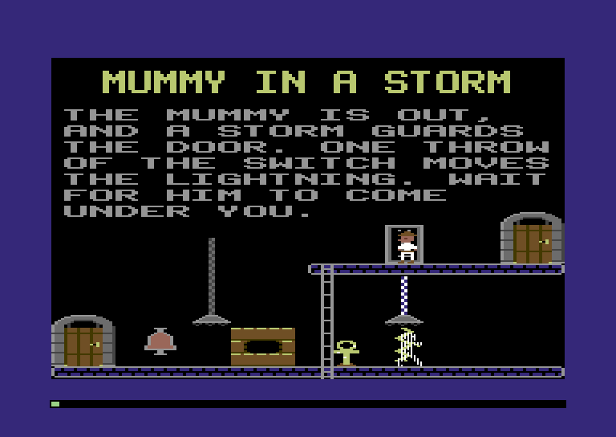
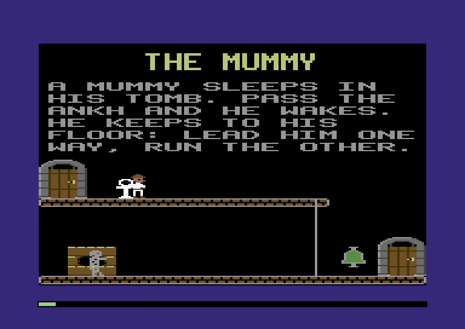
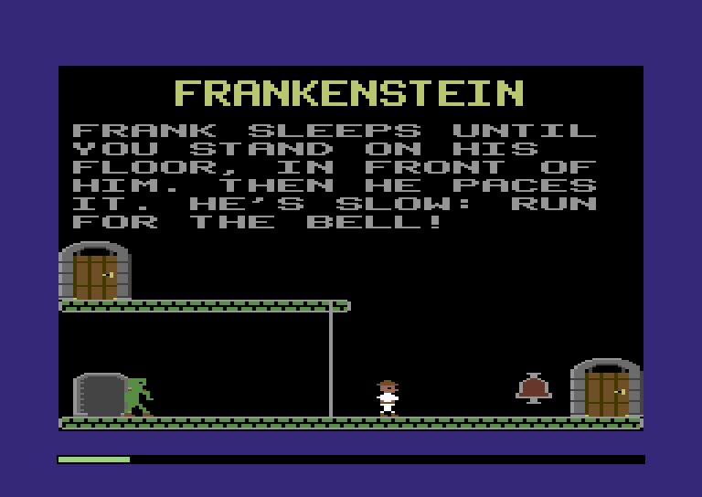
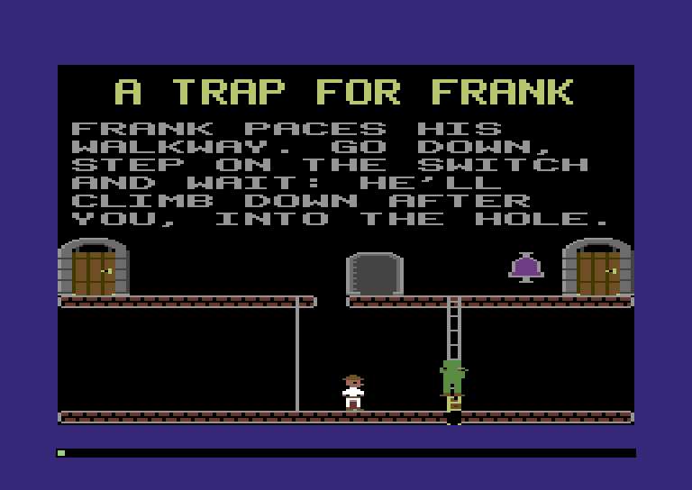
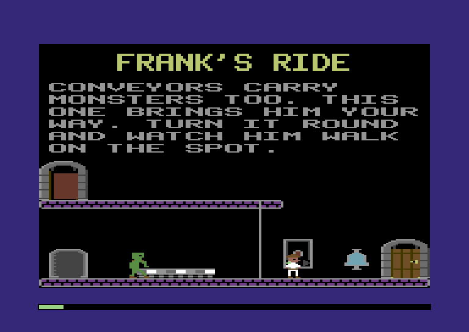

:::mission-briefing
The castle has been too quiet. Its machines hum and its guns slide up
and down, but nothing in it *wants* you. This chapter wakes the two
things that do. A **mummy** sleeps in a tomb of sandstone blocks until
you walk past his ankh, then climbs out and follows you along his floor.
**Frankenstein's monster** stands asleep in his alcove until you share
his floor, then walks the walkways, ladders and poles after you, and
never stops.



Five more Training Castle rooms come alive: the Mummy, Frankenstein,
A Trap for Frank, Frank's Ride and Mummy in a Storm. The monsters fall
into trapdoors, ride conveyor belts, and die in lightning and laser fire,
all with the machines we already built.

And the lightning gets proper dice. New under the hood: **XOR and bit
rotation**, and how a computer makes numbers that **look random but
come out the same every time**.
:::

## Dice that come up the same

Chapter 6's bolts flicker by the clock: each turn, a bolt mixes the
step counter with its slot number and calls that a dice roll. It isn't
really random, and the pattern repeats every few seconds.

The 1984 game has a proper number maker, and it's tiny. Two bytes of
memory hold the **dice**. Each roll stirs them with a rotate and two
XORs, keeps the result for next time, and hands one byte back.

:::under-the-hood `Math.random()`
In JavaScript, `Math.random()` gives a number between 0 and 1, and you
never know which. That's no good in a test: a test that plays a room
needs the bolts to flicker the same way every run.

So we use a **pseudo-random** number maker: a little sum that turns one
number into the next. The numbers *look* random, but start from the
same number, the **seed**, and you get the same list every time. Record
the joystick, play it back, and the bolts flicker exactly as before.

Chapter 2 scattered the title's stars with a sum like this, a multiply
and an add. The Comet's CPU can't multiply in one instruction, so the 1984 dice
use its two cheapest tricks: moving bits along, and XOR.
:::

### XOR

We met `^` in Chapter 2, flipping the explorer's sprite block between 0
and 8. It's **exclusive OR**. For each pair of bits it gives 1 if they
differ and 0 if they're the same:

```
  0101 0111     $57
^ 1110 0011     $E3
= 1011 0100     $B4
```

Read it as "flip the bits of the first number wherever the second has a
1". That's why `^ 8` flipped bit 3 and nothing else. With a messy second
number, like `$E3`, XOR flips a messy set of bits, and the result looks
like neither input. That's the stirring.

### Rotation

A **rotate** moves every bit one place along, and the bit that falls
off one end comes back in at the other. `std.math.rotr(u16, x, 1)` rotates a 16-bit number one place right:
bit 0 lands in bit 15, and every other bit moves down one.

One roll does a rotate and two XORs. Here's the very first roll after
power-on:

:::diagram ch08-dice
:::

That's the whole recipe. The 1984 game's version is a handful of
instructions at `$5ED5`, and ours makes the same numbers in the same
order.

### Two bytes of memory

The dice need a home. The engine's two bytes end at `$020E`, so the
dice go right after them:

**`src/map.zig`** (add above the text region)

```zig
/// The dice: two bytes, and each roll makes the next pair from the last
/// (dice.zig).
pub const dice = Region{ .name = "dice", .first = 0x020F, .last = 0x0210 };
pub const dice_low = dice.first + 0;
pub const dice_high = dice.first + 1;
```

**`src/map.zig`** (in `regions`, add below `engine`)

```zig
    dice,
```

A new file. The seed is the 1984 game's own two bytes, `$C6` and `$57`:

**`src/dice.zig`** (new file)

```zig
//! The dice: numbers that look random, rolled the way the 1984 game rolls
//! them. Two bytes of memory hold the dice. Each roll stirs them with a
//! rotate and two XORs, and hands back one of them.

const std = @import("std");
const machine = @import("machine");
const Machine = machine.Machine;
const map = @import("map.zig");

/// The two bytes the 1984 game starts its dice from.
const first_low: u8 = 0xC6;
const first_high: u8 = 0x57;

/// Once, at power-on: the same dice every time.
pub fn start(m: *Machine) void {
    m.poke(map.dice_low, first_low);
    m.poke(map.dice_high, first_high);
}
```

`start` runs once, at boot. It never runs again, not even for a new
game, so the dice carry on from wherever they got to.

**`src/dice.zig`** (add at the end)

```zig
/// Roll: the next byte. Take the two bytes as one 16-bit number and
/// rotate it a bit to the right, so the high byte's bottom bit lands at
/// the top of the low byte. XOR that low byte into the high byte. Then
/// the new low byte is the old one, its bottom bit cleared, XOR the new
/// high byte.
pub fn roll(m: *Machine) u8 {
    const low = m.peek(map.dice_low);
    const high = m.peek(map.dice_high);
    const turned: u8 = @truncate(std.math.rotr(u16, @as(u16, high) << 8 | low, 1));
    const new_high = high ^ turned;
    const new_low = (low & 0xFE) ^ new_high;
    m.poke(map.dice_high, new_high);
    m.poke(map.dice_low, new_low);
    m.work(24); // two rotates, three XORs, an AND
    return new_low;
}
```

`turned` is the low byte of the rotated number: `@truncate` keeps the
low 8 bits of the 16.

The first test checks that we roll 1984's numbers, in 1984's order. The
second asks how long before they repeat:

**`src/dice.zig`** (add at the end)

```zig
// ---- tests ----------------------------------------------------------------

test "the dice roll 1984's numbers, in 1984's order" {
    const m = try std.testing.allocator.create(Machine);
    defer std.testing.allocator.destroy(m);
    m.* = .{};
    start(m);
    for ([_]u8{ 0x72, 0xFF, 0x8C, 0xB8, 0xD0, 0xD0, 0xB8, 0x8C }) |want| {
        try std.testing.expectEqual(want, roll(m));
    }
}

test "after their first roll, the dice come round again every 32,767 rolls" {
    const m = try std.testing.allocator.create(Machine);
    defer std.testing.allocator.destroy(m);
    m.* = .{};
    start(m);
    _ = roll(m); // the starting pair never comes back, but this one does
    const low = m.ram[map.dice_low];
    const high = m.ram[map.dice_high];
    var rolls: usize = 0;
    var fours = [_]usize{0} ** 4; // how often each of the four low-bit pairs comes up
    while (true) {
        fours[roll(m) & 3] += 1;
        rolls += 1;
        if (m.ram[map.dice_low] == low and m.ram[map.dice_high] == high) break;
    }
    try std.testing.expectEqual(32_767, rolls);
    for (fours) |n| try std.testing.expect(n > 8_100 and n < 8_300); // a quarter each, near enough
}
```

After their first roll, the dice go round a loop of 32,767 pairs, half
of all there are. The starting pair, `$57 $C6`, leads onto the loop and
never comes up again. The test also counts the bottom two bits of every
roll: each of 00 to 11 comes up close to a quarter of the time. That's
what the bolts use, `roll & 3`. Two rolls in a row aren't independent,
though: the second's bottom bit follows from the first. For a
flickering bolt, nobody can tell.

Boot starts the dice:

**`src/main.zig`** (add below the `guns` import)

```zig
const dice = @import("dice.zig");
```

**`src/main.zig`** (in `boot`, add below `player.start`)

```zig
    dice.start(m);
```

### The bolts roll

A bolt rolls twice each turn: once for how long until its next turn,
and once for its next picture:

**`src/lightning.zig`** (add below the `player` import)

```zig
const dice = @import("dice.zig");
```

**`src/lightning.zig`** (replace `crackle`)

```zig
/// A bolt's turn: a new wait before the next, from 1 to 4 steps, and a
/// new picture, never the same one twice running, both by the dice. A
/// switched-off machine sets `destroy`, and the bolt's last turn frees
/// its slot.
pub fn crackle(m: *Machine, n: u3) void {
    const a = actors.slot(m, n);
    if (a.state.destroy) {
        a.state.destroy = false;
        a.state.free = true;
        return;
    }
    a.state.created = false;
    a.pace = 1 + (dice.roll(m) & 3);
    const first = @intFromEnum(shapes.Id.bolt_0);
    var next = dice.roll(m) & 3;
    if (first + next == a.frame) next = (next + 1) & 3; // the same again: the next one instead
    actors.setFrame(m, n, @enumFromInt(first + next));
    m.work(20); // the sums and the test
}
```

The wait is 1 to 4 steps, as before. The picture is one of the four
bolt pictures, by the dice. If it comes up the same as the one showing,
the bolt takes the next one instead, so it never sits still. That's
1984's rule, roll for roll.

Run the Lightning room, room 4. Every bolt takes the next roll of the
same dice, so two machines no longer dance in step.

## The mummy

A mummy's record says three things: his state, where his ankh stands,
and where his tomb is. His state is 1 while he sleeps in the tomb, 2
once he's out, and 3 when he's gone for good. Two more bytes were called
`runtime` until now. They're where he is once he's out of the tomb:

**`src/castle.zig`** (replace the monsters and the pattern, from their comment to `Frankenstein`)

```zig
/// A mummy, his tomb, and the ankh that wakes him. `state` says where he
/// is. Out of his tomb, (x, y) is where he got to: the castle remembers,
/// a step at a time.
pub const Mummy = extern struct { state: u8, ankh_x: u8, ankh_y: u8, tomb_x: u8, tomb_y: u8, x: u8, y: u8 };
pub const mummy_tomb: u8 = 1; // asleep in his tomb
pub const mummy_out: u8 = 2; // out, and after you
pub const mummy_dead: u8 = 3; // gone for good

// Frankenstein's monster, later in this chapter, and the title screens'
// pattern. For now the loader only needs their sizes, and the authoring
// kit their fields.
pub const Pattern = extern struct { count: u8, shape: u8, x: u8, y: u8, step_x: u8, step_y: u8 };
pub const Frankenstein = extern struct { state: u8, x: u8, y: u8, runtime: [4]u8 };
```

Like a gun's row in Chapter 7, his position is in the castle record.
Leave him halfway across the floor, come back, and there he is.

### Pictures

The tomb is built of sandstone blocks, 5 across and 3 down. When he
wakes, the middle three blocks of the middle row fall out and leave a
dark hole. He climbs out in three pictures and walks in three each way:

**`src/shapes.zig`** (in `Id`, add at the end, after `laser`)

```zig
    brick,
    tomb_open,
    ankh,
    mummy_rise_0,
    mummy_rise_1,
    mummy_rise_2,
    mummy_right_0,
    mummy_right_1,
    mummy_right_2,
    mummy_left_0,
    mummy_left_1,
    mummy_left_2,
```

:::type-in The mummy's pictures
**`src/art.zig`** (add above `// ---- pictures for the castle`)

```zig
// ---- the mummy --------------------------------------------------------------

/// A block of the tomb's sandstone. The tomb is 15 of them, five across
/// and three high.
pub const brick = room(.{ .brown, .orange, .yellow }, &.{
    "3332",
    "2222",
    "2222",
    "2222",
    "2222",
    "2222",
    "2222",
    "1111",
});

/// The hole in the tomb's middle row, once its three middle blocks fall.
pub const tomb_open = room(.{ .brown, .orange, .yellow }, &.{
    "21........12",
    "1..........1",
    "............",
    "1..........1",
    "1..........1",
    "............",
    "1..........1",
    "11........11",
});

/// The ankh. Walk past it and the mummy wakes; it flashes while he does.
pub const ankh = room(.{ .orange, .yellow, .white }, &.{
    "..2222..",
    ".22..22.",
    ".2....2.",
    ".2....3.",
    ".22..22.",
    "..2222..",
    "22222222",
    "23222222",
    "...22...",
    "...22...",
    "...32...",
    "...22...",
    "...22...",
    "...22...",
    "..1221..",
    ".111111.",
});

/// The mummy waking, seen from the front: arms crossed, then one arm out,
/// then both. Bandages are the sprite's own colour, eyes the shared orange.
pub const mummy_rise_0 = frame(.light_grey, &.{
    "..2222..",
    ".222222.",
    ".232232.",
    ".222222.",
    ".2.22.2.",
    "..2222..",
    ".222222.",
    "2.2222.2",
    "22.22.22",
    "2222.222",
    "2.2222.2",
    ".222222.",
    ".22.222.",
    ".222.22.",
    ".222222.",
    ".22.222.",
    "..2222..",
    "..2..2..",
    "..2..2..",
    "..2..2..",
    ".22..22.",
});

pub const mummy_rise_1 = frame(.light_grey, &.{
    "..2222..",
    ".222222.",
    ".232232.",
    ".222222.",
    ".2.22.2.",
    "..2222..",
    "2222222.",
    "2.22222.",
    "2.2.22.2",
    "2222.222",
    "2.2222.2",
    ".222222.",
    ".22.222.",
    ".222.22.",
    ".222222.",
    ".22.222.",
    "..2222..",
    "..2..2..",
    "..2..2..",
    "..2..2..",
    ".22..22.",
});

pub const mummy_rise_2 = frame(.light_grey, &.{
    "..2222..",
    ".222222.",
    ".232232.",
    ".222222.",
    "22.22.22",
    "2.2222.2",
    "22222222",
    "2.2222.2",
    "..2.22..",
    "..22.2..",
    "..2222..",
    "..22.2..",
    "..2.22..",
    "..2222..",
    "..22.2..",
    ".222222.",
    ".22..22.",
    ".22..22.",
    ".2....2.",
    ".2....2.",
    "22....22",
});

/// Walking, arms out in front: three frames each way.
pub const mummy_right_0 = frame(.light_grey, &.{
    "..222...",
    ".22222..",
    ".22232..",
    ".22222..",
    ".2.222..",
    "..222...",
    ".2222222",
    ".22.2222",
    ".2222...",
    ".2.22...",
    ".2222...",
    ".22.2...",
    ".2222...",
    ".2.22...",
    ".22222..",
    ".22.22..",
    "222..22.",
    "22...22.",
    "2.....22",
    "2.....22",
    "22.....2",
});

pub const mummy_right_1 = frame(.light_grey, &.{
    "..222...",
    ".22222..",
    ".22232..",
    ".22222..",
    ".2.222..",
    "..222...",
    ".2222222",
    ".22.2222",
    ".2222...",
    ".2.22...",
    ".2222...",
    ".22.2...",
    ".2222...",
    ".2.22...",
    ".2222...",
    ".22.2...",
    "..222...",
    "..222...",
    "..22.2..",
    "..2..2..",
    "..22.22.",
});

pub const mummy_right_2 = frame(.light_grey, &.{
    "..222...",
    ".22222..",
    ".22232..",
    ".22222..",
    ".2.222..",
    "..222...",
    ".2222222",
    ".22.2222",
    ".2222...",
    ".2.22...",
    ".2222...",
    ".22.2...",
    ".2222...",
    ".2.22...",
    ".22222..",
    ".22.22..",
    ".22..2..",
    ".2...22.",
    "22....2.",
    "2.....22",
    "22.....2",
});

pub const mummy_left_0 = mirror(mummy_right_0);
pub const mummy_left_1 = mirror(mummy_right_1);
pub const mummy_left_2 = mirror(mummy_right_2);
```
:::

Build now, and the compiler stops:

```
error: the shape table doesn't fit in its region
```

That's Chapter 2's packer, checking the table against its region. The
mummy's twelve pictures don't fit. The region was 4,096 bytes, from
`$6800` up to the castle at `$7800`, and Frankenstein's monster still
has to come. So we move the star map and the shape table down 2,048
bytes, and give the table 6,144:

**`src/map.zig`** (replace the star map and the shape table)

```zig
pub const stars = Region{ .name = "star map", .first = 0x5F00, .last = 0x5FFF };
pub const shape_table = Region{ .name = "shape table", .first = 0x6000, .last = hw.program_end - 1 };
```

The 2 KB comes out of the program image, the room we keep for the
game's code. It still has nearly 22 KB. Boot copies the stars and the
table to their new homes without a line changed.

### Who's on the plate?

A monster stepping on a trapdoor's switch should flip it, as the
explorer does. He keeps "the switch under my feet this turn" and "last
turn" in two bytes of his own. A monster keeps them in the object that
runs it, in two of the slot's spare bytes:

**`src/objects.zig`** (in `Object`, replace the `spare` bytes)

```zig
    plate: u8, // a monster's: the trapdoor switch under its feet this turn, or none
    last_plate: u8, // ...and last turn
    spare: u8,
```

**`src/objects.zig`** (in `add`, replace the last two lines before `return n`)

```zig
    o.actor = actors.none;
    o.plate = none;
    o.last_plate = none;
    m.work(36); // the stores
```

An object knows its actor by slot number, in `actor`. The mummy's turn
needs the opposite: from the actor, its object. Chapter 7's `gunOf` did
that for guns only. Let's make it work for any kind:

**`src/objects.zig`** (add above `clock`)

```zig
/// The object of `kind` that runs actor `n`: the link from an object to
/// its actor, followed backwards. An actor never keeps an object's number,
/// because taking a key out of the table moves the objects about.
pub fn owner(m: *Machine, kind: Kind, n: u3) ?*align(1) Object {
    const count = m.peek(map.engine_objects);
    var i: u8 = 0;
    while (i < count) : (i += 1) {
        const o = slot(m, i);
        m.work(12); // the tests and the loop
        if (o.kind == kind and o.actor == n) return o;
    }
    return null;
}
```

Why not keep the object's number in the actor instead? Because objects
move: taking a key copies the last object into its slot. Actors never
move, so the object's `actor` is safe.

The laser uses it now:

**`src/guns.zig`** (in `fly`, replace the `gunOf` line)

```zig
        if (objects.owner(m, .gun, n)) |o| {
```

Delete `gunOf` from `guns.zig`. Nothing calls it any more.

The trapdoor code learns to serve anyone:

**`src/trapdoors.zig`** (add below the `objects` import)

```zig
const actors = @import("actors.zig");
const player = @import("player.zig");
```

`underfoot` moves here from the explorer's file:

**`src/trapdoors.zig`** (add below `open`)

```zig
/// Something is under an actor's feet when they're within 4 fat pixels
/// of its left edge, one byte of the screen.
const underfoot = 4;
```

`under` says what's under an actor's feet:

**`src/trapdoors.zig`** (add at the end)

```zig
/// What an actor can find under its feet.
pub const Under = enum { nothing, hole, plate };

/// What actor `n` finds under its feet at object `object`: the hole of an
/// open trapdoor (a shut one can't be stood in front of), a switch, or
/// nothing.
pub fn under(m: *Machine, n: u3, object: u8) Under {
    const a = actors.slot(m, n);
    const o = objects.slot(m, object);
    m.work(16); // the tests
    if (a.box.x +% player.feet_x -% o.box.x >= underfoot) return .nothing;
    return switch (o.kind) {
        .trapdoor => .hole,
        .plate => .plate,
        else => .nothing,
    };
}
```

`tread` flips a switch when an actor steps onto it. It takes pointers to
the two bytes, wherever they live.

**`src/trapdoors.zig`** (add at the end)

```zig
/// A switch flips when it's stepped onto: when an actor's touch found one
/// under its feet this turn (`plate`) that wasn't there last turn
/// (`last`). Standing on it doesn't flip it again. Then this turn's
/// becomes last turn's, and this turn's is cleared for the next touch.
pub fn tread(m: *Machine, plate: *align(1) u8, last: *align(1) u8) void {
    if (plate.* != objects.none and plate.* != last.*) flip(m, plate.*);
    last.* = plate.*;
    plate.* = objects.none;
    m.work(16); // the tests and the stores
}
```

In `player.zig`, delete `underfoot` and the explorer's own `tread`.
His turn hands his two bytes to the new one:

**`src/player.zig`** (in `turn`, replace the `tread` line)

```zig
    trapdoors.tread(m, m.view(u8, map.player_plate), m.view(u8, map.player_last_plate));
```

**`src/player.zig`** (replace `touch`)

```zig
/// His `touch`: he's in front of object `object`. An open trapdoor under
/// his feet is the end of him; a trapdoor's switch under them is noted,
/// for his turn to flip.
pub fn touch(m: *Machine, n: u3, object: u8) bool {
    switch (trapdoors.under(m, n, object)) {
        .hole => return die(m),
        .plate => m.poke(map.player_plate, object),
        .nothing => {},
    }
    return false;
}
```

His `touch` is a `switch` on what `under` found, and the compiler checks
that no answer is forgotten.

### A new file for the mummy

The constants say what a mummy is:

**`src/mummy.zig`** (new file)

```zig
//! Mummies, their tombs and their ankhs. A mummy sleeps in a tomb of
//! sandstone blocks until someone walks past his ankh. Then the blocks
//! fall, he climbs out, and he follows the explorer along his floor,
//! for as long as the castle stands.

const machine = @import("machine");
const Machine = machine.Machine;
const Color = machine.Color;
const map = @import("map.zig");
const castle = @import("castle.zig");
const grid = @import("grid.zig");
const room = @import("room.zig");
const shapes = @import("shapes.zig");
const actors = @import("actors.zig");
const objects = @import("objects.zig");
const player = @import("player.zig");
const trapdoors = @import("trapdoors.zig");

/// The tomb: 5 blocks across and 3 down, each 4 fat pixels by 8 rows.
/// Its hole is the middle three blocks of the middle row.
const across = 5;
const down = 3;

/// The ankh wakes him when the explorer's feet are fewer than 8 fat
/// pixels past its left edge.
const reach = 8;

/// Out of his tomb, he stands in front of the hole, feet on the floor
/// under the tomb: 6 fat pixels in from its left edge, 3 rows down from
/// its top.
const out_x = 6;
const out_y = 3;
```

Preparing his record builds the tomb block by block. If he's already
out, the middle blocks come out. Then the ankh, an object. If he's out
and not dead, he's an actor too:

**`src/mummy.zig`** (add at the end)

```zig
/// A mummy record: the tomb, open if he's out of it, and the ankh, an
/// object. Out and not dead, he's an actor too, where the castle says he
/// got to.
pub fn prepare(m: *Machine, r: castle.Record) void {
    const u = m.view(castle.Mummy, r.at);
    var row: u8 = 0;
    while (row < down) : (row += 1) {
        var col: u8 = 0;
        while (col < across) : (col += 1) room.place(m, .brick, u.tomb_x + 4 * col, u.tomb_y + 8 * row);
    }
    if (u.state != castle.mummy_tomb) open(m, u);
    room.place(m, .ankh, u.ankh_x, u.ankh_y);
    const n = objects.add(m, .ankh, room.boxOf(m, .ankh, u.ankh_x, u.ankh_y), r.at) orelse return;
    if (u.state == castle.mummy_out) wake(m, n, false);
    m.work(20); // the tests
}

/// Knock out the middle three blocks of the tomb's middle row, and draw
/// the hole they leave.
fn open(m: *Machine, u: *align(1) castle.Mummy) void {
    const y = u.tomb_y + 8;
    var col: u8 = 1;
    while (col < across - 1) : (col += 1) room.unplace(m, .brick, u.tomb_x + 4 * col, y);
    room.place(m, .tomb_open, u.tomb_x + 4, y);
}
```

`open` rubs out three blocks with Chapter 6's `unplace` and draws the
hole.

### The ankh

The ankh is the trigger. Walk past it, and the mummy wakes. It flashes
white and gold while he climbs out:

**`src/mummy.zig`** (add above `prepare`)

```zig
/// The ankh's colours, and white for when it flashes: 8 flashes, a change
/// every fourth step.
const gold: u8 = @as(u8, @intFromEnum(Color.orange)) << 4 | @intFromEnum(Color.yellow);
const flash: u8 = @as(u8, @intFromEnum(Color.white)) << 4 | @intFromEnum(Color.white);
const flashes = 8;
```

**`src/mummy.zig`** (add at the end)

```zig
/// The ankh's `in_front`: the explorer walks past it. If its mummy is in
/// his tomb, he's out now, in the castle and on the screen: the ankh
/// flashes, the tomb opens, and he climbs out.
pub fn release(m: *Machine, n: u8, who: u3) void {
    const o = objects.slot(m, n);
    const a = actors.slot(m, who);
    m.work(20); // the tests
    if (a.kind != .player or !player.playing(m)) return;
    if (a.box.x +% player.feet_x -% o.box.x >= reach) return;
    const u = m.view(castle.Mummy, o.record);
    if (u.state != castle.mummy_tomb) return;
    u.state = castle.mummy_out;
    u.x = u.tomb_x + out_x; // where he'll be once he's out, in case
    u.y = u.tomb_y + out_y; // the room ends before he is
    o.flags.execute = true;
    o.step = flashes;
    open(m, u);
    wake(m, n, true);
}

/// The ankh's `execute`, every fourth step after it woke him: white, then
/// gold again, 8 times over.
pub fn glow(m: *Machine, n: u8) void {
    if (objects.clock(m) & 3 != 0) return;
    const o = objects.slot(m, n);
    o.step -= 1;
    if (o.step == 0) o.flags.execute = false;
    room.tint(m, o.box.x, o.box.y, 2, 2, if (o.step & 1 != 0) flash else gold);
}
```

`release` is the ankh's `in_front`. It wants the explorer, playing, with
his feet fewer than 8 fat pixels past the ankh's left edge. If the
mummy is in his tomb, he's out now. The castle hears first: state 2,
and a position in front of the tomb, in case the room ends before he
takes a step. Then the ankh flashes, the tomb opens, and the mummy is
made.

`glow` is the ankh's `execute`. Every fourth step it tints the ankh's
cells white or gold, eight times, and then switches itself off.

### Climbing out

The climb is a little table. Each entry is a picture and a step down:

**`src/mummy.zig`** (add above `prepare`)

```zig
/// Climbing out, one entry a turn, a turn every fourth step: a picture
/// and a step down. He starts in the hole, 8 rows up, and drops to the
/// floor. Then he walks.
const Rise = struct { dy: u8 = 0, frame: shapes.Id };
const rise = [_]Rise{
    .{ .frame = .mummy_rise_0 },
    .{ .frame = .mummy_rise_0 },
    .{ .frame = .mummy_rise_1 },
    .{ .dy = 2, .frame = .mummy_rise_1 },
    .{ .dy = 2, .frame = .mummy_rise_2 },
    .{ .dy = 2, .frame = .mummy_rise_2 },
    .{ .dy = 2, .frame = .mummy_rise_2 },
};
const rise_pace = 4;
const walk_pace = 2;
const rise_drop = 8;
comptime {
    var y: u8 = 0;
    for (rise) |r| y += r.dy;
    if (y != rise_drop) @compileError("climbing out must drop him 8 rows, from the hole to the floor");
}

/// His walk: three pictures each way, in a row in shapes.Id.
const right_0 = @intFromEnum(shapes.Id.mummy_right_0);
const left_0 = @intFromEnum(shapes.Id.mummy_left_0);
comptime {
    if (@intFromEnum(shapes.Id.mummy_right_2) != right_0 + 2 or @intFromEnum(shapes.Id.mummy_left_2) != left_0 + 2)
        @compileError("each way's three mummy pictures must be in a row in shapes.Id");
}
```

He starts in the hole, 8 rows above the floor, and takes one entry a
turn, a turn every fourth step. The `comptime` block checks that the
steps add up to 8 while the game compiles.

**`src/mummy.zig`** (add at the end)

```zig
/// Ankh `n`'s mummy as an actor: climbing out of the hole, or already out
/// where the castle says. With no sprite free, he stays in the castle and
/// out of sight until the next visit.
fn wake(m: *Machine, n: u8, climbing: bool) void {
    const o = objects.slot(m, n);
    const u = m.view(castle.Mummy, o.record);
    const slot = actors.add(m, .mummy) orelse return;
    o.actor = slot;
    const a = actors.slot(m, slot);
    if (climbing) {
        a.box.x = u.tomb_x + out_x;
        a.box.y = u.tomb_y + out_y - rise_drop;
        a.pace = rise_pace;
        actors.setFrame(m, slot, rise[0].frame);
    } else {
        a.box.x = u.x;
        a.box.y = u.y;
        a.walk = rise.len;
        a.pace = walk_pace;
        actors.setFrame(m, slot, .mummy_left_0);
    }
    m.work(20); // the stores
}
```

`wake` makes the actor. A mummy just released starts at the top of the
climb. One already out starts where the castle says, with the climb
over. `walk`, the field that counts the explorer's steps through a
doorway, counts through the climbing table for the mummy.

### Walking

**`src/mummy.zig`** (add at the end)

```zig
/// A mummy's turn. Climbing out, the next entry of `rise`. Out, a step
/// towards the explorer's X, if he's walking the room, the mummy isn't
/// there yet, and the grid has a way along. A mummy never climbs: he
/// keeps to his floor. Every step goes into the castle.
pub fn walk(m: *Machine, n: u3) void {
    const a = actors.slot(m, n);
    const o = objects.owner(m, .ankh, n) orelse return;
    if (a.state.destroy) {
        a.state.destroy = false;
        a.state.free = true;
        o.actor = actors.none;
        return;
    }
    a.state.created = false;
    trapdoors.tread(m, &o.plate, &o.last_plate);
    if (a.walk < rise.len) {
        const r = rise[a.walk];
        a.walk += 1;
        a.box.y += r.dy;
        actors.setFrame(m, n, r.frame);
        if (a.walk == rise.len) a.pace = walk_pace;
        return;
    }
    if (!player.playing(m)) return;
    const him = actors.slot(m, @intCast(m.peek(map.player_actor))).box.x;
    const x = a.box.x;
    m.work(30); // the sums and the tests
    if ((if (x > him) x - him else him - x) < 2) return; // he's there
    const ways = grid.at(m, x + player.feet_x, a.box.y + player.feet_y);
    const first: u8 = if (x < him) right_0 else left_0;
    if (x < him) {
        if (ways & grid.right == 0) return;
        a.box.x += 1;
    } else {
        if (ways & grid.left == 0) return;
        a.box.x -= 1;
    }
    const next = a.frame + 1;
    actors.setFrame(m, n, @enumFromInt(if (next > first and next < first + 3) next else first));
    const u = m.view(castle.Mummy, o.record);
    u.x = a.box.x;
    u.y = a.box.y;
}
```

After the `destroy` check and the switch, a climbing mummy takes the
next entry of the table. Out of the tomb, his rule is short. Find the explorer's X. If the
mummy is fewer than 2 fat pixels away, stop: he's right underneath.
Otherwise take one fat pixel towards it, if the grid has a way. He never
looks at the explorer's Y, and he never climbs. He keeps to his floor.

That's all his cunning, and it's enough. Stand on the walkway above him
and he shuffles along under you. Come down a ladder, and he's waiting.

:::inside-the-disk Climbing out, our way
The 1984 mummy also slides sideways as he climbs, 2 fat pixels a turn.
Our tomb is our own drawing, so ours climbs straight out and stands in
front of it. The steps down are 1984's.
:::

### Hit and touch

**`src/mummy.zig`** (add at the end)

```zig
/// A mummy's `hit`: his sprite touched another. Lightning and lasers are
/// the end of him; the explorer and Frankenstein's monster are nothing to
/// him. (A forcefield is in his group: he walks through it, if the grid
/// lets him.)
pub fn hit(m: *Machine, n: u3, other: u3) bool {
    switch (actors.slot(m, other).kind) {
        .lightning, .laser => {},
        else => return false,
    }
    const o = objects.owner(m, .ankh, n) orelse return true;
    m.view(castle.Mummy, o.record).state = castle.mummy_dead;
    return true;
}

/// A mummy's `touch`: an open trapdoor under his feet is the end of him,
/// and a trapdoor's switch flips, as it does for the explorer.
pub fn touch(m: *Machine, n: u3, object: u8) bool {
    const o = objects.owner(m, .ankh, n) orelse return false;
    switch (trapdoors.under(m, n, object)) {
        .hole => {
            m.view(castle.Mummy, o.record).state = castle.mummy_dead;
            return true;
        },
        .plate => o.plate = object,
        .nothing => {},
    }
    return false;
}
```

Lightning, lasers and open trapdoors are the end of him. The explorer
is no harm to him, but the other way round, Chapter 6's `player.hit`
kills the explorer on any sprite but a forcefield. A switch under the
mummy's feet goes into his object's `plate`, for his next turn to flip.

### The ankh and the mummy join the tables

The objects get a new kind:

**`src/objects.zig`** (add below the `guns` import)

```zig
const mummy = @import("mummy.zig");
```

**`src/objects.zig`** (replace `Kind`)

```zig
/// Every kind of object. Later chapters add more.
pub const Kind = enum(u8) { door, bell, machine, lever, button, trapdoor, plate, belt, control, booth, key, lock, gun, panel, ankh, _ };
```

**`src/objects.zig`** (in `kinds`, add below the panel's entry)

```zig
    .ankh = .{ .execute = mummy.glow, .in_front = mummy.release },
```

And the actors. First the comment, and the import:

**`src/actors.zig`** (replace the comment at the top)

```zig
//! The actor table: everything in a room that moves by itself, as a
//! sprite. Eight slots in a row, one for each of the VIDEO chip's
//! sprites: slot n is sprite n. The explorer, bolts of lightning,
//! forcefields, lasers, and the monsters.
```

**`src/actors.zig`** (add below the `guns` import)

```zig
const mummy = @import("mummy.zig");
```

In Chapter 7 the laser took kind 4 and left a gap at 3, because 3 is the
mummy's number in 1984. Now he fills it:

**`src/actors.zig`** (replace `Kind`)

```zig
/// Every kind of actor, numbered as in 1984.
pub const Kind = enum(u8) { player, lightning, forcefield, mummy, laser, _ };
```

**`src/actors.zig`** (in `kinds`, add below the forcefield's entry)

```zig
    .mummy = .{ .turn = mummy.walk, .flickers = true, .hit = mummy.hit, .touch = mummy.touch, .group = 0b010 },
```

No gaps now, so `directEnumArray` allows none again:

**`src/actors.zig`** (replace the first line of `kinds` and the comment above it)

```zig
/// One entry for every kind, found by number. The compiler won't build
/// the table with a kind missing.
const kinds = std.enums.directEnumArray(Kind, Behaviour, 0, .{
```

The mummy flickers when he dies. His **group** is `0b010`, and two
sprites ignore each other when their groups share a bit. A forcefield is `0b011`, so the mummy
walks through a field's sprite, if the grid lets him. Lightning and
lasers are `0b100`. They share nothing with `0b010`, so they meet the
mummy, and his `hit` hears about it.

The room's preparer:

**`src/room.zig`** (add below the `guns` import)

```zig
const mummy = @import("mummy.zig");
```

**`src/room.zig`** (in `prepares`, replace the mummy's entry)

```zig
    .mummy = mummy.prepare,
```

The authoring kit checks the tomb and the ankh are on the screen and
don't overlap anything:

**`src/author.zig`** (in `checkRoom`, add above the walkways' loop)

```zig
    for (room.mummy, 0..) |u, i| {
        boxes = boxes ++ [_]Box{
            onScreen(name, std.fmt.comptimePrint("mummy {d}'s tomb", .{i}), u.tomb_x, u.tomb_y, 20, 24),
            onScreen(name, std.fmt.comptimePrint("mummy {d}'s ankh", .{i}), u.ankh_x, u.ankh_y, 8, 16),
        };
    }
```

### The Mummy room

Here's a puzzle. The castle remembers where the mummy is. Until Chapter
9 gives each new game a clean copy of the castle, it remembers across
deaths too. So if the mummy catches you at the door you came in by,
he's still standing there when you come back. A room like that can't be
won again.

So every monster room in this chapter has the same shape. You come in
upstairs, where the monster can't reach you, and the way down is a
pole. A pole only goes down, and a mummy never climbs anyway. However
the last visit ended, you arrive safe, with time to read the sign and
watch him:

**`src/training.zig`** (replace the `mummy` room)

```zig
        .mummy = .{
            .color = .orange,
            .map = spot(11),
            // You come in upstairs, where the mummy can't follow, past the
            // ankh. His tomb is on the floor below, and the way down is the
            // pole at the far end.
            .door = &.{
                .{ .x = 16, .y = 96, .to = .ray_guns, .to_door = 1 },
                .{ .x = 156, .y = 160, .to = .frankenstein },
            },
            .walkway = &.{ floor, .{ .length = 30, .x = 16, .y = 128 } },
            .pole = &.{.{ .length = 8, .x = 128, .y = 128 }},
            .bell = &.{.{ .x = 140, .y = 168, .door = 1 }},
            .mummy = &.{.{ .state = castle.mummy_tomb, .ankh_x = 48, .ankh_y = 112, .tomb_x = 28, .tomb_y = 168, .x = 0, .y = 0 }},
            .text = says("THE MUMMY", &.{
                "A MUMMY SLEEPS IN",
                "HIS TOMB. PASS THE",
                "ANKH AND HE WAKES.",
                "HE KEEPS TO HIS",
                "FLOOR: LEAD HIM ONE",
                "WAY, RUN THE OTHER.",
            }),
        },
```

The ankh stands on your walkway, so you can't help waking him. His tomb
is on the floor below. Lead him to the left end, then run right for the
pole. He's half as fast as you, so he can't keep up.

:::type-in The Mummy room's tests
**`src/main.zig`** (add above `explorer`)

```zig
test "the mummy: past the ankh he climbs out, and keeps under you along his floor" {
    const m = try std.testing.allocator.create(Machine);
    defer std.testing.allocator.destroy(m);
    inRoom(m, 11); // in upstairs; the ankh at x 48, the tomb on the floor below
    const u = m.view(castle.Mummy, room.first(m, .mummy).?);
    hold(m, 0, 200); // reading the sign: nothing stirs
    try std.testing.expectEqual(castle.mummy_tomb, u.state);
    try std.testing.expectEqual(0, count(m, .mummy));
    while (feet(m) < 56) hold(m, machine.joy.right, 2); // past the ankh
    try std.testing.expectEqual(castle.mummy_out, u.state);
    try std.testing.expectEqual(1, count(m, .mummy));
    hold(m, 0, 120); // he climbs out, and walks along under you
    const mummy = monster(m, .mummy).?;
    try std.testing.expectEqual(192 - 21, mummy.box.y); // on the floor
    try std.testing.expect(distance(mummy.box.x, explorer(m).box.x) < 2);
    try std.testing.expectEqual(mummy.box.x, u.x); // and the castle knows where
    try escapeMummy(m);
}

test "the mummy: caught once, he's still out, and the room can still be won" {
    const m = try std.testing.allocator.create(Machine);
    defer std.testing.allocator.destroy(m);
    inRoom(m, 11);
    while (feet(m) < 56) hold(m, machine.joy.right, 2);
    while (feet(m) < 129) hold(m, machine.joy.right, 2); // to the pole, slowly enough
    hold(m, 0, 200); // for him to be waiting at its foot
    while (m.ram[map.player_status] == @intFromEnum(player.Status.playing)) hold(m, machine.joy.down, 2);
    try std.testing.expectEqual(@intFromEnum(player.Status.dead), m.ram[map.player_status]);
    hold(m, 0, 100);
    back(m, 11);
    try std.testing.expectEqual(castle.mummy_out, m.view(castle.Mummy, room.first(m, .mummy).?).state);
    try std.testing.expect(monster(m, .mummy).?.box.x > 110); // where he caught him, by the pole
    try escapeMummy(m);
}
```

**`src/main.zig`** (add above `feet`)

```zig
/// The first actor of `kind` in the room, if there is one.
fn monster(m: *Machine, kind: actors.Kind) ?*align(1) actors.Actor {
    for (actors.table(m)) |*a| {
        if (!a.state.unused and a.kind == kind) return a;
    }
    return null;
}

/// How far apart two X positions are.
fn distance(a: u8, b: u8) u8 {
    return if (a > b) a - b else b - a;
}

/// Back at the castle's start after a death: N `n` times, to room n's
/// door 0, with the castle as he left it.
fn back(m: *Machine, n: usize) void {
    for (0..n) |_| {
        m.input = .{ .key = 'N' };
        _ = m.runFrame(@This());
        m.input = .{};
        hold(m, 0, 14);
    }
}

/// From the Mummy room's door 0, with the mummy out on the floor: lead
/// him to the left end, then run for the pole, down, the bell and the door.
fn escapeMummy(m: *Machine) !void {
    while (feet(m) > 19) hold(m, machine.joy.left, 2);
    while (distance(monster(m, .mummy).?.box.x, explorer(m).box.x) >= 2) hold(m, 0, 2);
    while (feet(m) < 129) hold(m, machine.joy.right, 2);
    hold(m, machine.joy.down, 70);
    while (feet(m) < 141) hold(m, machine.joy.right, 2);
    hold(m, machine.joy.fire, 4);
    hold(m, machine.joy.right, 60);
    hold(m, machine.joy.up | machine.joy.right, 4);
    try std.testing.expectEqual(@intFromEnum(player.Status.doorway), m.ram[map.player_status]);
    try std.testing.expectEqual(12, m.ram[map.room_number]);
}
```
:::

The second test is the one that matters most. It gets caught at the
foot of the pole, comes back with N, and checks the room still works:
the mummy is out, by the pole where he caught you, and the same escape
gets you out.

`back` presses the N key `n` times, with a short rest after each, to
walk the rooms from the castle's start back to this one.



**He's out!** Walk past the ankh and it flashes. The blocks fall, and
up he comes. Wherever you walk, he's underneath.

## Mummy in a Storm

The next room puts a mummy and a lightning storm together:

**`src/training.zig`** (replace the `mummy_storm` room)

```zig
        .mummy_storm = .{
            .color = .blue,
            .map = spot(16),
            // The mummy is out, on the floor. One machine runs by the way
            // out; the other, off, hangs under the switch upstairs, and the
            // switch flips them both.
            .door = &.{
                .{ .x = 156, .y = 96, .to = .under_fire, .to_door = 1 },
                .{ .x = 16, .y = 160, .to = .locked_away },
            },
            .walkway = &.{ floor, upper_right },
            .ladder = &.{.{ .length = 9, .x = 100, .y = 128 }},
            .bell = &.{.{ .x = 44, .y = 168, .door = 1 }},
            .lightning = &.{
                .{ .state = 0, .x = 124, .y = 136, .length = 3, .machines = .{ 0, 0, 0, 0 } },
                .{ .state = castle.lightning_on, .x = 64, .y = 112, .length = 6, .machines = .{ 0, 0, 0, 0 } },
                .{ .state = castle.lightning_switch, .x = 120, .y = 104, .length = 0, .machines = .{ 0, 8, 0xFF, 0xFF } },
            },
            .mummy = &.{.{ .state = castle.mummy_out, .ankh_x = 104, .ankh_y = 176, .tomb_x = 72, .tomb_y = 168, .x = 78, .y = 171 }},
            .text = says("MUMMY IN A STORM", &.{
                "THE MUMMY IS OUT,",
                "AND A STORM GUARDS",
                "THE DOOR. ONE THROW",
                "OF THE SWITCH MOVES",
                "THE LIGHTNING. WAIT",
                "FOR HIM TO COME",
                "UNDER YOU.",
            }),
        },
```

The mummy is already out, pacing the floor. A machine running by the
way out guards the door. Upstairs, the switch hangs over a second
machine, switched off. One throw of the switch flips them both: the
door's machine stops, and the one under the switch starts.

So stand at the switch and wait. The mummy comes along the floor until
he's right under you, and under the machine. Push up.

:::type-in Mummy in a Storm's tests
**`src/main.zig`** (add above `explorer`)

```zig
test "mummy in a storm: one throw, and he's gone and the door is clear" {
    const m = try std.testing.allocator.create(Machine);
    defer std.testing.allocator.destroy(m);
    inRoom(m, 16); // in upstairs on the right; the mummy is out, on the floor
    hold(m, 0, 4);
    try std.testing.expectEqual(1, count(m, .lightning)); // the one by the door
    try stormOut(m);
}

test "mummy in a storm: caught once, the same throw still works" {
    const m = try std.testing.allocator.create(Machine);
    defer std.testing.allocator.destroy(m);
    inRoom(m, 16);
    hold(m, 0, 200); // he comes along under you
    while (feet(m) > 102) hold(m, machine.joy.left, 2); // to the ladder, at x 100
    while (m.ram[map.player_status] == @intFromEnum(player.Status.playing)) hold(m, machine.joy.down, 2); // and down onto him
    hold(m, 0, 100);
    back(m, 16);
    try std.testing.expectEqual(castle.mummy_out, m.view(castle.Mummy, room.first(m, .mummy).?).state);
    try stormOut(m);
}
```

**`src/main.zig`** (add above `feet`)

```zig
/// Mummy in a Storm, from upstairs: to the switch, wait for him to come
/// under you, throw it up, then down the ladder and out by the bell.
fn stormOut(m: *Machine) !void {
    const u = m.view(castle.Mummy, room.first(m, .mummy).?);
    while (feet(m) > 126) hold(m, machine.joy.left, 2); // under the lever, at x 124
    while (distance(monster(m, .mummy).?.box.x, explorer(m).box.x) >= 2) hold(m, 0, 2);
    hold(m, machine.joy.up, 4);
    hold(m, 0, 40);
    try std.testing.expectEqual(castle.mummy_dead, u.state);
    try std.testing.expectEqual(0, count(m, .mummy));
    while (feet(m) > 102) hold(m, machine.joy.left, 2); // the ladder
    hold(m, machine.joy.down, 70);
    while (feet(m) > 55) hold(m, machine.joy.left, 2); // the bell, past the dead machine
    hold(m, machine.joy.fire, 4);
    hold(m, machine.joy.left, 60);
    hold(m, machine.joy.up | machine.joy.right, 4);
    try std.testing.expectEqual(@intFromEnum(player.Status.doorway), m.ram[map.player_status]);
    try std.testing.expectEqual(17, m.ram[map.room_number]);
}
```
:::

Nothing in this room is new code. The bolt is an actor in group
`0b100`, the mummy is in `0b010`, the boxes share a fat pixel, and both
`hit`s are told. The bolt doesn't care. The mummy dies, and the castle
says state 3, so he's gone on every visit after that. That's the second
test: die on the way down the ladder and come back, and the same throw
still works.

## Frankenstein's monster

Frankenstein's monster is the castle's other horror. He's no faster
than the mummy, but he climbs, he slides down poles, and he chooses his way
at every junction, by where you are.

His record has the alcove's position and a state byte. The state is
four flags. The castle file sets `left`, for an alcove that faces left,
and may set `awake`, for a monster already loose. The game sets `awake`
when he wakes and `dead` when he dies. The four bytes that were called
`runtime` hold where he got to, his picture, and which way he's going:

**`src/castle.zig`** (replace Frankenstein and the pattern, from their comment to `Frankenstein`)

```zig
/// A Frankenstein's monster, and the alcove at (x, y) he stands in. Awake,
/// the rest of the record is where he got to, his picture and the way
/// he's going.
pub const Frankenstein = extern struct { state: Frank, x: u8, y: u8, frank_x: u8, frank_y: u8, frame: u8, way: u8 };

/// His state: four flags in one byte, kept in the castle. The castle file
/// sets `left`, and may set `awake`.
pub const Frank = packed struct(u8) {
    left: bool = false, // bit 0: his alcove faces left
    awake: bool = false, // bit 1: he's out of it, and after you
    dead: bool = false, // bit 2: gone for good
    unused: u4 = 0,
    end: bool = false, // bit 7: not a monster at all, the end of the room's monsters
};

// The title screens' pattern, which Chapter 11 brings to life. For now
// the loader only needs its size, and the authoring kit its fields.
pub const Pattern = extern struct { count: u8, shape: u8, x: u8, y: u8, step_x: u8, step_y: u8 };
```

`Frank` is a `packed struct(u8)`, like Chapter 7's `Gun`, with 1984's
bit numbers. `end` is bit 7, the same end marker as the guns'.

His alcove, asleep, three pictures each way, four climbing, and one for
sliding down a pole:

**`src/shapes.zig`** (in `Id`, add at the end, after `mummy_left_2`)

```zig
    alcove_right,
    alcove_left,
    frank_asleep,
    frank_right_0,
    frank_right_1,
    frank_right_2,
    frank_left_0,
    frank_left_1,
    frank_left_2,
    frank_climb_0,
    frank_climb_1,
    frank_climb_2,
    frank_climb_3,
    frank_slide,
```

:::type-in Frankenstein's pictures
**`src/art.zig`** (add above `// ---- pictures for the castle`)

```zig
// ---- Frankenstein's monster -------------------------------------------------

/// His alcove: a stone niche with a dark back wall, so that it doesn't
/// look like a doorway. He stands inside it, 4 fat pixels in from its
/// left edge.
pub const alcove_right = room(.{ .dark_grey, .grey, .light_grey }, &.{
    "...3333333333...",
    "..322222222223..",
    ".32211111111223.",
    "3221111111111223",
    "3211111111111123",
    "3221111111111123",
    "3211111111111123",
    "3211111111111123",
    "3221111111111123",
    "3211111111111123",
    "3211111111111123",
    "3221111111111123",
    "3211111111111123",
    "3211111111111123",
    "3221111111111123",
    "3211111111111123",
    "3211111111111123",
    "3221111111111123",
    "3211111111111123",
    "3211111111111123",
    "3221111111111123",
    "3211111111111123",
    "3333111111111333",
    "2222111111111222",
});

pub const alcove_left = mirror(alcove_right);

/// The monster himself is green, the sprite's own colour, with the shared
/// orange for his boots and the bolts in his neck. Asleep, facing the room.
pub const frank_asleep = frame(.green, &.{
    ".222222.",
    ".222222.",
    ".2.22.2.",
    ".222222.",
    ".22..22.",
    "..2222..",
    "3.2222.3",
    ".222222.",
    "22222222",
    "22.22.22",
    "22.22.22",
    "22.22.22",
    "22.22.22",
    ".2.22.2.",
    "..2222..",
    "..2..2..",
    "..2..2..",
    "..2..2..",
    "..2..2..",
    ".33..33.",
    ".33..33.",
});

/// Walking: three frames each way, a stiff stride.
pub const frank_right_0 = frame(.green, &.{
    ".22222..",
    ".22222..",
    ".222.2..",
    ".22222..",
    ".2222...",
    "..222...",
    ".32223..",
    ".222222.",
    "2222.22.",
    "2222..2.",
    "2222..2.",
    "2222..22",
    "2222....",
    ".222....",
    ".2222...",
    ".22.2...",
    ".2..22..",
    "22...2..",
    "2....22.",
    "33...33.",
    "333..333",
});

pub const frank_right_1 = frame(.green, &.{
    ".22222..",
    ".22222..",
    ".222.2..",
    ".22222..",
    ".2222...",
    "..222...",
    ".32223..",
    ".222222.",
    "2222.22.",
    "2222..2.",
    "2222..2.",
    "2222..22",
    "2222....",
    ".222....",
    ".222....",
    ".222....",
    ".222....",
    ".22.2...",
    ".2..2...",
    ".33.33..",
    ".333333.",
});

pub const frank_right_2 = frame(.green, &.{
    ".22222..",
    ".22222..",
    ".222.2..",
    ".22222..",
    ".2222...",
    "..222...",
    ".32223..",
    ".222222.",
    "2222.22.",
    "2222..2.",
    "2222..2.",
    "2222..22",
    "2222....",
    ".222....",
    ".2222...",
    ".22.22..",
    ".22..2..",
    ".2...22.",
    "22....2.",
    "33....33",
    "333...33",
});

pub const frank_left_0 = mirror(frank_right_0);
pub const frank_left_1 = mirror(frank_right_1);
pub const frank_left_2 = mirror(frank_right_2);

/// Climbing, from behind, and sliding down a pole.
pub const frank_climb_0 = frame(.green, &.{
    ".2......",
    ".2222...",
    ".22222..",
    ".22222..",
    ".22222..",
    "..222...",
    ".32223..",
    ".222222.",
    "2222222.",
    "2222222.",
    "2222222.",
    ".22222.2",
    ".22222..",
    ".22222..",
    ".22.22..",
    ".22.22..",
    ".22.22..",
    ".22.33..",
    ".22.333.",
    ".33.....",
    "333.....",
});

pub const frank_climb_1 = frame(.green, &.{
    "........",
    ".22222..",
    ".22222..",
    ".22222..",
    ".22222..",
    "2.222.2.",
    "232223.2",
    "2222222.",
    ".222222.",
    ".222222.",
    ".222222.",
    ".22222..",
    ".22222..",
    ".22222..",
    ".22.22..",
    ".22.22..",
    ".22.22..",
    ".22.22..",
    ".22.22..",
    ".33.33..",
    "333.333.",
});

pub const frank_climb_2 = mirror(frank_climb_0);
pub const frank_climb_3 = mirror(frank_climb_1);

pub const frank_slide = frame(.green, &.{
    "...22...",
    "..2..2..",
    ".222222.",
    ".222222.",
    ".2.22.2.",
    ".222222.",
    "..2222..",
    "3.2222.3",
    ".222222.",
    "22222222",
    "22222222",
    ".222222.",
    "..2222..",
    ".22..22.",
    ".2....2.",
    ".2....2.",
    "..2..2..",
    "..2..2..",
    "..2..2..",
    ".33..33.",
    ".33..33.",
});
```
:::

The left-facing alcove and walking pictures are `mirror`ed from the
right. The climbing pictures show his back, and the last two are the
first two mirrored, so his arms and legs swap as he climbs.

### The alcove

The alcove is an object, so it can hold his plate bytes and his actor
number, like the ankh. It's also a solid thing a laser can hit:

**`src/objects.zig`** (replace the comment at the top)

```zig
//! The room's object table: the things in a room that an actor can stand
//! in front of, or that have work to do. Preparing the room fills it, up
//! to 32 of them, 16 bytes each: doors and doorbells, the machines and
//! the switches that work them, keys and locks, ray guns, and the
//! monsters' ankhs and alcoves. A key can leave the table while the room
//! runs.
```

**`src/objects.zig`** (add below the `mummy` import)

```zig
const frankenstein = @import("frankenstein.zig");
```

**`src/objects.zig`** (replace `Kind`)

```zig
/// Every kind of object. Later chapters add more.
pub const Kind = enum(u8) { door, bell, machine, lever, button, trapdoor, plate, belt, control, booth, key, lock, gun, panel, ankh, alcove, _ };
```

**`src/objects.zig`** (in `kinds`, add below the ankh's entry)

```zig
    .alcove = .{ .execute = null, .in_front = null }, // it's only there to be shot at
```

A new file:

**`src/frankenstein.zig`** (new file)

```zig
//! Frankenstein's monster. He stands asleep in his alcove until an
//! explorer comes onto his floor in front of him. Then he walks the
//! castle's walkways, ladders and poles, choosing his way at every
//! junction by where the explorer is. He's slower than you, and he never
//! gives up.

const machine = @import("machine");
const Machine = machine.Machine;
const map = @import("map.zig");
const castle = @import("castle.zig");
const grid = @import("grid.zig");
const room = @import("room.zig");
const shapes = @import("shapes.zig");
const actors = @import("actors.zig");
const objects = @import("objects.zig");
const player = @import("player.zig");
const trapdoors = @import("trapdoors.zig");

/// Directions, as everywhere: 0 up, 2 right, 4 down, 6 left, and `still`.
const still: u8 = 0x80;
const right = 2;

/// He stands on the walkway under his alcove, 24 rows below its top. Asleep,
/// his left edge is the record's X; the alcove's picture starts 4 fat
/// pixels further left, so that he stands inside it.
const alcove_height = 24;
const alcove_dx = 4;
```

`still` is `0x80`, the same "not moving" the guns' panel reads from the
stick.

**`src/frankenstein.zig`** (add at the end)

```zig
/// A Frankenstein record: three cells of walkway under his alcove lose
/// their way back in, so that nobody walks in behind him and he only
/// walks out. Then the alcove, an object, and the monster himself, unless
/// he's dead.
pub fn prepare(m: *Machine, r: castle.Record) void {
    const f = m.view(castle.Frankenstein, r.at);
    if (grid.column(f.x)) |col| {
        // 1984's arithmetic: facing right, his own cell and the two after
        // it; facing left, the cell before his, his, and the one after.
        const first = if (f.state.left) col -| 1 else col;
        const closed: u8 = if (f.state.left) grid.right else grid.left;
        const row = (f.y + alcove_height) / 8;
        for (0..3) |i| {
            const at = grid.cell(m, first + @as(u8, @intCast(i)), row);
            m.poke(at, m.peek(at) & ~closed);
        }
    }
    const picture: shapes.Id = if (f.state.left) .alcove_left else .alcove_right;
    room.place(m, picture, f.x -% alcove_dx, f.y);
    const n = objects.add(m, .alcove, room.boxOf(m, picture, f.x -% alcove_dx, f.y), r.at) orelse return;
    if (f.state.dead) return;
    const slot = actors.add(m, .frankenstein) orelse return; // no sprite: he waits in the castle
    objects.slot(m, n).actor = slot;
    const a = actors.slot(m, slot);
    a.pace = pace;
    if (f.state.awake) {
        a.box.x = f.frank_x;
        a.box.y = f.frank_y;
        a.way = f.way;
        actors.setFrame(m, slot, @enumFromInt(f.frame));
    } else {
        a.box.x = f.x;
        a.box.y = f.y + alcove_height - player.feet_y;
        a.way = still;
        actors.setFrame(m, slot, .frank_asleep);
    }
    m.work(40); // the sums and the stores
}
```

Preparing his record changes the navigation grid, as a forcefield's
wall does, but only one way: the three cells of walkway under his
alcove lose the way back in. Facing right, his cell and the next two
lose their *left* bit, so you can walk out of the alcove but not into
it. The monster walks out of it the same way. It's 1984's own trick for
keeping a sleeping monster's doorway one-way, cell for cell.

Then the alcove's picture, 4 fat pixels left of him, so that he stands
in its middle. Then the object, and the monster: asleep in the alcove,
or, if he's awake, where the castle says.

### Waking

Two more constants:

**`src/frankenstein.zig`** (add above `prepare`)

```zig
/// He wakes when the explorer's top is fewer than 4 rows from his.
const level = 4;

/// A turn every other step: a fat pixel along, or two rows up or down.
const pace = 2;
```

**`src/frankenstein.zig`** (add at the end)

```zig
/// His turn. Asleep, he only checks whether to wake. Awake, he chooses a
/// way, takes a step, and the castle remembers where he got to.
pub fn turn(m: *Machine, n: u3) void {
    const a = actors.slot(m, n);
    const o = objects.owner(m, .alcove, n) orelse return;
    if (a.state.destroy) {
        a.state.destroy = false;
        a.state.free = true;
        o.actor = actors.none;
        return;
    }
    a.state.created = false;
    const f = m.view(castle.Frankenstein, o.record);
    if (!f.state.awake) {
        if (!wakes(m, a, f)) return;
        f.state.awake = true;
        a.way = still;
    }
    trapdoors.tread(m, &o.plate, &o.last_plate);
    const ways = grid.at(m, a.box.x + player.feet_x, a.box.y + player.feet_y);
    a.way = choose(m, a, ways);
    move(m, n, ways);
    f.frank_x = a.box.x;
    f.frank_y = a.box.y;
    f.frame = a.frame;
    f.way = a.way;
    m.work(20); // the stores
}

/// Does he wake? Only for an explorer walking the room, on his level
/// (their tops fewer than 4 rows apart), and in front of him.
fn wakes(m: *Machine, a: *align(1) actors.Actor, f: *align(1) castle.Frankenstein) bool {
    if (!player.playing(m)) return false;
    const him = actors.slot(m, @intCast(m.peek(map.player_actor))).box;
    const y = a.box.y;
    m.work(24); // the sums and the tests
    if ((if (him.y > y) him.y - y else y - him.y) >= level) return false;
    return if (f.state.left) him.x <= a.box.x else him.x > a.box.x;
}
```

`turn` checks `destroy`, then, while he's asleep, only whether to wake.
`wakes` wants the explorer playing, on his level (their tops fewer than
4 rows apart), and **in front** of him: to his right if the alcove faces
right, to his left if it faces left. Walk past behind him and he sleeps
on.

Awake, his turn is three things: flip any switch under his feet, choose
a way, take a step. Then the castle remembers where he got to, his
picture and his way.

### Choosing a way

Here's the clever part:

**`src/frankenstein.zig`** (add at the end)

```zig
/// Which way now, from the cell whose ways are `ways`. One way out: that
/// one. Two, straight through (a corridor), and he's going one of them:
/// keep going. Otherwise it's a junction, and the explorer decides: the
/// direction he's farthest away in comes first, then the other, as long
/// as the grid has it. No way at all, or none towards the explorer: stand.
fn choose(m: *Machine, a: *align(1) actors.Actor, ways: u8) u8 {
    m.work(60); // the loops and the tests
    var open: u8 = 0;
    var lowest: u8 = 0;
    var d: u8 = 8;
    while (d > 0) {
        d -= 2;
        if (ways & bit(d) != 0) {
            open += 1;
            lowest = d;
        }
    }
    if (open == 0) return still;
    if (open == 1) return lowest;
    if (open == 2 and ways & bit(lowest ^ 4) != 0 and a.way != still and ways & bit(a.way) != 0) return a.way;

    // How far the explorer is in each of the four directions, by number:
    // up, right, down, left. 0xFF for a way he isn't.
    var far = [4]u8{ 0xFF, 0xFF, 0xFF, 0xFF };
    if (player.playing(m)) {
        const him = actors.slot(m, @intCast(m.peek(map.player_actor))).box;
        if (him.x >= a.box.x) far[1] = him.x - a.box.x else far[3] = a.box.x - him.x;
        if (him.y < a.box.y) far[0] = a.box.y - him.y else far[2] = him.y - a.box.y;
    }
    // The farthest first. Each time round, only distances shorter than
    // the last one tried, and a tie goes to the lower number.
    var shorter: u8 = 0xFF;
    while (true) {
        var pick: ?u8 = null;
        var most: u8 = 0;
        var i: u8 = 4;
        while (i > 0) {
            i -= 1;
            if (far[i] >= shorter or far[i] < most) continue;
            most = far[i];
            pick = i;
        }
        const way = 2 * (pick orelse return still);
        if (ways & bit(way) != 0) return way;
        shorter = most;
        m.work(40); // another time round
    }
}

/// The grid bit for direction `way`.
fn bit(way: u8) u8 {
    return @as(u8, 1) << @intCast(way);
}
```

Read it from the top. `choose` looks at the grid's ways out of the cell
under his feet and counts them.

- **No way at all:** stand still.
- **One way:** take it. That's a walkway's end, and he turns round.
- **Two ways, straight through** (left and right, or up and down), and
  he's going one of them: keep going. That's a **corridor**.
- **Anything else is a junction**, and the explorer decides.

At a junction, `far` holds how far the explorer is in each direction:
up, right, down, left. He can only be one way across and one way up or
down, so two of the four stay `0xFF`, "not this way". Then the loop
tries the farthest first. If the grid has that way, go. If not, the
next farthest.

:::diagram ch08-choose
:::

So in a corridor he ignores you completely. He paces from end to end,
and only at a ladder or pole, where ways meet, does he turn your way.
That's what makes him beatable. Wait until he's walking away, and you
can drop down behind him.

:::inside-the-disk Ties go to the lower number
1984's loop has a quirk we keep. Each time round, it only looks at
distances *shorter* than the last one it tried. If two ways are exactly
as far, the first wins, in the order up, right, down, left. If the
first is shut, the second is skipped too, because it's not shorter, and
he stands still. It's rare, because the two numbers have to match
exactly, fat pixel for row. But it's 1984's rule, so it's ours.
:::

`bit` turns a direction into its grid bit: 1 shifted left by the
direction number, so 0 → `up` (1), 2 → `right` (4), and so on. Chapter
4 numbered the directions and the bits so that this would work.

### Taking a step

The last constant is his pictures, checked like the mummy's:

**`src/frankenstein.zig`** (add above `prepare`)

```zig
/// His pictures: three for each way he walks, four climbing, all in a row
/// in shapes.Id.
const right_0 = @intFromEnum(shapes.Id.frank_right_0);
const left_0 = @intFromEnum(shapes.Id.frank_left_0);
const climb_0 = @intFromEnum(shapes.Id.frank_climb_0);
comptime {
    if (@intFromEnum(shapes.Id.frank_right_2) != right_0 + 2 or @intFromEnum(shapes.Id.frank_left_2) != left_0 + 2 or
        @intFromEnum(shapes.Id.frank_climb_3) != climb_0 + 3)
        @compileError("Frankenstein's walking and climbing pictures must be in rows in shapes.Id");
}
```

**`src/frankenstein.zig`** (add at the end)

```zig
/// A step the way he chose, and his picture. Along: up onto the
/// walkway's row and a fat pixel over, the next picture of his walk.
/// Up or down: in line with the rungs, and two rows. With rungs here or
/// just below, he climbs; with none, it's a pole, and he slides down.
fn move(m: *Machine, n: u3, ways: u8) void {
    const a = actors.slot(m, n);
    const way = a.way;
    if (way == still) return; // and he keeps the picture he has
    const fx = a.box.x + player.feet_x;
    const fy = a.box.y + player.feet_y;
    m.work(40); // the sums and the tests
    var next: u8 = undefined;
    if (way & 3 == 2) {
        a.box.y -= fy % 8;
        const first: u8 = if (way == right) right_0 else left_0;
        a.box.x = if (way == right) a.box.x + 1 else a.box.x - 1;
        next = a.frame + 1;
        if (next <= first or next >= first + 3) next = first;
    } else {
        a.box.x = a.box.x - fx % 4 + 1;
        const rungs = (ways | grid.at(m, fx, fy +| 8)) & grid.up != 0;
        if (rungs) {
            a.box.y = if (way == 0) a.box.y - 2 else a.box.y + 2;
            next = climb_0 + ((a.box.y >> 1) & 3);
        } else {
            a.box.y += 2;
            next = @intFromEnum(shapes.Id.frank_slide);
        }
    }
    if (next != a.frame) actors.setFrame(m, n, @enumFromInt(next));
}
```

Walking along, he first lines his feet up with the walkway's row. Then
one fat pixel over, and the next of his three walking pictures. Going
up or down, he first lines up with the rungs, as the explorer does, then
2 rows. If there are rungs here or in the cell below, he climbs, and his
picture follows his Y. With no rungs, it's a pole, and he slides down.

:::inside-the-disk The rungs rule
Chapter 4 decided when the explorer shows his climbing picture: when
the cell under his feet **or the one below** has a way up. The 1984
explorer looks only at his own cell, so for his first steps down from a
ladder's top he shows the pole picture. That leaves the monsters a
choice. Frankenstein uses our rule, so he climbs down a
ladder as cleanly as you do. The 1984 Frankenstein copies 1984's
explorer, quirk and all.
:::

### Hit and touch

**`src/frankenstein.zig`** (add at the end)

```zig
/// His `hit`. Asleep, nothing touches him. Awake, lightning or a laser is
/// the end of him; the explorer, a forcefield or a mummy is nothing to him.
pub fn hit(m: *Machine, n: u3, other: u3) bool {
    const o = objects.owner(m, .alcove, n) orelse return false;
    const f = m.view(castle.Frankenstein, o.record);
    if (!f.state.awake) return false;
    switch (actors.slot(m, other).kind) {
        .lightning, .laser => {},
        else => return false,
    }
    f.state.awake = false;
    f.state.dead = true;
    return true;
}

/// His `touch`: an open trapdoor under his feet is the end of him, awake
/// or asleep, and a trapdoor's switch flips, as it does for anyone.
pub fn touch(m: *Machine, n: u3, object: u8) bool {
    const o = objects.owner(m, .alcove, n) orelse return false;
    switch (trapdoors.under(m, n, object)) {
        .hole => {
            const f = m.view(castle.Frankenstein, o.record);
            f.state.awake = false;
            f.state.dead = true;
            return true;
        },
        .plate => o.plate = object,
        .nothing => {},
    }
    return false;
}
```

Asleep, nothing can touch him: lightning crackles past and lasers stop
on the alcove in front of him. Awake, lightning or a laser kills him.
An open trapdoor kills him awake or asleep, and he flips switches like
everyone else.

### Joining the tables

**`src/actors.zig`** (add below the `mummy` import)

```zig
const frankenstein = @import("frankenstein.zig");
```

**`src/actors.zig`** (replace `Kind`)

```zig
/// Every kind of actor, numbered as in 1984.
pub const Kind = enum(u8) { player, lightning, forcefield, mummy, laser, frankenstein, _ };
```

**`src/actors.zig`** (in `kinds`, add below the laser's entry)

```zig
    .frankenstein = .{ .turn = frankenstein.turn, .flickers = true, .hit = frankenstein.hit, .touch = frankenstein.touch, .group = 0 },
```

His group is 0, like the explorer's: he meets everything. He flickers
when he dies.

**`src/room.zig`** (add below the `mummy` import)

```zig
const frankenstein = @import("frankenstein.zig");
```

**`src/room.zig`** (in `prepares`, replace Frankenstein's entry)

```zig
    .frankenstein = frankenstein.prepare,
```

Only the title screens' pattern is left in `later` now. Chapter 3
promised that the monsters would come alive, and here they are:

**`src/room.zig`** (replace the comment above `later`)

```zig
/// The title screens' pattern comes alive in Chapter 11.
```

**`src/author.zig`** (in `checkRoom`, add above the walkways' loop)

```zig
    for (room.frankenstein, 0..) |f, i| {
        boxes = boxes ++ [_]Box{onScreen(name, std.fmt.comptimePrint("Frankenstein {d}'s alcove", .{i}), f.x - 4, f.y, 16, 24)};
    }
```

### Lasers

A laser that flies into an alcove should stop there. The laser's
`touch` from Chapter 7 learns about alcoves:

**`src/guns.zig`** (replace `strike`)

```zig
/// A laser's `touch`: a lightning machine stops it, and so does any gun
/// but its own, which it leaves from right beside, and so does a
/// Frankenstein's alcove.
pub fn strike(m: *Machine, n: u3, object: u8) bool {
    const o = objects.slot(m, object);
    m.work(12); // the tests
    return switch (o.kind) {
        .machine => true,
        .gun => o.actor != n,
        .alcove => true,
        else => false,
    };
}
```

Out on the walkways, an awake monster's `hit` does the rest.

### The Frankenstein room

**`src/training.zig`** (replace the `frankenstein` room)

```zig
        .frankenstein = .{
            .color = .green,
            .map = spot(12),
            // Upstairs, out of his reach; the pole takes you down to his
            // floor, in front of him.
            .door = &.{
                .{ .x = 16, .y = 96, .to = .mummy, .to_door = 1 },
                .{ .x = 156, .y = 160, .to = .frank_trap },
            },
            .walkway = &.{ floor, upper_left },
            .pole = &.{.{ .length = 8, .x = 88, .y = 128 }},
            .bell = &.{.{ .x = 140, .y = 168, .door = 1 }},
            .frankenstein = &.{.{ .state = .{}, .x = 24, .y = 168, .frank_x = 0, .frank_y = 0, .frame = 0, .way = 0 }},
            .text = says("FRANKENSTEIN", &.{
                "FRANK SLEEPS UNTIL",
                "YOU STAND ON HIS",
                "FLOOR, IN FRONT OF",
                "HIM. THEN HE PACES",
                "IT. HE'S SLOW: RUN",
                "FOR THE BELL!",
            }),
        },
```

You come in upstairs again. His alcove is on the floor below, facing
right, and the pole drops you right in front of him.

One old test changes. Chapter 6's search test checks that the slow
search through the castle agrees with the grid, except at forcefields
and trapdoors. Now there's a third exception: the three cells by each
alcove, which only the grid knows about:

**`src/main.zig`** (in the search test, replace everything from the comment above `const plan` to the end of the loop)

```zig
        // The search reads only the castle, so it walks through every
        // raised forcefield and open trapdoor (two cells each) and into
        // every Frankenstein's alcove (three).
        const plan = @field(training.plan.rooms, @tagName(name));
        var walls = plan.forcefield.len;
        for (plan.trapdoor) |t| walls += t.state & castle.trapdoor_open;
        try std.testing.expectEqual(2 * walls + 3 * plan.frankenstein.len, differ);
```

And three new tests. He sleeps until you're on his floor. Caught once,
you come back and wait upstairs until he's walking away under the pole.
And the third test shows the asleep-and-awake rule with a bolt that
belongs to no machine:

:::type-in Frankenstein's tests
**`src/main.zig`** (add above `explorer`)

```zig
test "Frankenstein: he sleeps until you're on his floor, then paces it end to end" {
    const m = try std.testing.allocator.create(Machine);
    defer std.testing.allocator.destroy(m);
    inRoom(m, 12); // in upstairs; his alcove on the floor below, facing right
    const f = m.view(castle.Frankenstein, room.first(m, .frankenstein).?);
    hold(m, 0, 200);
    try std.testing.expect(!f.state.awake);
    while (feet(m) < 89) hold(m, machine.joy.right, 2); // onto the pole
    hold(m, machine.joy.down, 70);
    try std.testing.expectEqual(192 - 21, explorer(m).box.y);
    hold(m, 0, 4);
    try std.testing.expect(f.state.awake);
    // Run for the door; he's only half as fast.
    while (feet(m) < 141) hold(m, machine.joy.right, 2);
    hold(m, machine.joy.fire, 4);
    hold(m, machine.joy.right, 60);
    hold(m, machine.joy.up | machine.joy.right, 4);
    try std.testing.expectEqual(@intFromEnum(player.Status.doorway), m.ram[map.player_status]);
    try std.testing.expectEqual(13, m.ram[map.room_number]);
    try std.testing.expect(f.frank_x > 40 and f.frank_x < 120); // on his way
}

test "Frankenstein: caught once, he paces his floor, and you go down behind him" {
    const m = try std.testing.allocator.create(Machine);
    defer std.testing.allocator.destroy(m);
    inRoom(m, 12);
    while (feet(m) < 89) hold(m, machine.joy.right, 2);
    hold(m, machine.joy.down, 70);
    while (m.ram[map.player_status] == @intFromEnum(player.Status.playing)) hold(m, 0, 2); // he comes for you
    hold(m, 0, 100);
    back(m, 12);
    try std.testing.expect(m.view(castle.Frankenstein, room.first(m, .frankenstein).?).state.awake);
    // Wait upstairs, by the pole, until he passes under it going left.
    while (feet(m) < 89) hold(m, machine.joy.right, 2);
    var frank = monster(m, .frankenstein).?;
    while (!(frank.way == 6 and frank.box.x < 80)) hold(m, 0, 2);
    hold(m, machine.joy.down, 70);
    while (feet(m) < 141) hold(m, machine.joy.right, 2);
    hold(m, machine.joy.fire, 4);
    hold(m, machine.joy.right, 60);
    hold(m, machine.joy.up | machine.joy.right, 4);
    try std.testing.expectEqual(13, m.ram[map.room_number]);
    frank = monster(m, .frankenstein) orelse return error.NoFrank;
    try std.testing.expect(frank.box.x < 100);
}

test "Frankenstein: asleep, a bolt can't touch him; awake, it's the end of him" {
    const m = try std.testing.allocator.create(Machine);
    defer std.testing.allocator.destroy(m);
    inRoom(m, 12);
    hold(m, 0, 4);
    const f = m.view(castle.Frankenstein, room.first(m, .frankenstein).?);
    const frank = monster(m, .frankenstein).?;
    const bolt = actors.add(m, .lightning).?; // a bolt with no machine, standing on him
    actors.slot(m, bolt).box.x = frank.box.x + 2;
    actors.slot(m, bolt).box.y = frank.box.y;
    actors.setFrame(m, bolt, .bolt_0);
    hold(m, 0, 100);
    try std.testing.expect(!f.state.dead);
    while (feet(m) < 89) hold(m, machine.joy.right, 2); // down to his floor, to wake him
    hold(m, machine.joy.down, 70);
    try std.testing.expect(f.state.dead);
    hold(m, 0, 100); // he flickers out
    try std.testing.expectEqual(0, count(m, .frankenstein));
}
```
:::

That last test puts a bolt where no room would: it tests `hit` on its
own, like Chapter 7's sprite-cap test.



**He's awake!** Land on his floor in front of him, and out he comes,
step by heavy step. Run for the bell. He's only half as fast as you, so
you'll make it, this time.

## A Trap for Frank

Now let's use the machines against him. In this room he's awake already,
pacing a walkway on the right. A gap keeps him off your walkway and
away from your door. A ladder goes down from his walkway to the floor,
and it ends on a trapdoor:

**`src/training.zig`** (replace the comment at the top)

```zig
//! The Training Castle: one lesson per room, written with the authoring
//! kit.
```

He starts awake, so his record says where he is, and his picture.
That's a shape ID, so the training castle needs `shapes`:

**`src/training.zig`** (add below the `art` import)

```zig
const shapes = @import("shapes.zig");
```

**`src/training.zig`** (replace the `frank_trap` room)

```zig
        .frank_trap = .{
            .color = .red,
            .map = spot(13),
            // He's awake already, on the walkway on the right, and the
            // ladder down from it ends on a trapdoor. Its switch is on the
            // floor, reached by the pole from where you come in. A gap
            // between the two walkways keeps him from your door.
            .door = &.{
                .{ .x = 16, .y = 96, .to = .frankenstein, .to_door = 1 },
                .{ .x = 156, .y = 96, .to = .frank_ride },
            },
            .walkway = &.{ floor, .{ .length = 18, .x = 16, .y = 128 }, upper_right },
            .pole = &.{.{ .length = 8, .x = 80, .y = 128 }},
            .ladder = &.{.{ .length = 9, .x = 124, .y = 128 }},
            .bell = &.{.{ .x = 140, .y = 104, .door = 1 }},
            .trapdoor = &.{.{ .state = 0, .x = 120, .y = 192, .switch_x = 96, .switch_y = 184 }},
            .frankenstein = &.{.{
                .state = .{ .awake = true },
                .x = 100,
                .y = 104,
                .frank_x = 100,
                .frank_y = 107,
                .frame = @intFromEnum(shapes.Id.frank_right_0),
                .way = 0x80, // still, until he chooses
            }},
            .text = says("A TRAP FOR FRANK", &.{
                "FRANK PACES HIS",
                "WALKWAY. GO DOWN,",
                "STEP ON THE SWITCH",
                "AND WAIT: HE'LL",
                "CLIMB DOWN AFTER",
                "YOU, INTO THE HOLE.",
            }),
        },
```

Go down the pole, and step on the switch. The trapdoor opens. Then wait.
He reaches the top of his ladder, which is a junction. You're farther
below him than you are to his left, so down he comes, into the hole.

The switch's place took two tries. Farther left, the explorer was nearly
as far left as below. One step down, Frank was still in the walkway's
cell, the explorer less far below, so he chose left, then down again,
for ever. Near the ladder's foot, down wins.

:::type-in A Trap for Frank's tests
**`src/main.zig`** (add above `explorer`)

```zig
test "a trap for Frank: the switch, then wait, and he climbs down into the hole" {
    const m = try std.testing.allocator.create(Machine);
    defer std.testing.allocator.destroy(m);
    inRoom(m, 13); // in upstairs on the left; he paces the walkway on the right
    hold(m, 0, 200);
    try std.testing.expectEqual(128 - 21, monster(m, .frankenstein).?.box.y); // he stays up there
    while (feet(m) < 81) hold(m, machine.joy.right, 2); // the pole, at x 80
    hold(m, machine.joy.down, 70);
    try trapFrank(m);
}

test "a trap for Frank: without the switch, he comes down alive" {
    const m = try std.testing.allocator.create(Machine);
    defer std.testing.allocator.destroy(m);
    inRoom(m, 13);
    while (feet(m) < 81) hold(m, machine.joy.right, 2);
    hold(m, machine.joy.down, 70);
    while (monster(m, .frankenstein).?.box.y != 192 - 21) hold(m, 0, 2);
    try std.testing.expect(!m.view(castle.Frankenstein, room.first(m, .frankenstein).?).state.dead);
}

test "a trap for Frank: caught once, lead him back up, and the trap still works" {
    const m = try std.testing.allocator.create(Machine);
    defer std.testing.allocator.destroy(m);
    inRoom(m, 13);
    while (feet(m) < 81) hold(m, machine.joy.right, 2);
    hold(m, machine.joy.down, 70);
    while (m.ram[map.player_status] == @intFromEnum(player.Status.playing)) hold(m, 0, 2);
    hold(m, 0, 100);
    back(m, 13);
    try std.testing.expectEqual(192 - 21, monster(m, .frankenstein).?.box.y); // he's on the floor now
    while (feet(m) < 84) hold(m, machine.joy.right, 2); // the end of your walkway, near his ladder
    while (monster(m, .frankenstein).?.box.y != 128 - 21) hold(m, 0, 2); // he climbs back up
    while (feet(m) > 81) hold(m, machine.joy.left, 2);
    hold(m, machine.joy.down, 70);
    try trapFrank(m);
}
```

**`src/main.zig`** (add above `feet`)

```zig
/// On the floor of A Trap for Frank, below the pole: the switch, wait
/// for him to climb down into the hole, the switch again, then up his
/// ladder to the door.
fn trapFrank(m: *Machine) !void {
    const trapdoor = m.view(castle.Trapdoor, room.first(m, .trapdoor).?);
    const f = m.view(castle.Frankenstein, room.first(m, .frankenstein).?);
    while (feet(m) < 97) hold(m, machine.joy.right, 2); // onto the switch, at x 96
    hold(m, 0, 10);
    try std.testing.expect(trapdoor.state & castle.trapdoor_open != 0);
    while (count(m, .frankenstein) != 0) hold(m, 0, 2); // down he comes
    try std.testing.expect(f.state.dead);
    hold(m, machine.joy.left, 8); // off the switch, and on again
    while (feet(m) < 97) hold(m, machine.joy.right, 2);
    hold(m, 0, 10);
    try std.testing.expect(trapdoor.state & castle.trapdoor_open == 0);
    while (feet(m) < 125) hold(m, machine.joy.right, 2); // over the trapdoor to his ladder
    hold(m, machine.joy.up, 70);
    while (feet(m) < 141) hold(m, machine.joy.right, 2);
    hold(m, machine.joy.fire, 4);
    hold(m, machine.joy.right, 60);
    hold(m, machine.joy.up | machine.joy.right, 4);
    try std.testing.expectEqual(@intFromEnum(player.Status.doorway), m.ram[map.player_status]);
    try std.testing.expectEqual(14, m.ram[map.room_number]);
}
```
:::

The second test leaves the switch alone, and he comes down alive. The
third gets caught by him on the floor, comes back, and leads him back
up his ladder first. You're on your walkway's end near his ladder, the
farthest way is up, and up he goes.



**Goodnight, Frankenstein!** He climbs down after you, straight into
the hole.

## Frank's Ride

A conveyor belt carries whatever stands on it, and in Chapter 6 that
was only the explorer. It's time the monsters rode too:

**`src/conveyors.zig`** (replace the comment at the top)

```zig
//! Conveyor belts and their control boxes. A running belt carries the
//! explorer along whether he likes it or not, and the monsters too. Its
//! control stops it, and starts it again the other way.
```

**`src/conveyors.zig`** (replace `carry`)

```zig
/// A belt's `in_front`: while it runs, it carries whoever is on it. A
/// monster goes 2 fat pixels a turn, whatever it's doing. An explorer goes
/// only while he's standing or walking (not climbing), a fat pixel a step
/// and two every eighth step, so walking against it only just loses.
pub fn carry(m: *Machine, n: u8, who: u3) void {
    const o = objects.slot(m, n);
    const a = actors.slot(m, who);
    m.work(24); // the tests
    if (m.view(castle.Conveyor, o.record).state & castle.conveyor_on == 0) return;
    switch (a.kind) {
        .player => {
            const walking = a.frame >= @intFromEnum(shapes.Id.explorer_right_0) and a.frame <= @intFromEnum(shapes.Id.explorer_left_3);
            if (!walking) return;
        },
        .mummy, .frankenstein => {},
        else => return,
    }
    if (a.box.x +% player.feet_x -% o.box.x >= length) return; // its feet aren't on it
    const left = m.view(castle.Conveyor, o.record).state & castle.conveyor_left != 0;
    const dx: u8 = if (left) 0xFF else 1;
    a.box.x +%= dx;
    if (a.kind != .player or objects.clock(m) & 7 == 0) a.box.x +%= dx;
}
```

The belt's `in_front` is called on an actor's turn, when its sprite
touches the background. For the explorer, nothing changes: only while
he stands or walks, one fat pixel, and two every eighth step. A monster
is carried 2 fat pixels a turn, whatever he's doing. That's 1984's rule.

**`src/training.zig`** (replace the `frank_ride` room)

```zig
        .frank_ride = .{
            .color = .purple,
            .map = spot(14),
            // The belt runs right, from his alcove towards the pole, and
            // its control is just past the pole.
            .door = &.{
                .{ .x = 16, .y = 96, .to = .frank_trap, .to_door = 1 },
                .{ .x = 156, .y = 160, .to = .under_fire },
            },
            .walkway = &.{ floor, .{ .length = 25, .x = 16, .y = 128 } },
            .pole = &.{.{ .length = 8, .x = 104, .y = 128 }},
            .bell = &.{.{ .x = 140, .y = 168, .door = 1 }},
            .conveyor = &.{.{ .state = castle.conveyor_on, .x = 56, .y = 184, .control_x = 116, .control_y = 160 }},
            .frankenstein = &.{.{ .state = .{}, .x = 24, .y = 168, .frank_x = 0, .frank_y = 0, .frame = 0, .way = 0 }},
            .text = says("FRANK'S RIDE", &.{
                "CONVEYORS CARRY",
                "MONSTERS TOO. THIS",
                "ONE BRINGS HIM YOUR",
                "WAY. TURN IT ROUND",
                "AND WATCH HIM WALK",
                "ON THE SPOT.",
            }),
        },
```

Here the belt runs from his alcove towards you. Slide down the pole and
he wakes, walks onto the belt, and comes at you three times as fast.
Press the control twice: the first press stops the belt, the second
starts it running the other way. Now what?

:::diagram ch08-ride
:::

Each turn he steps right, onto the belt's end, and the belt carries him
2 fat pixels left, off it again. He walks and walks, on the spot, while
you ring the bell.

:::type-in Frank's Ride's tests
**`src/main.zig`** (add above `explorer`)

```zig
test "Frank's ride: the belt brings him fast; turned round, it holds him on the spot" {
    const m = try std.testing.allocator.create(Machine);
    defer std.testing.allocator.destroy(m);
    inRoom(m, 14); // in upstairs; the belt runs right, from his alcove towards the pole
    while (feet(m) < 105) hold(m, machine.joy.right, 2); // the pole, at x 104
    hold(m, machine.joy.down, 70); // onto his floor: he wakes
    while (feet(m) < 119) hold(m, machine.joy.right, 2); // to the control box
    const frank = monster(m, .frankenstein).?;
    while (frank.box.x + player.feet_x < 58) hold(m, 0, 2); // walking to the belt
    const on = frank.box.x;
    hold(m, 0, 8); // two of his turns on the belt
    try std.testing.expectEqual(on + 6, frank.box.x); // a fat pixel walking and two riding, each turn
    try rideOut(m);
}

test "Frank's ride: caught once, he's on your side, and the belt sends him back" {
    const m = try std.testing.allocator.create(Machine);
    defer std.testing.allocator.destroy(m);
    inRoom(m, 14);
    while (feet(m) < 105) hold(m, machine.joy.right, 2);
    hold(m, machine.joy.down, 70);
    while (m.ram[map.player_status] == @intFromEnum(player.Status.playing)) hold(m, 0, 2); // he rides over to you
    hold(m, 0, 100);
    back(m, 14);
    while (feet(m) < 105) hold(m, machine.joy.right, 2);
    const frank = monster(m, .frankenstein).?;
    try std.testing.expect(frank.box.x > 88); // past the belt, on your side
    while (!(frank.way == 6 and frank.box.x < 92)) hold(m, 0, 2); // back at the belt, held by it
    hold(m, machine.joy.down, 70);
    try rideOut(m);
}
```

**`src/main.zig`** (add above `feet`)

```zig
/// On the floor of Frank's Ride, below the pole: the control twice (the
/// belt stops, then runs left), and he walks on the spot at its far end
/// while you ring and go.
fn rideOut(m: *Machine) !void {
    const belt = m.view(castle.Conveyor, room.first(m, .conveyor).?);
    while (feet(m) < 119) hold(m, machine.joy.right, 2); // at the control box
    hold(m, machine.joy.fire, 4);
    hold(m, 0, 4);
    hold(m, machine.joy.fire, 4);
    try std.testing.expect(belt.state & castle.conveyor_on != 0 and belt.state & castle.conveyor_left != 0);
    const frank = monster(m, .frankenstein).?;
    hold(m, 0, 300);
    for (0..100) |_| {
        hold(m, 0, 2);
        try std.testing.expect(frank.box.x + player.feet_x >= 54 and frank.box.x + player.feet_x <= 57); // on the spot
    }
    while (feet(m) < 141) hold(m, machine.joy.right, 2);
    hold(m, machine.joy.fire, 4);
    hold(m, machine.joy.right, 60);
    hold(m, machine.joy.up | machine.joy.right, 4);
    try std.testing.expectEqual(@intFromEnum(player.Status.doorway), m.ram[map.player_status]);
    try std.testing.expectEqual(15, m.ram[map.room_number]);
}
```
:::

The first test checks the speed, 6 fat pixels in two turns, then turns
the belt round and checks him at its end, a hundred times over. In the
second, he rode all the way to you, so next visit he's on your side.
Walking back, he meets the belt still running your way, and it holds
him at its near end. Slide down then, and turn it round.



**Every Training Castle room with a monster works!** Rooms 11 to 14 and
16: two mummies and three Frankensteins, a trapdoor, a belt and a storm.

:::inside-the-disk The nearest explorer
Chapter 5 said a mummy chases the nearest explorer. That was close,
not exact. In 1984 he chases player 1 while player 1 is playing, and
player 2 only after that. Frankenstein measures both explorers and goes
by the nearer one in each direction. Ours has only player 1 so far, and
Chapter 9 brings player 2.
:::

:::inside-the-disk What else is different
A few smaller differences, so that nothing hides. The ankh's flash
colours are ours, and our ankh is 16 rows tall where 1984's is 23.
1984's alcove is narrower and taller, and stands on the walkway: it rubs
out a strip of walkway and, under a right-facing one, draws one walkway
piece back. Ours stands above the walkway and needs neither. Chapter 11
will have to place both pictures for the real castles. An awake
Frankenstein's picture byte holds *our* shape number, not 1984's, so
the real castles in Chapter 11 will need a translation for it. And
1984's Frankensteins steer round each other, with a mask of ways
another monster is blocking. No room of ours has two Frankensteins on
one floor yet, so that waits too.
:::

:::power-up The Seeded Dice Power-Up
Need numbers that look random? Keep a seed, and roll it with a little
sum: a rotate and a couple of XORs is plenty. Start from the same seed
and you get the same numbers, so tests and replays see the same game.
The bottom bits are fine for small choices like a bolt's flicker. Give
everything one shared set of dice.
:::

:::power-up The Follow-It-Back Power-Up
When one table links to another by slot number, the link only goes one
way. To follow it back, search: "which object has `actor == n`?" It
costs a short loop, and it can't go stale when things move.
:::

:::byte-budget Chapter 8
**Memory.** Two new bytes: the dice, at `$020F`–`$0210`. The star map
moves to `$5F00` and the shape table to `$6000`, so the table has 6,144
bytes. It uses 5,106 of them, 1,332 more than Chapter 7, for 26 new
pictures. A mummy's position is two bytes of his record, a
Frankenstein's four; the castle is 4,652 bytes, 156 more. An object slot
is still 16 bytes: two of its spare bytes are a monster's plates now.

**Time.** A roll of the dice costs 40 cycles, and a bolt rolls twice a
turn. A mummy's turn costs about 120 cycles, a Frankenstein's about 200
in a corridor and 40 more for every way he tries at a junction. Both
walk with a new picture every turn, and that adds about 650 to unpack
the sprite. The busiest
step in the Boss Battle costs 4,248 cycles in the actors' bucket, in the
Mummy room: about a fifth of a frame.
:::

:::game-over Common mistakes
- **The build stops: the shape table doesn't fit.** Move the star map to
  `$5F00` and the shape table to `$6000` in `map.zig`.
- **The bolts flicker identically in every run, and so does every
  test.** That's right, and it's the point. If they *don't*, check that
  `boot` calls `dice.start` once and nothing else writes the dice.
- **The mummy never stops shuffling.** He stops when he's fewer than 2
  fat pixels from you; check the `< 2`.
- **Frankenstein walks into his own alcove, or never leaves it.** The
  grid patch must take `left` from a right-facing alcove's cells, and
  `right` from a left-facing one's.
- **A monster stands on a trapdoor's switch and nothing happens.** Its
  turn must call `trapdoors.tread` with its object's `plate` and
  `last_plate`, and `add` must start them at `none`.
:::

:::boss-battle Five monster rooms, one run
From your project folder:

```
zig build
zig build test
zig build run -- --frames 4060 --press 20:f:5 --key 45:N --key 60:N --key 75:N --key 90:N --key 105:N --key 120:N --key 135:N --key 150:N --key 165:N --key 180:N --key 195:N --press 315:r:62 --press 497:l:74 --press 639:r:220 --press 859:d:70 --press 929:r:24 --press 953:f:4 --press 957:r:60 --press 1017:ur:4 --press 1131:r:162 --press 1293:d:70 --press 1363:r:104 --press 1467:f:4 --press 1471:r:60 --press 1531:ur:4 --press 1646:r:146 --press 1792:d:70 --press 1862:r:32 --press 2082:l:8 --press 2090:r:8 --press 2108:r:56 --press 2164:u:70 --press 2234:r:32 --press 2266:f:4 --press 2270:r:60 --press 2330:ur:4 --press 2445:r:194 --press 2639:d:70 --press 2709:r:28 --press 2831:f:4 --press 2839:f:4 --press 3343:r:44 --press 3387:f:4 --press 3391:r:60 --press 3451:ur:4 --key 3515:N --press 3648:l:78 --press 3730:u:4 --press 3774:l:48 --press 3822:d:70 --press 3892:l:92 --press 3984:f:4 --press 3988:l:60 --press 4048:ur:4 --dump-every 10
```

The run presses N eleven times for the Mummy room and plays it, then
walks on through Frankenstein, A Trap for Frank and Frank's Ride. In
Under Fire it presses N once more, for Mummy in a Storm. It prints:

```
ran 4060 frames (3881 calls to frame)
cycles: max 242822 (1235%), avg 1768 (8%) of 19656
  bucket 0: max 348, avg 27
  bucket 1: max 241532, avg 963
  bucket 2: max 1278, avg 196
  bucket 3: max 4248, avg 507
  bucket 4: max 2432, avg 73
overruns: 0, loading pauses: 17
last frame: frames/frame_04059.ppm
```

`frame_00500.ppm` has the mummy out of his tomb and following along the
floor, under the explorer on the walkway above. `frame_01380.ppm` has Frankenstein
awake and walking out of his alcove. `frame_02040.ppm` has him climbing
down his ladder towards the open trapdoor. `frame_02950.ppm` has him
walking on the spot against the belt. `frame_03780.ppm` has the storm
moved, and the mummy gone. The last frame is the explorer in the
doorway, on his way to Locked Away.

Then play it:

```
zig build wasm
python3 -m http.server -d web
```

Open <http://localhost:8000>. Press N eleven times, walk past the ankh,
and see how long you can keep the mummy under you. Then go and wake
Frankenstein.

**It's alive!** Both of the castle's monsters walk, climb, ride and die.
Next chapter, a second explorer.
:::

:::warp-zone
The finished checkpoint is [`code/ch08/`](../code/ch08/), also as a
download, [`ch08.zip`](downloads/ch08.zip), which unzips into the same
`code/` folder as the others. To start Chapter 9 from a known-good game,
replace your project with it:

```
cd code
rm -rf my-creep
cp -r ch08 my-creep
rm -rf my-creep/.zig-cache my-creep/zig-out my-creep/web
```
:::

:::bonus-stage
- **Loaded dice.** Start the dice from `first_low = 0x01, first_high =
  0x00` and roll. Then try any other pair. Why do almost all of them give
  32,767?
- **Two Frankensteins.** Give the Frankenstein room a second alcove,
  facing left at the far end. What happens when they meet in a
  corridor?
- **A shot at Frank.** Put a ray gun in Frank's Ride and steer it from a
  panel. A laser that meets him awake is the end of him; a laser fired at
  his alcove stops on it.
:::
