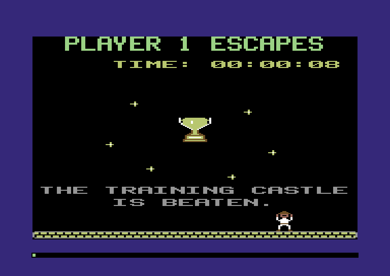
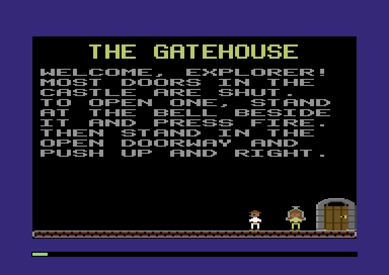
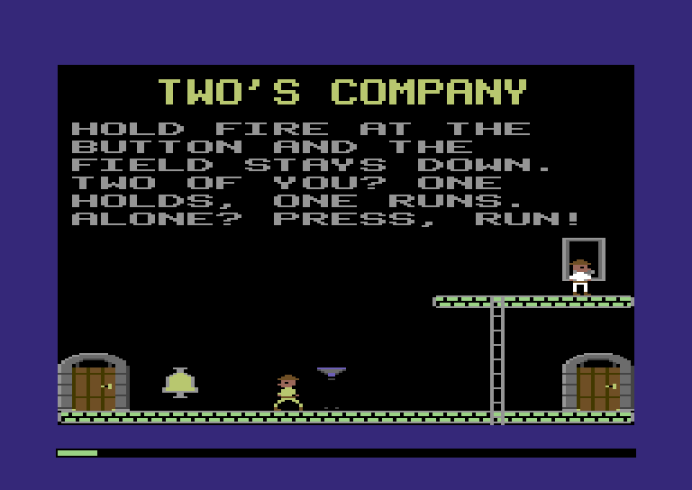
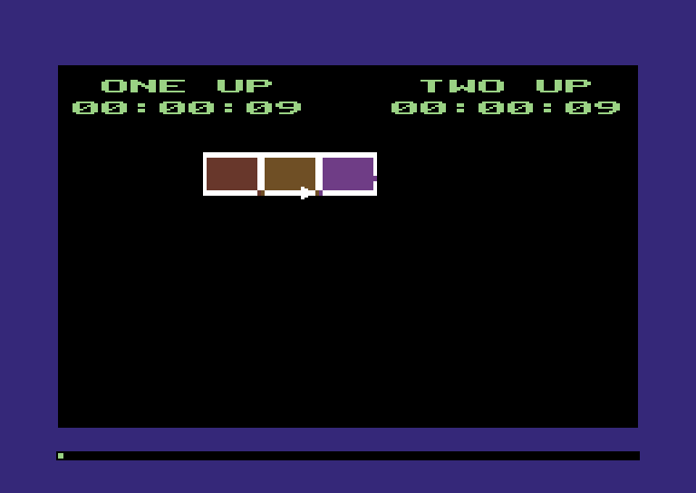
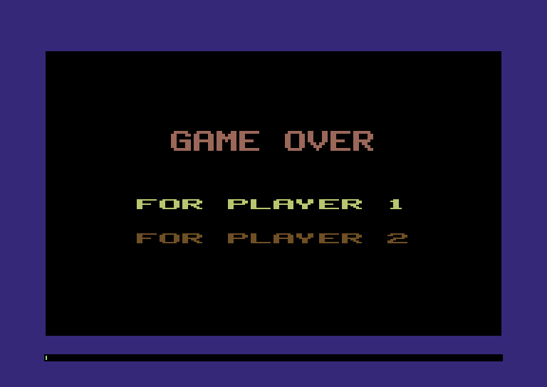

:::mission-briefing
Twenty rooms work, one at a time. This chapter turns them into a
**game**. Press fire and a fresh castle is laid out for you. Between
rooms, the **castle map** shows every room you've seen, with a blinking
arrow at the door you'll come in by. A **clock** counts your time. Lose
your last life and it's **GAME OVER**. Walk through the way out, and the
final room builds itself piece by piece while you cheer.



And you don't have to go alone. Fire on **joystick 2** starts a game for
two. Both explorers play at once, in the same room or in different ones.
Two's Company and The Way Out, rooms 18 and 19, come alive, and the
whole Training Castle can be played from the title screen to the end.

New under the hood: **one stretch of memory doing two jobs** (Zig's
`extern union`), and **binary-coded decimal**, numbers you can print
without dividing.
:::

## A fresh castle every game

Play writes into the castle. A door you open stays open, because its
record's bit 7 is set. A key you take is gone from its record. A dead
mummy is marked dead. That's what makes a room stay the way you left it
when you come back, and it's right. But after GAME OVER, the next game
gets the castle the last one left behind.

The 1984 game never plays the castle it loads. It loads it to `$9800`,
a **staging** copy, and copies it to `$7800` at the start of every game.
Chapter 3 promised we'd do the same. Here's the region, and a sentence
more for the castle's comment:

**`src/map.zig`** (replace the castle region and its comment)

```zig
/// The castle: its header, its room directory and every room's objects,
/// exactly as the castle file holds them. A game plays on this copy.
pub const castle = Region{ .name = "castle", .first = 0x7800, .last = 0x97FF };

/// The castle as it came, untouched: each new game starts from a copy.
pub const staging = Region{ .name = "staging", .first = 0x9800, .last = 0xB7FF };
```

**`src/map.zig`** (in `regions`, add below `castle`)

```zig
    staging,
```

`boot` now loads the castle into the staging region. A game will copy it
from there:

**`src/main.zig`** (in `boot`, replace the castle's `load`)

```zig
    m.load(map.stars.first, &title.star_map);
    m.load(map.staging.first, training.bytes); // a new game copies it to map.castle
```

## The header moves in

The castle file starts with a 256-byte **header**. The disk fills in only
its first few bytes: the size, the magic `$80`, where each player starts,
and the lives. Most of the rest is zeros. In 1984, those zeros are the
game's own. While a game is on, the header holds each player's room,
door, status, keys and time. Chapter 7 already put the keys there.

So the header is one stretch of memory with two jobs. On the disk, it
describes the castle. In play, it's the game's notebook. Because a new
game copies a fresh castle over it, the notebook starts blank every time.

Most of the game's bytes come in **pairs**: player 1's, then player
2's. To reach player 2's lives, add 1 to `lives`.

:::diagram ch09-header
:::

**`src/castle.zig`** (replace the header, from its comment to `magic_value`)

```zig
// ---- the header -----------------------------------------------------------

// The castle file fills in the first nine bytes. The rest are zeros on
// the disk, and while a game is on, they're the game's own. Most come in
// pairs: player 1's byte, then player 2's.
pub const header = map.castle.first;
pub const header_size = 0x100;
pub const size = header + 0x00; // 2 bytes: the castle's length, header included
pub const magic = header + 0x02; // always $80: "this is a castle"
pub const start_room = header + 0x03; // player 1, then player 2
pub const start_door = header + 0x05; // player 1, then player 2
pub const lives = header + 0x07; // the lives a game starts with, then the lives left
pub const room = header + 0x09; // the room he's in, or goes to next
pub const door = header + 0x0B; // the door he comes into it by
pub const status = header + 0x0D; // a player.Status: playing, in a doorway, gone, dead
pub const in_game = header + 0x0F; // 1 while he still has lives and hasn't escaped
pub const last = header + 0x11; // 1 byte: the last player still walking the last room
pub const two = header + 0x12; // 1 byte: 1 in a game for two
pub const keys_count = header + 0x13; // keys carried: player 1, then player 2
pub const keys_held = header + 0x15; // their numbers: 32 for player 1, then 32 for player 2
pub const pocket = 32; // keys a player can carry
pub const time = header + 0x55; // 4 bytes each: his time in the castle (clock.zig)
pub const escaped = header + 0x5D; // 1 once he's through the way out
pub const final_room = header + 0x5F; // 2 bytes: the final room's objects, or 0
pub const magic_value: u8 = 0x80;
```

Build now, and the compiler stops:

```
error: local constant shadows declaration of 'room'
```

The walker's test in `castle.zig` has a local constant called `room`,
and now the file has a declaration called `room` too. Zig won't let a
local name hide one from the file around it, because then `room` would
mean two things in one place. Rename the test's local `room` to `bytes`:

| Replace | With |
|---|---|
| `const room = [_]u8{` | `const bytes = [_]u8{` |
| `m.load(at, &room);` | `m.load(at, &bytes);` |
| `at + room.len` | `at + bytes.len` |

:::under-the-hood One region, two jobs
In JavaScript, if you want an object to be "a castle description" and
later "a save game", you make two objects. Memory is cheap, and the
garbage collector tidies up.

The Comet has 64 KB, and 1984 used all of it. So the same bytes take
turns. The header is "what the disk says" until the game starts, then
"what the game knows". This works because the two jobs never need the
bytes at the same time. It also means a saved castle (Chapter 11) is just
the castle with its header: the whole game's state comes along for free.
:::

## Two of everything

Chapter 5 kept seven bytes at `$0200` about player 1. Lives, room and
door now live in the header. What's left is what an explorer needs from
one of his turns to the next: his actor slot, his stick, his two plate
bytes, and something new, his **mask**. That's five bytes, and we need
them twice.

In `map.zig`, delete the `player` region, its comment and its seven
`player_` constants. Delete `player,` from `regions` too. The players
get a new home, further up:

**`src/map.zig`** (add above the text region)

```zig
/// What the game knows about each explorer from one of his turns to the
/// next: five bytes for player 1, then five for player 2 (player.zig).
pub const players = Region{ .name = "players", .first = 0x0211, .last = 0x021A };
```

**`src/map.zig`** (in `regions`, add below `dice`)

```zig
    players,
```

Now `player.zig`. It's the biggest change in the chapter, so we'll go
from the top:

**`src/player.zig`** (replace the comment at the top)

```zig
//! The explorers: player 1 on joystick 1 and player 2 on joystick 2,
//! each an actor of kind `player`. They walk the castle's floors, climb
//! its ladders, slide down its poles and go through its doors.
```

**`src/player.zig`** (add above `Status`)

```zig
/// Player 1 or player 2, as a number: 0 or 1. It picks his byte in each
/// of the castle header's pairs.
pub const Number = u1;

/// What the game keeps for each explorer from one of his turns to the
/// next. Where he is and what he's doing in a room is mostly his actor's
/// business (actors.zig).
pub const Player = extern struct {
    actor: u8, // the actor slot he has in this room, or actors.none
    last_stick: u8, // his joystick as it read at his last turn
    plate: u8, // the trapdoor switch under his feet this turn, or objects.none
    last_plate: u8, // the one under them last turn
    mask: u8, // the ways the other explorer leaves him for his next step
};
comptime {
    if (2 * @sizeOf(Player) != map.players.last - map.players.first + 1)
        @compileError("two Players must fill the players region exactly");
}

/// Each player's joystick port, and the colour of his coat.
const ports = [2]u16{ hw.joy1, hw.joy2 };
const coats = [2]Color{ .white, .yellow };
```

`Number` is a `u1`: a whole number that can only be 0 or 1. That's
exactly a player. It can't be 2 by mistake, and adding it to a header
address picks his byte of the pair.

`Player` is an `extern struct` of five bytes. Chapter 3 showed that
`extern` promises the fields lie in memory in the order written. The
`comptime` block checks that two of them fill the players region, byte
for byte.

Each player has his own joystick port. Player 2's coat is yellow, so you
can tell them apart.

**`src/player.zig`** (replace `start`)

```zig
/// Once, at power-on.
pub fn start(m: *Machine) void {
    m.poke(hw.sprite_mc0, @intFromEnum(Color.pink)); // code 01: skin
    m.poke(hw.sprite_mc1, @intFromEnum(Color.orange)); // code 11: hat, belt, boots
    for (records(m)) |*r| r.last_stick = 0xFF; // nothing held
}
```

`start` used to set one `last_stick`. Now it sets both. Delete
`newGame` too: a new game is about to get its own file.

**`src/player.zig`** (add below `start`)

```zig
/// Both players' records, as the two structs they are.
fn records(m: *Machine) *align(1) [2]Player {
    return m.view([2]Player, map.players.first);
}

/// Player `p`'s record.
pub fn record(m: *Machine, p: Number) *align(1) Player {
    return &records(m)[p];
}

/// Which player actor `n` is. Only for an actor of kind `player`.
pub fn number(m: *Machine, n: u3) Number {
    m.work(8); // the compare
    return @intFromBool(record(m, 1).actor == n);
}

/// Is player `p` in the room about to be played? He is if he's still in
/// the game and it's the room he's in.
pub fn here(m: *Machine, p: Number) bool {
    m.work(16); // the tests
    return m.peek(castle.in_game + p) != 0 and m.peek(castle.room + p) == m.peek(map.room_number);
}

/// Into the room: every player who's here, player 1 first.
pub fn arrive(m: *Machine) void {
    m.poke(map.engine_ending, 0);
    for (0..2) |i| {
        const p: Number = @intCast(i);
        record(m, p).actor = actors.none;
        if (here(m, p)) add(m, p);
    }
}
```

`records` views the region as `[2]Player`, an array of two structs, so
`record(m, 1)` is player 2's. `number` goes the other way, from an actor
slot to a player: if he's player 2's actor, he's player 2.

`here` asks whether a player belongs in the room about to be drawn. He
does if he's still in the game and the header says it's his room.
`arrive` adds everyone who's here, player 1 first.

**`src/player.zig`** (replace `add`)

```zig
/// Player `p` into the room, at the door he came by. If it's open he walks
/// out of it; if it's shut he starts in front of it. A room with no doors
/// (the final room) puts him in the middle of the floor.
fn add(m: *Machine, p: Number) void {
    const n = actors.add(m, .player) orelse return; // the players come first, so never
    const r = record(m, p);
    r.actor = n;
    r.plate = objects.none;
    r.last_plate = objects.none;
    r.mask = 0xFF;
    setStatus(m, p, .playing);
    const a = actors.slot(m, n);
    a.box.x = middle;
    a.box.y = room.floor_top - feet_y;
    a.way = still;
    if (room.doorAt(m, m.peek(map.room_number), m.peek(castle.door + p))) |at| {
        const d = m.view(castle.Door, at);
        a.box.x = d.x + door_x;
        a.box.y = d.y + door_y;
        if (d.side & castle.door_open != 0) {
            // Inside it, where a walk in ends, and on his way out.
            a.box.x += walk_across;
            a.box.y -= walk_up;
            a.walk = walk_out;
            a.pace = 3;
            setStatus(m, p, .doorway);
        }
    }
    m.work(40); // the sums and the stores
    picture(m, n, if (a.box.x < middle) .explorer_right_0 else .explorer_left_0);
}
```

**`src/player.zig`** (add below `add`)

```zig
/// The colour of player `p`'s coat.
pub fn coat(p: Number) Color {
    return coats[p];
}

/// Show picture `id` for explorer `n`, in his own coat.
fn picture(m: *Machine, n: u3, id: shapes.Id) void {
    actors.setFrame(m, n, id);
    actors.slot(m, n).color = @intFromEnum(coat(number(m, n)));
}
```

`add` reads his door from his own byte of the header. `picture` is how
every new frame gets shown from now on: it sets the frame and then the
sprite's colour, his coat.

**`src/player.zig`** (replace `status` and `playing`)

```zig
/// What player `p` is doing.
pub fn status(m: *Machine, p: Number) Status {
    return @enumFromInt(m.peek(castle.status + p));
}

fn setStatus(m: *Machine, p: Number, s: Status) void {
    m.poke(castle.status + p, @intFromEnum(s));
}

/// Is actor `n` an explorer, walking the room?
pub fn playing(m: *Machine, n: u3) bool {
    m.work(8); // the test
    if (actors.slot(m, n).kind != .player) return false;
    return status(m, number(m, n)) == .playing;
}

/// Player `p`'s actor, if he's in this room and walking it.
pub fn walking(m: *Machine, p: Number) ?*align(1) actors.Actor {
    const n = record(m, p).actor;
    m.work(12); // the tests
    if (n == actors.none or status(m, p) != .playing) return null;
    return actors.slot(m, @intCast(n));
}
```

`status` reads the header too. `playing` gets the actor's slot, as
before, and works out whose status to read. `walking` is new. It hands
back player `p`'s actor, but only if he's in the room and walking it.
It's what a monster will ask.

**`src/player.zig`** (replace `turn` and `read`)

```zig
/// His turn, actor `n`'s: on every engine step while he walks the room,
/// every third in a doorway.
pub fn turn(m: *Machine, n: u3) void {
    const a = actors.slot(m, n);
    if (a.state.destroy) { // his last turn: he's gone, or dead
        a.state.destroy = false;
        a.state.free = true;
        return;
    }
    a.state.created = false;
    const p = number(m, n);
    const r = record(m, p);
    read(m, a, p);
    trapdoors.tread(m, &r.plate, &r.last_plate);
    switch (status(m, p)) {
        .playing => steer(m, n),
        .doorway => walk(m, n),
        else => {},
    }
}

/// Read player `p`'s joystick, once a turn: its direction, and whether
/// fire is down now and wasn't at his last turn. The port byte is kept
/// for next time here and nowhere else in a room, so a fire button held
/// down is never a fresh press, however far he carries it.
fn read(m: *Machine, a: *align(1) actors.Actor, p: Number) void {
    const r = record(m, p);
    const stick = m.peek(ports[p]);
    a.stick = stick_way[stick & 0x0F];
    a.fire = @intFromBool(pressed(stick, r.last_stick));
    r.last_stick = stick;
    m.work(16); // the table read and the test
}
```

`turn` reads his own record's plates, and `read` reads his own port.

**`src/player.zig`** (in `steer`, replace the `ways` line)

```zig
    const r = record(m, number(m, n));
    const ways = waysAt(m, fx, fy) & r.mask; // less any way the other explorer is in
    r.mask = 0xFF;
```

That `mask` will matter in a moment. For now it's always `0xFF`, all
eight ways allowed, and `&` with `0xFF` changes nothing.

**`src/player.zig`** (at the end of `steer`)

```zig
    if (next != now) picture(m, n, @enumFromInt(next));
```

**`src/player.zig`** (replace `walkIn` and `walk`)

```zig
/// Into the door whose record is at `at`: he stands in front of it and
/// walks in, and when the room is over he'll come out of the door it
/// leads to.
pub fn walkIn(m: *Machine, n: u3, at: u16) void {
    if (!playing(m, n)) return;
    const p = number(m, n);
    const a = actors.slot(m, n);
    const d = m.view(castle.Door, at);
    setStatus(m, p, .doorway);
    a.walk = walk_in;
    a.pace = 3;
    a.box.x = d.x + door_x;
    a.box.y = d.y + door_y;
    m.poke(castle.room + p, d.to_room);
    m.poke(castle.door + p, d.to_door);
    m.work(30); // the stores
}

/// A turn in a doorway: the next entry of the `doorway` table.
fn walk(m: *Machine, n: u3) void {
    const a = actors.slot(m, n);
    const w = doorway[a.walk];
    m.work(24); // the table read and the sums
    if (w.then) |then| {
        setStatus(m, number(m, n), then);
        a.pace = 1;
        if (then == .gone) a.state.destroy = true;
        return;
    }
    a.box.x +%= w.dx;
    a.box.y +%= w.dy;
    a.walk += 1;
    picture(m, n, w.frame);
}
```

Going through a door sets *his* room and door. The other explorer might
be staying behind.

**`src/player.zig`** (replace `kill`, `die`, `hit` and `touch`)

```zig
/// Give up this life (the X key): every explorer walking the room
/// flickers away, and the castle starts him again at its start door.
pub fn kill(m: *Machine) void {
    for (0..2) |i| {
        const p: Number = @intCast(i);
        const n = record(m, p).actor;
        if (n != actors.none and die(m, @intCast(n))) actors.slot(m, @intCast(n)).state.flash = true;
    }
}

/// This life is over for explorer `n`, if he's walking the room: he's
/// dead. True if he was, so that he starts to flicker.
fn die(m: *Machine, n: u3) bool {
    if (!playing(m, n)) return false;
    setStatus(m, number(m, n), .dead);
    return true;
}

/// His `hit`: his sprite touched actor `other`'s. A forcefield only stands
/// in his way (the grid sees to that), and the other explorer is a
/// friend; anything else is deadly.
pub fn hit(m: *Machine, n: u3, other: u3) bool {
    switch (actors.slot(m, other).kind) {
        .forcefield, .player => return false,
        else => return die(m, n),
    }
}

/// His `touch`: he's in front of object `object`. An open trapdoor under
/// his feet is the end of him; a trapdoor's switch under them is noted,
/// for his turn to flip.
pub fn touch(m: *Machine, n: u3, object: u8) bool {
    switch (trapdoors.under(m, n, object)) {
        .hole => return die(m, n),
        .plate => record(m, number(m, n)).plate = object,
        .nothing => {},
    }
    return false;
}
```

Chapter 6's rule was "anything else is deadly". Two explorers touching
would have killed each other! So a `player` joins the forcefield as
harmless, for now. `kill`, the X key, kills everyone walking the room.

**`src/player.zig`** (replace `roomOver`, `nextRoom` and `pressedFire`)

```zig
/// Is the room over? Not while anyone in it is playing or in a doorway.
/// Once they've all gone through a door or died, it runs on for 30 more
/// steps (a door finishes opening, a flicker ends), and then it is. On
/// the way it notes the last player still walking the room.
pub fn roomOver(m: *Machine) bool {
    var busy = false;
    var i: u8 = 2;
    while (i > 0) { // player 2 first, so that player 1 has the last word
        i -= 1;
        const p: Number = @intCast(i);
        m.work(16); // the tests
        if (record(m, p).actor == actors.none) continue;
        switch (status(m, p)) {
            .playing => {
                m.poke(castle.last, p);
                busy = true;
            },
            .doorway => busy = true,
            else => {},
        }
    }
    if (busy) return false;
    const left = m.peek(map.engine_ending);
    m.work(10); // the tests
    if (left == 1) return true;
    m.poke(map.engine_ending, if (left == 0) ending_steps else left - 1);
    return false;
}

/// Was fire pressed on player `p`'s stick this frame? For the screens
/// between rooms, where there's no actor. It keeps the stick for next
/// time, so call it once a frame.
pub fn pressedFire(m: *Machine, p: Number) bool {
    const r = record(m, p);
    const stick = m.peek(ports[p]);
    const yes = pressed(stick, r.last_stick);
    r.last_stick = stick;
    m.work(10);
    return yes;
}
```

`roomOver` waits until nobody in the room is playing or in a doorway.
On its way round, it notes in `last` the last player still walking.
That decides who plays next, as you're about to see. `pressedFire` takes
a player now.

## The game

A new file runs the game from the title screen's fire button to the end:

**`src/game.zig`** (new file)

```zig
//! A whole game, from the title screen's fire button to its end: who
//! plays which room next, and lives. It all lives in the castle header,
//! which a new game copies afresh.

const machine = @import("machine");
const Machine = machine.Machine;
const map = @import("map.zig");
const castle = @import("castle.zig");
const actors = @import("actors.zig");
const player = @import("player.zig");

/// On the title screen, every frame: fire on stick 1 starts a game for
/// one, fire on stick 2 a game for two. Null while nobody's pressed.
pub fn chosen(m: *Machine) ?bool {
    const one = player.pressedFire(m, 0);
    const two = player.pressedFire(m, 1);
    if (two) return true;
    if (one) return false;
    return null;
}

/// A new game: a fresh copy of the castle, every door shut and every key
/// where it was, then each player at the start. The header's scratch
/// bytes are zeros in the castle file, so the copy clears them too.
/// Thousands of bytes at 8 cycles each: call it with the display blanked.
pub fn start(m: *Machine, two: bool) void {
    m.copy(map.castle.first, map.staging.first, m.peek16(map.staging.first));
    m.poke(castle.two, @intFromBool(two));
    for (0..2) |i| {
        const p: u16 = @intCast(i);
        m.poke(castle.room + p, m.peek(castle.start_room + p));
        m.poke(castle.door + p, m.peek(castle.start_door + p));
    }
    m.poke(castle.in_game, 1);
    m.poke(castle.in_game + 1, @intFromBool(two));
    m.work(40); // the loop and the stores
}
```

`chosen` reads both sticks every frame. Fire on stick 1 is a game for
one; fire on stick 2 is a game for two.

`start` copies the staging castle over the playing one with
`m.copy`. That's 4,644 bytes at 8 cycles each, 37,244 cycles in all:
nearly two frames. So it happens with the display blanked, as a loading
pause. Then each player's room and door come from the castle's start
bytes, and `in_game` says who's playing.

**`src/game.zig`** (add at the end)

```zig
/// Which room next? With both players in one room, that one, for both.
/// In two rooms, the one the player who wasn't last to leave a room is
/// in. With one left in the game, his. False if nobody's left.
pub fn next(m: *Machine) bool {
    const one = m.peek(castle.in_game) != 0;
    const two = m.peek(castle.in_game + 1) != 0;
    m.work(30); // the tests
    if (!one and !two) return false;
    var p: player.Number = if (one) 0 else 1;
    if (one and two and m.peek(castle.room) != m.peek(castle.room + 1))
        p = @intCast(m.peek(castle.last) ^ 1);
    m.poke(map.room_number, m.peek(castle.room + p));
    return true;
}

/// The room's over: settle up with everyone who was in it. Dead, he loses
/// a life, and starts again at the castle's start, unless that was his
/// last: then he's out of the game. Then on to the next room: false if
/// nobody's left to play it.
pub fn after(m: *Machine) bool {
    for (0..2) |i| {
        const p: player.Number = @intCast(i);
        m.work(20); // the tests
        if (player.record(m, p).actor == actors.none) continue; // he wasn't here
        if (player.status(m, p) == .dead) {
            const lives = m.peek(castle.lives + p) -| 1;
            m.poke(castle.lives + p, lives);
            if (lives == 0) {
                m.poke(castle.in_game + p, 0);
            } else {
                m.poke(castle.room + p, m.peek(castle.start_room + p));
                m.poke(castle.door + p, m.peek(castle.start_door + p));
            }
        }
    }
    return next(m);
}
```

`next` picks the room to draw. If both players are in one room, that's
the one, and they play it together. If they're in two rooms, the player
who *wasn't* last to leave a room goes next: `last ^ 1`. So the players
take turns, and neither has to wait for long.

`after` settles up when a room is over. A dead player loses a life. With
lives left, he starts again at the castle's start, as he did in Chapter
5. With none, he's out of the game.

Now `main.zig`:

**`src/main.zig`** (add below the `dice` import)

```zig
const game = @import("game.zig");
```

**`src/main.zig`** (in `frame`, replace the `.title` prong)

```zig
        .title => {
            if (game.chosen(m)) |two| {
                m.poke(hw.control, 0); // the copy of the castle is a loading pause
                game.start(m, two);
                _ = game.next(m);
                setMode(m, .draw_room);
            } else {
                m.poke(hw.control, machine.display_on); // before the beam reaches the display
                m.bucket(bucket_drawing);
                title.twinkle(m);
            }
        },
```

**`src/main.zig`** (in the `.draw_room` prong)

```zig
            player.arrive(m);
```

**`src/main.zig`** (in the `.room` prong, replace the `roomOver` line)

```zig
                if (player.roomOver(m)) setMode(m, if (game.after(m)) .draw_room else .draw_title);
```

And the N and P keys send everyone to the next room:

**`src/room.zig`** (in `flip`, replace the `player_door` line)

```zig
    for (0..2) |i| { // everyone comes in by its first door
        const p: u16 = @intCast(i);
        m.poke(castle.room + p, next);
        m.poke(castle.door + p, 0);
    }
```

## Which explorer?

Every object that asked "is the explorer playing?" now asks about the
explorer who touched it, `who`. `playing` checks his kind itself, so the
`a.kind != .player` test goes:

**`src/doors.zig`** (in `ring`)

```zig
/// A bell's `in_front`: an explorer, at the bell, presses fire. If its
/// door is shut, the door gets to work.
```

**`src/doors.zig`** (in `ring`, replace the `return` line)

```zig
    if (!player.playing(m, who) or a.fire == 0) return;
```

**`src/conveyors.zig`** (in `press`, the same line)

```zig
    if (!player.playing(m, who) or a.fire == 0) return;
```

**`src/forcefields.zig`** (in `press`, the same)

```zig
    if (!player.playing(m, who) or a.fire == 0) return;
```

**`src/locks.zig`** (in `take` and in `unlock`, both the same)

```zig
    if (!player.playing(m, who) or a.fire == 0) return;
```

**`src/lightning.zig`** (in `pull`, replace the `return` line)

```zig
    if (!player.playing(m, who)) return;
```

**`src/guns.zig`** (in `steer`, the same)

```zig
    if (!player.playing(m, who)) return;
```

**`src/mummy.zig`** (in `release`, the same)

```zig
    if (!player.playing(m, who)) return;
```

**`src/transmitter.zig`** (in `use`, nearly the same)

```zig
    if (o.flags.execute or !player.playing(m, who)) return;
```

The monsters chase player 1 for now:

**`src/guns.zig`** (in `run`, replace the first two lines of the `if`)

```zig
        if (player.walking(m, 0)) |a| {
            const him = a.box.y;
```

**`src/mummy.zig`** (in `walk`, replace the two lines that find him)

```zig
    const him = (player.walking(m, 0) orelse return).box.x;
```

**`src/frankenstein.zig`** (in `wakes`, the same)

```zig
    const him = (player.walking(m, 0) orelse return false).box;
```

**`src/frankenstein.zig`** (in `choose`, the first two lines of the `if`)

```zig
    if (player.walking(m, 0)) |explorer| {
        const him = explorer.box;
```

`guns.zig`, `mummy.zig` and `frankenstein.zig` don't use `map` any more.
Delete the line `const map = @import("map.zig");` from all three.

The title screen should say how to start a game for two:

**`src/title.zig`** (in `star_map`, add below the `PRESS FIRE` line)

```zig
            (row == 15 and col >= 5 and col < 35) or // STICK 2 FOR TWO
```

**`src/title.zig`** (in `draw`, add below `PRESS FIRE`)

```zig
    text.say(m, 20, 120, .grey, "STICK 2 FOR TWO");
```

The first line keeps the stars off the new words.

The tests read the old player bytes in a few places. In `main.zig`,
replace every one:

| Replace | With |
|---|---|
| `m.ram[map.player_status]` | `m.ram[castle.status]` |
| `, m.ram[map.room_number])` | `, m.ram[castle.room])` |
| `m.ram[map.player_door]` | `m.ram[castle.door]` |
| `m.ram[map.player_lives]` | `m.ram[castle.lives]` |

**`src/main.zig`** (replace `explorer`)

```zig
/// Player 1's actor slot.
fn explorer(m: *Machine) *align(1) actors.Actor {
    return actors.slot(m, @intCast(player.record(m, 0).actor));
}
```

**`src/main.zig`** (in `inRoom`, replace the `room_number` line)

```zig
    m.ram[castle.room] = n; // instead of the castle's start room
    m.ram[map.room_number] = n;
```

A test that jumps to a room now sets the header's room too, or `here`
wouldn't let him in.

Build, test, and run with fire on stick 2:

```
zig build run -- --frames 300 --press 20:f:5@2 --press 60:l:80 --press 100:l:40@2 --dump-every 10
```

`--press 20:f:5@2` presses fire on stick 2. Player 1 walks off left, and
player 2 follows him out of the door.



**Two explorers!** In the browser, player 2's stick is the keys I, J, K
and L, with Return for fire.

## Two's Company

Two explorers in one room should be more than twice one. They should
help each other, and get in each other's way.

### The nearest, and the held

**`src/player.zig`** (add below `walking`)

```zig
/// The explorer walking the room whose top is nearest row `y`, if
/// anyone is: what a gun turns towards. Player 2 is looked at first, and
/// only a nearer player 1 takes his place, so a tie goes to player 2.
pub fn nearest(m: *Machine, y: u8) ?*align(1) actors.Actor {
    var best: ?*align(1) actors.Actor = null;
    var gap: u8 = 0xFF;
    var i: u8 = 2;
    while (i > 0) {
        i -= 1;
        const a = walking(m, @intCast(i)) orelse continue;
        const d = if (a.box.y > y) a.box.y - y else y - a.box.y;
        m.work(20); // the sums and the test
        if (best == null or d < gap) {
            best = a;
            gap = d;
        }
    }
    return best;
}

/// Is actor `n`'s fire button down right now? Not a fresh press: held.
pub fn holding(m: *Machine, n: u3) bool {
    if (!playing(m, n)) return false;
    return held(record(m, number(m, n)).last_stick, joy.fire);
}
```

`nearest` is for the guns. It looks at player 2 first, and swaps to
player 1 only if he's *strictly* nearer. So a tie goes to player 2, as
it does in 1984. `holding` asks whether fire is down right now, held, not
freshly pressed. Its stick byte is the one `read` kept at his last turn.

### Jostling

**`src/player.zig`** (replace `hit`, and add `jostle` below it)

```zig
/// His `hit`: his sprite touched actor `other`'s. A forcefield only stands
/// in his way (the grid sees to that), and the other explorer only
/// jostles; anything else is deadly.
pub fn hit(m: *Machine, n: u3, other: u3) bool {
    const b = actors.slot(m, other);
    switch (b.kind) {
        .forcefield => return false,
        .player => {
            jostle(m, n, b);
            return false;
        },
        else => return die(m, n),
    }
}

/// Two explorers touching: he can't step into the other one. With the
/// other below him, his next step can't be down; above him, it can't be
/// up. Side by side (the same Y), or with the other one on a ladder or a
/// pole, they pass straight through each other.
fn jostle(m: *Machine, n: u3, other: *align(1) actors.Actor) void {
    const a = actors.slot(m, n);
    m.work(24); // the tests
    if (other.frame >= climb_0 and other.frame <= @intFromEnum(shapes.Id.explorer_slide)) return;
    if (other.box.y == a.box.y) return;
    record(m, number(m, n)).mask = if (other.box.y > a.box.y) ~grid.down else ~grid.up;
}
```

Two explorers walk through each other on the level. But if one of them
is on a ladder above the other, he can't climb down through his head.
When their sprites touch, each explorer's `hit` is told about the other.
If the other one is lower down, my next step can't go down. If he's
higher, it can't go up. That's the `mask` in his record, and `steer`
uses it once and puts it back to `0xFF`.

`~grid.down` is every bit except `down`: the ways I'm still allowed.
A side-by-side touch, or one on a ladder or pole, changes nothing.

### Holding a field down

Chapter 6's forcefield button wanted a fresh press, so one explorer
could only drop the field for its countdown. In 1984 the button works
every step that fire is **held**, and the countdown keeps starting
again. Hold fire, and the field stays down for as long as you like.
Alone, that's no help: you can't hold the button and run. With two,
one holds, and the other runs.

**`src/forcefields.zig`** (replace the top of `press`)

```zig
/// A button's `in_front`: an explorer holds fire down at it. The field
/// goes down (if it's up), the gauge goes out, and the countdown starts
/// again from the top, every step he keeps holding it.
pub fn press(m: *Machine, n: u8, who: u3) void {
    const o = objects.slot(m, n);
    m.work(16); // the tests
    if (!player.holding(m, who)) return;
```

### Belts and pockets for two

The conveyor's state byte had a pressed bit and a held bit for player
1, with room left for player 2 in the next bit up:

**`src/castle.zig`** (in the conveyor's state bits)

```zig
pub const conveyor_pressed: u8 = 0b0000_0100; // player 1 pressed the control this step (player 2: the next bit)
pub const conveyor_held: u8 = 0b0001_0000; // ...and last step (player 2: the next bit)
```

**`src/conveyors.zig`** (replace `press`)

```zig
/// A control box's `in_front`: an explorer presses fire at it. The belt
/// hears about it on its next step: his bit, player 1's or player 2's.
pub fn press(m: *Machine, n: u8, who: u3) void {
    const a = actors.slot(m, who);
    m.work(12); // the tests
    if (!player.playing(m, who) or a.fire == 0) return;
    m.view(castle.Conveyor, objects.slot(m, n).record).state |= castle.conveyor_pressed << player.number(m, who);
}
```

**`src/conveyors.zig`** (in `run`, replace its comment and the press test)

```zig
/// last step, by either player) works the belt: running, it stops and
/// turns round; stopped, it starts. Then, every other step while it runs,
/// its slats move on a cell, by recolouring them.
pub fn run(m: *Machine, n: u8) void {
    const o = objects.slot(m, n);
    const c = m.view(castle.Conveyor, o.record);
    m.work(20); // the tests
    const pressed = (c.state >> 2) & 0b11; // bits 2 and 3: a bit for each player
    const held = (c.state >> 4) & 0b11; // bits 4 and 5
    if (pressed & ~held != 0) {
```

**`src/conveyors.zig`** (further down `run`, replace the two lines that remember the press)

```zig
    c.state = (c.state & ~castle.conveyor_players) | pressed << 4; // this step's presses are held now
```

Each player's press is his own bit. A belt works when someone pressed it
this step and wasn't already pressing it last step. `conveyor_players`
covers all four bits.

Chapter 7 kept a 32-byte pocket in the header for each player. Now
player 2 gets his:

**`src/locks.zig`** (replace the comment at the top)

```zig
//! Keys and locks. A key is an object until an explorer presses fire at
//! it; then it's a number in his pocket. A lock opens its door when he
//! presses fire at it with the right number in his pocket. Each player
//! has a pocket of his own.
```

**`src/locks.zig`** (replace `take` and `carrying`, with `pocket` between them)

```zig
/// A key's `in_front`: an explorer presses fire at it, and it goes into
/// his pocket. It's rubbed out of the room and out of the castle, and the
/// object table lets it go at the end of the step.
pub fn take(m: *Machine, n: u8, who: u3) void {
    const a = actors.slot(m, who);
    const o = objects.slot(m, n);
    m.work(16); // the tests
    if (!player.playing(m, who) or a.fire == 0) return;
    const p = player.number(m, who);
    const count = m.peek(castle.keys_count + p);
    if (count == castle.pocket) return; // his pocket is full: leave it where it is
    const k = m.view(castle.Key, o.record);
    m.poke(pocket(p) + count, k.number);
    m.poke(castle.keys_count + p, count + 1);
    k.shape = 0; // gone from the castle, for good
    room.unplace(m, .key, o.box.x, o.box.y);
    o.flags.picked = true;
    o.flags.disable = true; // and until it goes, nobody can stand in front of it
}

/// Where player `p`'s pocket is: 32 bytes each, player 1's first.
fn pocket(p: player.Number) u16 {
    return castle.keys_held + @as(u16, p) * castle.pocket;
}

/// Is key `number` in player `p`'s pocket?
pub fn carrying(m: *Machine, p: player.Number, number: u8) bool {
    const count = m.peek(castle.keys_count + p);
    var i: u8 = 0;
    while (i < count) : (i += 1) {
        m.work(10); // the test and the loop
        if (m.peek(pocket(p) + i) == number) return true;
    }
    return false;
}
```

**`src/locks.zig`** (in `unlock`, its comment's first line)

```zig
/// A lock's `in_front`: an explorer presses fire at it. With its key in
```

**`src/locks.zig`** (and its key test)

```zig
    if (!carrying(m, player.number(m, who), l.number)) return;
```

**`src/main.zig`** (in the keys test, the `carrying` line)

```zig
    try std.testing.expect(locks.carrying(m, 0, @intFromEnum(Color.light_blue)));
```

### The monsters see both

**`src/guns.zig`** (in `run`, the `if` that finds him)

```zig
        if (player.nearest(m, g.gun_y)) |a| {
```

**`src/mummy.zig`** (in `walk`)

```zig
    const him = (player.walking(m, 0) orelse player.walking(m, 1) orelse return).box.x; // player 1 first
```

The mummy doesn't measure. He follows player 1 while player 1 is
walking the room, and player 2 only when he isn't.

**`src/frankenstein.zig`** (replace `wakes`)

```zig
/// Does he wake? Only for an explorer walking the room, on his level
/// (their tops fewer than 4 rows apart), and in front of him. Either
/// explorer will do.
fn wakes(m: *Machine, a: *align(1) actors.Actor, f: *align(1) castle.Frankenstein) bool {
    for (0..2) |p| {
        const him = (player.walking(m, @intCast(p)) orelse continue).box;
        const y = a.box.y;
        m.work(24); // the sums and the tests
        if ((if (him.y > y) him.y - y else y - him.y) >= level) continue;
        if (if (f.state.left) him.x <= a.box.x else him.x > a.box.x) return true;
    }
    return false;
}
```

**`src/frankenstein.zig`** (in `choose`, replace the comment and the `if`)

```zig
    // How far the explorers are in each of the four directions, by
    // number: up, right, down, left. With two, the nearer one's distance
    // counts. 0xFF for a way nobody is.
    var far = [4]u8{ 0xFF, 0xFF, 0xFF, 0xFF };
    for (0..2) |p| {
        const him = (player.walking(m, @intCast(p)) orelse continue).box;
        var apart = [4]u8{ 0xFF, 0xFF, 0xFF, 0xFF };
        if (him.x >= a.box.x) apart[1] = him.x - a.box.x else apart[3] = a.box.x - him.x;
        if (him.y < a.box.y) apart[0] = a.box.y - him.y else apart[2] = him.y - a.box.y;
        for (&far, apart) |*f, his| f.* = @min(f.*, his);
        m.work(40); // the sums and the tests
    }
```

Frankenstein wakes for either explorer. When he chooses a way, each
direction gets the nearer explorer's distance, and he heads for the
farthest, as before.

### Room 18

**`src/training.zig`** (replace room 18)

```zig
        .two_players = .{
            .color = .light_green,
            .map = spot(18),
            // The field blocks the floor, between the door in and the
            // way on. Its button is upstairs, up the ladder.
            .door = &.{
                .{ .x = 156, .y = 160, .to = .locked_away, .to_door = 1 },
                .{ .x = 16, .y = 160, .to = .way_out },
            },
            .walkway = &.{ floor, .{ .length = 14, .x = 120, .y = 128 } },
            .ladder = &.{.{ .length = 9, .x = 136, .y = 128 }},
            .bell = &.{.{ .x = 44, .y = 168, .door = 1 }},
            .forcefield = &.{.{ .button_x = 156, .button_y = 96, .field_x = 88, .field_y = 168 }},
            .text = says("TWO'S COMPANY", &.{
                "HOLD FIRE AT THE",
                "BUTTON AND THE",
                "FIELD STAYS DOWN.",
                "TWO OF YOU? ONE",
                "HOLDS, ONE RUNS.",
                "ALONE? PRESS, RUN!",
            }),
        },
```



The field sits across the floor, between the door in and the way on.
Its button is up the ladder. One explorer climbs and holds fire. The
other runs through, rings the bell and goes. Then the one upstairs lets
go, climbs down and runs for it before the countdown ends. Alone? Press,
then run. It's tight, but it's possible.

## The castle map

Between rooms, the 1984 game shows the castle map: every room you've
been in, in its colour, with a blinking arrow at the door you'll come in
by. Above it are each player's name and time.

### A clock you can print

Each player's time is four bytes in the header: frames, seconds, minutes
and hours. We'd like to print it every time the map comes up, as
`00:01:42`. With an ordinary binary byte, printing 42 means dividing by
10 to get the 4 and keeping the remainder for the 2. The Comet's CPU
can't divide. A software divide is a loop of shifts and subtracts,
dozens of cycles per digit.

There's a trick. **Binary-coded decimal** (BCD) keeps one decimal digit
in each half of a byte. 42 seconds is stored as `$42`: the high half is
4, the low half is 2. Each half of a byte is called a **nibble**, four
bits, 0 to 15. Printing is now easy: the high digit is `digits >> 4`,
the low digit is `digits & 0x0F`.

The cost is in counting. Add 1 to `$09` and you get `$0A`, not `$10`.
So after each add, if the low nibble has reached `$A`, add 6 more. That
skips the six codes from `$A` to `$F`, and carries into the high nibble:

:::diagram ch09-bcd
:::

**`src/clock.zig`** (new file)

```zig
//! Each explorer's time in the castle: a clock that runs while he's in a
//! room, kept in binary-coded decimal, a decimal digit to each half of a
//! byte, so that printing it needs no dividing.

const machine = @import("machine");
const Machine = machine.Machine;
const Color = machine.Color;
const map = @import("map.zig");
const castle = @import("castle.zig");
const text = @import("text.zig");
const actors = @import("actors.zig");
const player = @import("player.zig");

/// One explorer's time: frames (0 to 49, in plain binary), then seconds,
/// minutes and hours, each two decimal digits in one byte.
pub const Time = extern struct { frames: u8, seconds: u8, minutes: u8, hours: u8 };
pub const frames_per_second = 50;

/// Player `p`'s time, in the castle header.
pub fn of(m: *Machine, p: player.Number) *align(1) Time {
    return m.view(Time, castle.time + @as(u16, p) * @sizeOf(Time));
}

/// Every frame of a room: a frame more for each explorer in it who's
/// playing or in a doorway.
pub fn tick(m: *Machine) void {
    for (0..2) |i| {
        const p: player.Number = @intCast(i);
        m.work(20); // the tests
        if (player.record(m, p).actor == actors.none) continue;
        switch (player.status(m, p)) {
            .playing, .doorway => advance(m, of(m, p)),
            else => {},
        }
    }
}

/// One frame later: 50 frames make a second, 60 seconds a minute, 60
/// minutes an hour, and after 99 hours it starts again.
fn advance(m: *Machine, t: *align(1) Time) void {
    m.work(12); // the add and the test
    t.frames += 1;
    if (t.frames < frames_per_second) return;
    t.frames = 0;
    if (!up(m, &t.seconds, 0x60)) return;
    if (!up(m, &t.minutes, 0x60)) return;
    _ = up(m, &t.hours, 0xA0);
}

/// Add one to the two decimal digits in `digits`. Past a 9 in the low
/// half, add 6 more: the 6 codes from $A to $F get skipped, and the carry
/// goes into the high half. At `limit` it goes back to 00, and returns
/// true: carry one into the next byte.
pub fn up(m: *Machine, digits: *align(1) u8, limit: u8) bool {
    m.work(14); // the add, the mask, the tests
    var n = digits.* + 1;
    if (n & 0x0F == 0x0A) n += 0x06;
    if (n == limit) {
        digits.* = 0;
        return true;
    }
    digits.* = n;
    return false;
}

/// Print player `p`'s time as HH:MM:SS at fat pixel (x, y). Each digit is
/// half a byte, so it's a shift or a mask away from its letter.
pub fn print(m: *Machine, x: u8, y: u8, color: Color, p: player.Number) void {
    const t = of(m, p);
    var at = map.text_buffer;
    for ([3]u8{ t.hours, t.minutes, t.seconds }) |digits| {
        m.poke(at, '0' + (digits >> 4));
        m.poke(at + 1, '0' + (digits & 0x0F));
        m.poke(at + 2, ':');
        at += 3;
        m.work(16); // the shift, the mask, the adds
    }
    m.poke(at - 2, m.peek(at - 2) | 0x80); // the last digit ends the string
    _ = text.draw(m, x, y, color, text.plain, map.text_buffer);
}

// ---- tests ----------------------------------------------------------------

const std = @import("std");

test "a decimal digit to each half: 09 + 1 is 10, and 59 + 1 carries" {
    const m = try std.testing.allocator.create(Machine);
    defer std.testing.allocator.destroy(m);
    m.* = .{};
    var d: u8 = 0x09;
    try std.testing.expect(!up(m, &d, 0x60));
    try std.testing.expectEqual(0x10, d);
    d = 0x59;
    try std.testing.expect(up(m, &d, 0x60));
    try std.testing.expectEqual(0x00, d);
    d = 0x99;
    try std.testing.expect(up(m, &d, 0xA0)); // 99 hours, and round again
}

test "an hour, a minute and a second, and it prints as it reads" {
    const m = try std.testing.allocator.create(Machine);
    defer std.testing.allocator.destroy(m);
    m.* = .{};
    const t = of(m, 1);
    for (0..(3600 + 60 + 1) * frames_per_second) |_| advance(m, t);
    try std.testing.expectEqual(Time{ .frames = 0, .seconds = 0x01, .minutes = 0x01, .hours = 0x01 }, t.*);
    t.minutes = 0x42;
    @import("screen.zig").start(m);
    text.start(m);
    print(m, 0, 0, .white, 1);
    try std.testing.expectEqualSlices(u8, "01:42:0", m.ram[map.text_buffer..][0..7]);
    try std.testing.expectEqual('1' | 0x80, m.ram[map.text_buffer + 7]);
}
```

`up` adds one and fixes the carry. At the `limit` (60 for seconds and
minutes, 100 for hours) it goes back to 00 and says "carry one".
`advance` chains them. The frames byte is plain binary, because it's
never printed. `print` writes eight letters and draws them.

`tick` adds a frame for each explorer playing or in a doorway. It costs
72 cycles a frame with two of them in the room. `print` costs 5,472
cycles, mostly drawing the letters.

:::inside-the-disk A clock in a chip
1984 doesn't count frames. Its machine had a time-of-day clock in one
of its chips, and that clock kept tenths, seconds, minutes and hours,
in BCD. The game started it when a player came into a room, stopped it
when he left, and kept its four bytes in the header, at the same `$55`
we use. Our machine has no such clock, so `tick` counts frames instead,
and its seconds, minutes and hours come out the same. The map shows the times; 1984 never
puts them on screen during a room, and nor do we.
:::

### Seven bytes for the map

The map needs a few bytes while it's on: when each arrow blinks next,
whether it's lit, and who has pressed fire. The player region's old
seven bytes at `$0200` are free:

**`src/map.zig`** (add where the player region was)

```zig
/// The castle map's working bytes, between rooms (chart.zig).
pub const between = Region{ .name = "between rooms", .first = 0x0200, .last = 0x0206 };
```

**`src/map.zig`** (in `regions`, add below `stack`)

```zig
    between,
```

Each room's colour byte in the castle directory has a spare bit. In
1984, bit 7 means "visited":

**`src/castle.zig`** (in `Entry`, the `color` line)

```zig
    color: u8, // low four bits: the room's colour. Bit 6 set: the end. Bit 7: visited
```

**`src/castle.zig`** (add below `end_plain`)

```zig
/// Bit 7 of a colour byte: an explorer has been in the room, so it's on
/// the castle map.
pub const visited: u8 = 0b1000_0000;
```

### Map pictures

A room on the map is drawn in cells 4 fat pixels wide and 8 rows tall,
the sizes in its directory entry. Each cell is a piece of floor, with a
wall piece drawn over it at each edge. Then there's an arrow for each
direction:

**`src/shapes.zig`** (in `Id`, add at the end, after `frank_slide`)

```zig
    map_floor,
    map_top,
    map_bottom,
    map_left,
    map_right,
    arrow_down,
    arrow_up,
    arrow_right,
    arrow_left,
```

:::type-in The castle map's pictures
**`src/art.zig`** (add above `// ---- pictures for the castle`)

```zig
// ---- the castle map ---------------------------------------------------------

/// A castle map cell: the floor of a room, and its walls, drawn over it
/// where the cell is at an edge. Code 10 takes the room's colour when the
/// map is drawn; code 11, the walls, stays white.
const chart = [3]Color{ .black, .black, .white };

pub const map_floor = room(chart, &.{
    "2222",
    "2222",
    "2222",
    "2222",
    "2222",
    "2222",
    "2222",
    "2222",
});

pub const map_top = room(chart, &.{
    "3333",
    "3333",
    "3333",
    "....",
    "....",
    "....",
    "....",
    "....",
});

pub const map_bottom = room(chart, &.{
    "....",
    "....",
    "....",
    "....",
    "....",
    "3333",
    "3333",
    "3333",
});

pub const map_left = room(chart, &.{
    "3...",
    "3...",
    "3...",
    "3...",
    "3...",
    "3...",
    "3...",
    "3...",
});

pub const map_right = room(chart, &.{
    "...3",
    "...3",
    "...3",
    "...3",
    "...3",
    "...3",
    "...3",
    "...3",
});

/// "You are here": an arrow at the door each explorer comes in by,
/// pointing into the room.
pub const arrow_down = frame(.white, &.{
    ".22.",
    ".22.",
    ".22.",
    ".22.",
    "2222",
    "2222",
    ".22.",
    ".22.",
});

pub const arrow_up = frame(.white, &.{
    ".22.",
    ".22.",
    "2222",
    "2222",
    ".22.",
    ".22.",
    ".22.",
    ".22.",
});

pub const arrow_right = frame(.white, &.{
    "2...",
    "22..",
    "222.",
    "2222",
    "222.",
    "22..",
    "2...",
});

pub const arrow_left = mirror(arrow_right);
```
:::

### Drawing the map

**`src/chart.zig`** (new file)

```zig
//! The castle map, between rooms: every room an explorer has been in,
//! in its colour, with its doors, and a blinking arrow at the door each
//! explorer comes in by next. Fire on each player's stick goes on.

const machine = @import("machine");
const Machine = machine.Machine;
const Color = machine.Color;
const hw = machine.hw;
const map = @import("map.zig");
const castle = @import("castle.zig");
const screen = @import("screen.zig");
const shapes = @import("shapes.zig");
const sprites = @import("sprites.zig");
const text = @import("text.zig");
const room = @import("room.zig");
const player = @import("player.zig");
const clock = @import("clock.zig");

/// The map at work, in its bytes between rooms (map.zig).
pub const Chart = extern struct {
    blink: [2]u8, // frames until each player's arrow blinks again
    lit: [2]u8, // 1 while it shows
    ready: [2]u8, // 1 once he's pressed fire, or if he isn't here
    steady: u8, // 1 when both arrows are at one door: then they don't blink
};

/// Frames on, then off: player 1's arrow blinks fast, player 2's slow.
const blinks = [2]u8{ 12, 30 };

/// Where an arrow goes from its door's place on the map, by the wall the
/// door is in (up, right, down, left): outside the room, pointing in.
/// Added with a wrapping +%, so 0xFF is one back.
const arrow_dx = [4]u8{ 0xFF, 2, 0xFF, 0xFB }; // -1, +2, -1, -5
const arrow_dy = [4]u8{ 0xF6, 0xFE, 6, 0xFE }; // -10, -2, +6, -2
const arrows = [4]shapes.Id{ .arrow_down, .arrow_left, .arrow_up, .arrow_right };

/// "ONE UP" and "TWO UP" are in the colour of the lives left: 1, 2, 3.
const lives_colors = [4]Color{ .black, .pink, .yellow, .light_green };

/// The chart's bytes.
fn chart(m: *Machine) *align(1) Chart {
    return m.view(Chart, map.between.first);
}

/// Draw the map for the room about to be played. Call it with the
/// display blanked.
pub fn draw(m: *Machine) void {
    screen.clear(m);
    m.poke(hw.sprite_enable, 0);
    m.poke(hw.sprite_multicolor, 0b11); // the arrows' code 10 is their own colour
    const c = chart(m);
    c.* = .{ .blink = blinks, .lit = .{ 1, 1 }, .ready = .{ 1, 1 }, .steady = 0 };
    for (0..2) |i| {
        const p: player.Number = @intCast(i);
        if (!player.here(m, p)) continue;
        const e = castle.entry(m, m.peek(castle.room + p));
        m.poke(e, m.peek(e) | castle.visited); // he's been here now
        c.ready[p] = 0;
    }
    const rooms = castle.roomCount(m);
    var n: u8 = 0;
    while (n < rooms) : (n += 1) {
        m.work(10); // the test and the loop
        if (m.peek(castle.entry(m, n)) & castle.visited != 0) sketch(m, n);
    }
    for (0..2) |i| {
        const p: player.Number = @intCast(i);
        if (player.here(m, p)) label(m, p);
    }
    if (c.ready[0] == 0 and c.ready[1] == 0 and m.peek(castle.door) == m.peek(castle.door + 1)) c.steady = 1;
}

/// Room `n` on the map: a cell of floor in its colour for every map cell
/// it covers, walls round the edge, and a gap in the wall for each door.
fn sketch(m: *Machine, n: u8) void {
    const e = m.view(castle.Entry, castle.entry(m, n));
    const colors = @as(u8, @intFromEnum(Color.black)) << 4 | (e.color & 0x0F);
    for ([_]shapes.Id{ .map_floor, .map_top, .map_bottom, .map_left, .map_right }) |id| shapes.recolor(m, id, colors);
    const left = e.map_x - castle.left_edge;
    var row: u8 = 0;
    while (row < e.size.height) : (row += 1) {
        var col: u8 = 0;
        while (col < e.size.width) : (col += 1) {
            const x = left + 4 * col;
            const y = e.map_y + 8 * row;
            screen.drawShape(m, .map_floor, x, y);
            if (row == 0) screen.drawShape(m, .map_top, x, y);
            if (row == e.size.height - 1) screen.drawShape(m, .map_bottom, x, y);
            if (col == 0) screen.drawShape(m, .map_left, x, y);
            if (col == e.size.width - 1) screen.drawShape(m, .map_right, x, y);
            m.work(30); // the tests and the loops
        }
    }

    // The doors: each one's map bytes say where along its wall it is.
    const width = 4 * @as(u8, e.size.width);
    const height = 8 * @as(u8, e.size.height);
    var i: u8 = 0;
    while (room.doorAt(m, n, i)) |at| : (i += 1) {
        const d = m.view(castle.Door, at);
        switch (d.side & 3) {
            0 => gap(m, left + d.map_x, e.map_y, 2), // the top wall
            1 => gap(m, left + width - 1, e.map_y + d.map_y, 1), // the right
            2 => gap(m, left + d.map_x, e.map_y + height - 3, 2), // the bottom
            else => gap(m, left, e.map_y + d.map_y, 1), // the left
        }
    }
}

/// A doorway in a wall: `across` fat pixels by 3 rows, from (x, y), back
/// to the floor's code 10.
fn gap(m: *Machine, x: u8, y: u8, across: u8) void {
    for (0..3) |down| {
        for (0..across) |i| screen.plot(m, x + @as(u8, @intCast(i)), y + @as(u8, @intCast(down)), 0b10);
    }
}

/// Player `p`'s name and time, coloured by his lives, and his arrow.
fn label(m: *Machine, p: player.Number) void {
    const color = lives_colors[@min(m.peek(castle.lives + p), 3)];
    if (p == 0) text.say(m, 12, 8, color, "ONE UP") else text.say(m, 100, 8, color, "TWO UP");
    clock.print(m, if (p == 0) 4 else 92, 20, color, p);

    // The arrow: sprite p, from its frame in sprite block p.
    const n = m.peek(castle.room + p);
    const at = room.doorAt(m, n, m.peek(castle.door + p)) orelse return; // no doors: no arrow
    const e = m.view(castle.Entry, castle.entry(m, n));
    const d = m.view(castle.Door, at);
    const side = d.side & 3;
    _ = sprites.unpack(m, arrows[side], p);
    m.poke(hw.sprite_pointers + p, p);
    sprites.place(m, p, e.map_x +% d.map_x +% arrow_dx[side], e.map_y +% d.map_y +% arrow_dy[side]);
    m.work(30); // the sums
}

/// Every frame of the map: blink the arrows, and listen to the sticks.
/// True once everyone here has pressed fire.
pub fn wait(m: *Machine) bool {
    const c = chart(m);
    var on: u8 = 0;
    for (0..2) |i| {
        const p: player.Number = @intCast(i);
        m.work(20); // the tests
        if (!player.here(m, p)) continue;
        if (c.steady == 0) {
            c.blink[p] -= 1;
            if (c.blink[p] == 0) {
                c.blink[p] = blinks[p];
                c.lit[p] ^= 1;
            }
        }
        if (c.lit[p] != 0) on |= @as(u8, 1) << p;
        const color: Color = if (c.steady != 0) .white else player.coat(p);
        m.poke(hw.spriteColor(p), @intFromEnum(color));
        if (player.pressedFire(m, p)) c.ready[p] = 1;
    }
    m.poke(hw.sprite_enable, on);
    return c.ready[0] != 0 and c.ready[1] != 0;
}
```

`draw` first marks the room about to be played as visited, for each
player who's in it. A player who isn't in it is `ready` already. Then it
sketches every visited room, and labels each player who's here.

`sketch` recolours the five map pictures to the room's colour, so the
floor's code 10 comes out in it. Then it draws each cell, and each door
as a gap: three rows of the floor's code 10 over the wall. A door's map
bytes in the castle say where along its wall it is.

`label` writes ONE UP or TWO UP in the colour of the lives left:
light green for 3, yellow for 2, pink for the last. Under it goes his
time. His arrow is sprite 0 or 1, set just outside the door, pointing
in. The four nudges are 1984's numbers.

`wait` runs every frame. Each arrow blinks at its own speed, player 1's
every 12 frames, player 2's every 30. If both players come in by the
same door, the arrows sit on top of each other, so they stop blinking and
turn white. When everyone here has pressed fire, it's on to the room.

The first map of a game costs 111,890 cycles to draw, nearly six frames.
That's another loading pause, so the screen stays blank until it's done.

### Into the game loop

**`src/main.zig`** (add below the `game` import)

```zig
const chart = @import("chart.zig");
const clock = @import("clock.zig");
```

**`src/main.zig`** (replace `Mode`)

```zig
/// What the game is doing. Power-on memory is 0, so it starts by drawing
/// the title screen. Every screen has a `draw_` mode, a frame with the
/// display blanked, before the frames it's on.
const Mode = enum(u8) { draw_title, title, draw_map, map, draw_room, room };
```

**`src/main.zig`** (in the `.title` prong, the `setMode` line)

```zig
                setMode(m, .draw_map);
```

**`src/main.zig`** (add above the `.draw_room` prong)

```zig
        .draw_map => {
            m.poke(hw.control, 0);
            m.bucket(bucket_drawing);
            chart.draw(m);
            setMode(m, .map);
        },
        .map => {
            m.poke(hw.control, machine.display_on);
            if (chart.wait(m) or room.flip(m)) setMode(m, .draw_room);
        },
```

**`src/main.zig`** (in the `.room` prong, below `actors.show`)

```zig
            m.bucket(0);
            clock.tick(m);
```

**`src/main.zig`** (in the `.room` prong, the `roomOver` line)

```zig
                if (player.roomOver(m)) setMode(m, if (game.after(m)) .draw_map else .draw_title);
```

N and P work on the map too, through `room.flip`.

The tests have to press fire on the map now:

**`src/main.zig`** (replace the first test, the title screen's)

```zig
test "fire on the title screen starts a game: the map, then the room" {
    const m = try std.testing.allocator.create(Machine);
    defer std.testing.allocator.destroy(m);
    m.boot(@This());

    _ = m.runFrame(@This()); // draws the title
    try std.testing.expectEqual(machine.FrameKind.loading, m.last.kind);
    try std.testing.expectEqual(@intFromEnum(Mode.title), m.ram[map.game_mode]);

    m.input = .{ .joy1 = machine.joy.fire };
    _ = m.runFrame(@This()); // the press, and a fresh castle
    try std.testing.expectEqual(machine.FrameKind.loading, m.last.kind);
    m.input = .{};
    _ = m.runFrame(@This()); // draws the map
    try std.testing.expectEqual(@intFromEnum(Mode.map), m.ram[map.game_mode]);
    try std.testing.expectEqual(0, m.ram[castle.two]); // a game for one
    hold(m, 0, 20);
    try std.testing.expectEqual(@intFromEnum(Mode.map), m.ram[map.game_mode]); // it waits for him
    hold(m, machine.joy.fire, 1);
    _ = m.runFrame(@This()); // draws the room
    try std.testing.expectEqual(@intFromEnum(Mode.room), m.ram[map.game_mode]);

    // In the Gatehouse's doorway, on the right, past the old wall at 255.
    try std.testing.expectEqual(156 + 6, explorer(m).box.x);
    try std.testing.expectEqual(160 + 11, explorer(m).box.y);
    _ = m.runFrame(@This());
    try std.testing.expect(m.ram[hw.sprite_x_msb] & 1 != 0);
    const block = explorer(m).block;

    // A step every other frame: eight frames is four fat pixels to the
    // left, and a new frame of the walk, in the other block.
    hold(m, machine.joy.left, 8);
    try std.testing.expectEqual(158, explorer(m).box.x);
    try std.testing.expect(explorer(m).block != block);
    try std.testing.expectEqual(@intFromEnum(shapes.Id.explorer_left_3), explorer(m).frame);
}
```

**`src/main.zig`** (in the N and P test, a comment)

```zig
    _ = m.runFrame(@This()); // draws the map, for room 0
```

**`src/main.zig`** (and the one after the N)

```zig
    _ = m.runFrame(@This()); // the key, on the map
```

**`src/main.zig`** (in the through-the-door test, add after the two `doorway` checks)

```zig
test "through the door and out of the one it leads to, and back again" {
    const m = try std.testing.allocator.create(Machine);
    defer std.testing.allocator.destroy(m);
    inRoom(m, 0);
    hold(m, machine.joy.left, 34);
    hold(m, machine.joy.fire, 4);
    hold(m, machine.joy.right, 60); // back to the door, and wait for it
    hold(m, machine.joy.up, 4); // up alone isn't the way in
    try std.testing.expectEqual(@intFromEnum(player.Status.playing), m.ram[castle.status]);
    hold(m, machine.joy.up | machine.joy.right, 4);
    try std.testing.expectEqual(@intFromEnum(player.Status.doorway), m.ram[castle.status]);
    try std.testing.expectEqual(1, m.ram[castle.room]); // the Long Gallery
    try std.testing.expectEqual(0, m.ram[castle.door]); // by its door 0
    onward(m); // the map, and fire
    hold(m, 0, 160);
    try std.testing.expectEqual(@intFromEnum(Mode.room), m.ram[map.game_mode]);
    try std.testing.expectEqual(@intFromEnum(player.Status.playing), m.ram[castle.status]);
    try std.testing.expectEqual(16 + 6, explorer(m).box.x); // walked out, in front of it
    try std.testing.expectEqual(160 + 11, explorer(m).box.y);

    // The way back is open already: the Gatehouse's door stays open.
    hold(m, machine.joy.up | machine.joy.right, 4);
    onward(m);
    hold(m, 0, 160);
    try std.testing.expectEqual(0, m.ram[castle.room]);
    try std.testing.expectEqual(1, objects.slot(m, 0).open);
    try std.testing.expectEqual(156 + 6, explorer(m).box.x);
}
```

**`src/main.zig`** (replace the X test)

```zig
test "X: a flicker, a life lost, back to the start; no lives left, the title" {
    const m = try std.testing.allocator.create(Machine);
    defer std.testing.allocator.destroy(m);
    inRoom(m, 2); // the Ladders room
    try std.testing.expectEqual(3, m.ram[castle.lives]);
    m.input = .{ .key = 'X' };
    _ = m.runFrame(@This());
    m.input = .{};
    hold(m, 0, 8);
    try std.testing.expect(explorer(m).state.dying);
    try std.testing.expectEqual(0, m.ram[hw.sprite_multicolor] & 1); // one colour while he flickers
    onward(m);
    try std.testing.expectEqual(2, m.ram[castle.lives]);
    try std.testing.expectEqual(0, m.ram[castle.room]); // the castle's start
    try std.testing.expectEqual(156 + 6, explorer(m).box.x);
    for (0..2) |i| {
        m.input = .{ .key = 'X' };
        _ = m.runFrame(@This());
        m.input = .{};
        if (i == 0) onward(m) else hold(m, 0, 120);
    }
    try std.testing.expectEqual(0, m.ram[castle.lives]);
    try std.testing.expectEqual(0, m.ram[castle.in_game]);
    try std.testing.expectEqual(@intFromEnum(Mode.title), m.ram[map.game_mode]);
}
```

**`src/main.zig`** (replace `back`)

```zig
/// Back at the castle's start after a death: on the map, N `n` times, to
/// room n's door 0, with the castle as he left it.
fn back(m: *Machine, n: usize) void {
    while (m.ram[map.game_mode] != @intFromEnum(Mode.map)) hold(m, 0, 1);
    for (0..n) |_| {
        m.input = .{ .key = 'N' };
        _ = m.runFrame(@This());
        m.input = .{};
        hold(m, 0, 14);
    }
}
```

**`src/main.zig`** (replace `inRoom`, and add `onward` below it)

```zig
/// Boot, press fire on the title, and stand in room `n`'s first doorway.
/// The map waits for fire; pressing it 8 frames after the title's press
/// keeps the frame count the rooms' clocks run on the same as ever.
fn inRoom(m: *Machine, n: u8) void {
    m.boot(@This());
    _ = m.runFrame(@This()); // draws the title
    m.input = .{ .joy1 = machine.joy.fire };
    _ = m.runFrame(@This());
    m.input = .{};
    m.ram[castle.room] = n; // instead of the castle's start room
    m.ram[map.room_number] = n;
    hold(m, 0, 7); // draws the map, and waits
    hold(m, machine.joy.fire, 1);
    _ = m.runFrame(@This()); // draws the room
}

/// Through a door or after a death: wait for the castle map, then press
/// fire, and the next room is drawn.
fn onward(m: *Machine) void {
    while (m.ram[map.game_mode] != @intFromEnum(Mode.map)) hold(m, 0, 1);
    hold(m, 0, 1);
    hold(m, machine.joy.fire, 1);
    _ = m.runFrame(@This()); // draws the room
}
```

`inRoom` presses fire on the map 8 frames after the title's press. That
keeps every later frame where it was in Chapter 8, so the tests that
count frames still count right. `onward` waits for the map and presses
fire.



That's two explorers through the Gatehouse and the Long Gallery,
together. Both arrows are at Ladders' door, so they're one steady white
arrow.

## Out!

The Way Out's left-hand door has its `exit` byte set. Walk through it,
and you've escaped. The 1984 game then clears the screen and shows
**PLAYER 1 ESCAPES** with his time. The final room appears a piece at a
time, and the explorer walks across the floor and cheers.

### Pieces of a room

To draw the final room a piece at a time, we need two things from
`room.zig`: drawing one record, and setting up a room's colours without
drawing it.

**`src/room.zig`** (in `draw`, replace the loop over the records, and add `build` below `draw`)

```zig
    while (walk.next(m)) |r| build(m, r);
}

/// Prepare one record: hand it to its kind's function.
pub fn build(m: *Machine, r: castle.Record) void {
    m.work(10); // the table read and the call
    prepares[@intFromEnum(r.kind)](m, r);
}
```

**`src/room.zig`** (make `prepare` public)

```zig
pub fn prepare(m: *Machine, n: u8) castle.Walker {
```

And big words:

**`src/text.zig`** (add below `say`)

```zig
/// `say`, twice as tall.
pub fn shout(m: *Machine, x: u8, y: u8, color: Color, comptime words: []const u8) void {
    const bytes = comptime terminated(words);
    m.load(map.text_buffer, &bytes);
    _ = draw(m, x, y, color, style_letters | 2, map.text_buffer);
}
```

`shout` is `say` with the letters two rows tall each.

He cheers in two frames, arms up, then out:

**`src/shapes.zig`** (in `Id`, add after `arrow_left`)

```zig
    explorer_cheer_0,
    explorer_cheer_1,
```

**`src/art.zig`** (the section's heading)

```zig
// ---- the castle map and the escape ------------------------------------------
```

:::type-in The cheer
**`src/art.zig`** (add above `// ---- pictures for the castle`)

```zig
/// Out of the castle, and cheering: arms up, then out.
pub const explorer_cheer_0 = frame(.white, &.{
    "........",
    "...33...",
    "..3333..",
    ".333333.",
    "1.1111.1",
    "1.1..1.1",
    "1.1111.1",
    "2..11..2",
    "2..22..2",
    "2.2222.2",
    ".222222.",
    "..2222..",
    "..2222..",
    "..3333..",
    "..2222..",
    ".22..22.",
    ".2....2.",
    ".2....2.",
    ".2....2.",
    ".3....3.",
    "33....33",
});

pub const explorer_cheer_1 = frame(.white, &.{
    "........",
    "...33...",
    "..3333..",
    ".333333.",
    "..1111..",
    "..1..1..",
    "..1111..",
    "...11...",
    "...22...",
    "..2222..",
    "22222222",
    "1.2222.1",
    "..2222..",
    "..3333..",
    "..2222..",
    "..2..2..",
    "..2..2..",
    "..2..2..",
    "..2..2..",
    "..3..3..",
    "..33.33.",
});
```
:::

### The escape

**`src/escape.zig`** (new file)

```zig
//! Out! The final room, put together a piece at a time, the explorer's
//! time in the castle, and a walk across the screen, with a cheer.

const machine = @import("machine");
const Machine = machine.Machine;
const map = @import("map.zig");
const castle = @import("castle.zig");
const screen = @import("screen.zig");
const shapes = @import("shapes.zig");
const text = @import("text.zig");
const grid = @import("grid.zig");
const room = @import("room.zig");
const actors = @import("actors.zig");
const objects = @import("objects.zig");
const player = @import("player.zig");
const clock = @import("clock.zig");
const dice = @import("dice.zig");
const game = @import("game.zig");

/// The escape at work, in the bytes it shares with the other screens
/// between rooms (game.zig).
pub const Escape = extern struct {
    who: u8, // the player escaping
    shown: u8, // the final room's records drawn so far, or `all`
    spot: u8, // in an image record, the places drawn so far
    wait: u8, // frames until the next piece
    walk: u8, // which of the two walks he does
    leg: u8, // how far through it he is
    left: u8, // steps left in this leg
};
const all = 0xFF;

/// A piece of the final room every 10 frames.
const piece_frames = 10;

/// His walk, in legs of so many steps: to the right, to the left, or
/// cheering on the spot. One walk in eight, he goes too far and comes back.
const Way = enum { right, left, cheer };
const Leg = struct { steps: u8, way: Way };
const walks = [2][]const Leg{
    &.{ .{ .steps = 128, .way = .right }, .{ .steps = 25, .way = .cheer }, .{ .steps = 45, .way = .right } },
    &.{ .{ .steps = 172, .way = .right }, .{ .steps = 44, .way = .left }, .{ .steps = 25, .way = .cheer }, .{ .steps = 45, .way = .right } },
};

/// He walks in from just off the left edge, on the final room's floor.
const start_x = 8;
const walker: u3 = 0; // his actor slot: he's the only actor

const right_0 = @intFromEnum(shapes.Id.explorer_right_0);
const left_0 = @intFromEnum(shapes.Id.explorer_left_0);

fn escape(m: *Machine) *align(1) Escape {
    return &game.between(m).escape;
}

/// The words, on an empty screen, and the explorer, waiting off it. Call
/// it with the display blanked.
pub fn draw(m: *Machine) void {
    const p = game.escaper(m) orelse return;
    actors.clear(m);
    screen.clear(m);
    grid.clear(m);
    objects.clear(m);
    m.poke(map.room_number, castle.roomCount(m)); // the final room
    _ = room.prepare(m, castle.roomCount(m)); // its colours
    if (p == 0) text.shout(m, 16, 0, .light_green, "PLAYER 1 ESCAPES") else text.shout(m, 16, 0, .light_green, "PLAYER 2 ESCAPES");
    text.say(m, 40, 24, .yellow, "TIME:");
    clock.print(m, 88, 24, .yellow, p);
    const walk: u8 = @intFromBool(dice.roll(m) & 0x0E == 0);
    escape(m).* = .{
        .who = p,
        .shown = if (m.peek16(castle.final_room) == 0) all else 0,
        .spot = 0,
        .wait = piece_frames,
        .walk = walk,
        .leg = 0,
        .left = walks[walk][0].steps,
    };
    const n = actors.add(m, .player).?; // the table is empty
    const a = actors.slot(m, n);
    a.box.x = start_x;
    a.box.y = room.floor_top - player.feet_y;
    picture(m, .explorer_right_0, p);
}

/// Every frame. First the final room, a piece at a time; then his walk,
/// a step every other frame. True when he's gone.
pub fn run(m: *Machine) bool {
    const e = escape(m);
    m.work(20); // the tests
    if (e.shown != all) {
        e.wait -= 1;
        if (e.wait == 0) {
            e.wait = piece_frames;
            piece(m, e);
        }
        return false;
    }
    if (m.peek(map.game_tick) & 1 != 0) return false;
    const legs = walks[e.walk];
    if (e.left == 0) {
        e.leg += 1;
        if (e.leg == legs.len) {
            m.poke(castle.in_game + e.who, 0); // out of the castle, and out of the game
            return true;
        }
        e.left = legs[e.leg].steps;
    }
    e.left -= 1;
    step(m, legs[e.leg].way, @intCast(e.who));
    return false;
}

/// The next piece of the final room: its next record, or, in a picture
/// drawn in several places, the next place.
fn piece(m: *Machine, e: *align(1) Escape) void {
    var walk = castle.Walker{ .at = room.stream(m, castle.roomCount(m)) };
    var i: u8 = 0;
    while (walk.next(m)) |r| : (i += 1) {
        if (i != e.shown) continue;
        if (r.kind != .image) {
            room.build(m, r);
            e.shown += 1;
            return;
        }
        shapes.point(m, .image, r.at);
        const place = r.at + castle.shapeSize(m, r.at) + 2 * @as(u16, e.spot);
        room.place(m, .image, m.peek(place), m.peek(place + 1));
        e.spot += 1;
        if (m.peek(place + 2) == 0) { // that was its last place
            e.spot = 0;
            e.shown += 1;
        }
        return;
    }
    e.shown = all; // every record drawn
}

/// One step of the walk, and its picture: Chapter 2's walk, a new frame
/// every 2 fat pixels, or a cheer, a new frame every 4 steps.
fn step(m: *Machine, way: Way, p: player.Number) void {
    const a = actors.slot(m, walker);
    m.work(20); // the sums
    switch (way) {
        .right => {
            a.box.x += 1;
            picture(m, @enumFromInt(right_0 + ((a.box.x >> 1) & 0b11)), p);
        },
        .left => {
            a.box.x -= 1;
            picture(m, @enumFromInt(left_0 + ((a.box.x >> 1) & 0b11)), p);
        },
        .cheer => picture(m, if (escape(m).left & 0b100 != 0) .explorer_cheer_0 else .explorer_cheer_1, p),
    }
}

/// His picture, in his own coat.
fn picture(m: *Machine, id: shapes.Id, p: player.Number) void {
    const a = actors.slot(m, walker);
    if (a.frame == @intFromEnum(id)) return;
    actors.setFrame(m, walker, id);
    a.color = @intFromEnum(player.coat(p));
}
```

`draw` finds the escaper, clears everything, and gets the final room's
colours ready. It writes the words and the time, and puts the explorer
just off the left edge of the floor.

`run` is called every frame. Every 10 frames, it adds a piece of the
final room. `piece` walks the final room's records to the next one not
yet drawn. Most records are one piece. An image record can be drawn in
several places, like the six sparkles, and each place is a piece of its
own.

Once every piece is up, he walks a step every other frame, in **legs**:
so far right, then a cheer of 25 steps, then off the right edge. One time
in eight, when the dice say so, he walks too far, comes back, and
cheers. At the end, he's out of the castle, so he's out of the game.

### GAME OVER

One more screen, and the game's file is done:

**`src/game.zig`** (replace the top, down to the imports)

```zig
//! A whole game, from the title screen's fire button to GAME OVER: who
//! plays which room next, lives, escapes, and the screens between rooms.
//! It all lives in the castle header, which a new game copies afresh.

const machine = @import("machine");
const Machine = machine.Machine;
const hw = machine.hw;
const map = @import("map.zig");
const castle = @import("castle.zig");
const screen = @import("screen.zig");
const text = @import("text.zig");
const actors = @import("actors.zig");
const player = @import("player.zig");
const chart = @import("chart.zig");
const escape = @import("escape.zig");
```

The map, the escape and GAME OVER each need a few bytes while they're
on. They're never on at the same time. So they can share the same seven
bytes.

:::diagram ch09-union
:::

**`src/game.zig`** (add above `chosen`)

```zig
/// The screens between rooms. Only one of them is ever on, so they share
/// the same seven bytes: an `extern union` lays its fields over each
/// other, all starting at its first byte.
pub const Between = extern union {
    chart: chart.Chart,
    escape: escape.Escape,
    over: Over,
};
comptime {
    if (@sizeOf(Between) != map.between.last - map.between.first + 1)
        @compileError("the screens between rooms must fill their region exactly");
}

/// Whichever of them is on.
pub fn between(m: *Machine) *align(1) Between {
    return m.view(Between, map.between.first);
}

/// GAME OVER stays up for 210 frames, a little over four seconds.
pub const Over = extern struct {
    wait: u8, // frames left
};
const over_frames = 210;
```

A Zig `extern union` is like an `extern struct`, except that every field
starts at the first byte. The fields sit on top of each other. Writing
`chart` and then reading `over` would read the chart's bytes as GAME
OVER's. That's never a problem here, because each screen writes all its
bytes when it's drawn.

This is the chapter's ladder rung. The header is memory that takes
turns over time. A union is the same idea, written down, so the compiler
knows about it.

`after` gets a new answer: on to the map, to an escape, or to GAME OVER.

**`src/game.zig`** (replace `after`)

```zig
/// What comes after a room.
pub const Then = enum { map, escape, over };

/// The room's over: settle up with everyone who was in it. Dead, he loses
/// a life, and starts again at the castle's start, unless that was his
/// last: then he's out of the game. Through the way out, he's escaped.
pub fn after(m: *Machine) Then {
    var then: Then = .map;
    for (0..2) |i| {
        const p: player.Number = @intCast(i);
        m.work(20); // the tests
        if (player.record(m, p).actor == actors.none) continue; // he wasn't here
        if (player.status(m, p) == .dead) {
            const lives = m.peek(castle.lives + p) -| 1;
            m.poke(castle.lives + p, lives);
            if (lives == 0) {
                m.poke(castle.in_game + p, 0);
                if (then == .map) then = .over;
            } else {
                m.poke(castle.room + p, m.peek(castle.start_room + p));
                m.poke(castle.door + p, m.peek(castle.start_door + p));
            }
        } else if (m.peek(castle.escaped + p) != 0) {
            then = .escape;
        }
    }
    if (then == .map) _ = next(m);
    return then;
}
```

Escaping is checked after dying. A player whose status says dead hasn't
escaped, even if he got the `escaped` byte on the way.

**`src/game.zig`** (add at the end)

```zig
/// The next player to show escaping: still in the game, and through the
/// way out.
pub fn escaper(m: *Machine) ?player.Number {
    for (0..2) |i| {
        const p: player.Number = @intCast(i);
        m.work(16); // the tests
        if (m.peek(castle.in_game + p) != 0 and m.peek(castle.escaped + p) != 0) return p;
    }
    return null;
}

/// GAME OVER, and in a game for two, whose. Call it with the display
/// blanked.
pub fn drawOver(m: *Machine) void {
    screen.clear(m);
    m.poke(hw.sprite_enable, 0);
    text.shout(m, 44, 56, .pink, "GAME OVER");
    if (m.peek(castle.two) != 0) {
        if (m.peek(castle.in_game) == 0) text.say(m, 32, 104, .yellow, "FOR PLAYER 1");
        if (m.peek(castle.in_game + 1) == 0) text.say(m, 32, 128, .orange, "FOR PLAYER 2");
    }
    between(m).over = .{ .wait = over_frames };
}

/// Every frame of GAME OVER. True when it's been up long enough.
pub fn over(m: *Machine) bool {
    const o = &between(m).over;
    o.wait -= 1;
    m.work(10); // the count and the test
    return o.wait == 0;
}
```

`escaper` finds the next player to show. Two can escape at once, from
the same room, and each gets his own escape, player 1 first. `drawOver`
shouts GAME OVER. In a game for two, it says for whom. `over` counts
down 210 frames.

The map's bytes come from the union now:

**`src/chart.zig`** (add below the `clock` import)

```zig
const game = @import("game.zig");
```

**`src/chart.zig`** (the comment on `Chart`)

```zig
/// The map at work, in the bytes it shares with the other screens
/// between rooms (game.zig).
```

**`src/chart.zig`** (in `chart`)

```zig
    return &game.between(m).chart;
```

**`src/map.zig`** (the comment on `between`)

```zig
/// The screens between rooms: the castle map, the escape and GAME OVER.
/// Only one of them is ever on, so they take turns with the same seven
/// bytes (game.zig).
```

Through the way out, he's escaped:

**`src/player.zig`** (in `walkIn`, the end of its comment)

```zig
/// leads to. Through the way out, he's escaped the castle.
```

**`src/player.zig`** (at the end of `walkIn`)

```zig
    m.poke(castle.door + p, d.to_door);
    if (d.exit != 0) m.poke(castle.escaped + p, 1);
```

And the game loop gets its last four modes:

**`src/main.zig`** (add below the `chart` import)

```zig
const escape = @import("escape.zig");
```

**`src/main.zig`** (in `Mode`, the four new modes)

```zig
const Mode = enum(u8) { draw_title, title, draw_map, map, draw_room, room, draw_escape, escape, draw_over, over };
```

**`src/main.zig`** (in the `.room` prong, the `roomOver` line)

```zig
                if (player.roomOver(m)) setMode(m, switch (game.after(m)) {
                    .map => .draw_map,
                    .escape => .draw_escape,
                    .over => .draw_over,
                });
```

**`src/main.zig`** (add below the `.room` prong)

```zig
        .draw_escape => {
            m.poke(hw.control, 0);
            m.bucket(bucket_drawing);
            escape.draw(m);
            setMode(m, .escape);
        },
        .escape => {
            m.poke(hw.control, machine.display_on);
            m.bucket(bucket_sprites);
            actors.show(m);
            m.bucket(bucket_drawing);
            if (escape.run(m)) setMode(m, if (game.escaper(m) != null) .draw_escape else .draw_over);
        },
        .draw_over => {
            m.poke(hw.control, 0);
            m.bucket(bucket_drawing);
            game.drawOver(m);
            setMode(m, .over);
        },
        .over => {
            m.poke(hw.control, machine.display_on);
            if (game.over(m)) setMode(m, if (game.next(m)) .draw_map else .draw_title);
        },
```

Build now, and the compiler stops:

```
error: m.view(game.Between): game.Between.over is smaller than the union; every field must be the same size
```

That's the machine's check on `m.view`, the one Chapter 3 met. A union
viewed in memory must have every field the same size. Otherwise the
bytes past the smallest field would mean something to one screen and
nothing to another, and that's a bug waiting to happen. GAME OVER needs
only one byte, so we say what the other six are:

**`src/game.zig`** (the fix: replace `Over`)

```zig
/// GAME OVER stays up for 210 frames, a little over four seconds.
pub const Over = extern struct {
    wait: u8, // frames left
    unused: [6]u8,
};
```

**`src/game.zig`** (and, in `drawOver`, its last line)

```zig
    between(m).over = .{ .wait = over_frames, .unused = @splat(0) };
```

The final room said "YOU ESCAPED!" across its top. The escape writes its
own words there now, so in `training.zig`, delete that line from the
final room's `text`.

Chapter 8's search test skipped the final room. Now it's a room that
gets drawn, so it's checked too:

**`src/main.zig`** (in the search test, the loop's first line)

```zig
    const names = std.enums.values(training.Room);
    inline for (0..names.len + 1) |n| { // and the final room, after the last
        m.ram[map.room_number] = n;
```

**`src/main.zig`** (further down the loop, the `plan` line)

```zig
        const plan = if (n == names.len) training.plan.final.? else @field(training.plan.rooms, @tagName(names[n]));
```

The X test can see GAME OVER now:

**`src/main.zig`** (replace the X test)

```zig
test "X: a flicker, a life lost, back to the start; no lives left, GAME OVER" {
    const m = try std.testing.allocator.create(Machine);
    defer std.testing.allocator.destroy(m);
    inRoom(m, 2); // the Ladders room
    try std.testing.expectEqual(3, m.ram[castle.lives]);
    m.input = .{ .key = 'X' };
    _ = m.runFrame(@This());
    m.input = .{};
    hold(m, 0, 8);
    try std.testing.expect(explorer(m).state.dying);
    try std.testing.expectEqual(0, m.ram[hw.sprite_multicolor] & 1); // one colour while he flickers
    onward(m);
    try std.testing.expectEqual(2, m.ram[castle.lives]);
    try std.testing.expectEqual(0, m.ram[castle.room]); // the castle's start
    try std.testing.expectEqual(156 + 6, explorer(m).box.x);
    for (0..2) |i| {
        m.input = .{ .key = 'X' };
        _ = m.runFrame(@This());
        m.input = .{};
        if (i == 0) onward(m) else hold(m, 0, 120);
    }
    try std.testing.expectEqual(0, m.ram[castle.lives]);
    try std.testing.expectEqual(0, m.ram[castle.in_game]);
    try std.testing.expectEqual(@intFromEnum(Mode.over), m.ram[map.game_mode]);
    hold(m, 0, 210);
    try std.testing.expectEqual(@intFromEnum(Mode.title), m.ram[map.game_mode]);
}
```



:::inside-the-disk What's ours in the escape
1984 draws the final room's pieces at its own pace, and writes the words
on a screen it has already cleared. Ours writes the words first, then
adds a piece every 10 frames, about five a second. 1984's cheer has four
frames, ours two. His walk is 1984's, step for step, but he walks on our
final room's floor. 1984's arrows on the map are white; ours are in the
players' coats until they share a door. Our player 2's coat is yellow;
1984's player 1 is yellow and player 2 orange (we kept white for player
1, as he's been all along). On the map, our fire needs a fresh press,
and both sticks are read every frame. And the door map bytes come from
our room builder: they agree with the Training Castle's first room, but
not yet with a real castle's whole map. Chapter 11 can check them.
:::

## The whole castle, through the stick

Chapter 7 promised that rooms stay winnable after a death, and every
chapter since has tested it. Now there's a bigger test: the whole
Training Castle, in order, from the title to GAME OVER, with nothing but
the stick. Then the same again with two players, both pressing the same
way.

**`src/main.zig`** (replace `hold`, and add `hold2` below it)

```zig
/// Hold joystick 1's `stick` switches for `frames` frames, then let go.
/// In a game for two, player 2 does just the same on joystick 2.
fn hold(m: *Machine, stick: u8, frames: usize) void {
    hold2(m, stick, if (m.ram[castle.two] != 0) stick else 0, frames);
}

/// Hold the two sticks' switches for `frames` frames, then let go.
fn hold2(m: *Machine, one: u8, two: u8, frames: usize) void {
    m.input = .{ .joy1 = one, .joy2 = two };
    for (0..frames) |_| _ = m.runFrame(@This());
    m.input = .{};
}
```

`hold` moves player 2's stick too, in a game for two. So any test of
ours plays for two as well, if it starts a game for two. `hold2` moves
each stick its own way.

**`src/main.zig`** (in `escapeRayGuns`, below the panel line)

```zig
    hold(m, 0, 8); // a turn of the gun's, to see him there
```

**`src/main.zig`** (replace `trapFrank`)

```zig
/// On the floor of A Trap for Frank, below the pole: the switch, wait
/// for him to climb down into the hole, the switch again, then up his
/// ladder to the door. In a game for two, player 2 waits at the foot of
/// the pole and treads the switch the second time: two pairs of feet on
/// it at once would flip it twice.
fn trapFrank(m: *Machine) !void {
    const trapdoor = m.view(castle.Trapdoor, room.first(m, .trapdoor).?);
    const f = m.view(castle.Frankenstein, room.first(m, .frankenstein).?);
    while (feet(m) < 97) hold2(m, machine.joy.right, 0, 2); // onto the switch, at x 96
    hold(m, 0, 10);
    try std.testing.expect(trapdoor.state & castle.trapdoor_open != 0);
    while (count(m, .frankenstein) != 0) hold(m, 0, 2); // down he comes
    try std.testing.expect(f.state.dead);
    if (m.ram[castle.two] != 0) {
        const two = actors.slot(m, @intCast(player.record(m, 1).actor));
        while (two.box.x + player.feet_x < 97) hold2(m, 0, machine.joy.right, 2);
    } else {
        hold(m, machine.joy.left, 8); // off the switch, and on again
        while (feet(m) < 97) hold(m, machine.joy.right, 2);
    }
    hold(m, 0, 10);
    try std.testing.expect(trapdoor.state & castle.trapdoor_open == 0);
    while (feet(m) < 125) hold(m, machine.joy.right, 2); // over the trapdoor to his ladder
    hold(m, machine.joy.up, 70);
    while (feet(m) < 141) hold(m, machine.joy.right, 2);
    hold(m, machine.joy.fire, 4);
    hold(m, machine.joy.right, 60);
    hold(m, machine.joy.up | machine.joy.right, 4);
    try std.testing.expectEqual(@intFromEnum(player.Status.doorway), m.ram[castle.status]);
    try std.testing.expectEqual(14, m.ram[castle.room]);
}
```

Two explorers walking in step stand on the switch together. One switch,
two pairs of feet: it would flip twice and do nothing. So player 2 waits
at the foot of the pole and treads the switch the second time.

:::type-in The whole castle
**`src/main.zig`** (add at the end)

```zig
test "the whole Training Castle, from the title to GAME OVER, through the stick" {
    const m = try std.testing.allocator.create(Machine);
    defer std.testing.allocator.destroy(m);
    m.boot(@This());
    _ = m.runFrame(@This()); // draws the title
    hold(m, machine.joy.fire, 1);
    try wholeCastle(m);
}

/// From the title's fire to the end of the game: every room in order, in
/// at its door 0 and out by its door 1, then the escape and GAME OVER.
fn wholeCastle(m: *Machine) !void {
    onward(m); // the Gatehouse
    hold(m, machine.joy.left, 34);
    try ringAndGo(m, .right, 1);

    while (feet(m) < 116) hold(m, machine.joy.right, 2); // the Long Gallery's bell
    try ringAndGo(m, .right, 2);

    while (feet(m) < 113) hold(m, machine.joy.right, 2); // Ladders: up, and along
    hold(m, machine.joy.up, 200);
    while (feet(m) < 144) hold(m, machine.joy.right, 2);
    try ringAndGo(m, .right, 3);

    while (feet(m) < 75) hold(m, machine.joy.right, 2); // Sliding Poles: down
    hold(m, machine.joy.down, 200);
    while (feet(m) < 144) hold(m, machine.joy.right, 2);
    try ringAndGo(m, .right, 4);

    while (feet(m) < 57) hold(m, machine.joy.right, 2); // Lightning: up to the switch
    hold(m, machine.joy.up, 200);
    while (feet(m) > 34) hold(m, machine.joy.left, 2);
    hold(m, machine.joy.down, 4); // both machines off
    while (feet(m) < 57) hold(m, machine.joy.right, 2);
    hold(m, machine.joy.down, 200);
    while (feet(m) < 144) hold(m, machine.joy.right, 2);
    try ringAndGo(m, .right, 5);

    while (explorer(m).box.x > 122) hold(m, machine.joy.left, 2); // Forcefields: the button
    hold(m, machine.joy.fire, 4);
    while (feet(m) > 50) hold(m, machine.joy.left, 2);
    try ringAndGo(m, .left, 6);

    while (feet(m) > 50) hold(m, machine.joy.left, 2); // Trapdoors: the bell is first
    try ringAndGo(m, .left, 7);

    while (feet(m) > 115) hold(m, machine.joy.left, 2); // Conveyors: the high road
    hold(m, machine.joy.up, 200);
    while (feet(m) > 39) hold(m, machine.joy.left, 2);
    hold(m, machine.joy.down, 200);
    while (feet(m) < 46) hold(m, machine.joy.right, 2); // the bell, short of the hole
    try ringAndGo(m, .left, 8);

    while (explorer(m).box.x > 116) hold(m, machine.joy.left, 2); // the Transmitter's booth
    const booth = m.view(castle.Teleport, room.first(m, .teleport).?);
    while (booth.target != 0) hold2(m, machine.joy.up, 0, 2); // one at a time: both would move it twice
    teleport(m);
    while (feet(m) > 50) hold(m, machine.joy.left, 2);
    try ringAndGo(m, .left, 9);

    while (feet(m) > 115) hold(m, machine.joy.left, 2); // Keys and Locks
    hold(m, machine.joy.up, 200);
    hold(m, machine.joy.right, 200);
    hold(m, machine.joy.fire, 4); // the key
    while (feet(m) > 115) hold(m, machine.joy.left, 2);
    hold(m, machine.joy.down, 200);
    while (feet(m) > 50) hold(m, machine.joy.left, 2);
    try ringAndGo(m, .left, 10); // the lock, for a bell

    try escapeRayGuns(m);
    onward(m);
    arrived(m);
    while (feet(m) < 56) hold(m, machine.joy.right, 2); // the Mummy: past the ankh
    hold(m, 0, 120);
    try escapeMummy(m);
    onward(m);
    arrived(m);
    while (feet(m) < 89) hold(m, machine.joy.right, 2); // Frankenstein: down, and run
    hold(m, machine.joy.down, 70);
    while (feet(m) < 141) hold(m, machine.joy.right, 2);
    try ringAndGo(m, .right, 13);

    while (feet(m) < 81) hold(m, machine.joy.right, 2); // A Trap for Frank
    hold(m, machine.joy.down, 70);
    try trapFrank(m);
    onward(m);
    arrived(m);
    while (feet(m) < 105) hold(m, machine.joy.right, 2); // Frank's Ride
    hold(m, machine.joy.down, 70);
    try rideOut(m);
    onward(m);
    arrived(m);
    const gun = m.view(castle.RayGun, room.first(m, .ray_gun).?); // Under Fire
    while (feet(m) > 115) hold(m, machine.joy.left, 2);
    hold(m, machine.joy.up, 200);
    while (feet(m) < 121) hold(m, machine.joy.right, 2);
    while (gun.gun_y != gun.y) hold(m, machine.joy.up, 2);
    while (feet(m) > 115) hold(m, machine.joy.left, 2);
    hold(m, machine.joy.down, 200);
    while (explorer(m).box.x < 138) hold(m, machine.joy.right, 2);
    hold(m, machine.joy.fire, 4);
    while (feet(m) > 50) hold(m, machine.joy.left, 2);
    try ringAndGo(m, .left, 16);

    hold(m, 0, 4); // Mummy in a Storm
    try stormOut(m);
    onward(m);
    arrived(m);
    while (explorer(m).box.x > 132) hold(m, machine.joy.left, 2); // Locked Away
    teleport(m);
    hold(m, machine.joy.right, 200);
    hold(m, machine.joy.fire, 4); // the key
    while (feet(m) > 103) hold(m, machine.joy.left, 2);
    hold(m, machine.joy.down, 200);
    while (feet(m) > 50) hold(m, machine.joy.left, 2);
    try ringAndGo(m, .left, 18); // the lock

    try twosCompany(m);
    try ringAndGo(m, .left, 19);

    while (feet(m) > 50) hold(m, machine.joy.left, 2); // The Way Out
    hold(m, machine.joy.fire, 4);
    hold(m, machine.joy.left, 60);
    hold(m, machine.joy.up | machine.joy.right, 4);
    try std.testing.expectEqual(1, m.ram[castle.escaped]);
    while (m.ram[map.game_mode] != @intFromEnum(Mode.over)) hold(m, 0, 1);
    try std.testing.expectEqual(0, m.ram[castle.in_game]);
}
```

**`src/main.zig`** (add at the end)

```zig
/// Fire at a bell (or a lock), walk to its door, `way` along the floor,
/// and in, to room `next`: then on from the map, and wait until he's
/// walked out of its door.
fn ringAndGo(m: *Machine, way: enum { left, right }, next: u8) !void {
    hold(m, machine.joy.fire, 4);
    hold(m, if (way == .left) machine.joy.left else machine.joy.right, 60);
    hold(m, machine.joy.up | machine.joy.right, 4);
    try std.testing.expectEqual(@intFromEnum(player.Status.doorway), m.ram[castle.status]);
    try std.testing.expectEqual(next, m.ram[castle.room]);
    onward(m);
    arrived(m);
}

/// Fire in a booth. In a game for two, fire again once the pad has
/// stopped flashing: the booth sends one explorer at a time.
fn teleport(m: *Machine) void {
    hold(m, machine.joy.fire, 4);
    hold(m, 0, 70); // 32 steps of flashing
    hold(m, machine.joy.fire, 4);
}

/// Until he's walked out of the door he came in by.
fn arrived(m: *Machine) void {
    while (m.ram[castle.status] != @intFromEnum(player.Status.playing)) hold(m, 0, 2);
}

/// Two's Company, alone: up to the button, press, and run for the bell.
fn twosCompany(m: *Machine) !void {
    while (feet(m) > 139) hold(m, machine.joy.left, 2); // the ladder, at x 136
    hold(m, machine.joy.up, 200);
    while (feet(m) < 159) hold(m, machine.joy.right, 2); // the button
    hold(m, machine.joy.fire, 4);
    while (feet(m) > 139) hold(m, machine.joy.left, 2);
    hold(m, machine.joy.down, 200);
    while (feet(m) > 50) hold(m, machine.joy.left, 2); // through the field, to the bell
    try std.testing.expect(feet(m) <= 50);
}
```
:::

That's every room, in at door 0 and out by door 1, using the escapes the
chapters before wrote. Where two at once would be wrong, as at the
transmitter's booth, which sends one explorer at a time, it moves only
stick 1.

:::type-in Tests for two
**`src/main.zig`** (add at the end)

```zig
test "the whole Training Castle for two, each doing what the other does" {
    const m = try std.testing.allocator.create(Machine);
    defer std.testing.allocator.destroy(m);
    m.boot(@This());
    _ = m.runFrame(@This()); // draws the title
    hold2(m, 0, machine.joy.fire, 1); // fire on stick 2: a game for two
    try std.testing.expectEqual(1, m.ram[castle.two]);
    try wholeCastle(m);
}

/// `inRoom`, in a game for two: fire on stick 2 at the title, and both
/// press fire on the map.
fn inRoom2(m: *Machine, n: u8) void {
    m.boot(@This());
    _ = m.runFrame(@This()); // draws the title
    hold2(m, 0, machine.joy.fire, 1);
    m.ram[castle.room] = n;
    m.ram[castle.room + 1] = n;
    m.ram[map.room_number] = n;
    hold(m, 0, 7);
    hold(m, machine.joy.fire, 1);
    _ = m.runFrame(@This()); // draws the room
}

/// Player 2's actor slot.
fn second(m: *Machine) *align(1) actors.Actor {
    return actors.slot(m, @intCast(player.record(m, 1).actor));
}
```

**`src/main.zig`** (add at the end)

```zig
test "a game for two: both on the map, and it waits for both" {
    const m = try std.testing.allocator.create(Machine);
    defer std.testing.allocator.destroy(m);
    m.boot(@This());
    _ = m.runFrame(@This());
    hold2(m, 0, machine.joy.fire, 1);
    try std.testing.expectEqual(1, m.ram[castle.in_game + 1]);
    hold(m, 0, 4);
    try std.testing.expectEqual(0b11, m.ram[hw.sprite_enable]); // two arrows
    hold2(m, machine.joy.fire, 0, 4);
    try std.testing.expectEqual(@intFromEnum(Mode.map), m.ram[map.game_mode]); // player 2 hasn't pressed
    hold2(m, 0, machine.joy.fire, 1);
    _ = m.runFrame(@This());
    try std.testing.expectEqual(@intFromEnum(Mode.room), m.ram[map.game_mode]);
    try std.testing.expectEqual(2, count(m, .player));
    try std.testing.expectEqual(@intFromEnum(Color.yellow), second(m).color); // player 2's coat
}

test "two's company: one holds the button, the other runs through" {
    const m = try std.testing.allocator.create(Machine);
    defer std.testing.allocator.destroy(m);
    inRoom2(m, 18);
    while (feet(m) > 139) hold(m, machine.joy.left, 2); // both to the ladder
    hold2(m, machine.joy.up, 0, 200); // player 1 up it
    while (feet(m) < 159) hold2(m, machine.joy.right, 0, 2); // to the button
    const field = actors.slot(m, 0);
    hold2(m, machine.joy.fire, 0, 600); // and he holds it down, far longer than 240 steps
    try std.testing.expectEqual(@intFromEnum(shapes.Id.field_off), field.frame);
    while (second(m).box.x + player.feet_x > 50) hold2(m, machine.joy.fire, machine.joy.left, 2); // through
    hold2(m, machine.joy.fire, machine.joy.fire, 4); // the bell
    hold2(m, machine.joy.fire, machine.joy.left, 60);
    hold2(m, machine.joy.fire, machine.joy.up | machine.joy.right, 4);
    try std.testing.expectEqual(@intFromEnum(player.Status.doorway), m.ram[castle.status + 1]);
    try std.testing.expectEqual(19, m.ram[castle.room + 1]);
    try std.testing.expectEqual(@intFromEnum(Mode.room), m.ram[map.game_mode]); // the room goes on for player 1
}
```

**`src/main.zig`** (add at the end)

```zig
test "on a ladder, the other explorer is in the way" {
    const m = try std.testing.allocator.create(Machine);
    defer std.testing.allocator.destroy(m);
    inRoom2(m, 2); // Ladders: the ladder at x 112
    while (feet(m) < 113) hold(m, machine.joy.right, 2);
    hold2(m, machine.joy.up, 0, 8); // player 1 four steps up
    const y = explorer(m).box.y;
    try std.testing.expectEqual(171 - 8, y);
    hold2(m, machine.joy.down, 0, 8); // player 2 stands at its foot
    try std.testing.expectEqual(y, explorer(m).box.y);
    hold2(m, 0, machine.joy.left, 20); // he steps away
    hold2(m, machine.joy.down, 0, 8);
    try std.testing.expectEqual(171, explorer(m).box.y);
}

test "the gun turns to the nearer explorer, and the mummy goes for player 1" {
    const m = try std.testing.allocator.create(Machine);
    defer std.testing.allocator.destroy(m);
    inRoom2(m, 15); // Under Fire: the ladder at x 112
    const gun = m.view(castle.RayGun, room.first(m, .ray_gun).?);
    while (feet(m) > 115) hold(m, machine.joy.left, 2);
    hold2(m, machine.joy.up, 0, 200); // player 1 upstairs, player 2 on the floor
    hold(m, 0, 100);
    try std.testing.expect(gun.gun_y > 160); // down at player 2's level

    inRoom2(m, 11); // the Mummy: in upstairs, the ankh at x 48
    while (second(m).box.x + player.feet_x < 56) hold2(m, 0, machine.joy.right, 2); // player 2 lets him out
    try std.testing.expectEqual(castle.mummy_out, m.view(castle.Mummy, room.first(m, .mummy).?).state);
    hold(m, 0, 200);
    try std.testing.expect(distance(monster(m, .mummy).?.box.x, explorer(m).box.x) < 2); // under player 1
}

test "Frankenstein wakes for player 2 too" {
    const m = try std.testing.allocator.create(Machine);
    defer std.testing.allocator.destroy(m);
    inRoom2(m, 12); // upstairs; the pole at x 88
    const f = m.view(castle.Frankenstein, room.first(m, .frankenstein).?);
    while (second(m).box.x + player.feet_x < 89) hold2(m, 0, machine.joy.right, 2);
    hold2(m, 0, machine.joy.down, 70);
    hold(m, 0, 4);
    try std.testing.expect(f.state.awake);
}
```

**`src/main.zig`** (add at the end)

```zig
test "player 2 out of lives: GAME OVER for him, and player 1 plays on" {
    const m = try std.testing.allocator.create(Machine);
    defer std.testing.allocator.destroy(m);
    inRoom2(m, 0);
    for (0..3) |life| {
        // Player 1 rings and goes in; with him in the doorway, X is for
        // player 2 alone.
        while (feet(m) > 148) hold2(m, machine.joy.left, 0, 2);
        hold2(m, machine.joy.fire, 0, 4);
        while (feet(m) < 165) hold2(m, machine.joy.right, 0, 2);
        hold2(m, machine.joy.up | machine.joy.right, 0, 4);
        m.input = .{ .key = 'X' };
        _ = m.runFrame(@This());
        m.input = .{};
        try std.testing.expectEqual(@intFromEnum(player.Status.dead), m.ram[castle.status + 1]);
        if (life == 2) break;
        // Two rooms: player 1's turn (player 2 was the last to leave his),
        // and back to the Gatehouse, where they're together again.
        onward(m);
        try std.testing.expectEqual(1, m.ram[map.room_number]);
        try std.testing.expectEqual(1, count(m, .player));
        while (m.ram[castle.status] != @intFromEnum(player.Status.playing)) hold(m, 0, 2);
        hold2(m, machine.joy.up | machine.joy.right, 0, 4); // back through the open door
        while (m.ram[map.game_mode] != @intFromEnum(Mode.map)) hold(m, 0, 1);
        hold2(m, 0, 0, 1);
        hold2(m, machine.joy.fire, machine.joy.fire, 1);
        _ = m.runFrame(@This());
        try std.testing.expectEqual(2, count(m, .player));
        while (m.ram[castle.status] != @intFromEnum(player.Status.playing)) hold(m, 0, 2);
    }
    while (m.ram[map.game_mode] != @intFromEnum(Mode.over)) hold(m, 0, 1);
    try std.testing.expectEqual(0, m.ram[castle.in_game + 1]);
    try std.testing.expectEqual(1, m.ram[castle.in_game]);
    while (m.ram[map.game_mode] == @intFromEnum(Mode.over)) hold(m, 0, 1);
    try std.testing.expectEqual(@intFromEnum(Mode.draw_map), m.ram[map.game_mode]); // on for player 1
}

test "both through the way out: an escape each, then GAME OVER" {
    const m = try std.testing.allocator.create(Machine);
    defer std.testing.allocator.destroy(m);
    inRoom2(m, 19);
    while (feet(m) > 50) hold(m, machine.joy.left, 2);
    hold(m, machine.joy.fire, 4);
    hold(m, machine.joy.left, 60);
    hold(m, machine.joy.up | machine.joy.right, 4);
    while (m.ram[map.game_mode] != @intFromEnum(Mode.escape)) hold(m, 0, 1);
    try std.testing.expectEqual(0, game.between(m).escape.who);
    while (m.ram[map.game_mode] != @intFromEnum(Mode.draw_escape)) hold(m, 0, 1);
    hold(m, 0, 2);
    try std.testing.expectEqual(1, game.between(m).escape.who);
    try std.testing.expectEqual(0, m.ram[castle.in_game]);
    while (m.ram[map.game_mode] != @intFromEnum(Mode.over)) hold(m, 0, 1);
    try std.testing.expectEqual(0, m.ram[castle.in_game + 1]);
}
```
:::

These test what this chapter promised. Both arrows show, and the map
waits for both. In Two's Company, one holds and one runs. On a ladder,
the one below is in the way. The gun turns to the nearer explorer, the
mummy chases player 1, and Frankenstein wakes for player 2. When player
2 runs out of lives, it's GAME OVER for him and player 1 plays on. And
both through the way out is an escape each, then GAME OVER.

**The Training Castle is beaten!** All 20 rooms and the final room, for
one or two.

:::inside-the-disk Whose turn is it?
1984 decides the next room just as `next` does. Together, they play
together. Apart, the player who wasn't last to leave a room goes. That
means a player can wait on the map while the other plays several rooms,
if the other keeps going through doors. Our status numbers are our own,
and so are some of the colours above. The header's addresses are 1984's.
:::

:::power-up The Take-Turns Power-Up
Two jobs that never need memory at the same time can share it. Name each
job's layout as a struct, put the structs in an `extern union`, and have
each job write all its bytes when it starts. The union tells the next
reader exactly which bytes are shared.
:::

:::power-up The Print-It-Often Power-Up
A number you print all the time and add to rarely, like a clock or a
score, can be kept in BCD. Counting costs a test and a +6. Printing
costs a shift and a mask, with no divide.
:::

:::byte-budget Chapter 9
**Memory.** New regions: the screens between rooms, 7 bytes at
`$0200`–`$0206` (where the player bytes were), the players, 10 bytes at
`$0211`–`$021A`, and the staging castle, 8 KB at `$9800`–`$B7FF`. The
castle is 4,644 bytes and lives in memory twice now, staged and
playing. The header gives the game 87 bytes of state for nothing. Eleven
new pictures go into the shape table.

**Time.** A new game's copy: 37,244 cycles. Drawing the first map:
111,890. Drawing the escape screen: 118,902. GAME OVER: 98,708. All four
are loading pauses, with the display blank. The map's frames cost 136
cycles. A room's clock costs 72 cycles a frame for two explorers, and
one step of `up` costs 14. The busiest escape frame, a piece of the final
room, costs 14,238 cycles, well inside a frame.
:::

:::game-over Common mistakes
- **"local constant shadows declaration of 'room'".** Rename the
  walker test's `room` to `bytes`.
- **"…is smaller than the union".** Every field of `Between` must be
  seven bytes: give `Over` its `unused: [6]u8`.
- **A new game starts with the doors open.** `boot` must load the castle
  into `map.staging`, and `game.start` must copy it to `map.castle`.
- **Player 2 never appears.** `here` checks `in_game + 1` and
  `room + 1`: `start` must set both, and the title must call
  `game.start(m, two)` with what `chosen` said.
- **The map never goes away in a game for one.** `draw` must mark a
  player who isn't here as `ready`.
- **The clock reads `00:00:0:`.** In `up`, the +6 goes on when the low
  nibble *is* `$A`, after the +1.
- **Two explorers climbing a ladder walk through each other.** `steer`
  must `&` the grid's ways with `r.mask`, then reset the mask to `0xFF`.
:::

:::boss-battle The whole castle, for two
From your project folder:

```
zig build
zig build test
zig build run -- --frames 3500 --press 20:f:5@2 --press 40:f:3 --press 40:f:3@2 --key 60:N --key 75:N --key 90:N --key 105:N --key 120:N --key 135:N --key 150:N --key 165:N --key 180:N --key 195:N --key 210:N --key 225:N --key 240:N --key 255:N --key 270:N --key 285:N --key 300:N --key 315:N --press 345:l:52 --press 345:l:52@2 --press 397:u:60 --press 460:r:46 --press 506:f:400 --press 515:l:182@2 --press 697:f:4@2 --press 701:l:60@2 --press 761:ur:4@2 --press 910:l:46 --press 956:d:100 --press 1056:l:250 --press 1310:ur:4 --press 1430:f:3 --press 1430:f:3@2 --press 1462:l:240 --press 1462:l:240@2 --press 1702:f:4 --press 1702:f:4@2 --press 1712:l:60 --press 1712:l:60@2 --press 1774:ur:4 --press 1774:ur:4@2 --dump-every 10
```

Fire on stick 2 starts a game for two. On the map, N eighteen times
goes to Two's Company. Player 1 climbs to the button and holds fire;
player 2 runs through, rings the bell and goes. Then player 1 lets go,
climbs down and runs for the door before the field comes back. Map,
fire, and both run for the Way Out's green door. It prints:

```
ran 3500 frames (3243 calls to frame)
cycles: max 244058 (1241%), avg 3010 (15%) of 19656
  bucket 0: max 37346, avg 84
  bucket 1: max 241532, avg 2482
  bucket 2: max 2510, avg 160
  bucket 3: max 2618, avg 263
  bucket 4: max 2160, avg 20
overruns: 0, loading pauses: 28
last frame: frames/frame_03499.ppm
```

`frame_00700.ppm` has player 2 at the bell, past the field, with player
1 holding the button. `frame_01420.ppm` is the map: the Gatehouse from
the first map, and the Way Out, with two different times. Player 2's is
shorter: his clock stopped while player 1 was still in Two's Company.
`frame_02100.ppm` is PLAYER 1 ESCAPES, with the trophy built.
`frame_02700.ppm` is player 2's escape, `frame_03000.ppm` GAME OVER for
both, and the last frame is the title, ready for another go.

Then play it:

```
zig build wasm
python3 -m http.server -d web
```

Open <http://localhost:8000>, find a friend, and press Return.

**You escaped!** The Training Castle is a whole game. Next chapter, it
gets a voice.
:::

:::warp-zone
The finished checkpoint is [`code/ch09/`](../code/ch09/), also as a
download, [`ch09.zip`](downloads/ch09.zip), which unzips into the same
`code/` folder as the others. To start Chapter 10 from a known-good game,
replace your project with it:

```
cd code
rm -rf my-creep
cp -r ch09 my-creep
rm -rf my-creep/.zig-cache my-creep/zig-out my-creep/web
```
:::

:::bonus-stage
- **Race.** In a game for two, print both times on the GAME OVER screen,
  and the difference.
- **Four lives.** Change Two's Company so that a lone explorer can't make
  it, then give the castle four lives. Is it fair?
- **Hours.** The clock goes up to 99 hours. How many frames is that,
  and would the frames byte notice?
:::
