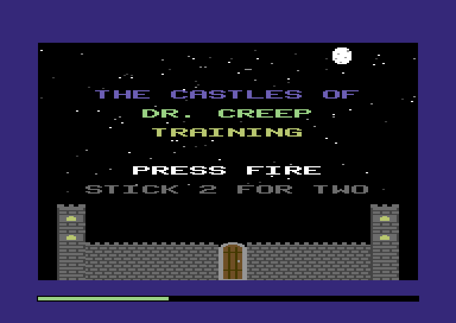
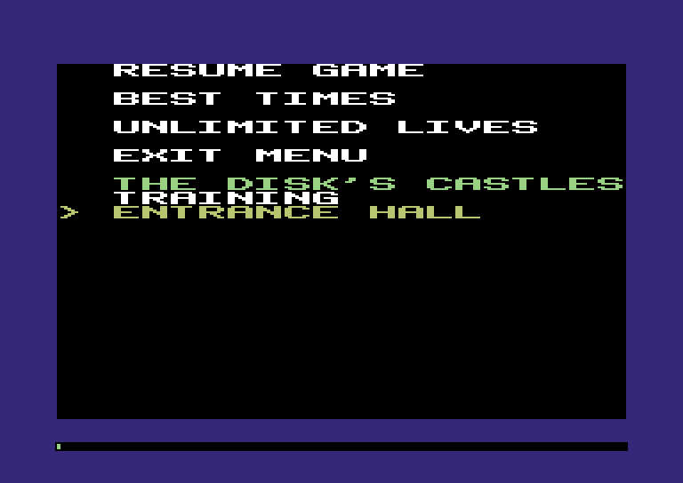
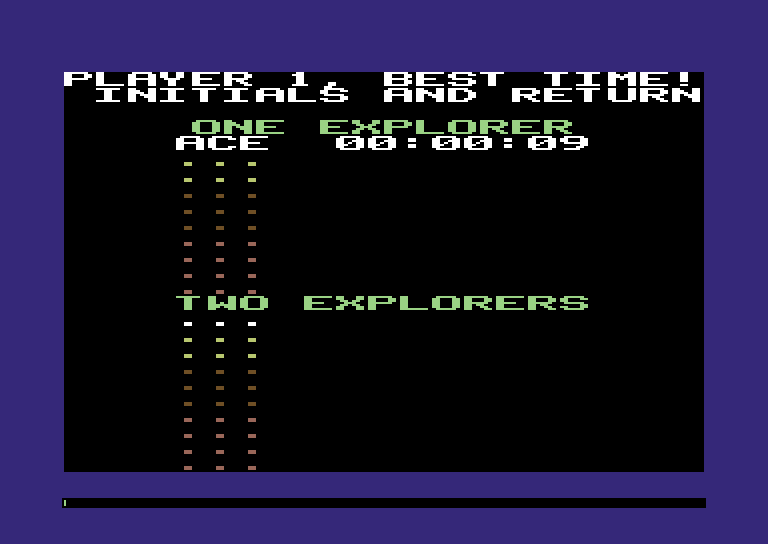
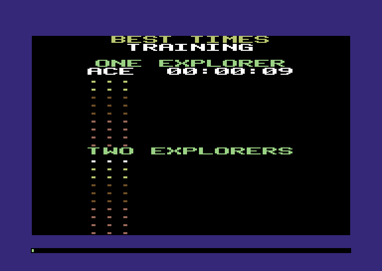
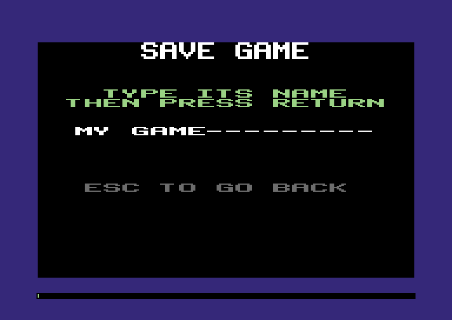

:::mission-briefing
For ten chapters the Training Castle has been compiled right into the
game. This chapter gives the Comet a **disk drive**, and the game reads
its castles from a disk, the way the 1984 game did. The title names
the castle. Esc opens a menu: pick another castle from the disk, look
at the best times, turn on unlimited lives, or resume a saved game.
Escape in good time and the game asks for your initials, then writes
the best times back to the disk. On the castle map, Esc saves the game
under any name you type.

Our game comes with its own disk, made by the compiler. A castle disk
from 1984 slots straight in too.

New under the hood: **devices, blocks and slow storage** (a disk is a
pile of numbered blocks, and every block costs time), and **overlaying
memory** (loading something into bytes you've only just finished
with).
:::

## The drive arrives

The machine folder has a new part: a disk drive. Replace your
`code/machine` with the new one from [`code/machine/`](../code/machine/).
Every checkpoint still builds and runs exactly as before. Section 13 of
the reference card is new, and it's all about the drive.

The drive is a **device**: a piece of hardware beside the CPU that does
one job when it's asked. The game asks through registers, the same way
it talks to the VIDEO chip. The drive's registers start at `$DD00`. The game
writes a file's name, an address in memory and a length, then a
**command**: 1 to load, 2 to save. By the time that `poke` returns,
the drive has done the job, and its status register says how it went:
0 for fine, 2 for "no file by that name", 4 for "the disk is full", and
so on.

"Done by the time `poke` returns" doesn't mean free. The drive charges
for its time, and that's this chapter's first big idea.

Disks slot in from outside too. The headless runner takes `--disk FILE`,
and `--save-disk FILE` writes the disk out when the run ends, saves and
all. In the browser there's a disk slot under the screen, and a button
to save the disk back to your computer.

## Inside a disk

A disk is a flat, spinning circle, and the drive reads it in rings
called **tracks**. This kind of disk has 35. Each track is cut into
**sectors** of 256 bytes. A sector is the smallest piece the drive can
read or write. Ask for one byte and the drive still reads its whole
sector. The outer tracks are longer, so they hold more sectors: 21 on
tracks 1 to 17, then 19, 18 and 17 further in. That's 683 sectors, or
174,848 bytes. A **disk image** (a `.d64` file) is exactly those bytes,
sector after sector, in one file.

Sectors are also called **blocks**, and the disk keeps its own
bookkeeping on track 18, the middle one:

- **Sector 0 is the BAM**, the block availability map. It has one bit
  for every sector on the disk: 1 means free. It also holds the disk's
  name and a two-letter ID.
- **Sector 1 is the start of the directory.** A directory sector holds
  eight entries of 32 bytes. An entry has the file's name (16 letters),
  its length in sectors, and the track and sector where it starts.

A **file** is a chain of sectors. The first two bytes of each sector
name the track and sector of the next. The other 254 bytes are the
file. The last sector has a 0 where the next track would be, and the
byte after it says where the file ends. In JavaScript terms a file is a
linked list, not an array: each piece points to the next.

Here's our game's disk, every sector of it, and the Training Castle
being loaded:

:::diagram ch11-disk
Each square is a sector, tracks left to right. Loading a file starts at
the directory on track 18, then follows the chain: each sector says
where the next one is.
:::

Why a chain? Files come and go. When a file is saved, any free sectors
will do, wherever they are, so the drive never has to find a long run
of free space. The price is that you can't jump to the middle of a
file. To find its tenth sector, you read the first nine.

Look at the order: 17/0, 17/10, 17/20, 17/9. The file skips ten
sectors each time. A real disk keeps spinning while the drive deals
with one sector, so the very next one has already gone past. Ten
sectors on, the drive is ready just as it comes round. Our drive keeps
the habit, so its disks look like any other.

Now the cost. **Every sector the drive reads or writes takes a frame's
worth of cycles: 19,656.** That's 254 bytes of file a frame, about
12,700 bytes a second. The CPU can copy that much memory in a tenth of
the time. The drives of the day were slower still. Loading is a pause,
and the game should blank the screen first, as it does for any long
frame (Chapter 2's loading pause).

## The game's own disk

The drive needs a disk, and we have one castle. So let's make a disk
with the Training Castle on it, and do it while the game compiles. The
drive's code works on a plain disk image and needs no machine, so the
compiler can run it:

**`src/master.zig`** (new file)

```zig
//! The game's own disk, made while the game compiles: a blank disk, then
//! the castles saved onto it, each as a "Z" file that loads at staging,
//! the way 1984's castles did. No score files yet: a castle gets one the
//! first time someone escapes from it.

const machine = @import("machine");
const drive = machine.drive;
const map = @import("map.zig");
const training = @import("training.zig");
const hall = @import("hall.zig");

pub const image: drive.Image = blk: {
    @setEvalBranchQuota(4_000_000); // building a disk is a lot of compile-time loops
    var disk: drive.Image = undefined;
    drive.format(&disk, "CASTLES OF CREEP", "84".*);
    var sectors: u32 = 0; // the drive counts them; nothing's charged while compiling
    drive.save(&disk, "ZTRAINING", map.staging.first, training.bytes, &sectors) catch |e| @compileError("the master disk: " ++ @errorName(e));
    drive.save(&disk, "ZENTRANCE HALL", map.staging.first, hall.bytes, &sectors) catch |e| @compileError("the master disk: " ++ @errorName(e));
    break :blk disk;
};
```

`format` writes an empty BAM and directory, and `save` writes a file
as a chain, the same as a save on the Comet does. Their names start
with a Z because that's how the 1984 disk told castles apart from
everything else. Every castle on it is a Z file, saved with the address
of staging, `$9800`, as its load address. The Entrance Hall from
Chapter 3 comes along too, as a second castle to choose from.

If the castles didn't fit, `save` would return an error, and the
`catch` turns it into a compile error: a disk that doesn't fit never
builds. `sectors` counts the sectors touched. On the Comet the drive
charges for them, but here the compiler does the work, for free.

The machine looks for one more declaration in your game: `disk`. If
it's there, the machine slots it into the drive at every power-on.
Import the new file in `main.zig`:

**`src/main.zig`** (add below the `tunes` import)

```zig
const master = @import("master.zig");
```

and hand the machine its disk:

**`src/main.zig`** (add above `Mode`)

```zig
/// The disk that comes with the game. The machine puts it in the drive
/// when it powers on; the game reads its castles from there, like any
/// other disk.
pub const disk = master.image;
```

Build and run, and save the disk out at the end:

```
zig build run -- --frames 10 --save-disk creep.d64
```

```
ran 10 frames (2 calls to frame)
cycles: max 167926 (854%), avg 87331 (444%) of 19656
  bucket 0: max 44, avg 30
  bucket 1: max 167896, avg 87278
  bucket 5: max 32, avg 23
overruns: 0, loading pauses: 1
last frame: frames/frame_00009.ppm
disk: creep.d64, 643 blocks free
```

An empty disk has 664 blocks free. The Training Castle takes 19 and the
Entrance Hall 2, so 643 are left. `creep.d64` is a real disk image,
174,848 bytes, and the title still reads the Training Castle from the
table compiled into the game. Let's read it from the disk instead.

## Talking to the drive

First, some room. The memory map gets three new regions, next to
staging, and staging's comment changes, because the disk is where its
castle comes from now:

**`src/map.zig`** (replace the comment on `staging`)

```zig
/// The castle as it came off the disk, untouched: each new game starts
/// from a copy. At power-on the disk's directory lands here first.
```

**`src/map.zig`** (add below `staging`)

```zig
/// The castle's best times, exactly as its score file holds them
/// (scores.zig).
pub const scores = Region{ .name = "best times", .first = 0xB800, .last = 0xB879 };

/// The shell: the disk, the menu, and the line being typed.
pub const shell = Region{ .name = "shell", .first = 0xB880, .last = 0xB89F };
pub const shell_disk = shell.first + 0; // a files.Disk: unread, ready, or no castle
pub const shell_castles = shell.first + 1; // how many castles the disk has (up to 16)
pub const shell_castle = shell.first + 2; // which of them is in staging
pub const shell_pointer = shell.first + 3; // the menu line the pointer is on
pub const shell_stick = shell.first + 4; // stick 1 as the menu last saw it
pub const shell_unlimited = shell.first + 5; // 1: lives never run out, and no best times
pub const shell_signing = shell.first + 6; // the player typing his initials, or 0xFF
pub const shell_place = shell.first + 7; // the best time he's signing
pub const shell_saving = shell.first + 8; // 1: typing a name to save under; 0: to resume
pub const shell_x = shell.first + 9; // where the line being typed starts
pub const shell_y = shell.first + 10;
pub const shell_max = shell.first + 11; // the most letters it takes
pub const shell_typed = shell.first + 12; // letters typed so far
pub const shell_line = shell.first + 16; // 16 bytes: the letters, bit 7 on the last

/// The castles on the disk, in directory order: 16 bytes a name, bit 7
/// on its last letter (files.zig).
pub const catalog = Region{ .name = "castle list", .first = 0xB900, .last = 0xB9FF };
```

`scores` holds a castle's best times, exactly as its score file has
them. `shell` is 32 bytes of state for everything around the castles:
the disk, the menu, and a line being typed. `catalog` is the castle
list: 16 bytes for each castle's name, room for 16 castles.

The drive's registers go in the map's hardware rows:

**`src/map.zig`** (add below the `input_ports` line)

```zig
const disk_drive = Region{ .name = "disk drive", .first = hw.drive_command, .last = hw.drive_name + hw.drive_name_max - 1 };
```

and all four in `regions`, so the overlap check sees them:

**`src/map.zig`** (in `regions`, add below `staging`)

```zig
    scores,
    shell,
    catalog,
```

**`src/map.zig`** (in `regions`, add below `input_ports`)

```zig
    disk_drive,
```

The disk code needs one thing from the best times: what a fresh table
looks like, for a castle nobody has escaped from yet. So let's start
`scores.zig` with the score file's layout:

**`src/scores.zig`** (new file)

```zig
//! Best times. Each castle keeps the ten fastest escapes from games for
//! one, and the ten from games for two, with the initials of whoever made
//! them, in a score file of 122 bytes: the same file, byte for byte, as
//! 1984's.

const machine = @import("machine");
const Machine = machine.Machine;
const map = @import("map.zig");

/// One best time: three initials, then seconds, minutes and hours, two
/// decimal digits to a byte. An empty place is all $FF, slower than any
/// time there is.
pub const Best = extern struct { initials: [3]u8, seconds: u8, minutes: u8, hours: u8 };
pub const places = 10;

/// The score file: its own length, then a table for games for one and a
/// table for games for two.
pub const File = extern struct { size: [2]u8, tables: [2][places]Best };
pub const file_size = @sizeOf(File);
comptime {
    if (file_size != map.scores.last - map.scores.first + 1)
        @compileError("the best times must fill their region exactly");
}

fn file(m: *Machine) *align(1) File {
    return m.view(File, map.scores.first);
}

/// Where place `k` of table `two` is.
fn address(two: u8, k: u8) u16 {
    return map.scores.first + 2 + (@as(u16, two) * places + k) * @sizeOf(Best);
}

/// Nobody's escaped yet.
pub fn fresh(m: *Machine) void {
    m.poke16(map.scores.first, file_size);
    m.fill(map.scores.first + 2, file_size - 2, 0xFF);
}
```

A best time is six bytes: three initials, then seconds, minutes and
hours as two decimal digits a byte, the same BCD as Chapter 9's clock.
A table is ten of them, fastest first. The file has a table for games
for one and a table for games for two, after two bytes giving the
file's own length: 2 + 2 × 10 × 6 = 122 bytes. On the disk the file
has a load address in front, so it's 124 bytes there. That's 1984's
score file, byte for byte.

The `comptime` block checks that the struct and the region agree. A
fresh table is all `$FF`, and `$FF` hours is slower than any real time,
so every escape beats an empty place.

Now the game's side of the drive, `files.zig`:

**`src/files.zig`** (new file)

```zig
//! The game's side of the disk drive: names, loads and saves, the list
//! of castles from the disk's directory, and a castle with its best times.

const machine = @import("machine");
const Machine = machine.Machine;
const hw = machine.hw;
const drive = machine.drive;
const map = @import("map.zig");
const castle = @import("castle.zig");
const scores = @import("scores.zig");

pub const Status = drive.Status;

/// Load at most `room` bytes of the named file to `at`.
pub fn load(m: *Machine, at: u16, room: u16) Status {
    return command(m, .load, at, room);
}

/// Save `len` bytes from `at` as the named file.
pub fn save(m: *Machine, at: u16, len: u16) Status {
    return command(m, .save, at, len);
}

/// Fill in the drive's registers and write the command. The drive has
/// done it by the time `poke` returns, and charged a frame a sector.
fn command(m: *Machine, c: drive.Command, at: u16, len: u16) Status {
    m.poke16(hw.drive_address, at);
    m.poke16(hw.drive_length, len);
    m.poke(hw.drive_command, @intFromEnum(c));
    return @enumFromInt(m.peek(hw.drive_status));
}

/// Name the next file: `words` from the program, as they are.
pub fn name(m: *Machine, comptime words: []const u8) void {
    m.load(hw.drive_name, words);
    m.poke(hw.drive_name_length, words.len);
}

/// Name the next file: `prefix`, then the stored name at `at`, up to
/// the letter with bit 7 set (which loses its bit 7).
pub fn nameFrom(m: *Machine, comptime prefix: []const u8, at: u16) void {
    m.load(hw.drive_name, prefix);
    var n: u8 = prefix.len;
    var from = at;
    while (n < hw.drive_name_max) {
        const letter = m.peek(from);
        m.poke(hw.drive_name + n, letter & 0x7F);
        n += 1;
        from += 1;
        if (letter & 0x80 != 0) break;
    }
    m.poke(hw.drive_name_length, n);
}

// ---- the castle list --------------------------------------------------------

pub const max_castles = 16;
const name_size = 16;

/// Where castle `n`'s name is kept.
pub fn entry(n: u8) u16 {
    return map.catalog.first + @as(u16, n) * name_size;
}

/// Letters in the stored name at `at`, up to the one with bit 7 set.
pub fn length(m: *Machine, at: u16) u8 {
    var n: u8 = 1;
    while (m.peek(at + n - 1) & 0x80 == 0) n += 1;
    return n;
}

/// What's in staging: nothing yet (power-on), a castle, or nothing to be
/// had (no disk, or no castle on it).
pub const Disk = enum(u8) { unread, ready, none };

/// Power-on: the castle list, then the first castle.
pub fn powerOn(m: *Machine) void {
    catalog(m);
    _ = pick(m, 0);
}

/// The castle list. The drive sends the directory as a little program
/// listing, a line for each file that matches "Z*": its length in blocks,
/// then its name in quotes. It lands in staging, which is free until the
/// castle loads over it, and every name between quotes after the first
/// line (that one is the disk's own name) goes in the list, less its Z.
pub fn catalog(m: *Machine) void {
    m.poke(map.shell_castles, 0);
    name(m, "$0:Z*");
    if (load(m, map.staging.first, map.staging.last - map.staging.first + 1) != .ok) return;
    var line = next(m, map.staging.first); // past the disk's name
    while (m.peek16(line) != 0) : (line = next(m, line)) {
        const count = m.peek(map.shell_castles);
        if (count == max_castles) return;
        var at = line + 4; // past the link and the line number
        while (m.peek(at) != '"' and m.peek(at) != 0) at += 1;
        if (m.peek(at) == 0 or m.peek(at + 1) != 'Z') continue; // BLOCKS FREE.
        at += 2;
        var len: u16 = 0;
        while (m.peek(at + len) != '"' and len < name_size - 1) len += 1;
        if (len == 0) continue;
        m.copy(entry(count), at, len);
        m.poke(entry(count) + len - 1, m.peek(entry(count) + len - 1) | 0x80);
        m.poke(map.shell_castles, count + 1);
    }
}

/// The line after the one at `line`: past its zero byte.
fn next(m: *Machine, line: u16) u16 {
    var at = line + 4;
    while (m.peek(at) != 0) at += 1;
    return at + 1;
}

/// Castle `n` from the disk into staging, over whatever was there, and
/// its best times (the file "Y" and its name) next to it. No score file
/// yet: a fresh table. True if a castle came.
pub fn pick(m: *Machine, n: u8) bool {
    m.poke(map.shell_castle, n);
    m.poke(map.shell_disk, @intFromEnum(Disk.none));
    if (n >= m.peek(map.shell_castles)) return false;
    nameFrom(m, "Z", entry(n));
    if (load(m, map.staging.first, map.staging.last - map.staging.first + 1) != .ok) return false;
    if (m.peek(map.staging.first + 2) != castle.magic_value) return false;
    nameFrom(m, "Y", entry(n));
    if (load(m, map.scores.first, scores.file_size) != .ok or m.peek16(map.scores.first) != scores.file_size)
        scores.fresh(m);
    m.poke(map.shell_disk, @intFromEnum(Disk.ready));
    return true;
}

/// Is there a castle to play?
pub fn ready(m: *Machine) bool {
    return m.peek(map.shell_disk) == @intFromEnum(Disk.ready);
}
```

`command` is the whole conversation: the address, the length, then the
command, and the status back. `name` puts a name from the program into
the drive's name register. `nameFrom` builds one from a name stored in
memory, after a prefix such as `"Z"`. A stored name ends at its letter
with bit 7 set, the way the castle's text strings end.

`powerOn` reads the castle list and then the first castle. The list
comes from the disk's **directory**. Load the name `$`, and the drive
sends the directory as a little program listing, a line for each file.
`$0:Z*` asks for only the files whose names start with Z: our castles.
Each line is two link bytes, a line number, some text, and a 0. The
first line has the disk's name, and the rest each have a file's length
as the line number, then its name in quotes. `catalog` walks the lines
and copies every quoted name, less its Z, into the castle list. They
come in directory order, which is the order the castles were saved on
the disk. That's the order the menu will show them.

Where does the listing go while `catalog` reads it? Into staging. And
then the first castle loads into staging, right over it:

:::diagram ch11-listing
The castle list's trip from the disk to memory, and the castle that
lands on top of it.
:::

This is **overlaying memory**: the same bytes doing two jobs, one after
the other. By the time the castle comes, the listing's job is done.
Staging is idle until a castle is in it, so the listing borrows it. On
a 64 KB machine, a 126-byte job doesn't get its own region when a free
one is right there.

`pick` loads castle `n`, the file Z plus its name, into staging, and
checks its magic byte, `$80`: any file can be called Z-something. Then
it loads the score file, Y plus the same name, into `scores`. A castle
nobody's escaped from has none yet, so a failed load means a fresh
table. `shell_disk` says how it went: `unread`, `ready`, or `none`.

## Power on

Over to `main.zig`. Import the two new files, around `master`:

**`src/main.zig`** (add above the `master` import)

```zig
const files = @import("files.zig");
```

**`src/main.zig`** (add below the `master` import)

```zig
const scores = @import("scores.zig");
```

`boot` doesn't load the Training Castle into staging any more:

**`src/main.zig`** (in `boot`, take out this line)

```zig
    m.load(map.staging.first, training.bytes); // a new game copies it to map.castle
```

The disk does it, on the first frame. The game starts in `draw_title`,
and `shell_disk` is 0, `unread`, because memory is 0 at power-on. So
the first frame reads the disk, after the display is blanked:

**`src/main.zig`** (in the `.draw_title` prong, add below the blank)

```zig
            // The first time: the disk's castles, and the first of them.
            if (m.peek(map.shell_disk) == @intFromEnum(files.Disk.unread)) files.powerOn(m);
```

A disk with no castle on it, or no disk at all, mustn't start a game.
`game.zig` gets the files:

**`src/game.zig`** (add below the `sound` import)

```zig
const files = @import("files.zig");
```

and `chosen` asks first:

**`src/game.zig`** (replace `chosen`)

```zig
/// On the title screen, every frame: fire on stick 1 starts a game for
/// one, fire on stick 2 a game for two. Null while nobody's pressed, or
/// there's no castle to play.
pub fn chosen(m: *Machine) ?bool {
    const one = player.pressedFire(m, 0);
    const two = player.pressedFire(m, 1);
    if (!files.ready(m)) return null;
    if (two) return true;
    if (one) return false;
    return null;
}
```

It reads both fire buttons first, so a press made with no castle
doesn't turn up later.

The title names the castle in play. `title.zig` gets the files:

**`src/title.zig`** (add below the `text` import)

```zig
const files = @import("files.zig");
```

keeps the stars off the name's row:

**`src/title.zig`** (in `star_map`, add below the DR. CREEP line)

```zig
            row == 9 or // the castle's name
```

and draws it, in the middle of the screen, or says there's no disk:

**`src/title.zig`** (in `draw`, add below DR. CREEP)

```zig
    if (files.ready(m)) {
        const name = files.entry(m.peek(map.shell_castle));
        _ = text.draw(m, 80 - 4 * files.length(m, name), 72, .yellow, text.plain, name);
    } else text.say(m, 24, 72, .red, "NO CASTLE DISK");
```

The screen is 160 fat pixels wide and a letter is 8, so a name of *n*
letters starts 4 × *n* left of the middle, at 80.

Two tests: the power-on frame reads the castles in directory order and
the first castle with them, and a drive with no disk leaves the game on
the title.

**`src/main.zig`** (add at the end)

```zig
test "power on: the disk's castles in directory order, and the first one ready to play" {
    const m = try std.testing.allocator.create(Machine);
    defer std.testing.allocator.destroy(m);
    m.boot(@This());
    _ = m.runFrame(@This()); // reads the disk, draws the title
    try std.testing.expectEqual(machine.FrameKind.loading, m.last.kind);
    try std.testing.expectEqual(2, m.ram[map.shell_castles]);
    try std.testing.expectEqualSlices(u8, "TRAININ", m.ram[files.entry(0)..][0..7]);
    try std.testing.expectEqual('G' | 0x80, m.ram[files.entry(0) + 7]);
    try std.testing.expectEqualSlices(u8, "ENTRANCE HAL", m.ram[files.entry(1)..][0..12]);
    try std.testing.expectEqualSlices(u8, training.bytes, m.ram[map.staging.first..][0..training.bytes.len]);
    try std.testing.expectEqual(scores.file_size, m.ram[map.scores.first]); // no score file: a fresh one
    try std.testing.expectEqual(0xFF, m.ram[map.scores.first + 2]);
}

test "no disk in the drive: the title says so, and fire starts nothing" {
    const m = try std.testing.allocator.create(Machine);
    defer std.testing.allocator.destroy(m);
    m.boot(@This());
    m.eject();
    _ = m.runFrame(@This());
    try std.testing.expectEqual(@intFromEnum(files.Disk.none), m.ram[map.shell_disk]);
    hold(m, machine.joy.fire, 1);
    hold(m, 0, 5);
    try std.testing.expectEqual(@intFromEnum(Mode.title), m.ram[map.game_mode]);
}
```

Run it:

```
zig build run -- --frames 60 --dump-every 10
```

```
ran 60 frames (29 calls to frame)
cycles: max 627734 (3193%), avg 28166 (143%) of 19656
  bucket 0: max 454404, avg 15715
  bucket 1: max 173316, avg 12406
  bucket 5: max 176, avg 44
overruns: 0, loading pauses: 1
last frame: frames/frame_00059.ppm
```



The first frame took 627,734 cycles, nearly 32 frames. Bucket 0 is the
disk: `powerOn` runs before the frame switches to the drawing bucket.
Its 454,404 cycles are 23 sectors. Two are for the listing (the BAM, for
the disk's name, and one directory sector), 20 are for the castle (the
directory sector to find it, then its 19), and one is the look for a
score file that isn't there. The other 2,316 cycles read the listing.
Bucket 1 is the title. The display was blanked, so it's one loading
pause, about two thirds of a second.

## The menu

Now the player's side. Esc on the title opens the menu. The menu needs
Esc's key code, and Esc is a typing key, so we'll start `typing.zig`
with its keys. The rest of the file comes with the best times:

**`src/typing.zig`** (new file)

```zig
//! Typing a line: initials for a best time, or the name of a saved game.
//! Each letter is drawn as it lands, Backspace takes the last one back,
//! Return is done and Esc gives up.

const machine = @import("machine");
const Machine = machine.Machine;
const hw = machine.hw;
const map = @import("map.zig");
const text = @import("text.zig");
const player = @import("player.zig");

/// The keys that aren't letters.
const key_return = 13;
const key_backspace = 8;
pub const key_esc = 27;
```

Here's the menu:

**`src/menu.zig`** (new file)

```zig
//! The menu, from Esc on the title screen. Stick 1 moves the pointer and
//! fire chooses: resume a saved game, look at the best times, unlimited
//! lives on or off, back to the title, or another castle from the disk.

const machine = @import("machine");
const Machine = machine.Machine;
const hw = machine.hw;
const joy = machine.joy;
const map = @import("map.zig");
const screen = @import("screen.zig");
const text = @import("text.zig");
const files = @import("files.zig");
const typing = @import("typing.zig");

/// The lines above the castles.
const Item = enum(u8) { resume_game, best_times, unlimited, exit };
const items = 4;

/// What the menu chose.
pub const Choice = enum { nothing, resume_game, best_times, exit, castle };

/// Esc on the keyboard? Any other key is seen and forgotten.
pub fn asked(m: *Machine) bool {
    const key = m.peek(hw.key);
    if (key == 0) return false;
    m.poke(hw.key, 0); // seen it
    return key == typing.key_esc;
}

/// The row of menu line `i`: the items with a row between, a heading,
/// then the castles.
fn rowOf(i: u8) u8 {
    return if (i < items) 16 * i else 72 + 8 * (i - items);
}

/// The whole menu, the pointer on the first line. Call it with the
/// display blanked.
pub fn draw(m: *Machine) void {
    screen.clear(m);
    m.poke(hw.sprite_enable, 0);
    text.say(m, 16, rowOf(0), .white, "RESUME GAME");
    text.say(m, 16, rowOf(1), .white, "BEST TIMES");
    lives(m);
    text.say(m, 16, rowOf(3), .white, "EXIT MENU");
    text.say(m, 16, 64, .light_green, "THE DISK'S CASTLES");
    var n: u8 = 0;
    while (n < m.peek(map.shell_castles)) : (n += 1) {
        // The castle in staging is the one picked: it's in white.
        const color: machine.Color = if (n == m.peek(map.shell_castle)) .white else .yellow;
        _ = text.draw(m, 16, rowOf(items + n), color, text.plain, files.entry(n));
    }
    m.poke(map.shell_pointer, 0);
    m.poke(map.shell_stick, m.peek(hw.joy1));
    pointer(m, '>');
}

/// UNLIMITED LIVES, reversed while it's on.
fn lives(m: *Machine) void {
    clear(m, 16, rowOf(@intFromEnum(Item.unlimited)), 15);
    const on = m.peek(map.shell_unlimited) != 0;
    const words = comptime text.terminated("UNLIMITED LIVES");
    m.load(map.text_buffer, &words);
    _ = text.draw(m, 16, rowOf(@intFromEnum(Item.unlimited)), .white, if (on) text.plain | text.style_reversed else text.plain, map.text_buffer);
}

/// Rub out `letters` letters at fat pixel (x, y): a row of cells, 8
/// bytes each, two to a letter.
fn clear(m: *Machine, x: u8, y: u8, letters: u8) void {
    m.fill(hw.bitmap + @as(u16, y / 8) * 320 + @as(u16, x / 4) * 8, @as(u16, letters) * 16, 0);
}

/// The pointer, `c`, left of its line; a space rubs it out.
fn pointer(m: *Machine, c: u8) void {
    const y = rowOf(m.peek(map.shell_pointer));
    clear(m, 0, y, 1);
    if (c == ' ') return;
    m.poke(map.text_buffer, c | 0x80);
    _ = text.draw(m, 0, y, .yellow, text.plain, map.text_buffer);
}

/// Was this switch pushed since the menu last looked? (0 is pushed.)
fn pushed(stick: u8, before: u8, bit: u8) bool {
    return stick & bit == 0 and before & bit != 0;
}

/// Every frame of the menu.
pub fn run(m: *Machine) Choice {
    if (asked(m)) return .exit;
    const stick = m.peek(hw.joy1);
    const before = m.peek(map.shell_stick);
    m.poke(map.shell_stick, stick);
    m.work(30); // the tests
    const lines = items + m.peek(map.shell_castles);
    const at = m.peek(map.shell_pointer);
    if (pushed(stick, before, joy.up) or pushed(stick, before, joy.down)) {
        pointer(m, ' ');
        const up = pushed(stick, before, joy.up);
        m.poke(map.shell_pointer, if (up) (if (at == 0) lines - 1 else at - 1) else (if (at == lines - 1) 0 else at + 1));
        pointer(m, '>');
        return .nothing;
    }
    if (!pushed(stick, before, joy.fire)) return .nothing;
    if (at >= items) {
        m.poke(hw.control, 0); // the castle's a loading pause: blank first
        _ = files.pick(m, at - items);
        return .castle;
    }
    return switch (@as(Item, @enumFromInt(at))) {
        .resume_game => .resume_game,
        .best_times => .best_times,
        .unlimited => {
            m.poke(map.shell_unlimited, m.peek(map.shell_unlimited) ^ 1);
            lives(m);
            return .nothing;
        },
        .exit => .exit,
    };
}
```

`asked` clears any key pressed on the title, so a stray key can't wait
for a later screen. Only Esc opens the menu.

The menu has four lines and then the castles. A pointer, `>`, sits left
of the line it's on, and `shell_pointer` says which. Stick 1 moves it
and fire chooses. `pushed` looks for a switch going down since the last
frame: `shell_stick` keeps the stick as it was, the way each player's
`last_stick` does in a room. Down from the last line goes round to the
top, and up from the top goes round to the bottom.

Fire on a castle blanks the display, because a load is a loading pause,
and `pick`s it. The title comes back with its name. The castle in
staging is drawn in white and the others in yellow.

`UNLIMITED LIVES` is drawn in reverse while it's on: its letters dark
on a light bar. Fire flips it.

Over in `main.zig`, import the menu below `master`:

**`src/main.zig`** (add below the `master` import)

```zig
const menu = @import("menu.zig");
```

`Mode` grows two modes, a screen's usual pair, and one line each is
easier to read now:

**`src/main.zig`** (replace `Mode`)

```zig
const Mode = enum(u8) {
    draw_title,
    title,
    draw_map,
    map,
    draw_room,
    room,
    draw_escape,
    escape,
    draw_over,
    over,
    draw_menu,
    menu,
};
```

On the title, Esc goes to the menu:

**`src/main.zig`** (in the `.title` prong, replace the first line)

```zig
            if (menu.asked(m)) {
                setMode(m, .draw_menu);
            } else if (game.chosen(m)) |two| {
```

and the menu's two modes go at the end of the `switch`. `draw_menu`
draws it with the display blanked. `menu` turns the display on and runs
it. Exit and a new castle both go back to the title. RESUME GAME and
BEST TIMES do nothing yet: they're the next two sections.

**`src/main.zig`** (add at the end of the `switch`)

```zig
        .draw_menu => {
            m.poke(hw.control, 0);
            m.bucket(bucket_drawing);
            menu.draw(m);
            setMode(m, .menu);
        },
        .menu => {
            m.poke(hw.control, machine.display_on);
            m.bucket(bucket_drawing);
            switch (menu.run(m)) {
                .nothing => {},
                .exit, .castle => setMode(m, .draw_title),
                .best_times => {}, // soon
                .resume_game => {}, // soon
            }
        },
```

The title tells the player about Esc. Keep the stars off that row too:

**`src/title.zig`** (in `star_map`, replace the castle's name line)

```zig
            row == 9 or row == 11 or // the castle's name, and the menu
```

and say it, in grey:

**`src/title.zig`** (in `draw`, add below NO CASTLE DISK)

```zig
    text.say(m, 16, 88, .grey, "ESC FOR THE MENU");
```

Unlimited lives is a change to `game.after`, where a death costs a life.
Its comment first:

**`src/game.zig`** (replace the comment on `after`)

```zig
/// The room's over: settle up with everyone who was in it. Dead, he loses
/// a life (unless the menu says lives are unlimited), and starts again at
/// the castle's start, unless that was his last: then he's out of the
/// game. Through the way out, he's escaped.
```

then the life:

**`src/game.zig`** (in `after`, replace the `lives` line)

```zig
            const lost: u8 = if (m.peek(map.shell_unlimited) != 0) 0 else 1;
            const lives = m.peek(castle.lives + p) -| lost;
```

The tests need keys. `typeIn` types its keys a frame each, as fast as
anybody could:

**`src/main.zig`** (add above `hold2`)

```zig
/// Type `keys`, a key a frame.
fn typeIn(m: *Machine, comptime keys: []const u8) void {
    for (keys) |c| {
        m.input = .{ .key = c };
        _ = m.runFrame(@This());
    }
    m.input = .{};
}
```

and three more things: `push`, a stick pushed and let go; the menu
choosing the Entrance Hall and playing it; and five lives given up with
unlimited lives on, still three left each time:

**`src/main.zig`** (add at the end)

```zig
/// Push stick 1 `way`, and let go.
fn push(m: *Machine, way: u8) void {
    hold(m, way, 1);
    hold(m, 0, 1);
}

test "the menu: down to the second castle, fire, and it's the one the title names and the game plays" {
    const m = try std.testing.allocator.create(Machine);
    defer std.testing.allocator.destroy(m);
    m.boot(@This());
    _ = m.runFrame(@This());
    typeIn(m, "\x1b"); // Esc
    _ = m.runFrame(@This()); // draws the menu
    try std.testing.expectEqual(@intFromEnum(Mode.menu), m.ram[map.game_mode]);
    for (0..5) |_| push(m, machine.joy.down); // past the four lines and the first castle
    try std.testing.expectEqual(5, m.ram[map.shell_pointer]);
    hold(m, machine.joy.fire, 1); // loads it
    try std.testing.expectEqual(machine.FrameKind.loading, m.last.kind);
    try std.testing.expectEqual(1, m.ram[map.shell_castle]);
    try std.testing.expectEqualSlices(u8, hall.bytes, m.ram[map.staging.first..][0..hall.bytes.len]);
    hold(m, 0, 2); // the title again
    try std.testing.expectEqual(@intFromEnum(Mode.title), m.ram[map.game_mode]);
    hold(m, machine.joy.fire, 1);
    onward(m);
    try std.testing.expectEqual(@intFromEnum(Mode.room), m.ram[map.game_mode]);
    try std.testing.expectEqual(hall.bytes.len, m.peek16(castle.size)); // the Entrance Hall
}

test "unlimited lives: give up as often as you like, and it's never GAME OVER" {
    const m = try std.testing.allocator.create(Machine);
    defer std.testing.allocator.destroy(m);
    m.boot(@This());
    _ = m.runFrame(@This());
    typeIn(m, "\x1b");
    _ = m.runFrame(@This());
    push(m, machine.joy.down);
    push(m, machine.joy.down);
    hold(m, machine.joy.fire, 1);
    try std.testing.expectEqual(1, m.ram[map.shell_unlimited]);
    typeIn(m, "\x1b"); // back to the title
    hold(m, 0, 2);
    hold(m, machine.joy.fire, 1);
    for (0..5) |_| {
        onward(m);
        arrived(m);
        typeIn(m, "X");
        while (m.ram[map.game_mode] == @intFromEnum(Mode.room)) hold(m, 0, 1);
        try std.testing.expectEqual(3, m.ram[castle.lives]);
    }
    try std.testing.expectEqual(@intFromEnum(Mode.draw_map), m.ram[map.game_mode]);
}
```

Run it, Esc, five pushes down, then fire:

```
zig build run -- --frames 320 --key 60:#27 --press 80:d:1 --press 90:d:1 --press 100:d:1 --press 110:d:1 --press 120:d:1 --press 140:f:1 --press 200:f:3 --press 240:f:3 --dump-every 10
```

```
ran 320 frames (256 calls to frame)
cycles: max 638586 (3248%), avg 7170 (36%) of 19656
  bucket 0: max 454404, avg 1853
  bucket 1: max 187528, avg 5170
  bucket 2: max 1080, avg 43
  bucket 3: max 458, avg 62
  bucket 4: max 52, avg 7
  bucket 5: max 176, avg 33
overruns: 0, loading pauses: 6
last frame: frames/frame_00319.ppm
```



Drawing the menu costs 139,728 cycles, a loading pause of 8 frames.
Moving the pointer costs about a thousand. Fire on the Entrance Hall
loads it (four sectors: the directory, its two, and the look for its
score file), and the title names it. Fire again, and the game plays the
Entrance Hall.

## Best times

You know the moment. You've raced through a castle and out of its last
door, and the game says: that time is one of the best, so sign it. 1984
kept the ten best times for every castle, one table for games for one
and another for games for two. We'll do the same, in the same file.

The best times print times, and Chapter 9's clock prints one, so let's
share it. `print` splits in two, and `write` puts a time's letters
anywhere:

**`src/clock.zig`** (replace `print`)

```zig
/// Print player `p`'s time as HH:MM:SS at fat pixel (x, y).
pub fn print(m: *Machine, x: u8, y: u8, color: Color, p: player.Number) void {
    const t = of(m, p);
    const end = write(m, map.text_buffer, t.hours, t.minutes, t.seconds);
    m.poke(end, m.peek(end) | 0x80); // the last digit ends the string
    _ = text.draw(m, x, y, color, text.plain, map.text_buffer);
}

/// Write a time as the letters HH:MM:SS at `at`, and return where its
/// last digit went. Each digit is half a byte, so it's a shift or a mask
/// away from its letter.
pub fn write(m: *Machine, at: u16, hours: u8, minutes: u8, seconds: u8) u16 {
    var to = at;
    for ([3]u8{ hours, minutes, seconds }) |digits| {
        m.poke(to, '0' + (digits >> 4));
        m.poke(to + 1, '0' + (digits & 0x0F));
        m.poke(to + 2, ':');
        to += 3;
        m.work(16); // the shift, the mask, the adds
    }
    return to - 2;
}
```

`scores.zig` needs more of the game now:

**`src/scores.zig`** (add below the `Machine` import)

```zig
const Color = machine.Color;
const hw = machine.hw;
```

**`src/scores.zig`** (add below the `map` import)

```zig
const castle = @import("castle.zig");
const screen = @import("screen.zig");
const text = @import("text.zig");
const clock = @import("clock.zig");
const player = @import("player.zig");
const files = @import("files.zig");
const typing = @import("typing.zig");
```

and here's the rest of it:

**`src/scores.zig`** (add at the end)

```zig
/// A time as one number to compare: hours, then minutes, then seconds.
/// Decimal digits in order compare as the numbers they are.
fn order(hours: u8, minutes: u8, seconds: u8) u32 {
    return @as(u32, hours) << 16 | @as(u32, minutes) << 8 | seconds;
}

/// Player `p` just escaped. Is his time one of the best ten? Then the
/// slower ones move down a place, his goes in with no initials yet, and
/// it's his turn to sign it. Not in a game with unlimited lives.
pub fn earned(m: *Machine, p: player.Number) bool {
    if (m.peek(map.shell_unlimited) != 0) return false;
    const t = clock.of(m, p);
    const two = m.peek(castle.two);
    const table = &file(m).tables[two];
    var k: u8 = 0;
    while (k < places) : (k += 1) {
        const b = &table[k];
        m.work(40); // the three compares
        if (order(t.hours, t.minutes, t.seconds) > order(b.hours, b.minutes, b.seconds)) continue;
        const at = address(two, k);
        m.copy(at + @sizeOf(Best), at, (places - 1 - k) * @sizeOf(Best)); // the slower ones, down one
        b.* = .{ .initials = "   ".*, .seconds = t.seconds, .minutes = t.minutes, .hours = t.hours };
        m.work(30); // the stores
        m.poke(map.shell_signing, p);
        m.poke(map.shell_place, k);
        return true;
    }
    return false;
}

/// The colour of each place, fastest first.
const colors = [places]Color{ .white, .yellow, .yellow, .orange, .orange, .orange, .pink, .pink, .pink, .pink };
const left = 28; // where the lines start

/// Both tables. If someone's signing his time, the top says so, and a
/// line waits for his initials. Call it with the display blanked.
pub fn draw(m: *Machine) void {
    screen.clear(m);
    m.poke(hw.sprite_enable, 0);
    const signing = m.peek(map.shell_signing);
    if (signing == 0xFF) {
        text.say(m, 40, 0, .yellow, "BEST TIMES");
        const name = files.entry(m.peek(map.shell_castle));
        _ = text.draw(m, 80 - 4 * files.length(m, name), 8, .white, text.plain, name);
    } else {
        const coat = player.coat(@intCast(signing));
        if (signing == 0) text.say(m, 0, 0, coat, "PLAYER 1, BEST TIME!") else text.say(m, 0, 0, coat, "PLAYER 2, BEST TIME!");
        text.say(m, 8, 8, .white, "INITIALS AND RETURN");
    }
    text.say(m, 32, 24, .light_green, "ONE EXPLORER");
    text.say(m, 28, 112, .light_green, "TWO EXPLORERS");
    for (0..2) |w| {
        var k: u8 = 0;
        while (k < places) : (k += 1) line(m, @intCast(w), k);
    }
    if (signing != 0xFF) {
        const two = m.peek(castle.two);
        typing.begin(m, left, rowOf(two, m.peek(map.shell_place)), 3);
    }
}

fn rowOf(two: u8, k: u8) u8 {
    return 32 + 88 * two + 8 * k;
}

/// One place: "ABC  01:23:45", or "..." while it's empty.
fn line(m: *Machine, two: u8, k: u8) void {
    const b = &file(m).tables[two][k];
    m.work(20); // the test
    if (b.initials[0] == 0xFF) {
        text.say(m, left, rowOf(two, k), colors[k], "...");
        return;
    }
    m.copy(map.text_buffer, address(two, k), 3); // the initials
    m.poke(map.text_buffer + 3, ' ');
    m.poke(map.text_buffer + 4, ' ');
    const end = clock.write(m, map.text_buffer + 5, b.hours, b.minutes, b.seconds);
    m.poke(end, m.peek(end) | 0x80);
    _ = text.draw(m, left, rowOf(two, k), colors[k], text.plain, map.text_buffer);
}

/// Every frame of the best times. Looking at them: fire on stick 1 or Esc
/// is done. Signing one: the initials, up to Return (or Esc, and it stays
/// unsigned); then the score file goes back to the disk. True when done.
pub fn run(m: *Machine) bool {
    const signing = m.peek(map.shell_signing);
    if (signing == 0xFF) {
        const key = m.peek(hw.key);
        if (key != 0) m.poke(hw.key, 0); // seen it
        return player.pressedFire(m, 0) or key == typing.key_esc;
    }
    switch (typing.run(m)) {
        .typing => return false,
        .done => {
            const at = address(m.peek(castle.two), m.peek(map.shell_place));
            const n = m.peek(map.shell_typed);
            m.copy(at, map.shell_line, n);
            m.poke(at + n - 1, m.peek(at + n - 1) & 0x7F); // not the end of anything here
        },
        .cancelled => {},
    }
    m.poke(map.shell_signing, 0xFF);
    m.poke(hw.control, 0); // the save is a loading pause: blank first
    _ = files.saveScores(m);
    return true;
}
```

`earned` runs when an explorer escapes. Its time goes in the table if
it beats a time already there. `order` turns a time into one number to
compare: hours, then minutes, then seconds, a byte each. BCD digits
read in order compare just as the numbers would, so `$09` seconds beats
`$10`. The first place with a slower time is his. Everything from there
down moves one place, with `m.copy`, and the tenth falls off the end.
The copy's source and destination overlap, and `m.copy` handles that.
His time goes in with blank initials. A tie goes in above the old time,
so the newest record wins it.

No best times in a game with unlimited lives, of course. That wouldn't
be fair to everyone else.

`draw` shows both tables. If someone's signing, the top line says who,
in his coat's colour, and dashes wait on his place. `run` waits for
fire or Esc when you're only looking. When you're signing, it waits for
the line to be typed, puts the initials in the table, and sends the
score file back to the disk.

Typing gets the rest of its file. Two more constants:

**`src/typing.zig`** (add above the keys)

```zig
pub const max_letters = 16;
const placeholder = '-';
```

and the typing:

**`src/typing.zig`** (add at the end)

```zig
/// Start a line at fat pixel (x, y), up to `max` letters long: a dash
/// where each letter will go.
pub fn begin(m: *Machine, x: u8, y: u8, max: u8) void {
    m.poke(map.shell_x, x);
    m.poke(map.shell_y, y);
    m.poke(map.shell_max, max);
    m.poke(map.shell_typed, 0);
    var i: u8 = 0;
    while (i < max) : (i += 1) letter(m, i, placeholder);
}

pub const Typing = enum { typing, done, cancelled };

/// Every frame: the key in the keyboard port, if there is one.
pub fn run(m: *Machine) Typing {
    const key = m.peek(hw.key);
    if (key == 0) return .typing;
    m.poke(hw.key, 0); // seen it
    const n = m.peek(map.shell_typed);
    m.work(20); // the tests
    switch (key) {
        key_return => if (n > 0) return finish(m, .done),
        key_esc => return finish(m, .cancelled),
        key_backspace => if (n > 0) {
            m.poke(map.shell_typed, n - 1);
            letter(m, n - 1, placeholder);
            if (n > 1) m.poke(map.shell_line + n - 2, m.peek(map.shell_line + n - 2) | 0x80);
        },
        'A'...'Z', '0'...'9', ' ', '.' => if (n < m.peek(map.shell_max)) {
            if (n > 0) m.poke(map.shell_line + n - 1, m.peek(map.shell_line + n - 1) & 0x7F);
            m.poke(map.shell_line + n, key | 0x80); // the last letter, for now
            m.poke(map.shell_typed, n + 1);
            letter(m, n, key);
        },
        else => {},
    }
    return .typing;
}

/// Return is stick 2's fire button too, and Space is stick 1's. Let both
/// sticks' edge detectors see this frame, so whichever key ended the line
/// isn't a press of fire on the next screen.
fn finish(m: *Machine, how: Typing) Typing {
    _ = player.pressedFire(m, 0);
    _ = player.pressedFire(m, 1);
    return how;
}

/// Draw letter `i` of the line as `c`: clear its two cells, then print it.
fn letter(m: *Machine, i: u8, c: u8) void {
    const x = m.peek(map.shell_x) + 8 * i;
    const y = m.peek(map.shell_y);
    // A cell is 8 bytes in a row in the bitmap, and a letter is two cells.
    m.fill(hw.bitmap + @as(u16, y / 8) * 320 + @as(u16, x / 4) * 8, 16, 0);
    m.poke(map.text_buffer, c | 0x80);
    _ = text.draw(m, x, y, .white, text.plain, map.text_buffer);
}
```

`begin` puts a dash where each letter will go. Each frame, `run` reads
the keyboard. A letter, digit, space or full stop takes the next dash.
Backspace takes one back, Return ends the line, and Esc gives up.

The letters are kept in `shell_line`, with bit 7 on the last one. That
bit moves along as you type and back as you rub out, so the line is
always a stored name, ready for `nameFrom`. That's how a saved game's
name will get to the drive.

`finish` needs a word. In the browser, Return is also stick 2's fire,
and Space is stick 1's, so the key that ends a line is also a press of
fire. `finish` asks both sticks for their press, which uses it up
before the next screen can see it.

Saving the scores is one more function in `files.zig`:

**`src/files.zig`** (add at the end)

```zig
/// Save the best times over the castle's score file, or as a new one.
pub fn saveScores(m: *Machine) Status {
    nameFrom(m, "@0:Y", entry(m.peek(map.shell_castle)));
    return save(m, map.scores.first, scores.file_size);
}
```

The name is Y plus the castle's name. `@0:` in front tells the drive to
save over a file of that name if there's one already.

In `main.zig`, two more modes:

**`src/main.zig`** (in `Mode`, add below `menu`)

```zig
    draw_times,
    times,
```

Nobody is signing at power-on, and `0xFF` says so:

**`src/main.zig`** (in `boot`, add below the stars)

```zig
    m.poke(map.shell_signing, 0xFF); // nobody's signing a best time
```

An escape that earns a place goes to the best times before the screen
for the next escape, or GAME OVER:

**`src/main.zig`** (in the `.escape` prong, replace the last line)

```zig
            if (escape.run(m)) {
                const who: player.Number = @intCast(game.between(m).escape.who);
                setMode(m, if (scores.earned(m, who)) .draw_times else if (game.escaper(m) != null) .draw_escape else .draw_over);
            }
```

BEST TIMES on the menu shows them:

**`src/main.zig`** (in the `.menu` prong, replace the BEST TIMES line)

```zig
                .best_times => setMode(m, .draw_times),
```

and the best times get their two modes:

**`src/main.zig`** (add at the end of the `switch`)

```zig
        .draw_times => {
            m.poke(hw.control, 0);
            m.bucket(bucket_drawing);
            scores.draw(m);
            setMode(m, .times);
        },
        .times => {
            m.poke(hw.control, machine.display_on);
            const signed = m.peek(map.shell_signing) != 0xFF;
            m.bucket(bucket_drawing);
            if (scores.run(m)) setMode(m, if (!signed) .draw_menu else if (game.escaper(m) != null) .draw_escape else .draw_over);
        },
```

After signing, the game goes where the escape was going anyway. After
looking, it goes back to the menu.

Four of the old tests now meet the best times. An escape from the
Training Castle is always a best time on a fresh disk, so the tests
must sign. `sign` waits for the screen and types the initials:

**`src/main.zig`** (add above `typeIn`)

```zig
/// Wait for the best times to ask, then type `initials` and Return.
fn sign(m: *Machine, comptime initials: []const u8) void {
    while (m.ram[map.game_mode] != @intFromEnum(Mode.times)) hold(m, 0, 1);
    typeIn(m, initials ++ "\r");
}
```

The whole-castle test signs, and so does player 2 in the game for two:

**`src/main.zig`** (in `wholeCastle`, below the `escaped` test)

```zig
    sign(m, "ACE");
    if (m.ram[castle.two] != 0) sign(m, "DUO"); // and player 2's escape
```

Both escapes in "both through the way out":

**`src/main.zig`** (in "both through the way out", below the first `who`)

```zig
    sign(m, "ONE");
```

**`src/main.zig`** (in the same test, below the second `in_game`)

```zig
    sign(m, "TWO");
```

And the fanfare test:

**`src/main.zig`** (in the fanfare test, below the escape song)

```zig
    sign(m, "WIN");
```

The new test reads the disk with the drive's own functions, so give
`main.zig` a short name for them:

**`src/main.zig`** (add above the power-on test)

```zig
const drive = machine.drive;
```

and the test: escape, sign, and find the time in the score file on the
disk. Then turn the machine off and on with the same disk in, and the
time is still the best:

**`src/main.zig`** (add at the end)

```zig
test "a best time: signed, saved to the disk, and still there after the power's been off" {
    const m = try std.testing.allocator.create(Machine);
    defer std.testing.allocator.destroy(m);
    inRoom(m, 19); // the Way Out
    while (feet(m) > 50) hold(m, machine.joy.left, 2);
    hold(m, machine.joy.fire, 4);
    hold(m, machine.joy.left, 60);
    hold(m, machine.joy.up | machine.joy.right, 4);
    sign(m, "ACE");
    try std.testing.expectEqualSlices(u8, "ACE", m.ram[map.scores.first + 2 ..][0..3]);
    while (m.ram[map.game_mode] != @intFromEnum(Mode.title)) hold(m, 0, 1);

    // The score file on the disk: "Y" and the castle's name, 122 bytes.
    var file: [scores.file_size]u8 = undefined;
    var sectors: u32 = 0;
    try std.testing.expectEqual(scores.file_size, try drive.load(m.diskImage().?, "YTRAINING", &file, &sectors));
    try std.testing.expectEqualSlices(u8, "ACE", file[2..5]);

    // Power off and on with the same disk in: the time's still the best.
    const kept = m.diskImage().?.*;
    m.boot(@This());
    try m.insert(&kept);
    _ = m.runFrame(@This());
    try std.testing.expectEqualSlices(u8, "ACE", m.ram[map.scores.first + 2 ..][0..3]);
    typeIn(m, "\x1b");
    _ = m.runFrame(@This());
    push(m, machine.joy.down);
    hold(m, machine.joy.fire, 1); // BEST TIMES
    hold(m, 0, 2);
    try std.testing.expectEqual(@intFromEnum(Mode.times), m.ram[map.game_mode]);
    hold(m, machine.joy.fire, 1); // and back to the menu
    hold(m, 0, 2);
    try std.testing.expectEqual(@intFromEnum(Mode.menu), m.ram[map.game_mode]);
}
```

Run it. This is the N key nineteen times to the Way Out, an escape, and
ACE:

```
zig build run -- --frames 2050 --press 60:f:3 --press 75:f:3 --key 100:N --key 115:N --key 130:N --key 145:N --key 160:N --key 175:N --key 190:N --key 205:N --key 220:N --key 235:N --key 250:N --key 265:N --key 280:N --key 295:N --key 310:N --key 325:N --key 340:N --key 355:N --key 370:N --press 400:f:3 --press 430:l:240 --press 670:f:4 --press 680:l:60 --press 742:ur:4 --key 1600:A --key 1604:C --key 1608:E --key 1612:#13 --key 1900:#27 --press 1920:d:1 --press 1940:f:1 --dump-every 10
```

```
ran 2050 frames (1755 calls to frame)
cycles: max 638586 (3248%), avg 4151 (21%) of 19656
  bucket 0: max 454404, avg 330
  bucket 1: max 241532, avg 3580
  bucket 2: max 1318, avg 112
  bucket 3: max 2346, avg 82
  bucket 4: max 2468, avg 15
  bucket 5: max 228, avg 30
overruns: 0, loading pauses: 30
last frame: frames/frame_02049.ppm
```



Drawing the best times costs 174,466 cycles. Signing writes the score
file: four sectors, 78,946 cycles, with the display blanked. Then GAME
OVER, the title, Esc, and BEST TIMES:



## Saving the game

A big castle can take an evening, and the Comet has to be switched off
some time. So the castle map gets a new key: Esc saves the game.

Chapter 9 promised this would be easy. Everything a game knows between
rooms is in the castle buffer: the rooms, the doors that are open, the
keys in each pocket, the lives, the clocks, all of it. So saving the
game is saving the castle buffer, header and all, as a file. Loading
that file back is the game, exactly where it was.

A resumed game mustn't set a best time, though. Save, try a room, lose,
load, try again: that's not a fair race. So a resumed game is marked,
in a bit of the castle's magic byte that 1984 used for the same job:

**`src/castle.zig`** (add below `magic_value`)

```zig
/// Bit 0 of the magic byte: this is a saved game, resumed. It keeps the
/// game off the best times, even if it's saved and resumed again.
pub const restored: u8 = 0x01;
```

The bit means something now, so `pick`'s magic test must look past it:
a castle is a castle either way.

**`src/files.zig`** (in `pick`, replace the magic test)

```zig
    if (m.peek(map.staging.first + 2) & ~castle.restored != castle.magic_value) return false;
```

And `earned` refuses a restored game:

**`src/scores.zig`** (replace the top of `earned`)

```zig
/// it's his turn to sign it. Not in a game with unlimited lives, or one
/// that was saved and resumed.
pub fn earned(m: *Machine, p: player.Number) bool {
    if (m.peek(map.shell_unlimited) != 0 or m.peek(castle.magic) & castle.restored != 0) return false;
```

The mark stays with the castle, through any number of saves.

The screen for typing a name is `position.zig`:

**`src/position.zig`** (new file)

```zig
//! Saving a game, and resuming one. Everything a game knows between
//! rooms is in the castle buffer, header and all, so saving the game is
//! saving those bytes, and loading them back is the game, where it was.

const machine = @import("machine");
const Machine = machine.Machine;
const hw = machine.hw;
const map = @import("map.zig");
const castle = @import("castle.zig");
const screen = @import("screen.zig");
const text = @import("text.zig");
const files = @import("files.zig");
const typing = @import("typing.zig");

/// Esc on the castle map: save the game. Other keys are left for N and P.
pub fn asked(m: *Machine) bool {
    if (m.peek(hw.key) != typing.key_esc) return false;
    m.poke(hw.key, 0); // seen it
    return true;
}

/// The screen for typing a name: to save under, or to resume, as
/// `shell_saving` says. Call it with the display blanked.
pub fn draw(m: *Machine) void {
    const saving = m.peek(map.shell_saving) != 0;
    screen.clear(m);
    m.poke(hw.sprite_enable, 0);
    if (saving) text.shout(m, 44, 0, .white, "SAVE GAME") else text.shout(m, 36, 0, .white, "RESUME GAME");
    text.say(m, 28, 40, .light_green, "TYPE ITS NAME");
    text.say(m, 12, 48, .light_green, "THEN PRESS RETURN");
    text.say(m, 20, 120, .grey, "ESC TO GO BACK");
    typing.begin(m, 16, 72, typing.max_letters);
}

/// Every frame. Null while he's typing (or after a name that didn't
/// work: the screen says why, and he can try again). True when the game
/// is saved or resumed; false if he went back.
pub fn run(m: *Machine) ?bool {
    switch (typing.run(m)) {
        .typing => return null,
        .cancelled => return false,
        .done => {},
    }
    m.poke(hw.control, 0); // the disk is a loading pause: blank first
    const problem = if (m.peek(map.shell_saving) != 0) save(m) else load(m);
    m.fill(hw.bitmap + 12 * 320, 320, 0); // row 12: the last problem
    switch (problem) {
        .none => return true,
        .no_disk => text.say(m, 8, 96, .red, "THE DRIVE IS EMPTY"),
        .not_found => text.say(m, 16, 96, .red, "NOT ON THIS DISK"),
        .full => text.say(m, 16, 96, .red, "THE DISK IS FULL"),
        .not_a_game => text.say(m, 12, 96, .red, "THAT'S NOT A GAME"),
        .taken => text.say(m, 12, 96, .red, "Z AND Y ARE TAKEN"),
        .other => text.say(m, 12, 96, .red, "THE DRIVE SAYS NO"),
    }
    return null;
}

const Problem = enum { none, no_disk, not_found, full, not_a_game, taken, other };

fn problemOf(s: files.Status) Problem {
    return switch (s) {
        .ok => .none,
        .no_disk => .no_disk,
        .not_found => .not_found,
        .full => .full,
        else => .other,
    };
}

/// Save the castle buffer under the name typed, over a file of that name
/// if there is one. Names starting Z and Y are the castles' and their
/// best times'.
fn save(m: *Machine) Problem {
    const first = m.peek(map.shell_line) & 0x7F;
    if (first == 'Z' or first == 'Y') return .taken;
    files.nameFrom(m, "@0:", map.shell_line);
    return problemOf(files.save(m, map.castle.first, m.peek16(castle.size)));
}

/// Load the file named into the castle buffer. It's a game if it's a
/// castle with someone still in it. Resumed, it's marked so: no best
/// times for this one.
fn load(m: *Machine) Problem {
    files.nameFrom(m, "", map.shell_line);
    const problem = problemOf(files.load(m, map.castle.first, map.castle.last - map.castle.first + 1));
    if (problem != .none) return problem;
    m.work(20); // the tests
    if (m.peek(castle.magic) & ~castle.restored != castle.magic_value) return .not_a_game;
    if (m.peek(castle.in_game) == 0 and m.peek(castle.in_game + 1) == 0) return .not_a_game;
    m.poke(castle.magic, m.peek(castle.magic) | castle.restored);
    return .none;
}
```

`asked` takes only Esc from the map's keyboard. Every other key is left
alone, because N and P still flip rooms there.

`draw` shows SAVE GAME or RESUME GAME, as `shell_saving` says, and a
line of 16 dashes. When the name is typed, `run` blanks the display and
saves or loads. If that worked, it's done. If not, it says why, under
the line, and the player can fix the name and press Return again.
There are six things that can go wrong, from "THE DRIVE IS EMPTY" to
"THE DRIVE SAYS NO".

`save` refuses names starting with Z or Y, the castles' and their best
times'. A saved game called ZOO would turn up in the castle list! Then
it saves the castle buffer over any file of that name, as long as the
castle's first two bytes say it is.

`load` loads the named file into the castle buffer. A file that loads
might be anything, so it checks: the magic byte must say castle, and
somebody must still be in the game. Then it sets the restored bit.

`main.zig` imports it:

**`src/main.zig`** (add below the `scores` import)

```zig
const position = @import("position.zig");
```

two more modes:

**`src/main.zig`** (in `Mode`, add below `times`)

```zig
    draw_name,
    name,
```

Esc on the map:

**`src/main.zig`** (in the `.map` prong, replace the last line)

```zig
            if (position.asked(m)) {
                m.poke(map.shell_saving, 1);
                setMode(m, .draw_name);
            } else if (chart.wait(m) or room.flip(m)) setMode(m, .draw_room);
```

RESUME GAME on the menu:

**`src/main.zig`** (in the `.menu` prong, replace the RESUME GAME line)

```zig
                .resume_game => {
                    m.poke(map.shell_saving, 0);
                    setMode(m, .draw_name);
                },
```

and the name screen's modes:

**`src/main.zig`** (add at the end of the `switch`)

```zig
        .draw_name => {
            m.poke(hw.control, 0);
            m.bucket(bucket_drawing);
            position.draw(m);
            setMode(m, .name);
        },
        .name => {
            m.poke(hw.control, machine.display_on);
            m.bucket(bucket_drawing);
            const saving = m.peek(map.shell_saving) != 0;
            if (position.run(m)) |done| {
                if (saving) {
                    setMode(m, .draw_map); // saved or not, back to the map
                } else if (done) {
                    sound.stop(m);
                    _ = game.next(m);
                    setMode(m, .draw_map);
                } else setMode(m, .draw_menu);
            }
        },
```

Saving goes back to the map, saved or not. A resumed game stops the
title's tune, works out whose turn it is with `game.next`, and goes to
the map. Esc on the resume screen goes back to the menu.

The test plays through the Gatehouse, saves on the map (with a slip
and a Backspace), and checks the file. Then it gives up three lives,
tries a name that isn't on the disk, and resumes the real one: same
room, same lives, same time, and no best time:

**`src/main.zig`** (add at the end)

```zig
test "saved on the map, resumed from the menu: the same room, lives and time, and no best time" {
    const m = try std.testing.allocator.create(Machine);
    defer std.testing.allocator.destroy(m);
    m.boot(@This());
    _ = m.runFrame(@This());
    hold(m, machine.joy.fire, 1);
    onward(m); // the Gatehouse
    hold(m, machine.joy.left, 34);
    hold(m, machine.joy.fire, 4);
    hold(m, machine.joy.right, 60);
    hold(m, machine.joy.up | machine.joy.right, 4);
    while (m.ram[map.game_mode] != @intFromEnum(Mode.map)) hold(m, 0, 1);
    const time = clock.of(m, 0).*;

    typeIn(m, "\x1b"); // Esc on the map: save
    _ = m.runFrame(@This());
    typeIn(m, "MY GAMX\x08E\r"); // a slip, Backspace, and Return
    try std.testing.expectEqual(machine.FrameKind.loading, m.last.kind);
    try std.testing.expectEqual(@intFromEnum(Mode.draw_map), m.ram[map.game_mode]);
    var file: [map.castle.last - map.castle.first + 1]u8 = undefined;
    var sectors: u32 = 0;
    const len = try drive.load(m.diskImage().?, "MY GAME", &file, &sectors);
    try std.testing.expectEqual(m.peek16(castle.size), len);
    try std.testing.expectEqual(1, file[castle.room - castle.header]); // the Long Gallery next

    // Give up three lives to GAME OVER and the title.
    for (0..3) |_| {
        onward(m);
        arrived(m);
        typeIn(m, "X");
        while (m.ram[map.game_mode] != @intFromEnum(Mode.map) and m.ram[map.game_mode] != @intFromEnum(Mode.title)) hold(m, 0, 1);
    }
    try std.testing.expectEqual(@intFromEnum(Mode.title), m.ram[map.game_mode]);

    typeIn(m, "\x1b"); // the menu, pointer on RESUME GAME
    _ = m.runFrame(@This());
    hold(m, machine.joy.fire, 1);
    hold(m, 0, 2);
    typeIn(m, "NO SUCH GAME\r");
    try std.testing.expectEqual(@intFromEnum(Mode.name), m.ram[map.game_mode]); // not on the disk: try again
    for (0..12) |_| typeIn(m, "\x08");
    typeIn(m, "MY GAME\r");
    try std.testing.expectEqual(@intFromEnum(Mode.draw_map), m.ram[map.game_mode]);
    try std.testing.expectEqual(1, m.ram[castle.room]);
    try std.testing.expectEqual(3, m.ram[castle.lives]);
    try std.testing.expectEqual(time, clock.of(m, 0).*);
    try std.testing.expect(m.ram[castle.magic] & castle.restored != 0);
    try std.testing.expect(!scores.earned(m, 0)); // a resumed game is off the best times
    onward(m);
    try std.testing.expectEqual(1, m.ram[map.room_number]);
}
```

Run it:

```
zig build run -- --frames 1700 --press 60:f:3 --press 75:f:3 --press 100:l:34 --press 134:f:4 --press 138:r:60 --press 198:ur:4 --key 380:#27 --key 400:M --key 404:Y --key 408:#32 --key 412:G --key 416:A --key 420:M --key 424:E --key 440:#13 --press 480:f:3 --key 580:X --press 730:f:3 --key 830:X --press 980:f:3 --key 1080:X --key 1480:#27 --press 1500:f:1 --key 1520:M --key 1524:Y --key 1528:#32 --key 1532:G --key 1536:A --key 1540:M --key 1544:E --key 1548:#13 --press 1600:f:3 --dump-every 10
```

```
ran 1700 frames (1505 calls to frame)
cycles: max 638586 (3248%), avg 3584 (18%) of 19656
  bucket 0: max 454404, avg 413
  bucket 1: max 435188, avg 2970
  bucket 2: max 1312, avg 68
  bucket 3: max 1118, avg 89
  bucket 4: max 2130, avg 15
  bucket 5: max 228, avg 27
overruns: 0, loading pauses: 20
last frame: frames/frame_01699.ppm
```



Saving the game is 22 sectors: the BAM, the directory twice (once to
look for the name, once for an empty entry), and the castle's 19.
That's 435,218 cycles, 23 frames of loading pause. The map comes back at once. Resuming reads
20 sectors, and the game walks into the Long Gallery, where it was.

## Got a castle disk? Slot it in!

The 1984 disk keeps its castles as Z files that load at `$9800`, in the
castle format we've matched since Chapter 3. Its score files are Y
files, in the same 124 bytes as ours. So the game we've built reads it.
In the browser, pick the disk image with the disk slot below the screen.
The page reads the file on your own computer and copies it into the
Comet's drive: nothing is sent anywhere. Headless, it's `--disk`.

A 1984 castle does a few things our Training Castle never asked for.
Here are two we can fix and test now.

**Machines at the left edge.** A castle X of 16 is the screen's left
edge, and the Training Castle never puts anything further left. 1984's
castles do. A machine hanging off the left edge must lose its off-screen
part. Chapter 6's `unplace` and `tint` subtract 16 from X, and below 16
that goes past zero: a debug build stops with an overflow. `screen.zig`'s eraser learns to leave out columns, the way
`drawPart` already does:

**`src/screen.zig`** (in `erase`, replace the first line)

```zig
pub fn erase(m: *Machine, id: shapes.Id, x: u8, y: u8) void {
    erasePart(m, id, x, y, 0);
}

/// `erase`, leaving out the shape's first `skip` byte columns, as
/// `drawPart` does.
pub fn erasePart(m: *Machine, id: shapes.Id, x: u8, y: u8, skip: u8) void {
```

**`src/screen.zig`** (in `erasePart`, replace the start of the loop)

```zig
            var i: u16 = skip;
            while (i < width and column + i - skip < 40) : (i += 1) {
```

`unplace` cuts at the edge the way `place` does:

**`src/room.zig`** (replace `unplace`)

```zig
/// Rub out shape `id` at castle point (x, y), cut off at the left edge
/// the way `place` cuts it.
pub fn unplace(m: *Machine, id: shapes.Id, x: u8, y: u8) void {
    m.work(8); // the test and the sums
    if (x >= castle.left_edge) {
        screen.erase(m, id, x - castle.left_edge, y);
    } else {
        screen.erasePart(m, id, 0, y, (castle.left_edge - x + 3) / 4);
    }
}
```

and `tint` skips cells left of the edge:

**`src/room.zig`** (in `tint`, replace the first line)

```zig
    // Cells left of the screen's edge aren't there to tint.
    var left = x;
    var wide = across;
    while (left < castle.left_edge and wide > 0) : (left += 4) wide -= 1;
    if (wide == 0) return;
    var cell = @as(u16, y / 8) * 40 + (left - castle.left_edge) / 4;
```

**`src/room.zig`** (in `tint`, replace the inner loop)

```zig
        while (i < wide) : (i += 1) m.poke(hw.screen + cell + i, colors);
```

with a test:

**`src/room.zig`** (add at the end)

```zig
test "a machine hanging off the left edge: what's off the screen is left out, and nothing breaks" {
    const m = try std.testing.allocator.create(Machine);
    defer std.testing.allocator.destroy(m);
    m.* = .{};
    screen.start(m);
    m.load(map.shape_table.first, shapes.table);
    tint(m, 8, 0, 3, 1, 0x55); // x 8 and 12 are off the screen; x 16 is its first cell
    try std.testing.expectEqual(0x55, m.ram[hw.screen]);
    try std.testing.expectEqual(0x00, m.ram[hw.screen + 1]);
    tint(m, 0, 8, 2, 1, 0x55); // all of it off the screen
    try std.testing.expectEqual(0x00, m.ram[hw.screen + 40]);
    place(m, .panel, 8, 0);
    unplace(m, .panel, 8, 0);
    for (m.ram[hw.bitmap..][0 .. 3 * 320]) |b| try std.testing.expectEqual(0, b);
}
```

**Frankenstein's picture.** An awake Frankenstein's record keeps his
picture number, so a castle saved mid-game wakes him up in the same
picture. We've stored our own shape numbers there. 1984 stores its own,
`$84` to `$8F`, and a saved game from a 1984 disk would show the wrong
picture. Let's store 1984's numbers and translate both ways:

**`src/frankenstein.zig`** (add above `prepare`'s comment)

```zig
/// An awake Frankenstein's record keeps his picture by 1984's numbers,
/// so a castle saved in the middle of a game means the same thing here
/// and on a 1984 disk: $84 to $86 walking right, $87 to $89 left, $8A
/// sliding down a pole, $8B to $8E climbing, $8F asleep.
const pictures = [_]shapes.Id{
    .frank_right_0, .frank_right_1, .frank_right_2, .frank_left_0,  .frank_left_1,  .frank_left_2,
    .frank_slide,   .frank_climb_0, .frank_climb_1, .frank_climb_2, .frank_climb_3, .frank_asleep,
};
const first_picture = 0x84;

/// The picture a record's frame byte names.
fn fromRecord(m: *Machine, byte: u8) shapes.Id {
    m.work(10); // the subtract and the test
    const i = byte -% first_picture;
    return if (i < pictures.len) pictures[i] else .frank_asleep;
}

/// The frame byte for a picture.
fn toRecord(m: *Machine, frame: u8) u8 {
    for (pictures, 0..) |id, i| {
        m.work(6); // the loop
        if (@intFromEnum(id) == frame) return first_picture + @as(u8, @intCast(i));
    }
    return first_picture + pictures.len - 1;
}
```

**`src/frankenstein.zig`** (in `prepare`, replace the `setFrame`)

```zig
        actors.setFrame(m, slot, fromRecord(m, f.frame));
```

**`src/frankenstein.zig`** (in `turn`, replace the frame line)

```zig
    f.frame = toRecord(m, a.frame);
```

**`src/frankenstein.zig`** (add at the end)

```zig
// ---- tests ----------------------------------------------------------------

test "every picture of an awake Frankenstein goes into his record by 1984's number, and back" {
    const std = @import("std");
    const m = try std.testing.allocator.create(Machine);
    defer std.testing.allocator.destroy(m);
    m.* = .{};
    for (pictures) |id| try std.testing.expectEqual(id, fromRecord(m, toRecord(m, @intFromEnum(id))));
    try std.testing.expectEqual(0x84, toRecord(m, @intFromEnum(shapes.Id.frank_right_0)));
    try std.testing.expectEqual(shapes.Id.frank_climb_0, fromRecord(m, 0x8B));
    try std.testing.expectEqual(shapes.Id.frank_asleep, fromRecord(m, 0x8F));
}
```

The Training Castle's Frankenstein record says it 1984's way too:

**`src/training.zig`** (in the Frankenstein record, replace the frame)

```zig
                .frame = 0x84, // walking right, by 1984's numbers (frankenstein.zig)
```

The last test makes a disk of its own: castles saved out of order, a
file that isn't a castle, and more than 16 castles. The menu has room
for 16, in directory order:

**`src/main.zig`** (add at the end)

```zig
test "a disk of your own: the castle list in its order, up to 16" {
    const m = try std.testing.allocator.create(Machine);
    defer std.testing.allocator.destroy(m);
    const disk_image = try std.testing.allocator.create(drive.Image);
    defer std.testing.allocator.destroy(disk_image);
    drive.format(disk_image, "MY CASTLES", "MC".*);
    var n: u32 = 0;
    try drive.save(disk_image, "ZSECOND", map.staging.first, hall.bytes, &n);
    try drive.save(disk_image, "NOTES", 0x1000, "NOT A CASTLE", &n);
    try drive.save(disk_image, "ZFIRST", map.staging.first, training.bytes, &n);
    var name = "ZMORE00".*;
    for (0..20) |i| {
        name[5] = '0' + @as(u8, @intCast(i / 10));
        name[6] = '0' + @as(u8, @intCast(i % 10));
        try drive.save(disk_image, &name, map.staging.first, hall.bytes, &n);
    }
    m.boot(@This());
    try m.insert(disk_image);
    _ = m.runFrame(@This());
    try std.testing.expectEqual(16, m.ram[map.shell_castles]);
    try std.testing.expectEqualSlices(u8, "SECON", m.ram[files.entry(0)..][0..5]); // first on the disk
    try std.testing.expectEqualSlices(u8, "FIRS", m.ram[files.entry(1)..][0..4]);
    try std.testing.expectEqualSlices(u8, hall.bytes, m.ram[map.staging.first..][0..hall.bytes.len]);
}
```

:::inside-the-disk The 1984 disk
The 1984 menu lists the castles in directory order too, up to 24 of
them. Ours fits 16 in one column. 1984 shows the castle in play
reversed, where ours is white, and its title tours the castle's rooms
while it waits. It opens the menu with a different key, and won't save
a game to the castle disk at all. We save to any disk, and keep the Z
and Y names for castles and best times instead.

The best times are 1984's file, byte for byte, with 1984's rule: no
best time with unlimited lives, or in a restored game, marked in the
same bit. One or two players is still chosen by which stick presses
fire, and the header's `two` byte picks the table, as in 1984.

1984's drive was much slower than ours. Ours loads a whole castle in
under half a second.
:::

:::inside-the-disk Still to check
Some details of 1984's castles can only be checked castle by castle.
They wait for the Epilogue, when every castle loads:

- **The map's door bytes.** Our builder works out where a door's arrow
  goes on the map. A real castle has its own bytes, which should match.
- **Two Frankensteins in one room.** 1984 keeps two awake monsters
  from walking into each other.
- **Ankhs and alcoves** may come in sizes the Training Castle never
  used.
- **Turn order.** When a game for two starts the players in different
  rooms, 1984 lets player 2 play on until he meets player 1. Ours takes
  strict turns.
- **1984's tunes** use our driver's commands, but some of their tempos
  tick faster than once a frame.
:::

:::power-up The Overlay Power-Up
When two jobs never need memory at the same time, let them share it.
The castle list's listing lives in staging only until the castle loads
over it. Write down in the memory map who borrows what, so the next
job doesn't arrive while the last one still needs its bytes.
:::

:::power-up The Slow Device Power-Up
When a device is slow, count how often you ask it. Every sector costs a
frame, so read each thing once, at a moment when the player is waiting
anyway, with the screen blanked. The castle list and the castle come at
power-on, in one pause, and the best times come with their castle.
:::

:::byte-budget Chapter 11
**Memory.** Three regions above staging: the best times, `$B800`–`$B879`
(122 bytes, the score file exactly), the shell's state, `$B880`–`$B89F`
(32 bytes), and the castle list, `$B900`–`$B9FF` (16 names of 16 bytes).
The disk's directory listing borrows staging, 126 bytes of it. The
game's own disk is 174,848 bytes inside the program, and 643 of its 664
blocks are free.

**Time.** A sector is 19,656 cycles, a frame. The power-on frame reads
23 sectors and draws the title: 638,586 cycles, 33 frames. Picking the
Training Castle from the menu is 21 sectors. A score file is 4 to save.
A saved game is 22 sectors to save and 20 to resume. Every one is a
loading pause with the display blanked. Drawing the menu costs 139,728
cycles, the best times 174,466 and the name screen 133,958. A letter
typed costs about 900.
:::

:::game-over Common mistakes
- **The title says NO CASTLE DISK.** `main.zig` must declare `pub const
  disk`, or the drive is empty at power-on. And `master.zig` must save
  each castle as a Z file.
- **A red stripe at power-on.** That's an overrun: the disk was read
  with the display on. Blank first, then read.
- **The menu shows a castle called BLOCKS FREE.** `catalog` must only
  take names between quotes that start with Z.
- **Pressing Return on the best times starts a game for two.** Return is
  stick 2's fire. `finish` must use up both sticks' fire presses.
- **A best time after resuming a game.** `load` must set
  `castle.restored`, and `earned` must check it.
- **The second best time wipes out the first.** `earned` must move the
  slower places down before it writes the new time.
- **N and P stop working on the map.** `position.asked` must clear the
  keyboard only when the key is Esc.
:::

:::boss-battle The whole game
From your project folder:

```
zig build
zig build test
zig build run -- --frames 3800 --press 324:f:5@2 --press 344:f:3 --press 344:f:3@2 --key 364:N --key 379:N --key 394:N --key 409:N --key 424:N --key 439:N --key 454:N --key 469:N --key 484:N --key 499:N --key 514:N --key 529:N --key 544:N --key 559:N --key 574:N --key 589:N --key 604:N --key 619:N --press 649:l:52 --press 649:l:52@2 --press 701:u:60 --press 764:r:46 --press 810:f:400 --press 819:l:182@2 --press 1001:f:4@2 --press 1005:l:60@2 --press 1065:ur:4@2 --press 1214:l:46 --press 1260:d:100 --press 1360:l:250 --press 1614:ur:4 --press 1734:f:3 --press 1734:f:3@2 --press 1766:l:240 --press 1766:l:240@2 --press 2006:f:4 --press 2006:f:4@2 --press 2016:l:60 --press 2016:l:60@2 --press 2078:ur:4 --press 2078:ur:4@2 --dump-every 10 --key 2740:A --key 2744:C --key 2748:E --key 2752:#13 --key 3330:D --key 3334:U --key 3338:O --key 3342:#13 --key 3640:#27 --press 3660:d:1 --press 3680:f:1
```

This is Chapter 10's Boss Battle game for two, starting 24 frames later
because of the disk, with each explorer signing his best time, and the
menu's BEST TIMES at the end. It prints:

```
ran 3800 frames (3478 calls to frame)
cycles: max 638586 (3248%), avg 3179 (16%) of 19656
  bucket 0: max 454404, avg 211
  bucket 1: max 241556, avg 2511
  bucket 2: max 2510, avg 149
  bucket 3: max 2618, avg 253
  bucket 4: max 2170, avg 20
  bucket 5: max 228, avg 33
overruns: 0, loading pauses: 34
last frame: frames/frame_03799.ppm
```

Player 1 escapes first and signs ACE, at 29 seconds. Player 2's clock
says 18, so his DUO goes in above ACE. The last frame shows both, in
the table for two explorers.

Then play it:

```
zig build wasm
python3 -m http.server -d web
```

Open <http://localhost:8000>. Press Esc on the title for the menu, try
the Entrance Hall, set a best time, and save a game on the map. The
**Save the disk** button below the screen keeps your disk, best times,
saved games and all. Slot it back in next time.

**That's the whole game!** Boot, pick a castle, play, save, set a best
time. Next, the Epilogue: all the castles.
:::

:::warp-zone
The finished checkpoint is [`code/ch11/`](../code/ch11/), also as a
download, [`ch11.zip`](downloads/ch11.zip), which unzips into the same
`code/` folder as the others. It needs the new machine from
[`code/machine/`](../code/machine/). To start the Epilogue from a
known-good game, replace your project with it:

```
cd code
rm -rf my-creep
cp -r ch11 my-creep
rm -rf my-creep/.zig-cache my-creep/zig-out my-creep/web
```
:::

:::bonus-stage
- **Delete a game.** The drive has no delete command. Save an empty
  file over the old name, and make RESUME GAME say "THAT'S NOT A GAME".
- **A disk directory screen.** List every file on the disk, not just
  the castles, with its length in blocks.
- **More than 16 castles.** Scroll the castle list when the pointer
  goes past the bottom of the screen.
- **A best time on the title.** Show the castle's fastest time under
  its name.
:::
